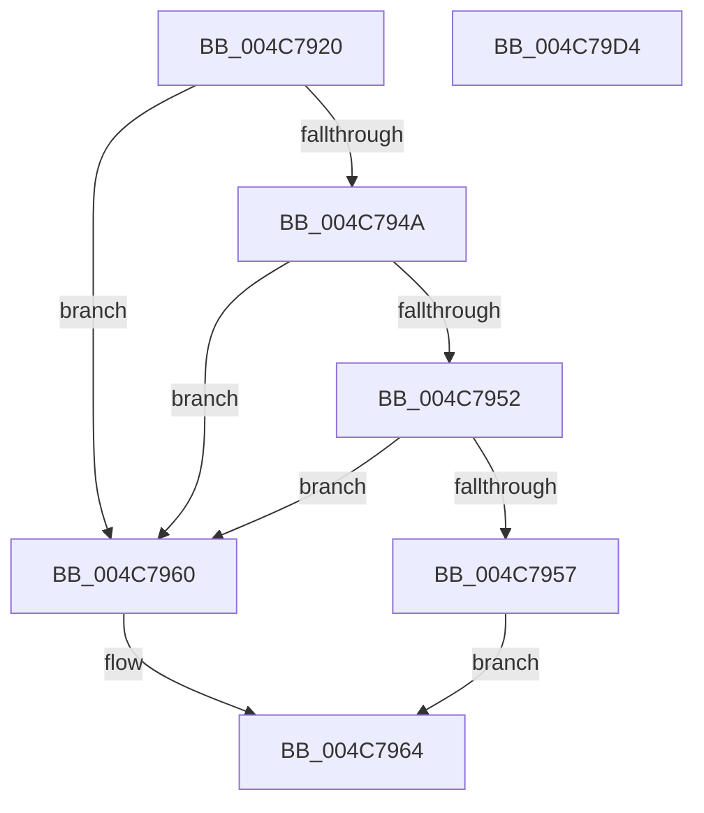

# PpmComputeIdleDurationHint

- RVA: `0x004C7920`–`0x004C79D5` (길이 `181` bytes)
- VA: `0x00000001404C7920`
- 실행 섹션: `.text`
- PDB 이름 있음: `예`; PDB Function 태그: `아니요`
- unwind 정보 RVA: `0x000BD23C`
- 디코드: `51`개 명령, `181/181` bytes 표시
- 미해석 바이트: `0` (있으면 어셈블리에 `.byte`로 보존)

> 이 문서는 커널 이미지의 기계어와 PDB 기호를 분석해 생성했습니다. 4번과 5번은 함수 원형과 자료형을 바이너리 사용 방식에서 추정한 C 해석이며 원본 소스 복구 결과는 아닙니다.

## 1. Dependencies

- 직접 호출 지점: **1**; 고유 호출 대상: **1**
- 직접 호출자로 확인된 함수: **1**
- RIP 상대 이미지 참조: **2**

### Outgoing calls
- `0x004C799C` → [PpmEstimateIdleDuration](PpmEstimateIdleDuration_function_004C79DC.md) (function, `0x004C79DC`)

### Direct callers
- [PpmIdleSelectStates](../2C/PpmIdleSelectStates_function_002CFFE8.md) at `0x002D016D`

### Static image references
- `0x004C794A` → RVA `0x00FC6A85` (`ALMOSTRO`; read)
- `0x004C7957` → RVA `0x00FC6F58` (`ALMOSTRO`; read)

## 2. Other-region calls and transfers

- 다른 실행 섹션으로 향하는 call: **0**
- 별도 외부 분기/꼬리 이동을 확인하지 못했습니다.

## 3. Assembly (complete function range)

```asm
004C7920  89 54 24 10                     mov dword ptr [rsp + 0x10], edx
004C7924  55                              push rbp
004C7925  53                              push rbx
004C7926  57                              push rdi
004C7927  48 8B EC                        mov rbp, rsp
004C792A  48 83 EC 60                     sub rsp, 0x60
004C792E  48 8B B9 40 88 00 00            mov rdi, qword ptr [rcx + 0x8840]
004C7935  33 C0                           xor eax, eax
004C7937  48 89 45 F0                     mov qword ptr [rbp - 0x10], rax
004C793B  89 45 28                        mov dword ptr [rbp + 0x28], eax
004C793E  89 45 38                        mov dword ptr [rbp + 0x38], eax
004C7941  48 89 45 20                     mov qword ptr [rbp + 0x20], rax
004C7945  45 84 C9                        test r9b, r9b
004C7948  74 16                           je 0x1404c7960
004C794A  38 05 35 F1 AF 00               cmp byte ptr [rip + 0xaff135], al
004C7950  75 0E                           jne 0x1404c7960
004C7952  38 41 21                        cmp byte ptr [rcx + 0x21], al
004C7955  75 09                           jne 0x1404c7960
004C7957  48 8B 1D FA F5 AF 00            mov rbx, qword ptr [rip + 0xaff5fa]
004C795E  EB 04                           jmp 0x1404c7964
004C7960  48 83 CB FF                     or rbx, 0xffffffffffffffff
004C7964  8B 45 40                        mov eax, dword ptr [rbp + 0x40]
004C7967  4D 8B C8                        mov r9, r8
004C796A  89 44 24 48                     mov dword ptr [rsp + 0x48], eax
004C796E  45 33 C0                        xor r8d, r8d
004C7971  48 8D 45 38                     lea rax, [rbp + 0x38]
004C7975  33 D2                           xor edx, edx
004C7977  48 89 44 24 40                  mov qword ptr [rsp + 0x40], rax
004C797C  48 8D 45 28                     lea rax, [rbp + 0x28]
004C7980  48 89 44 24 38                  mov qword ptr [rsp + 0x38], rax
004C7985  48 8D 45 20                     lea rax, [rbp + 0x20]
004C7989  48 89 44 24 30                  mov qword ptr [rsp + 0x30], rax
004C798E  48 8D 45 F0                     lea rax, [rbp - 0x10]
004C7992  48 89 44 24 28                  mov qword ptr [rsp + 0x28], rax
004C7997  48 89 5C 24 20                  mov qword ptr [rsp + 0x20], rbx
004C799C  E8 3B 00 00 00                  call 0x1404c79dc
004C79A1  0F B7 45 38                     movzx eax, word ptr [rbp + 0x38]
004C79A5  66 09 47 38                     or word ptr [rdi + 0x38], ax
004C79A9  48 8B 45 20                     mov rax, qword ptr [rbp + 0x20]
004C79AD  48 89 5F 08                     mov qword ptr [rdi + 8], rbx
004C79B1  48 89 87 B8 02 00 00            mov qword ptr [rdi + 0x2b8], rax
004C79B8  8A 45 28                        mov al, byte ptr [rbp + 0x28]
004C79BB  88 87 CD 02 00 00               mov byte ptr [rdi + 0x2cd], al
004C79C1  48 8B 45 F0                     mov rax, qword ptr [rbp - 0x10]
004C79C5  48 89 87 B0 02 00 00            mov qword ptr [rdi + 0x2b0], rax
004C79CC  48 83 C4 60                     add rsp, 0x60
004C79D0  5F                              pop rdi
004C79D1  5B                              pop rbx
004C79D2  5D                              pop rbp
004C79D3  C3                              ret
004C79D4  CC                              int3
```

## 4. C-style interpretation (structured pseudocode)

```c
__int64 __fastcall PpmComputeIdleDurationHint(__int64 a1, int a2, __int64 a3, unsigned __int8 a4, unsigned int a5)
{
    __int64 result;
    __int64 v_rbx;
    __int64 v_rsp;
    unsigned __int64 v_stack_m28;
    unsigned int v_stack_m30;
    unsigned __int64 v_stack_m38;
    unsigned __int64 v_stack_m40;
    unsigned __int64 v_stack_m48;
    unsigned __int64 v_stack_m50;
    unsigned __int64 v_stack_m58;
    unsigned int v_stack_p10;
    unsigned int v_stack_p20;
    unsigned __int64 v_stack_p8;

    v_stack_p10 = a2;
    v_rsp = (v_rsp) - (96);
    result = 0;
    v_stack_m28 = 0;
    v_stack_p10 = 0;
    v_stack_p20 = 0;
    v_stack_p8 = 0;
    if (a4 == 0) goto loc_004C7960;
    if ((*(unsigned __int8 *)(v_rip + 11530549)) != 0) goto loc_004C7960;
    if ((*(unsigned __int8 *)(a1 + 33)) != 0) goto loc_004C7960;
    goto loc_004C7964;
loc_004C7960:
    v_rbx = (*(unsigned __int64 *)(v_rip + 11531770)) | (-1);
loc_004C7964:
    v_stack_m30 = (unsigned int)((unsigned int)(a5));
    a3 = 0;
    a2 = 0;
    v_stack_m38 = v_stack_p20;
    v_stack_m40 = v_stack_p10;
    v_stack_m48 = v_stack_p8;
    v_stack_m50 = v_stack_m28;
    v_stack_m58 = v_rbx;
    result = PpmEstimateIdleDuration(a1, a2, a3, a3);
    *(unsigned __int64 *)(*(unsigned __int64 *)(a1 + 34880) + 8) = v_rbx;
    *(unsigned __int64 *)(*(unsigned __int64 *)(a1 + 34880) + 696) = v_stack_p8;
    *(unsigned __int8 *)(*(unsigned __int64 *)(a1 + 34880) + 717) = (unsigned __int8)(v_stack_p10);
    *(unsigned __int64 *)(*(unsigned __int64 *)(a1 + 34880) + 688) = v_stack_m28;
    v_rsp = (v_rsp) + (96);
    return v_stack_m28;
}
```

## 5. (Beta) C Style

```c
int64_t PpmComputeIdleDurationHint(void *Arg1, int32_t Arg2, int64_t Arg3, uint8_t Arg4, uint32_t Arg5)
{
    uint8_t *arg1 = (uint8_t *)Arg1;

    int64_t result;
    int64_t local_rbx;
    int64_t local_rsp;
    uint64_t v_stack_m28;
    uint32_t v_stack_m30;
    uint64_t v_stack_m38;
    uint64_t v_stack_m40;
    uint64_t v_stack_m48;
    uint64_t v_stack_m50;
    uint64_t v_stack_m58;
    uint32_t v_stack_p10;
    uint32_t v_stack_p20;
    uint64_t v_stack_p8;

    v_stack_p10 = Arg2;
    local_rsp = (local_rsp) - (96);
    result = 0;
    v_stack_m28 = 0;
    v_stack_p10 = 0;
    v_stack_p20 = 0;
    v_stack_p8 = 0;
    if (Arg4 == 0) goto loc_004C7960;
    if ((*(uint8_t *)(v_rip + 0xAFF135)) != 0) goto loc_004C7960;
    if ((*(uint8_t *)(arg1 + 0x21)) != 0) goto loc_004C7960;
    goto loc_004C7964;
loc_004C7960:
    local_rbx = (*(uint64_t *)(v_rip + 0xAFF5FA)) | (-1);
loc_004C7964:
    v_stack_m30 = (uint32_t)((uint32_t)(Arg5));
    Arg3 = 0;
    Arg2 = 0;
    v_stack_m38 = v_stack_p20;
    v_stack_m40 = v_stack_p10;
    v_stack_m48 = v_stack_p8;
    v_stack_m50 = v_stack_m28;
    v_stack_m58 = local_rbx;
    result = PpmEstimateIdleDuration(Arg1, Arg2, Arg3, Arg3);
    *(uint64_t *)(*(uint64_t *)(arg1 + 0x8840) + 0x8) = local_rbx;
    *(uint64_t *)(*(uint64_t *)(arg1 + 0x8840) + 0x2B8) = v_stack_p8;
    *(uint8_t *)(*(uint64_t *)(arg1 + 0x8840) + 0x2CD) = (uint8_t)(v_stack_p10);
    *(uint64_t *)(*(uint64_t *)(arg1 + 0x8840) + 0x2B0) = v_stack_m28;
    local_rsp = (local_rsp) + (96);
    return v_stack_m28;
}
```

### 관측된 메모리 오프셋

구조체 형식이 확인되지 않은 접근은 인자 기준의 오프셋으로만 기록했습니다.

| 기준 인자 | 오프셋 표현 | 폭 (bit) | 접근 |
|---|---:|---:|---|
| `Arg1` | `+ 0x21` | `8` | `R` |
| `Arg1` | `+ 0x8840` | `64` | `R` |

## 6. Execution-region graph

[열기: 2D/3D 그래프와 함수 탐색 컨트롤 패널](../../../control-panel.html?section=text&rva=0x004C7920&view=graph)

- 2D 그래프는 위에서 아래로 흐르고, 3D 그래프는 빈 공간을 드래그해 회전합니다. Shift+드래그는 이동, 휠은 확대·축소, 함수 노드 선택은 대상 보고서 이동입니다.

### Static fallback


