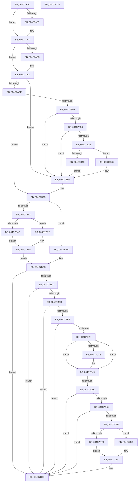

# PpmEstimateIdleDuration

- RVA: `0x004C79DC`–`0x004C7CC6` (길이 `746` bytes)
- VA: `0x00000001404C79DC`
- 실행 섹션: `.text`
- PDB 이름 있음: `예`; PDB Function 태그: `아니요`
- unwind 정보 RVA: `0x000BD24C`
- 디코드: `195`개 명령, `746/746` bytes 표시
- 미해석 바이트: `0` (있으면 어셈블리에 `.byte`로 보존)

> 이 문서는 커널 이미지의 기계어와 PDB 기호를 분석해 생성했습니다. 4번과 5번은 함수 원형과 자료형을 바이너리 사용 방식에서 추정한 C 해석이며 원본 소스 복구 결과는 아닙니다.

## 1. Dependencies

- 직접 호출 지점: **10**; 고유 호출 대상: **7**
- 직접 호출자로 확인된 함수: **2**
- RIP 상대 이미지 참조: **5**

### Outgoing calls
- `0x004C7A55` → [memset](../6C/memset_function_006C6C40.md) (function, `0x006C6C40`)
- `0x004C7ABE` → [KeEstimateClockTickDuration](KeEstimateClockTickDuration_function_004C7CCC.md) (function, `0x004C7CCC`)
- `0x004C7B18` → [Feature_PpmDynamicHintAdjust__private_IsEnabledNoReportingNoInline](../4F/Feature_PpmDynamicHintAdjust__private_IsEnabledNoReportingNoInline_function_004FC610.md) (function, `0x004FC610`)
- `0x004C7BA1` → [Feature_PpmDynamicHintAdjust__private_IsEnabledNoReportingNoInline](../4F/Feature_PpmDynamicHintAdjust__private_IsEnabledNoReportingNoInline_function_004FC610.md) (function, `0x004FC610`)
- `0x004C7BD1` → [memset](../6C/memset_function_006C6C40.md) (function, `0x006C6C40`)
- `0x004C7BF1` → [PpmGetIdleConstrainedMask](../4B/PpmGetIdleConstrainedMask_function_004BCC5C.md) (function, `0x004BCC5C`)
- `0x004C7C23` → [KeEnumerateNextProcessor](../41/KeEnumerateNextProcessor_function_00415480.md) (function, `0x00415480`)
- `0x004C7C30` → [KeGetPrcb](../2D/KeGetPrcb_function_002D85D0.md) (function, `0x002D85D0`)
- `0x004C7C53` → [KeEnumerateNextProcessor](../41/KeEnumerateNextProcessor_function_00415480.md) (function, `0x00415480`)
- `0x004C7CA5` → [_security_check_cookie](../6A/_security_check_cookie_function_006AC640.md) (function, `0x006AC640`)

### Direct callers
- [PpmIdleSelectStates](../2C/PpmIdleSelectStates_function_002CFFE8.md) at `0x002D0332`
- [PpmIdleSelectStates](../2C/PpmIdleSelectStates_function_002CFFE8.md) at `0x002D0689`
- [PpmComputeIdleDurationHint](PpmComputeIdleDurationHint_function_004C7920.md) at `0x004C799C`

### Static image references
- `0x004C79FB` → RVA `0x00E0A740` (`.data`; read)
- `0x004C7B00` → RVA `0x00FC6AA0` (`ALMOSTRO`; read)
- `0x004C7B23` → RVA `0x00FC5314` (`ALMOSTRO`; read)
- `0x004C7B32` → RVA `0x00FC5318` (`ALMOSTRO`; read)
- `0x004C7BD6` → RVA `0x00FC6F60` (`ALMOSTRO`; read)

## 2. Other-region calls and transfers

- 다른 실행 섹션으로 향하는 call: **0**
- 별도 외부 분기/꼬리 이동을 확인하지 못했습니다.

## 3. Assembly (complete function range)

```asm
004C79DC  48 89 5C 24 10                  mov qword ptr [rsp + 0x10], rbx
004C79E1  55                              push rbp
004C79E2  56                              push rsi
004C79E3  57                              push rdi
004C79E4  41 54                           push r12
004C79E6  41 55                           push r13
004C79E8  41 56                           push r14
004C79EA  41 57                           push r15
004C79EC  48 8D AC 24 60 FF FF FF         lea rbp, [rsp - 0xa0]
004C79F4  48 81 EC A0 01 00 00            sub rsp, 0x1a0
004C79FB  48 8B 05 3E 2D 94 00            mov rax, qword ptr [rip + 0x942d3e]
004C7A02  48 33 C4                        xor rax, rsp
004C7A05  48 89 85 90 00 00 00            mov qword ptr [rbp + 0x90], rax
004C7A0C  48 8B 85 08 01 00 00            mov rax, qword ptr [rbp + 0x108]
004C7A13  4C 8B F9                        mov r15, rcx
004C7A16  4C 8B B5 20 01 00 00            mov r14, qword ptr [rbp + 0x120]
004C7A1D  33 C9                           xor ecx, ecx
004C7A1F  48 8B B5 18 01 00 00            mov rsi, qword ptr [rbp + 0x118]
004C7A26  41 8A D8                        mov bl, r8b
004C7A29  48 89 44 24 70                  mov qword ptr [rsp + 0x70], rax
004C7A2E  44 8B EA                        mov r13d, edx
004C7A31  48 8B 85 10 01 00 00            mov rax, qword ptr [rbp + 0x110]
004C7A38  33 D2                           xor edx, edx
004C7A3A  89 4C 24 62                     mov dword ptr [rsp + 0x62], ecx
004C7A3E  41 B8 00 01 00 00               mov r8d, 0x100
004C7A44  66 89 4C 24 66                  mov word ptr [rsp + 0x66], cx
004C7A49  4D 8B E1                        mov r12, r9
004C7A4C  48 8D 4D 88                     lea rcx, [rbp - 0x78]
004C7A50  48 89 44 24 68                  mov qword ptr [rsp + 0x68], rax
004C7A55  E8 E6 F1 1F 00                  call 0x1406c6c40
004C7A5A  49 8B 87 40 88 00 00            mov rax, qword ptr [r15 + 0x8840]
004C7A61  33 C9                           xor ecx, ecx
004C7A63  48 83 CF FF                     or rdi, 0xffffffffffffffff
004C7A67  48 89 4C 24 48                  mov qword ptr [rsp + 0x48], rcx
004C7A6C  89 4C 24 40                     mov dword ptr [rsp + 0x40], ecx
004C7A70  8A 90 CC 02 00 00               mov dl, byte ptr [rax + 0x2cc]
004C7A76  8B C1                           mov eax, ecx
004C7A78  41 89 0E                        mov dword ptr [r14], ecx
004C7A7B  41 38 4F 21                     cmp byte ptr [r15 + 0x21], cl
004C7A7F  74 06                           je 0x1404c7a87
004C7A81  8D 41 08                        lea eax, [rcx + 8]
004C7A84  41 89 06                        mov dword ptr [r14], eax
004C7A87  45 85 ED                        test r13d, r13d
004C7A8A  74 06                           je 0x1404c7a92
004C7A8C  83 C8 04                        or eax, 4
004C7A8F  41 89 06                        mov dword ptr [r14], eax
004C7A92  48 89 74 24 38                  mov qword ptr [rsp + 0x38], rsi
004C7A97  48 8D 4C 24 48                  lea rcx, [rsp + 0x48]
004C7A9C  48 89 4C 24 30                  mov qword ptr [rsp + 0x30], rcx
004C7AA1  41 83 FD 02                     cmp r13d, 2
004C7AA5  4C 89 64 24 28                  mov qword ptr [rsp + 0x28], r12
004C7AAA  44 8A CB                        mov r9b, bl
004C7AAD  0F 94 C0                        sete al
004C7AB0  49 8B CF                        mov rcx, r15
004C7AB3  45 85 ED                        test r13d, r13d
004C7AB6  88 44 24 20                     mov byte ptr [rsp + 0x20], al
004C7ABA  41 0F 95 C0                     setne r8b
004C7ABE  E8 09 02 00 00                  call 0x1404c7ccc
004C7AC3  48 8B 74 24 48                  mov rsi, qword ptr [rsp + 0x48]
004C7AC8  41 B8 01 00 00 00               mov r8d, 1
004C7ACE  48 3B B5 00 01 00 00            cmp rsi, qword ptr [rbp + 0x100]
004C7AD5  41 8B D8                        mov ebx, r8d
004C7AD8  48 0F 43 B5 00 01 00 00         cmovae rsi, qword ptr [rbp + 0x100]
004C7AE0  48 89 74 24 48                  mov qword ptr [rsp + 0x48], rsi
004C7AE5  45 85 ED                        test r13d, r13d
004C7AE8  0F 85 AB 00 00 00               jne 0x1404c7b99
004C7AEE  41 8B 8F A4 2D 00 00            mov ecx, dword ptr [r15 + 0x2da4]
004C7AF5  45 33 ED                        xor r13d, r13d
004C7AF8  85 C9                           test ecx, ecx
004C7AFA  0F 84 9C 00 00 00               je 0x1404c7b9c
004C7B00  8B 05 9A EF AF 00               mov eax, dword ptr [rip + 0xafef9a]
004C7B06  FF C1                           inc ecx
004C7B08  33 D2                           xor edx, edx
004C7B0A  F7 F1                           div ecx
004C7B0C  41 3B C0                        cmp eax, r8d
004C7B0F  41 0F 42 C0                     cmovb eax, r8d
004C7B13  8B F8                           mov edi, eax
004C7B15  44 8B E8                        mov r13d, eax
004C7B18  E8 F3 4A 03 00                  call 0x1404fc610
004C7B1D  33 C9                           xor ecx, ecx
004C7B1F  85 C0                           test eax, eax
004C7B21  74 76                           je 0x1404c7b99
004C7B23  39 0D EB D7 AF 00               cmp dword ptr [rip + 0xafd7eb], ecx
004C7B29  74 6E                           je 0x1404c7b99
004C7B2B  45 8B 87 40 86 00 00            mov r8d, dword ptr [r15 + 0x8640]
004C7B32  8B 0D E0 D7 AF 00               mov ecx, dword ptr [rip + 0xafd7e0]
004C7B38  45 8B 8F A4 2D 00 00            mov r9d, dword ptr [r15 + 0x2da4]
004C7B3F  41 03 C9                        add ecx, r9d
004C7B42  45 2B 87 A0 2D 00 00            sub r8d, dword ptr [r15 + 0x2da0]
004C7B49  44 3B C1                        cmp r8d, ecx
004C7B4C  77 33                           ja 0x1404c7b81
004C7B4E  8B 85 28 01 00 00               mov eax, dword ptr [rbp + 0x128]
004C7B54  45 3B C1                        cmp r8d, r9d
004C7B57  45 0F 43 C1                     cmovae r8d, r9d
004C7B5B  33 D2                           xor edx, edx
004C7B5D  45 2B C8                        sub r9d, r8d
004C7B60  44 8B C3                        mov r8d, ebx
004C7B63  44 03 CB                        add r9d, ebx
004C7B66  41 F7 F1                        div r9d
004C7B69  8B C8                           mov ecx, eax
004C7B6B  48 3B CF                        cmp rcx, rdi
004C7B6E  0F 47 F9                        cmova edi, ecx
004C7B71  4C 3B E9                        cmp r13, rcx
004C7B74  1B DB                           sbb ebx, ebx
004C7B76  81 E3 00 10 00 00               and ebx, 0x1000
004C7B7C  41 03 D8                        add ebx, r8d
004C7B7F  EB 18                           jmp 0x1404c7b99
004C7B81  8B 05 19 EF AF 00               mov eax, dword ptr [rip + 0xafef19]
004C7B87  33 D2                           xor edx, edx
004C7B89  2B 85 28 01 00 00               sub eax, dword ptr [rbp + 0x128]
004C7B8F  BB 01 10 00 00                  mov ebx, 0x1001
004C7B94  41 F7 F0                        div r8d
004C7B97  8B F8                           mov edi, eax
004C7B99  45 33 ED                        xor r13d, r13d
004C7B9C  48 3B F7                        cmp rsi, rdi
004C7B9F  76 19                           jbe 0x1404c7bba
004C7BA1  E8 6A 4A 03 00                  call 0x1404fc610
004C7BA6  85 C0                           test eax, eax
004C7BA8  75 08                           jne 0x1404c7bb2
004C7BAA  41 8B 1E                        mov ebx, dword ptr [r14]
004C7BAD  83 CB 01                        or ebx, 1
004C7BB0  EB 03                           jmp 0x1404c7bb5
004C7BB2  41 0B 1E                        or ebx, dword ptr [r14]
004C7BB5  41 89 1E                        mov dword ptr [r14], ebx
004C7BB8  EB 03                           jmp 0x1404c7bbd
004C7BBA  48 8B FE                        mov rdi, rsi
004C7BBD  33 D2                           xor edx, edx
004C7BBF  48 C7 45 80 01 00 20 00         mov qword ptr [rbp - 0x80], 0x200001
004C7BC7  41 B8 00 01 00 00               mov r8d, 0x100
004C7BCD  48 8D 4D 88                     lea rcx, [rbp - 0x78]
004C7BD1  E8 6A F0 1F 00                  call 0x1406c6c40
004C7BD6  4C 39 2D 83 F3 AF 00            cmp qword ptr [rip + 0xaff383], r13
004C7BDD  0F 84 A8 00 00 00               je 0x1404c7c8b
004C7BE3  45 38 6F 21                     cmp byte ptr [r15 + 0x21], r13b
004C7BE7  0F 84 9E 00 00 00               je 0x1404c7c8b
004C7BED  48 8D 4D 80                     lea rcx, [rbp - 0x80]
004C7BF1  E8 66 50 FF FF                  call 0x1404bcc5c
004C7BF6  84 C0                           test al, al
004C7BF8  0F 84 8D 00 00 00               je 0x1404c7c8b
004C7BFE  48 8B 45 88                     mov rax, qword ptr [rbp - 0x78]
004C7C02  48 8D 54 24 50                  lea rdx, [rsp + 0x50]
004C7C07  48 89 44 24 58                  mov qword ptr [rsp + 0x58], rax
004C7C0C  48 8D 4C 24 40                  lea rcx, [rsp + 0x40]
004C7C11  48 8D 45 80                     lea rax, [rbp - 0x80]
004C7C15  66 44 89 6C 24 60               mov word ptr [rsp + 0x60], r13w
004C7C1B  48 89 44 24 50                  mov qword ptr [rsp + 0x50], rax
004C7C20  49 8B DD                        mov rbx, r13
004C7C23  E8 58 D8 F4 FF                  call 0x140415480
004C7C28  85 C0                           test eax, eax
004C7C2A  75 5F                           jne 0x1404c7c8b
004C7C2C  8B 4C 24 40                     mov ecx, dword ptr [rsp + 0x40]
004C7C30  E8 9B 09 E1 FF                  call 0x1402d85d0
004C7C35  48 8B 88 70 88 00 00            mov rcx, qword ptr [rax + 0x8870]
004C7C3C  48 83 F9 FF                     cmp rcx, -1
004C7C40  74 07                           je 0x1404c7c49
004C7C42  48 3B CB                        cmp rcx, rbx
004C7C45  48 0F 47 D9                     cmova rbx, rcx
004C7C49  48 8D 54 24 50                  lea rdx, [rsp + 0x50]
004C7C4E  48 8D 4C 24 40                  lea rcx, [rsp + 0x40]
004C7C53  E8 28 D8 F4 FF                  call 0x140415480
004C7C58  85 C0                           test eax, eax
004C7C5A  74 D0                           je 0x1404c7c2c
004C7C5C  48 85 DB                        test rbx, rbx
004C7C5F  74 2A                           je 0x1404c7c8b
004C7C61  48 8B 4C 24 48                  mov rcx, qword ptr [rsp + 0x48]
004C7C66  49 03 CC                        add rcx, r12
004C7C69  48 3B CB                        cmp rcx, rbx
004C7C6C  76 1D                           jbe 0x1404c7c8b
004C7C6E  41 0F BA 2E 0D                  bts dword ptr [r14], 0xd
004C7C73  49 3B DC                        cmp rbx, r12
004C7C76  77 07                           ja 0x1404c7c7f
004C7C78  BE 01 00 00 00                  mov esi, 1
004C7C7D  EB 05                           jmp 0x1404c7c84
004C7C7F  41 2B DC                        sub ebx, r12d
004C7C82  8B F3                           mov esi, ebx
004C7C84  48 3B F7                        cmp rsi, rdi
004C7C87  48 0F 42 FE                     cmovb rdi, rsi
004C7C8B  48 8B 44 24 68                  mov rax, qword ptr [rsp + 0x68]
004C7C90  48 89 30                        mov qword ptr [rax], rsi
004C7C93  48 8B 44 24 70                  mov rax, qword ptr [rsp + 0x70]
004C7C98  48 89 38                        mov qword ptr [rax], rdi
004C7C9B  48 8B 8D 90 00 00 00            mov rcx, qword ptr [rbp + 0x90]
004C7CA2  48 33 CC                        xor rcx, rsp
004C7CA5  E8 96 49 1E 00                  call 0x1406ac640
004C7CAA  48 8B 9C 24 E8 01 00 00         mov rbx, qword ptr [rsp + 0x1e8]
004C7CB2  48 81 C4 A0 01 00 00            add rsp, 0x1a0
004C7CB9  41 5F                           pop r15
004C7CBB  41 5E                           pop r14
004C7CBD  41 5D                           pop r13
004C7CBF  41 5C                           pop r12
004C7CC1  5F                              pop rdi
004C7CC2  5E                              pop rsi
004C7CC3  5D                              pop rbp
004C7CC4  C3                              ret
004C7CC5  CC                              int3
```

## 4. C-style interpretation (structured pseudocode)

```c
__int64 __fastcall PpmEstimateIdleDuration(__int64 a1, int a2, unsigned __int8 a3, __int64 a4, __int64 a5, __int64 a6, __int64 a7, __int64 a8, __int64 a9, unsigned int a10)
{
    __int64 result;
    __int64 v_r13;
    __int64 v_rbx;
    __int64 v_rdi;
    __int64 v_rsi;
    __int64 v_rsp;
    unsigned __int64 v_stack_m150;
    unsigned __int64 v_stack_m158;
    unsigned __int64 v_stack_m168;
    unsigned __int64 v_stack_m170;
    unsigned __int16 v_stack_m172;
    unsigned int v_stack_m176;
    unsigned __int16 v_stack_m178;
    unsigned __int64 v_stack_m180;
    unsigned __int64 v_stack_m188;
    unsigned __int64 v_stack_m190;
    unsigned int v_stack_m198;
    unsigned __int64 v_stack_m1A0;
    unsigned __int64 v_stack_m1A8;
    unsigned __int64 v_stack_m1B0;
    unsigned __int8 v_stack_m1B8;
    unsigned __int64 v_stack_m48;
    unsigned __int64 v_stack_mD8;
    unsigned __int64 v_stack_p10;

    v_stack_p10 = v_rbx;
    v_rsp = (v_rsp) - (416);
    result = (*(unsigned __int64 *)(v_rip + 9710910)) ^ (v_rsp);
    v_stack_m48 = result;
    a1 = 0;
    v_stack_m168 = a6;
    a2 = 0;
    v_stack_m176 = 0;
    v_stack_m172 = 0;
    v_stack_m170 = a7;
    result = memset(v_stack_m150, a2, 256, a4);
    a1 = 0;
    v_rdi = (v_rdi) | (-1);
    v_stack_m190 = 0;
    v_stack_m198 = 0;
    *(unsigned int *)(a9) = 0;
    result = 0;
    if ((*(unsigned __int8 *)(a1 + 33)) != 0) {
        result = a1 + 8;
        *(unsigned int *)(a9) = (unsigned int)(result);
    }
    if ((unsigned int)((unsigned int)(a2)) != 0) {
        result = (unsigned int)((result) | (4));
        *(unsigned int *)(a9) = (unsigned int)(result);
    }
    v_stack_m1A0 = a8;
    v_stack_m1A8 = v_stack_m190;
    v_stack_m1B0 = a4;
    result = (((unsigned int)((unsigned int)(a2))) == 2) ? 1 : 0;
    v_stack_m1B8 = (unsigned __int8)(result);
    a3 = ((unsigned int)((unsigned int)(a2)) != 0) ? 1 : 0;
    result = KeEstimateClockTickDuration(0, *(unsigned __int8 *)(*(unsigned __int64 *)(a1 + 34880) + 716), a3, a3);
    v_rsi = v_stack_m190;
    if (v_stack_m190 >= a5) { v_rsi = a5; }
    v_stack_m190 = v_rsi;
    if ((unsigned int)((unsigned int)(a2)) != 0) goto loc_004C7B99;
    v_r13 = 0;
    if ((unsigned int)((unsigned int)(*(unsigned int *)(a1 + 11684))) == 0) goto loc_004C7B9C;
    a1 = (unsigned int)(((unsigned int)(*(unsigned int *)(a1 + 11684))) + 1);
    a2 = 0;
    result = (unsigned int)(*(unsigned int *)(v_rip + 11530138));
    if (((unsigned int)((unsigned int)(*(unsigned int *)(v_rip + 11530138)))) < 1) { result = 1; }
    result = Feature_PpmDynamicHintAdjust__private_IsEnabledNoReportingNoInline(a1, a2, 1, a3);
    a1 = 0;
    if ((unsigned int)(result) == 0) goto loc_004C7B99;
    if ((*(unsigned int *)(v_rip + 11524075)) == 0) goto loc_004C7B99;
    a1 = (unsigned int)(((unsigned int)(*(unsigned int *)(v_rip + 11524064))) + ((unsigned int)((unsigned int)(*(unsigned int *)(a1 + 11684)))));
    a3 = (unsigned int)(((unsigned int)(*(unsigned int *)(a1 + 34368))) - (*(unsigned int *)(a1 + 11680)));
    if (a3 > ((unsigned int)(a1))) goto loc_004C7B81;
    if (a3 >= ((unsigned int)((unsigned int)(*(unsigned int *)(a1 + 11684))))) { a3 = (unsigned int)((unsigned int)(*(unsigned int *)(a1 + 11684))); }
    a2 = 0;
    a4 = (unsigned int)(((unsigned int)(*(unsigned int *)(a1 + 11684))) - (a3));
    a4 = (unsigned int)((a4) + (1));
    v_rdi = (unsigned int)((unsigned int)(result));
    if (((unsigned int)((unsigned int)((unsigned int)(a10)))) > ((unsigned int)((unsigned int)(result)))) { v_rdi = (unsigned int)((unsigned int)((unsigned int)((unsigned int)(a10)))); }
    v_rbx = (unsigned int)((1) & (0x1000ULL));
    v_rbx = (unsigned int)((v_rbx) + (1));
    goto loc_004C7B99;
loc_004C7B81:
    a2 = 0;
    result = (unsigned int)(((unsigned int)(*(unsigned int *)(v_rip + 11530009))) - (a10));
loc_004C7B99:
    v_r13 = 0;
loc_004C7B9C:
    if (v_rsi <= ((unsigned int)((unsigned int)(result)))) goto loc_004C7BBA;
    result = Feature_PpmDynamicHintAdjust__private_IsEnabledNoReportingNoInline((unsigned int)((unsigned int)((unsigned int)(a10))), a2, 1, a4);
    if ((unsigned int)(result) != 0) goto loc_004C7BB2;
    v_rbx = (unsigned int)(((unsigned int)(*(unsigned int *)(a9))) | (1));
    goto loc_004C7BB5;
loc_004C7BB2:
    v_rbx = (unsigned int)((v_rbx) | (*(unsigned int *)(a9)));
loc_004C7BB5:
    *(unsigned int *)(a9) = (unsigned int)(v_rbx);
    goto loc_004C7BBD;
loc_004C7BBA:
loc_004C7BBD:
    a2 = 0;
    v_stack_m158 = 0x200001ULL;
    result = memset(v_stack_m150, a2, 256, a4);
    if ((*(unsigned __int64 *)(v_rip + 11531139)) == 0) goto loc_004C7C8B;
    if ((*(unsigned __int8 *)(a1 + 33)) == 0) goto loc_004C7C8B;
    result = PpmGetIdleConstrainedMask(v_stack_m158, a2, 256, a4);
    if ((unsigned __int8)(result) == 0) goto loc_004C7C8B;
    v_stack_m180 = v_stack_m150;
    v_stack_m178 = 0;
    v_stack_m188 = v_stack_m158;
    result = KeEnumerateNextProcessor(v_stack_m198, v_stack_m188, 256, a4);
    if ((unsigned int)(result) != 0) goto loc_004C7C8B;
loc_004C7C2C:
    result = KeGetPrcb((unsigned int)(v_stack_m198), v_stack_m188, 256, a4);
    v_rbx = 0;
    if ((*(unsigned __int64 *)(result + 34928)) != -1) {
        v_rbx = 0;
        if ((*(unsigned __int64 *)(result + 34928)) > 0) { v_rbx = *(unsigned __int64 *)(result + 34928); }
    }
    result = KeEnumerateNextProcessor(v_stack_m198, v_stack_m188, 256, a4);
    if ((unsigned int)(result) == 0) goto loc_004C7C2C;
    if (v_rbx == 0) goto loc_004C7C8B;
    a1 = (v_stack_m190) + (a4);
    if (a1 <= v_rbx) goto loc_004C7C8B;
    if (v_rbx > a4) goto loc_004C7C7F;
    goto loc_004C7C84;
loc_004C7C7F:
    v_rbx = (unsigned int)((v_rbx) - ((unsigned int)(a4)));
loc_004C7C84:
    v_rdi = v_rsi;
    if (((unsigned int)((unsigned int)(v_rbx))) < v_rsi) { v_rdi = (unsigned int)((unsigned int)(v_rbx)); }
loc_004C7C8B:
    *(unsigned __int64 *)(v_stack_m170) = (unsigned int)((unsigned int)(v_rbx));
    *(unsigned __int64 *)(v_stack_m168) = v_rdi;
    a1 = (v_stack_m48) ^ (v_rsp);
    result = _security_check_cookie(a1, v_stack_m188, 256, a4);
    v_rsp = (v_rsp) + (416);
    return result;
}
```

## 5. (Beta) C Style

```c
int64_t PpmEstimateIdleDuration(void *Arg1, int32_t Arg2, uint8_t Arg3, int64_t Arg4, int64_t Arg5, int64_t Arg6, int64_t Arg7, int64_t Arg8, void *Arg9, uint32_t Arg10)
{
    uint8_t *arg1 = (uint8_t *)Arg1;
    uint8_t *arg9 = (uint8_t *)Arg9;

    int64_t result;
    int64_t local_r13;
    int64_t local_rbx;
    int64_t local_rdi;
    int64_t local_rsi;
    int64_t local_rsp;
    uint64_t v_stack_m150;
    uint64_t v_stack_m158;
    uint64_t v_stack_m168;
    uint64_t v_stack_m170;
    uint16_t v_stack_m172;
    uint32_t v_stack_m176;
    uint16_t v_stack_m178;
    uint64_t v_stack_m180;
    uint64_t v_stack_m188;
    uint64_t v_stack_m190;
    uint32_t v_stack_m198;
    uint64_t v_stack_m1A0;
    uint64_t v_stack_m1A8;
    uint64_t v_stack_m1B0;
    uint8_t v_stack_m1B8;
    uint64_t v_stack_m48;
    uint64_t v_stack_mD8;
    uint64_t v_stack_p10;

    v_stack_p10 = local_rbx;
    local_rsp = (local_rsp) - (416);
    result = (*(uint64_t *)(v_rip + 0x942D3E)) ^ (local_rsp);
    v_stack_m48 = result;
    Arg1 = 0;
    v_stack_m168 = Arg6;
    Arg2 = 0;
    v_stack_m176 = 0;
    v_stack_m172 = 0;
    v_stack_m170 = Arg7;
    result = memset(v_stack_m150, Arg2, 256, Arg4);
    Arg1 = 0;
    local_rdi = (local_rdi) | (-1);
    v_stack_m190 = 0;
    v_stack_m198 = 0;
    *(uint32_t *)(arg9) = 0;
    result = 0;
    if ((*(uint8_t *)(arg1 + 0x21)) != 0) {
        result = Arg1 + 8;
        *(uint32_t *)(arg9) = (uint32_t)(result);
    }
    if ((uint32_t)((uint32_t)(Arg2)) != 0) {
        result = (uint32_t)((result) | (4));
        *(uint32_t *)(arg9) = (uint32_t)(result);
    }
    v_stack_m1A0 = Arg8;
    v_stack_m1A8 = v_stack_m190;
    v_stack_m1B0 = Arg4;
    result = (((uint32_t)((uint32_t)(Arg2))) == 2) ? 1 : 0;
    v_stack_m1B8 = (uint8_t)(result);
    Arg3 = ((uint32_t)((uint32_t)(Arg2)) != 0) ? 1 : 0;
    result = KeEstimateClockTickDuration(0, *(uint8_t *)(*(uint64_t *)(arg1 + 0x8840) + 0x2CC), Arg3, Arg3);
    local_rsi = v_stack_m190;
    if (v_stack_m190 >= Arg5) { local_rsi = Arg5; }
    v_stack_m190 = local_rsi;
    if ((uint32_t)((uint32_t)(Arg2)) != 0) goto loc_004C7B99;
    local_r13 = 0;
    if ((uint32_t)((uint32_t)(*(uint32_t *)(arg1 + 0x2DA4))) == 0) goto loc_004C7B9C;
    Arg1 = (uint32_t)(((uint32_t)(*(uint32_t *)(arg1 + 0x2DA4))) + 1);
    Arg2 = 0;
    result = (uint32_t)(*(uint32_t *)(v_rip + 0xAFEF9A));
    if (((uint32_t)((uint32_t)(*(uint32_t *)(v_rip + 0xAFEF9A)))) < 1) { result = 1; }
    result = Feature_PpmDynamicHintAdjust__private_IsEnabledNoReportingNoInline(Arg1, Arg2, 1, Arg3);
    Arg1 = 0;
    if ((uint32_t)(result) == 0) goto loc_004C7B99;
    if ((*(uint32_t *)(v_rip + 0xAFD7EB)) == 0) goto loc_004C7B99;
    Arg1 = (uint32_t)(((uint32_t)(*(uint32_t *)(v_rip + 0xAFD7E0))) + ((uint32_t)((uint32_t)(*(uint32_t *)(arg1 + 0x2DA4)))));
    Arg3 = (uint32_t)(((uint32_t)(*(uint32_t *)(arg1 + 0x8640))) - (*(uint32_t *)(arg1 + 0x2DA0)));
    if (Arg3 > ((uint32_t)(Arg1))) goto loc_004C7B81;
    if (Arg3 >= ((uint32_t)((uint32_t)(*(uint32_t *)(arg1 + 0x2DA4))))) { Arg3 = (uint32_t)((uint32_t)(*(uint32_t *)(arg1 + 0x2DA4))); }
    Arg2 = 0;
    Arg4 = (uint32_t)(((uint32_t)(*(uint32_t *)(arg1 + 0x2DA4))) - (Arg3));
    Arg4 = (uint32_t)((Arg4) + (1));
    local_rdi = (uint32_t)((uint32_t)(result));
    if (((uint32_t)((uint32_t)((uint32_t)(Arg10)))) > ((uint32_t)((uint32_t)(result)))) { local_rdi = (uint32_t)((uint32_t)((uint32_t)((uint32_t)(Arg10)))); }
    local_rbx = (uint32_t)((1) & (0x1000ULL));
    local_rbx = (uint32_t)((local_rbx) + (1));
    goto loc_004C7B99;
loc_004C7B81:
    Arg2 = 0;
    result = (uint32_t)(((uint32_t)(*(uint32_t *)(v_rip + 0xAFEF19))) - (Arg10));
loc_004C7B99:
    local_r13 = 0;
loc_004C7B9C:
    if (local_rsi <= ((uint32_t)((uint32_t)(result)))) goto loc_004C7BBA;
    result = Feature_PpmDynamicHintAdjust__private_IsEnabledNoReportingNoInline((uint32_t)((uint32_t)((uint32_t)(Arg10))), Arg2, 1, Arg4);
    if ((uint32_t)(result) != 0) goto loc_004C7BB2;
    local_rbx = (uint32_t)(((uint32_t)(*(uint32_t *)(arg9))) | (1));
    goto loc_004C7BB5;
loc_004C7BB2:
    local_rbx = (uint32_t)((local_rbx) | (*(uint32_t *)(arg9)));
loc_004C7BB5:
    *(uint32_t *)(arg9) = (uint32_t)(local_rbx);
    goto loc_004C7BBD;
loc_004C7BBA:
loc_004C7BBD:
    Arg2 = 0;
    v_stack_m158 = 0x200001ULL;
    result = memset(v_stack_m150, Arg2, 256, Arg4);
    if ((*(uint64_t *)(v_rip + 0xAFF383)) == 0) goto loc_004C7C8B;
    if ((*(uint8_t *)(arg1 + 0x21)) == 0) goto loc_004C7C8B;
    result = PpmGetIdleConstrainedMask(v_stack_m158, Arg2, 256, Arg4);
    if ((uint8_t)(result) == 0) goto loc_004C7C8B;
    v_stack_m180 = v_stack_m150;
    v_stack_m178 = 0;
    v_stack_m188 = v_stack_m158;
    result = KeEnumerateNextProcessor(v_stack_m198, v_stack_m188, 256, Arg4);
    if ((uint32_t)(result) != 0) goto loc_004C7C8B;
loc_004C7C2C:
    result = KeGetPrcb((uint32_t)(v_stack_m198), v_stack_m188, 256, Arg4);
    local_rbx = 0;
    if ((*(uint64_t *)(result + 0x8870)) != -1) {
        local_rbx = 0;
        if ((*(uint64_t *)(result + 0x8870)) > 0) { local_rbx = *(uint64_t *)(result + 0x8870); }
    }
    result = KeEnumerateNextProcessor(v_stack_m198, v_stack_m188, 256, Arg4);
    if ((uint32_t)(result) == 0) goto loc_004C7C2C;
    if (local_rbx == 0) goto loc_004C7C8B;
    Arg1 = (v_stack_m190) + (Arg4);
    if (Arg1 <= local_rbx) goto loc_004C7C8B;
    if (local_rbx > Arg4) goto loc_004C7C7F;
    goto loc_004C7C84;
loc_004C7C7F:
    local_rbx = (uint32_t)((local_rbx) - ((uint32_t)(Arg4)));
loc_004C7C84:
    local_rdi = local_rsi;
    if (((uint32_t)((uint32_t)(local_rbx))) < local_rsi) { local_rdi = (uint32_t)((uint32_t)(local_rbx)); }
loc_004C7C8B:
    *(uint64_t *)(v_stack_m170) = (uint32_t)((uint32_t)(local_rbx));
    *(uint64_t *)(v_stack_m168) = local_rdi;
    Arg1 = (v_stack_m48) ^ (local_rsp);
    result = _security_check_cookie(Arg1, v_stack_m188, 256, Arg4);
    local_rsp = (local_rsp) + (416);
    return result;
}
```

### 관측된 메모리 오프셋

구조체 형식이 확인되지 않은 접근은 인자 기준의 오프셋으로만 기록했습니다.

| 기준 인자 | 오프셋 표현 | 폭 (bit) | 접근 |
|---|---:|---:|---|
| `Arg1` | `+ 0x21` | `8` | `R` |
| `Arg1` | `+ 0x2DA0` | `32` | `R` |
| `Arg1` | `+ 0x2DA4` | `32` | `R` |
| `Arg1` | `+ 0x8640` | `32` | `R` |
| `Arg1` | `+ 0x8840` | `64` | `R` |
| `Arg9` | `+ 0x0` | `32` | `R` |
| `Arg9` | `+ 0x0` | `32` | `R/W` |
| `Arg9` | `+ 0x0` | `32` | `W` |

## 6. Execution-region graph

[열기: 2D/3D 그래프와 함수 탐색 컨트롤 패널](../../../control-panel.html?section=text&rva=0x004C79DC&view=graph)

- 2D 그래프는 위에서 아래로 흐르고, 3D 그래프는 빈 공간을 드래그해 회전합니다. Shift+드래그는 이동, 휠은 확대·축소, 함수 노드 선택은 대상 보고서 이동입니다.

### Static fallback


