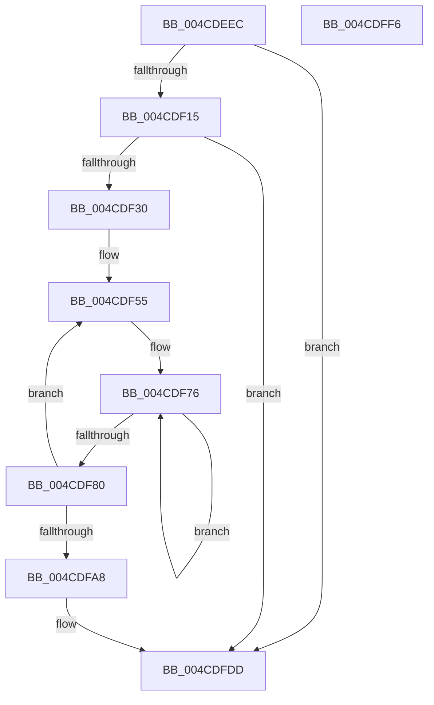

# PpmEventHgsHardwareTableResonMapTable

- RVA: `0x004CDEEC`–`0x004CDFF7` (길이 `267` bytes)
- VA: `0x00000001404CDEEC`
- 실행 섹션: `.text`
- PDB 이름 있음: `예`; PDB Function 태그: `아니요`
- unwind 정보 RVA: `0x000BD9D8`
- 디코드: `56`개 명령, `267/267` bytes 표시
- 미해석 바이트: `0` (있으면 어셈블리에 `.byte`로 보존)

> 이 문서는 커널 이미지의 기계어와 PDB 기호를 분석해 생성했습니다. 4번과 5번은 함수 원형과 자료형을 바이너리 사용 방식에서 추정한 C 해석이며 원본 소스 복구 결과는 아닙니다.

## 1. Dependencies

- 직접 호출 지점: **3**; 고유 호출 대상: **3**
- 직접 호출자로 확인된 함수: **1**
- RIP 상대 이미지 참조: **5**

### Outgoing calls
- `0x004CDF23` → [EtwEventEnabled](../39/EtwEventEnabled_function_00392450.md) (function, `0x00392450`)
- `0x004CDFD8` → [EtwWriteEx](../25/EtwWriteEx_function_0025F0D0.md) (function, `0x0025F0D0`)
- `0x004CDFE8` → [_security_check_cookie](../6A/_security_check_cookie_function_006AC640.md) (function, `0x006AC640`)

### Direct callers
- [PpmEventTraceControlCallback](../../page/A5/PpmEventTraceControlCallback_function_00A51F60.md) at `0x00A52131`

### Static image references
- `0x004CDEF5` → RVA `0x00E0A740` (`.data`; read)
- `0x004CDF09` → RVA `0x00E67A39` (`.data`; read)
- `0x004CDF15` → RVA `0x00F083E8` (`.data`; read)
- `0x004CDF1C` → RVA `0x0001E918` (`.rdata`; read)
- `0x004CDF42` → RVA `0x00E07780` (`.data`; read)

## 2. Other-region calls and transfers

- 다른 실행 섹션으로 향하는 call: **0**
- 별도 외부 분기/꼬리 이동을 확인하지 못했습니다.

## 3. Assembly (complete function range)

```asm
004CDEEC  40 53                           push rbx
004CDEEE  48 81 EC 70 01 00 00            sub rsp, 0x170
004CDEF5  48 8B 05 44 C8 93 00            mov rax, qword ptr [rip + 0x93c844]
004CDEFC  48 33 C4                        xor rax, rsp
004CDEFF  48 89 84 24 60 01 00 00         mov qword ptr [rsp + 0x160], rax
004CDF07  33 DB                           xor ebx, ebx
004CDF09  38 1D 2A 9B 99 00               cmp byte ptr [rip + 0x999b2a], bl
004CDF0F  0F 84 C8 00 00 00               je 0x1404cdfdd
004CDF15  48 8B 0D CC A4 A3 00            mov rcx, qword ptr [rip + 0xa3a4cc]
004CDF1C  48 8D 15 F5 09 B5 FF            lea rdx, [rip - 0x4af60b]
004CDF23  E8 28 45 EC FF                  call 0x140392450
004CDF28  84 C0                           test al, al
004CDF2A  0F 84 AD 00 00 00               je 0x1404cdfdd
004CDF30  48 8D 44 24 40                  lea rax, [rsp + 0x40]
004CDF35  C7 44 24 40 08 00 00 00         mov dword ptr [rsp + 0x40], 8
004CDF3D  48 89 44 24 50                  mov qword ptr [rsp + 0x50], rax
004CDF42  4C 8D 05 37 98 93 00            lea r8, [rip + 0x939837]
004CDF49  48 C7 44 24 58 04 00 00 00      mov qword ptr [rsp + 0x58], 4
004CDF52  44 8B CB                        mov r9d, ebx
004CDF55  4D 8B 50 08                     mov r10, qword ptr [r8 + 8]
004CDF59  47 8D 1C 09                     lea r11d, [r9 + r9]
004CDF5D  41 8D 4B 01                     lea ecx, [r11 + 1]
004CDF61  48 03 C9                        add rcx, rcx
004CDF64  48 83 CA FF                     or rdx, 0xffffffffffffffff
004CDF68  4C 89 44 CC 50                  mov qword ptr [rsp + rcx*8 + 0x50], r8
004CDF6D  48 C7 44 CC 58 01 00 00 00      mov qword ptr [rsp + rcx*8 + 0x58], 1
004CDF76  48 FF C2                        inc rdx
004CDF79  66 41 39 1C 52                  cmp word ptr [r10 + rdx*2], bx
004CDF7E  75 F6                           jne 0x1404cdf76
004CDF80  41 8D 4B 02                     lea ecx, [r11 + 2]
004CDF84  41 FF C1                        inc r9d
004CDF87  48 03 C9                        add rcx, rcx
004CDF8A  8D 14 55 02 00 00 00            lea edx, [rdx*2 + 2]
004CDF91  49 83 C0 10                     add r8, 0x10
004CDF95  4C 89 54 CC 50                  mov qword ptr [rsp + rcx*8 + 0x50], r10
004CDF9A  89 54 CC 58                     mov dword ptr [rsp + rcx*8 + 0x58], edx
004CDF9E  89 5C CC 5C                     mov dword ptr [rsp + rcx*8 + 0x5c], ebx
004CDFA2  41 83 F9 08                     cmp r9d, 8
004CDFA6  72 AD                           jb 0x1404cdf55
004CDFA8  48 8B 0D 39 A4 A3 00            mov rcx, qword ptr [rip + 0xa3a439]
004CDFAF  48 8D 44 24 50                  lea rax, [rsp + 0x50]
004CDFB4  48 89 44 24 38                  mov qword ptr [rsp + 0x38], rax
004CDFB9  48 8D 15 58 09 B5 FF            lea rdx, [rip - 0x4af6a8]
004CDFC0  C7 44 24 30 11 00 00 00         mov dword ptr [rsp + 0x30], 0x11
004CDFC8  45 33 C9                        xor r9d, r9d
004CDFCB  48 89 5C 24 28                  mov qword ptr [rsp + 0x28], rbx
004CDFD0  45 33 C0                        xor r8d, r8d
004CDFD3  48 89 5C 24 20                  mov qword ptr [rsp + 0x20], rbx
004CDFD8  E8 F3 10 D9 FF                  call 0x14025f0d0
004CDFDD  48 8B 8C 24 60 01 00 00         mov rcx, qword ptr [rsp + 0x160]
004CDFE5  48 33 CC                        xor rcx, rsp
004CDFE8  E8 53 E6 1D 00                  call 0x1406ac640
004CDFED  48 81 C4 70 01 00 00            add rsp, 0x170
004CDFF4  5B                              pop rbx
004CDFF5  C3                              ret
004CDFF6  CC                              int3
```

## 4. C-style interpretation (structured pseudocode)

```c
__int64 __fastcall PpmEventHgsHardwareTableResonMapTable(void)
{
    __int64 result;
    __int64 v_rbx;
    __int64 v_rsp;
    unsigned __int64 v_stack_m120;
    unsigned __int64 v_stack_m128;
    unsigned __int64 v_stack_m138;
    unsigned __int64 v_stack_m140;
    unsigned int v_stack_m148;
    unsigned __int64 v_stack_m150;
    unsigned __int64 v_stack_m158;
    unsigned __int64 v_stack_m18;

    v_rsp = (v_rsp) - (368);
    result = (*(unsigned __int64 *)(v_rip + 9685060)) ^ (v_rsp);
    v_stack_m18 = result;
    v_rbx = 0;
    if ((*(unsigned __int8 *)(v_rip + 10066730)) == 0) goto loc_004CDFDD;
    result = EtwEventEnabled(*(unsigned __int64 *)(v_rip + 10724556), v_rip - 4912651, a3, a4);
    if ((unsigned __int8)(result) == 0) goto loc_004CDFDD;
    v_stack_m138 = 8;
    v_stack_m128 = v_stack_m138;
    v_stack_m120 = 4;
loc_004CDF55:
    a1 = (0 + 0 * 1 + 1) + (0 + 0 * 1 + 1);
    a2 = (v_rip - 4912651) | (-1);
    *(unsigned __int64 *)(v_rsp + a1 * 8 + 80) = v_rip + 9672759;
    *(unsigned __int64 *)(v_rsp + a1 * 8 + 88) = 1;
loc_004CDF76:
    a2 = (a2) + 1;
    if ((*(unsigned __int16 *)(*(unsigned __int64 *)(v_rip + 9672759 + 8) + a2 * 2)) != 0) goto loc_004CDF76;
    a4 = (unsigned int)((0) + 1);
    a1 = (0 + 0 * 1 + 2) + (0 + 0 * 1 + 2);
    a3 = (v_rip + 9672759) + (16);
    *(unsigned __int64 *)(v_rsp + a1 * 8 + 80) = *(unsigned __int64 *)(v_rip + 9672759 + 8);
    *(unsigned int *)(v_rsp + a1 * 8 + 88) = (unsigned int)(a2 * 2 + 2);
    *(unsigned int *)(v_rsp + a1 * 8 + 92) = 0;
    if (((unsigned int)(a4)) < 8) goto loc_004CDF55;
    v_stack_m140 = v_stack_m128;
    v_stack_m148 = 17;
    a4 = 0;
    v_stack_m150 = 0;
    a3 = 0;
    v_stack_m158 = 0;
    result = EtwWriteEx(*(unsigned __int64 *)(v_rip + 10724409), v_rip - 4912808, a3, a4);
loc_004CDFDD:
    a1 = (v_stack_m18) ^ (v_rsp);
    result = _security_check_cookie(a1, v_rip - 4912808, a3, a4);
    v_rsp = (v_rsp) + (368);
    return result;
}
```

## 5. (Beta) C Style

```c
void PpmEventHgsHardwareTableResonMapTable(void)
{
    int64_t result;
    int64_t local_rbx;
    int64_t local_rsp;
    uint64_t v_stack_m120;
    uint64_t v_stack_m128;
    uint64_t v_stack_m138;
    uint64_t v_stack_m140;
    uint32_t v_stack_m148;
    uint64_t v_stack_m150;
    uint64_t v_stack_m158;
    uint64_t v_stack_m18;

    local_rsp = (local_rsp) - (368);
    result = (*(uint64_t *)(v_rip + 0x93C844)) ^ (local_rsp);
    v_stack_m18 = result;
    local_rbx = 0;
    if ((*(uint8_t *)(v_rip + 0x999B2A)) == 0) goto loc_004CDFDD;
    result = EtwEventEnabled(*(uint64_t *)(v_rip + 0xA3A4CC), v_rip - 4912651, a3, a4);
    if ((uint8_t)(result) == 0) goto loc_004CDFDD;
    v_stack_m138 = 8;
    v_stack_m128 = v_stack_m138;
    v_stack_m120 = 4;
loc_004CDF55:
    a1 = (0 + 0 * 1 + 1) + (0 + 0 * 1 + 1);
    a2 = (v_rip - 4912651) | (-1);
    *(uint64_t *)(local_rsp + a1 * 8 + 0x50) = v_rip + 9672759;
    *(uint64_t *)(local_rsp + a1 * 8 + 0x58) = 1;
loc_004CDF76:
    a2 = (a2) + 1;
    if ((*(uint16_t *)(*(uint64_t *)(v_rip + 0x939837 + 0x8) + a2 * 2)) != 0) goto loc_004CDF76;
    a4 = (uint32_t)((0) + 1);
    a1 = (0 + 0 * 1 + 2) + (0 + 0 * 1 + 2);
    a3 = (v_rip + 9672759) + (16);
    *(uint64_t *)(local_rsp + a1 * 8 + 0x50) = *(uint64_t *)(v_rip + 0x939837 + 0x8);
    *(uint32_t *)(local_rsp + a1 * 8 + 0x58) = (uint32_t)(a2 * 2 + 2);
    *(uint32_t *)(local_rsp + a1 * 8 + 0x5C) = 0;
    if (((uint32_t)(a4)) < 8) goto loc_004CDF55;
    v_stack_m140 = v_stack_m128;
    v_stack_m148 = 17;
    a4 = 0;
    v_stack_m150 = 0;
    a3 = 0;
    v_stack_m158 = 0;
    result = EtwWriteEx(*(uint64_t *)(v_rip + 0xA3A439), v_rip - 4912808, a3, a4);
loc_004CDFDD:
    a1 = (v_stack_m18) ^ (local_rsp);
    result = _security_check_cookie(a1, v_rip - 4912808, a3, a4);
    local_rsp = (local_rsp) + (368);
    return result;
}
```

## 6. Execution-region graph

[열기: 2D/3D 그래프와 함수 탐색 컨트롤 패널](../../../control-panel.html?section=text&rva=0x004CDEEC&view=graph)

- 2D 그래프는 위에서 아래로 흐르고, 3D 그래프는 빈 공간을 드래그해 회전합니다. Shift+드래그는 이동, 휠은 확대·축소, 함수 노드 선택은 대상 보고서 이동입니다.

### Static fallback


