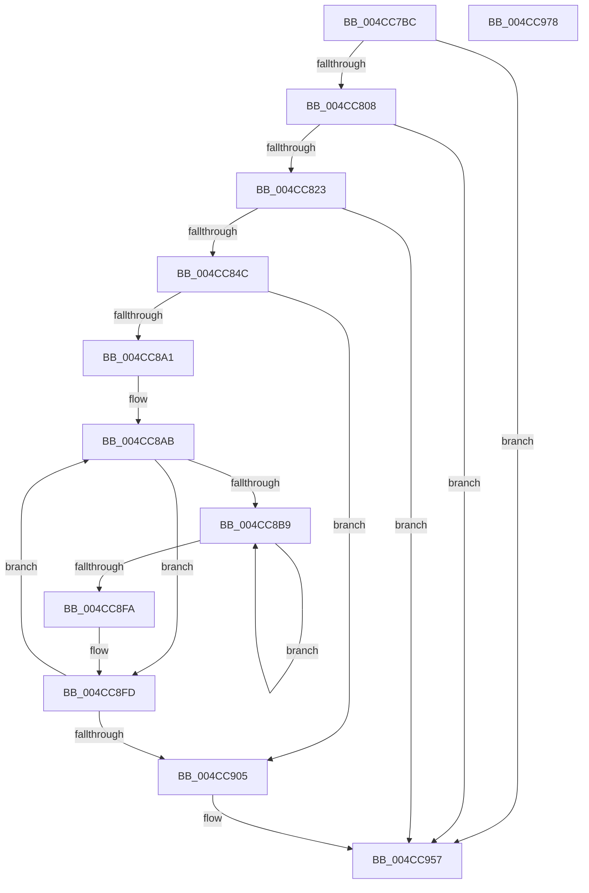

# PpmEventHgsNormalizedTable

- RVA: `0x004CC7BC`–`0x004CC979` (길이 `445` bytes)
- VA: `0x00000001404CC7BC`
- 실행 섹션: `.text`
- PDB 이름 있음: `예`; PDB Function 태그: `아니요`
- unwind 정보 RVA: `0x000BD7B8`
- 디코드: `108`개 명령, `445/445` bytes 표시
- 미해석 바이트: `0` (있으면 어셈블리에 `.byte`로 보존)

> 이 문서는 커널 이미지의 기계어와 PDB 기호를 분석해 생성했습니다. 4번과 5번은 함수 원형과 자료형을 바이너리 사용 방식에서 추정한 C 해석이며 원본 소스 복구 결과는 아닙니다.

## 1. Dependencies

- 직접 호출 지점: **6**; 고유 호출 대상: **6**
- 직접 호출자로 확인된 함수: **1**
- RIP 상대 이미지 참조: **6**

### Outgoing calls
- `0x004CC7E6` → [KeQueryMaximumProcessorCountEx](../26/KeQueryMaximumProcessorCountEx_function_00264D60.md) (function, `0x00264D60`)
- `0x004CC816` → [EtwEventEnabled](../39/EtwEventEnabled_function_00392450.md) (function, `0x00392450`)
- `0x004CC83B` → [ExAllocatePool2](../../poolcode/B8/ExAllocatePool2_function_00B820F0.md) (function, `0x00B820F0`)
- `0x004CC945` → [EtwWriteEx](../25/EtwWriteEx_function_0025F0D0.md) (function, `0x0025F0D0`)
- `0x004CC952` → [ExFreePoolWithTag](../../poolcode/B8/ExFreePoolWithTag_function_00B82870.md) (function, `0x00B82870`)
- `0x004CC95E` → [_security_check_cookie](../6A/_security_check_cookie_function_006AC640.md) (function, `0x006AC640`)

### Direct callers
- [PpmEventTraceControlCallback](../../page/A5/PpmEventTraceControlCallback_function_00A51F60.md) at `0x00A5211B`

### Static image references
- `0x004CC7D3` → RVA `0x00E0A740` (`.data`; read)
- `0x004CC7EB` → RVA `0x00E67A39` (`.data`; read)
- `0x004CC7F5` → RVA `0x00FC6BC8` (`ALMOSTRO`; read)
- `0x004CC808` → RVA `0x00F083E8` (`.data`; read)
- `0x004CC80F` → RVA `0x0001E7E0` (`.rdata`; read)
- `0x004CC84C` → RVA `0x00FC6A96` (`ALMOSTRO`; read)

## 2. Other-region calls and transfers

- 다른 실행 섹션으로 향하는 call: **2**
  - `0x004CC83B` → [ExAllocatePool2](../../poolcode/B8/ExAllocatePool2_function_00B820F0.md) (`.text` → `POOLCODE`)
  - `0x004CC952` → [ExFreePoolWithTag](../../poolcode/B8/ExFreePoolWithTag_function_00B82870.md) (`.text` → `POOLCODE`)
- 별도 외부 분기/꼬리 이동을 확인하지 못했습니다.

## 3. Assembly (complete function range)

```asm
004CC7BC  48 89 5C 24 08                  mov qword ptr [rsp + 8], rbx
004CC7C1  48 89 7C 24 10                  mov qword ptr [rsp + 0x10], rdi
004CC7C6  55                              push rbp
004CC7C7  48 8D 6C 24 A9                  lea rbp, [rsp - 0x57]
004CC7CC  48 81 EC B0 00 00 00            sub rsp, 0xb0
004CC7D3  48 8B 05 66 DF 93 00            mov rax, qword ptr [rip + 0x93df66]
004CC7DA  48 33 C4                        xor rax, rsp
004CC7DD  48 89 45 47                     mov qword ptr [rbp + 0x47], rax
004CC7E1  B9 FF FF 00 00                  mov ecx, 0xffff
004CC7E6  E8 75 85 D9 FF                  call 0x140264d60
004CC7EB  80 3D 47 B2 99 00 00            cmp byte ptr [rip + 0x99b247], 0
004CC7F2  89 45 EB                        mov dword ptr [rbp - 0x15], eax
004CC7F5  48 8B 05 CC A3 AF 00            mov rax, qword ptr [rip + 0xafa3cc]
004CC7FC  8B 48 04                        mov ecx, dword ptr [rax + 4]
004CC7FF  89 4D E7                        mov dword ptr [rbp - 0x19], ecx
004CC802  0F 84 4F 01 00 00               je 0x1404cc957
004CC808  48 8B 0D D9 BB A3 00            mov rcx, qword ptr [rip + 0xa3bbd9]
004CC80F  48 8D 15 CA 1F B5 FF            lea rdx, [rip - 0x4ae036]
004CC816  E8 35 5C EC FF                  call 0x140392450
004CC81B  84 C0                           test al, al
004CC81D  0F 84 34 01 00 00               je 0x1404cc957
004CC823  8B 45 E7                        mov eax, dword ptr [rbp - 0x19]
004CC826  B9 00 01 00 00                  mov ecx, 0x100
004CC82B  0F AF 45 EB                     imul eax, dword ptr [rbp - 0x15]
004CC82F  41 B8 50 50 4D 65               mov r8d, 0x654d5050
004CC835  6B D0 0B                        imul edx, eax, 0xb
004CC838  89 45 EF                        mov dword ptr [rbp - 0x11], eax
004CC83B  E8 B0 58 6B 00                  call 0x140b820f0
004CC840  48 8B D8                        mov rbx, rax
004CC843  48 85 C0                        test rax, rax
004CC846  0F 84 0B 01 00 00               je 0x1404cc957
004CC84C  0F B6 0D 43 A2 AF 00            movzx ecx, byte ptr [rip + 0xafa243]
004CC853  48 8D 45 F3                     lea rax, [rbp - 0xd]
004CC857  83 65 03 00                     and dword ptr [rbp + 3], 0
004CC85B  45 33 C9                        xor r9d, r9d
004CC85E  83 65 13 00                     and dword ptr [rbp + 0x13], 0
004CC862  83 65 23 00                     and dword ptr [rbp + 0x23], 0
004CC866  83 65 33 00                     and dword ptr [rbp + 0x33], 0
004CC86A  48 89 45 F7                     mov qword ptr [rbp - 9], rax
004CC86E  48 8D 45 EB                     lea rax, [rbp - 0x15]
004CC872  48 89 45 07                     mov qword ptr [rbp + 7], rax
004CC876  48 8D 45 E7                     lea rax, [rbp - 0x19]
004CC87A  48 89 45 17                     mov qword ptr [rbp + 0x17], rax
004CC87E  48 8D 45 EF                     lea rax, [rbp - 0x11]
004CC882  48 89 45 27                     mov qword ptr [rbp + 0x27], rax
004CC886  8B 45 EB                        mov eax, dword ptr [rbp - 0x15]
004CC889  89 4D F3                        mov dword ptr [rbp - 0xd], ecx
004CC88C  B9 04 00 00 00                  mov ecx, 4
004CC891  89 4D FF                        mov dword ptr [rbp - 1], ecx
004CC894  89 4D 0F                        mov dword ptr [rbp + 0xf], ecx
004CC897  89 4D 1F                        mov dword ptr [rbp + 0x1f], ecx
004CC89A  89 4D 2F                        mov dword ptr [rbp + 0x2f], ecx
004CC89D  85 C0                           test eax, eax
004CC89F  74 64                           je 0x1404cc905
004CC8A1  48 8B 3D 20 A3 AF 00            mov rdi, qword ptr [rip + 0xafa320]
004CC8A8  8B 4D E7                        mov ecx, dword ptr [rbp - 0x19]
004CC8AB  45 8B D1                        mov r10d, r9d
004CC8AE  45 33 DB                        xor r11d, r11d
004CC8B1  4C 03 57 08                     add r10, qword ptr [rdi + 8]
004CC8B5  85 C9                           test ecx, ecx
004CC8B7  74 44                           je 0x1404cc8fd
004CC8B9  41 0F AF C9                     imul ecx, r9d
004CC8BD  41 8D 14 0B                     lea edx, [r11 + rcx]
004CC8C1  48 8B 0D 00 A3 AF 00            mov rcx, qword ptr [rip + 0xafa300]
004CC8C8  4C 6B C2 0B                     imul r8, rdx, 0xb
004CC8CC  8A 44 91 19                     mov al, byte ptr [rcx + rdx*4 + 0x19]
004CC8D0  41 88 44 18 09                  mov byte ptr [r8 + rbx + 9], al
004CC8D5  8A 44 91 18                     mov al, byte ptr [rcx + rdx*4 + 0x18]
004CC8D9  41 88 44 18 0A                  mov byte ptr [r8 + rbx + 0xa], al
004CC8DE  41 8A 02                        mov al, byte ptr [r10]
004CC8E1  45 89 5C 18 04                  mov dword ptr [r8 + rbx + 4], r11d
004CC8E6  41 FF C3                        inc r11d
004CC8E9  41 88 44 18 08                  mov byte ptr [r8 + rbx + 8], al
004CC8EE  45 89 0C 18                     mov dword ptr [r8 + rbx], r9d
004CC8F2  8B 4D E7                        mov ecx, dword ptr [rbp - 0x19]
004CC8F5  44 3B D9                        cmp r11d, ecx
004CC8F8  72 BF                           jb 0x1404cc8b9
004CC8FA  8B 45 EB                        mov eax, dword ptr [rbp - 0x15]
004CC8FD  41 FF C1                        inc r9d
004CC900  44 3B C8                        cmp r9d, eax
004CC903  72 A6                           jb 0x1404cc8ab
004CC905  6B 45 EF 0B                     imul eax, dword ptr [rbp - 0x11], 0xb
004CC909  48 8D 15 D0 1E B5 FF            lea rdx, [rip - 0x4ae130]
004CC910  83 65 43 00                     and dword ptr [rbp + 0x43], 0
004CC914  45 33 C9                        xor r9d, r9d
004CC917  48 8B 0D CA BA A3 00            mov rcx, qword ptr [rip + 0xa3baca]
004CC91E  45 33 C0                        xor r8d, r8d
004CC921  48 89 5D 37                     mov qword ptr [rbp + 0x37], rbx
004CC925  89 45 3F                        mov dword ptr [rbp + 0x3f], eax
004CC928  48 8D 45 F7                     lea rax, [rbp - 9]
004CC92C  48 89 44 24 38                  mov qword ptr [rsp + 0x38], rax
004CC931  C7 44 24 30 05 00 00 00         mov dword ptr [rsp + 0x30], 5
004CC939  48 83 64 24 28 00               and qword ptr [rsp + 0x28], 0
004CC93F  48 83 64 24 20 00               and qword ptr [rsp + 0x20], 0
004CC945  E8 86 27 D9 FF                  call 0x14025f0d0
004CC94A  BA 50 50 4D 65                  mov edx, 0x654d5050
004CC94F  48 8B CB                        mov rcx, rbx
004CC952  E8 19 5F 6B 00                  call 0x140b82870
004CC957  48 8B 4D 47                     mov rcx, qword ptr [rbp + 0x47]
004CC95B  48 33 CC                        xor rcx, rsp
004CC95E  E8 DD FC 1D 00                  call 0x1406ac640
004CC963  4C 8D 9C 24 B0 00 00 00         lea r11, [rsp + 0xb0]
004CC96B  49 8B 5B 10                     mov rbx, qword ptr [r11 + 0x10]
004CC96F  49 8B 7B 18                     mov rdi, qword ptr [r11 + 0x18]
004CC973  49 8B E3                        mov rsp, r11
004CC976  5D                              pop rbp
004CC977  C3                              ret
004CC978  CC                              int3
```

## 4. C-style interpretation (structured pseudocode)

```c
__int64 __fastcall PpmEventHgsNormalizedTable(__int64 a1, __int64 a2, __int64 a3, int a4)
{
    __int64 result;
    __int64 v_r10;
    __int64 v_r11;
    __int64 v_rsp;
    unsigned __int64 v_stack_m18;
    unsigned int v_stack_m1C;
    unsigned int v_stack_m20;
    unsigned __int64 v_stack_m28;
    unsigned int v_stack_m2C;
    unsigned int v_stack_m30;
    unsigned __int64 v_stack_m38;
    unsigned int v_stack_m3C;
    unsigned int v_stack_m40;
    unsigned __int64 v_stack_m48;
    unsigned int v_stack_m4C;
    unsigned int v_stack_m50;
    unsigned __int64 v_stack_m58;
    unsigned int v_stack_m5C;
    unsigned __int64 v_stack_m5F;
    unsigned int v_stack_m60;
    unsigned __int64 v_stack_m68;
    unsigned __int64 v_stack_m6C;
    unsigned int v_stack_m70;
    unsigned int v_stack_m74;
    unsigned int v_stack_m78;
    unsigned __int64 v_stack_m8;
    unsigned __int64 v_stack_m80;
    unsigned int v_stack_m88;
    unsigned __int64 v_stack_m90;
    unsigned __int64 v_stack_m98;
    unsigned __int64 v_stack_p10;
    unsigned __int64 v_stack_p8;

    v_stack_p8 = v_rbx;
    v_stack_p10 = v_rdi;
    v_rsp = (v_rsp) - (176);
    result = (*(unsigned __int64 *)(v_rip + 9690982)) ^ (v_rsp);
    v_stack_m18 = result;
    result = KeQueryMaximumProcessorCountEx((unsigned int)(0xFFFFULL), a2, a3, a4);
    v_stack_m74 = (unsigned int)(result);
    v_stack_m78 = (unsigned int)((unsigned int)(*(unsigned int *)(*(unsigned __int64 *)(v_rip + 11510732) + 4)));
    if ((*(unsigned __int8 *)(v_rip + 10072647)) == 0) goto loc_004CC957;
    result = EtwEventEnabled(*(unsigned __int64 *)(v_rip + 10730457), v_rip - 4907062, a3, a4);
    if ((unsigned __int8)(result) == 0) goto loc_004CC957;
    result = (unsigned int)(((unsigned int)(v_stack_m78)) * (v_stack_m74));
    a2 = (unsigned int)((v_rip - 4907062) * ((unsigned int)(result)));
    v_stack_m70 = (unsigned int)(result);
    result = ExAllocatePool2(256, a2, (unsigned int)(0x654D5050ULL), a4);
    if (result == 0) goto loc_004CC957;
    a4 = 0;
    v_stack_m68 = v_stack_m6C;
    v_stack_m58 = v_stack_m74;
    v_stack_m48 = v_stack_m78;
    v_stack_m38 = v_stack_m70;
    v_stack_m6C = (unsigned int)(*(unsigned __int8 *)(v_rip + 11510339));
    v_stack_m60 = 4;
    v_stack_m50 = 4;
    v_stack_m40 = 4;
    v_stack_m30 = 4;
    if ((unsigned int)((unsigned int)(v_stack_m74)) == 0) goto loc_004CC905;
loc_004CC8AB:
    v_r11 = 0;
    v_r10 = (0) + (*(unsigned __int64 *)(*(unsigned __int64 *)(v_rip + 11510560) + 8));
    if ((unsigned int)((unsigned int)(v_stack_m78)) == 0) goto loc_004CC8FD;
loc_004CC8B9:
    a1 = (unsigned int)(((unsigned int)(v_stack_m78)) * (0));
    a3 = ((unsigned int)(0x654D5050ULL)) * (v_r11 + a1 * 1);
    *(unsigned __int8 *)(a3 + result * 1 + 9) = (unsigned __int8)(*(unsigned __int8 *)(*(unsigned __int64 *)(v_rip + 11510528) + v_r11 + a1 * 1 * 4 + 25));
    *(unsigned __int8 *)(a3 + result * 1 + 10) = (unsigned __int8)(*(unsigned __int8 *)(*(unsigned __int64 *)(v_rip + 11510528) + v_r11 + a1 * 1 * 4 + 24));
    *(unsigned int *)(a3 + result * 1 + 4) = 0;
    v_r11 = (unsigned int)((v_r11) + 1);
    *(unsigned __int8 *)(a3 + result * 1 + 8) = (unsigned __int8)(*(unsigned __int8 *)(v_r10));
    *(unsigned int *)(a3 + result * 1) = 0;
    if (((unsigned int)(v_r11)) < ((unsigned int)((unsigned int)(v_stack_m78)))) goto loc_004CC8B9;
loc_004CC8FD:
    a4 = (unsigned int)((a4) + 1);
    if (a4 < ((unsigned int)((unsigned int)(v_stack_m74)))) goto loc_004CC8AB;
loc_004CC905:
    result = (unsigned int)(((unsigned int)(v_stack_m74)) * (v_stack_m70));
    a4 = 0;
    a3 = 0;
    v_stack_m28 = result;
    v_stack_m20 = (unsigned int)(result);
    v_stack_m80 = v_stack_m68;
    v_stack_m88 = 5;
    result = EtwWriteEx(*(unsigned __int64 *)(v_rip + 10730186), v_rip - 4907312, a3, a4);
    result = ExFreePoolWithTag(result, (unsigned int)(0x654D5050ULL), a3, a4);
loc_004CC957:
    a1 = (v_stack_m18) ^ (v_rsp);
    result = _security_check_cookie(a1, (unsigned int)(0x654D5050ULL), a3, a4);
    return result;
}
```

## 5. (Beta) C Style

```c
int64_t PpmEventHgsNormalizedTable(int64_t Arg1, int64_t Arg2, int64_t Arg3, int32_t Arg4)
{
    int64_t result;
    int64_t local_r10;
    int64_t local_r11;
    int64_t local_rsp;
    uint64_t v_stack_m18;
    uint32_t v_stack_m1C;
    uint32_t v_stack_m20;
    uint64_t v_stack_m28;
    uint32_t v_stack_m2C;
    uint32_t v_stack_m30;
    uint64_t v_stack_m38;
    uint32_t v_stack_m3C;
    uint32_t v_stack_m40;
    uint64_t v_stack_m48;
    uint32_t v_stack_m4C;
    uint32_t v_stack_m50;
    uint64_t v_stack_m58;
    uint32_t v_stack_m5C;
    uint64_t v_stack_m5F;
    uint32_t v_stack_m60;
    uint64_t v_stack_m68;
    uint64_t v_stack_m6C;
    uint32_t v_stack_m70;
    uint32_t v_stack_m74;
    uint32_t v_stack_m78;
    uint64_t v_stack_m8;
    uint64_t v_stack_m80;
    uint32_t v_stack_m88;
    uint64_t v_stack_m90;
    uint64_t v_stack_m98;
    uint64_t v_stack_p10;
    uint64_t v_stack_p8;

    v_stack_p8 = local_rbx;
    v_stack_p10 = local_rdi;
    local_rsp = (local_rsp) - (176);
    result = (*(uint64_t *)(v_rip + 0x93DF66)) ^ (local_rsp);
    v_stack_m18 = result;
    result = KeQueryMaximumProcessorCountEx((uint32_t)(0xFFFFULL), Arg2, Arg3, Arg4);
    v_stack_m74 = (uint32_t)(result);
    v_stack_m78 = (uint32_t)((uint32_t)(*(uint32_t *)(*(uint64_t *)(v_rip + 0xAFA3CC) + 0x4)));
    if ((*(uint8_t *)(v_rip + 0x99B247)) == 0) goto loc_004CC957;
    result = EtwEventEnabled(*(uint64_t *)(v_rip + 0xA3BBD9), v_rip - 4907062, Arg3, Arg4);
    if ((uint8_t)(result) == 0) goto loc_004CC957;
    result = (uint32_t)(((uint32_t)(v_stack_m78)) * (v_stack_m74));
    Arg2 = (uint32_t)((v_rip - 4907062) * ((uint32_t)(result)));
    v_stack_m70 = (uint32_t)(result);
    result = ExAllocatePool2(256, Arg2, (uint32_t)(0x654D5050ULL), Arg4);
    if (result == 0) goto loc_004CC957;
    Arg4 = 0;
    v_stack_m68 = v_stack_m6C;
    v_stack_m58 = v_stack_m74;
    v_stack_m48 = v_stack_m78;
    v_stack_m38 = v_stack_m70;
    v_stack_m6C = (uint32_t)(*(uint8_t *)(v_rip + 0xAFA243));
    v_stack_m60 = 4;
    v_stack_m50 = 4;
    v_stack_m40 = 4;
    v_stack_m30 = 4;
    if ((uint32_t)((uint32_t)(v_stack_m74)) == 0) goto loc_004CC905;
loc_004CC8AB:
    local_r11 = 0;
    local_r10 = (0) + (*(uint64_t *)(*(uint64_t *)(v_rip + 0xAFA320) + 0x8));
    if ((uint32_t)((uint32_t)(v_stack_m78)) == 0) goto loc_004CC8FD;
loc_004CC8B9:
    Arg1 = (uint32_t)(((uint32_t)(v_stack_m78)) * (0));
    Arg3 = ((uint32_t)(0x654D5050ULL)) * (local_r11 + Arg1 * 1);
    *(uint8_t *)(Arg3 + result * 1 + 0x9) = (uint8_t)(*(uint8_t *)(*(uint64_t *)(v_rip + 0xAFA300) + local_r11 + Arg1 * 1 * 4 + 0x19));
    *(uint8_t *)(Arg3 + result * 1 + 0xA) = (uint8_t)(*(uint8_t *)(*(uint64_t *)(v_rip + 0xAFA300) + local_r11 + Arg1 * 1 * 4 + 0x18));
    *(uint32_t *)(Arg3 + result * 1 + 0x4) = 0;
    local_r11 = (uint32_t)((local_r11) + 1);
    *(uint8_t *)(Arg3 + result * 1 + 0x8) = (uint8_t)(*(uint8_t *)(local_r10));
    *(uint32_t *)(Arg3 + result * 1) = 0;
    if (((uint32_t)(local_r11)) < ((uint32_t)((uint32_t)(v_stack_m78)))) goto loc_004CC8B9;
loc_004CC8FD:
    Arg4 = (uint32_t)((Arg4) + 1);
    if (Arg4 < ((uint32_t)((uint32_t)(v_stack_m74)))) goto loc_004CC8AB;
loc_004CC905:
    result = (uint32_t)(((uint32_t)(v_stack_m74)) * (v_stack_m70));
    Arg4 = 0;
    Arg3 = 0;
    v_stack_m28 = result;
    v_stack_m20 = (uint32_t)(result);
    v_stack_m80 = v_stack_m68;
    v_stack_m88 = 5;
    result = EtwWriteEx(*(uint64_t *)(v_rip + 0xA3BACA), v_rip - 4907312, Arg3, Arg4);
    result = ExFreePoolWithTag(result, (uint32_t)(0x654D5050ULL), Arg3, Arg4);
loc_004CC957:
    Arg1 = (v_stack_m18) ^ (local_rsp);
    result = _security_check_cookie(Arg1, (uint32_t)(0x654D5050ULL), Arg3, Arg4);
    return result;
}
```

## 6. Execution-region graph

[열기: 2D/3D 그래프와 함수 탐색 컨트롤 패널](../../../control-panel.html?section=text&rva=0x004CC7BC&view=graph)

- 2D 그래프는 위에서 아래로 흐르고, 3D 그래프는 빈 공간을 드래그해 회전합니다. Shift+드래그는 이동, 휠은 확대·축소, 함수 노드 선택은 대상 보고서 이동입니다.

### Static fallback


