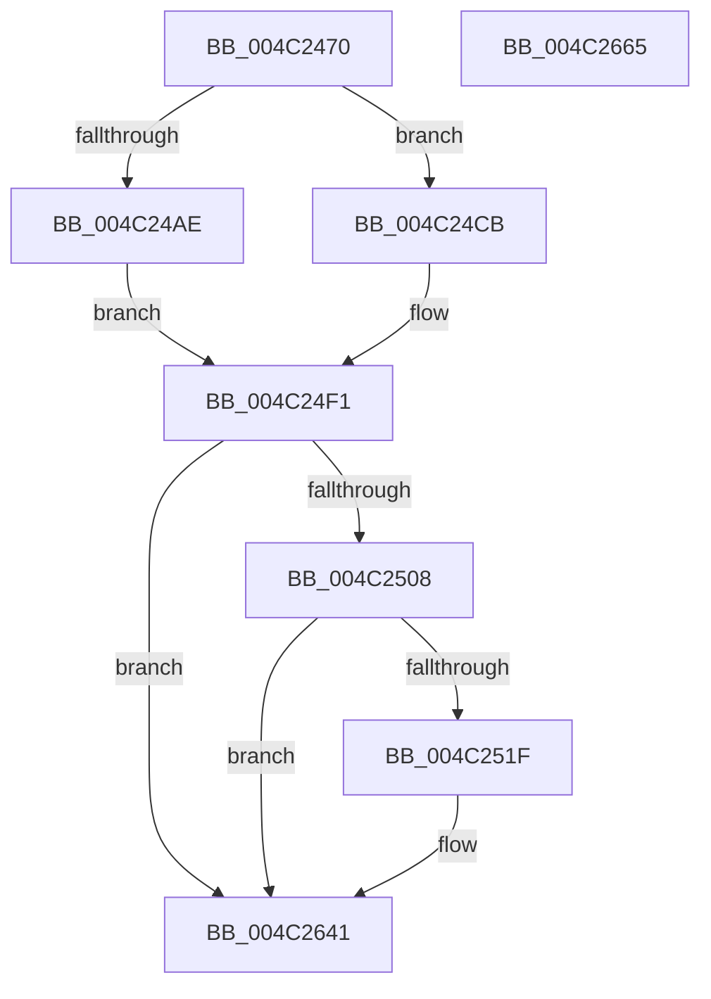

# PpmEventProcessorPerfStateChange

- RVA: `0x004C2470`–`0x004C2666` (길이 `502` bytes)
- VA: `0x00000001404C2470`
- 실행 섹션: `.text`
- PDB 이름 있음: `예`; PDB Function 태그: `아니요`
- unwind 정보 RVA: `0x000BCAD4`
- 디코드: `107`개 명령, `502/502` bytes 표시
- 미해석 바이트: `0` (있으면 어셈블리에 `.byte`로 보존)

> 이 문서는 커널 이미지의 기계어와 PDB 기호를 분석해 생성했습니다. 4번과 5번은 함수 원형과 자료형을 바이너리 사용 방식에서 추정한 C 해석이며 원본 소스 복구 결과는 아닙니다.

## 1. Dependencies

- 직접 호출 지점: **3**; 고유 호출 대상: **3**
- 직접 호출자로 확인된 함수: **1**
- RIP 상대 이미지 참조: **5**

### Outgoing calls
- `0x004C2512` → [EtwEventEnabled](../39/EtwEventEnabled_function_00392450.md) (function, `0x00392450`)
- `0x004C263C` → [EtwWriteEx](../25/EtwWriteEx_function_0025F0D0.md) (function, `0x0025F0D0`)
- `0x004C2648` → [_security_check_cookie](../6A/_security_check_cookie_function_006AC640.md) (function, `0x006AC640`)

### Direct callers
- [PpmPerfApplyHiddenProcessorState](../5D/PpmPerfApplyHiddenProcessorState_function_005D4048.md) at `0x005D40FF`

### Static image references
- `0x004C2491` → RVA `0x00E0A740` (`.data`; read)
- `0x004C24B2` → RVA `0x00011340` (`.rdata`; read)
- `0x004C24D2` → RVA `0x00011290` (`.rdata`; read)
- `0x004C24F1` → RVA `0x00E67A39` (`.data`; read)
- `0x004C2508` → RVA `0x00F083E8` (`.data`; read)

## 2. Other-region calls and transfers

- 다른 실행 섹션으로 향하는 call: **0**
- 별도 외부 분기/꼬리 이동을 확인하지 못했습니다.

## 3. Assembly (complete function range)

```asm
004C2470  48 8B C4                        mov rax, rsp
004C2473  48 89 58 08                     mov qword ptr [rax + 8], rbx
004C2477  48 89 70 20                     mov qword ptr [rax + 0x20], rsi
004C247B  44 89 40 18                     mov dword ptr [rax + 0x18], r8d
004C247F  89 50 10                        mov dword ptr [rax + 0x10], edx
004C2482  55                              push rbp
004C2483  57                              push rdi
004C2484  41 56                           push r14
004C2486  48 8D 68 A8                     lea rbp, [rax - 0x58]
004C248A  48 81 EC 40 01 00 00            sub rsp, 0x140
004C2491  48 8B 05 A8 82 94 00            mov rax, qword ptr [rip + 0x9482a8]
004C2498  48 33 C4                        xor rax, rsp
004C249B  48 89 45 30                     mov qword ptr [rbp + 0x30], rax
004C249F  33 F6                           xor esi, esi
004C24A1  48 8B D9                        mov rbx, rcx
004C24A4  89 74 24 40                     mov dword ptr [rsp + 0x40], esi
004C24A8  40 38 71 44                     cmp byte ptr [rcx + 0x44], sil
004C24AC  75 1D                           jne 0x1404c24cb
004C24AE  48 8B 41 08                     mov rax, qword ptr [rcx + 8]
004C24B2  48 8D 3D 87 EE B4 FF            lea rdi, [rip - 0x4b1179]
004C24B9  8B 50 14                        mov edx, dword ptr [rax + 0x14]
004C24BC  89 54 24 40                     mov dword ptr [rsp + 0x40], edx
004C24C0  48 C7 44 24 78 04 00 00 00      mov qword ptr [rsp + 0x78], 4
004C24C9  EB 26                           jmp 0x1404c24f1
004C24CB  0F B6 81 20 77 FF FF            movzx eax, byte ptr [rcx - 0x88e0]
004C24D2  48 8D 3D B7 ED B4 FF            lea rdi, [rip - 0x4b1249]
004C24D9  66 89 44 24 40                  mov word ptr [rsp + 0x40], ax
004C24DE  8A 81 21 77 FF FF               mov al, byte ptr [rcx - 0x88df]
004C24E4  88 44 24 42                     mov byte ptr [rsp + 0x42], al
004C24E8  48 C7 44 24 78 03 00 00 00      mov qword ptr [rsp + 0x78], 3
004C24F1  40 38 35 41 55 9A 00            cmp byte ptr [rip + 0x9a5541], sil
004C24F8  48 8D 44 24 40                  lea rax, [rsp + 0x40]
004C24FD  48 89 44 24 70                  mov qword ptr [rsp + 0x70], rax
004C2502  0F 84 39 01 00 00               je 0x1404c2641
004C2508  48 8B 0D D9 5E A4 00            mov rcx, qword ptr [rip + 0xa45ed9]
004C250F  48 8B D7                        mov rdx, rdi
004C2512  E8 39 FF EC FF                  call 0x140392450
004C2517  84 C0                           test al, al
004C2519  0F 84 22 01 00 00               je 0x1404c2641
004C251F  48 8B 4B 08                     mov rcx, qword ptr [rbx + 8]
004C2523  45 33 C9                        xor r9d, r9d
004C2526  45 33 C0                        xor r8d, r8d
004C2529  48 8B D7                        mov rdx, rdi
004C252C  8B 41 40                        mov eax, dword ptr [rcx + 0x40]
004C252F  89 44 24 44                     mov dword ptr [rsp + 0x44], eax
004C2533  8B 41 54                        mov eax, dword ptr [rcx + 0x54]
004C2536  89 44 24 48                     mov dword ptr [rsp + 0x48], eax
004C253A  48 8D 44 24 44                  lea rax, [rsp + 0x44]
004C253F  48 89 44 24 50                  mov qword ptr [rsp + 0x50], rax
004C2544  48 8D 44 24 48                  lea rax, [rsp + 0x48]
004C2549  48 89 44 24 60                  mov qword ptr [rsp + 0x60], rax
004C254E  48 8D 41 50                     lea rax, [rcx + 0x50]
004C2552  48 89 45 80                     mov qword ptr [rbp - 0x80], rax
004C2556  48 8D 41 60                     lea rax, [rcx + 0x60]
004C255A  48 89 45 90                     mov qword ptr [rbp - 0x70], rax
004C255E  48 8D 41 58                     lea rax, [rcx + 0x58]
004C2562  48 89 45 A0                     mov qword ptr [rbp - 0x60], rax
004C2566  48 8D 41 5C                     lea rax, [rcx + 0x5c]
004C256A  48 89 45 B0                     mov qword ptr [rbp - 0x50], rax
004C256E  48 8D 41 64                     lea rax, [rcx + 0x64]
004C2572  48 89 45 C0                     mov qword ptr [rbp - 0x40], rax
004C2576  48 8D 41 68                     lea rax, [rcx + 0x68]
004C257A  48 89 45 D0                     mov qword ptr [rbp - 0x30], rax
004C257E  48 C7 44 24 58 04 00 00 00      mov qword ptr [rsp + 0x58], 4
004C2587  48 C7 44 24 68 04 00 00 00      mov qword ptr [rsp + 0x68], 4
004C2590  48 C7 45 88 04 00 00 00         mov qword ptr [rbp - 0x78], 4
004C2598  48 C7 45 98 04 00 00 00         mov qword ptr [rbp - 0x68], 4
004C25A0  48 C7 45 A8 04 00 00 00         mov qword ptr [rbp - 0x58], 4
004C25A8  48 C7 45 B8 04 00 00 00         mov qword ptr [rbp - 0x48], 4
004C25B0  48 C7 45 C8 04 00 00 00         mov qword ptr [rbp - 0x38], 4
004C25B8  48 C7 45 D8 04 00 00 00         mov qword ptr [rbp - 0x28], 4
004C25C0  0F B6 41 70                     movzx eax, byte ptr [rcx + 0x70]
004C25C4  89 44 24 4C                     mov dword ptr [rsp + 0x4c], eax
004C25C8  48 8D 44 24 4C                  lea rax, [rsp + 0x4c]
004C25CD  48 89 45 E0                     mov qword ptr [rbp - 0x20], rax
004C25D1  48 8D 45 68                     lea rax, [rbp + 0x68]
004C25D5  48 89 45 F0                     mov qword ptr [rbp - 0x10], rax
004C25D9  48 8D 45 70                     lea rax, [rbp + 0x70]
004C25DD  48 89 45 00                     mov qword ptr [rbp], rax
004C25E1  48 8D 41 48                     lea rax, [rcx + 0x48]
004C25E5  48 89 45 10                     mov qword ptr [rbp + 0x10], rax
004C25E9  48 8D 41 6C                     lea rax, [rcx + 0x6c]
004C25ED  48 8B 0D F4 5D A4 00            mov rcx, qword ptr [rip + 0xa45df4]
004C25F4  48 89 45 20                     mov qword ptr [rbp + 0x20], rax
004C25F8  48 8D 44 24 50                  lea rax, [rsp + 0x50]
004C25FD  48 89 44 24 38                  mov qword ptr [rsp + 0x38], rax
004C2602  C7 44 24 30 0E 00 00 00         mov dword ptr [rsp + 0x30], 0xe
004C260A  48 89 74 24 28                  mov qword ptr [rsp + 0x28], rsi
004C260F  48 89 74 24 20                  mov qword ptr [rsp + 0x20], rsi
004C2614  48 C7 45 E8 04 00 00 00         mov qword ptr [rbp - 0x18], 4
004C261C  48 C7 45 F8 04 00 00 00         mov qword ptr [rbp - 8], 4
004C2624  48 C7 45 08 04 00 00 00         mov qword ptr [rbp + 8], 4
004C262C  48 C7 45 18 08 00 00 00         mov qword ptr [rbp + 0x18], 8
004C2634  48 C7 45 28 04 00 00 00         mov qword ptr [rbp + 0x28], 4
004C263C  E8 8F CA D9 FF                  call 0x14025f0d0
004C2641  48 8B 4D 30                     mov rcx, qword ptr [rbp + 0x30]
004C2645  48 33 CC                        xor rcx, rsp
004C2648  E8 F3 9F 1E 00                  call 0x1406ac640
004C264D  4C 8D 9C 24 40 01 00 00         lea r11, [rsp + 0x140]
004C2655  49 8B 5B 20                     mov rbx, qword ptr [r11 + 0x20]
004C2659  49 8B 73 38                     mov rsi, qword ptr [r11 + 0x38]
004C265D  49 8B E3                        mov rsp, r11
004C2660  41 5E                           pop r14
004C2662  5F                              pop rdi
004C2663  5D                              pop rbp
004C2664  C3                              ret
004C2665  CC                              int3
```

## 4. C-style interpretation (structured pseudocode)

```c
__int64 __fastcall PpmEventProcessorPerfStateChange(__int64 a1, int a2, int a3, int a4)
{
    __int64 result;
    __int64 v_rsi;
    __int64 v_rsp;
    unsigned __int64 v_stack_m100;
    unsigned __int64 v_stack_m108;
    unsigned int v_stack_m10C;
    unsigned int v_stack_m110;
    unsigned int v_stack_m114;
    unsigned __int8 v_stack_m116;
    unsigned int v_stack_m118;
    unsigned __int64 v_stack_m120;
    unsigned int v_stack_m128;
    unsigned __int64 v_stack_m130;
    unsigned __int64 v_stack_m138;
    unsigned __int64 v_stack_m18;
    unsigned __int64 v_stack_mE0;
    unsigned __int64 v_stack_mE8;
    unsigned __int64 v_stack_mF0;
    unsigned __int64 v_stack_mF8;

    *(unsigned __int64 *)(v_rsp + 8) = v_rbx;
    *(unsigned __int64 *)(v_rsp + 32) = v_rsi;
    *(unsigned int *)(v_rsp + 24) = a3;
    *(unsigned int *)(v_rsp + 16) = a2;
    v_rsp = (v_rsp) - (320);
    result = (*(unsigned __int64 *)(v_rip + 9732776)) ^ (v_rsp);
    *(unsigned __int64 *)(v_rsp - 88 + 48) = result;
    v_rsi = 0;
    v_stack_m118 = 0;
    if ((*(unsigned __int8 *)(a1 + 68)) != 0) goto loc_004C24CB;
    v_stack_m118 = (unsigned int)((unsigned int)(*(unsigned int *)(*(unsigned __int64 *)(a1 + 8) + 20)));
    v_stack_mE0 = 4;
    goto loc_004C24F1;
loc_004C24CB:
    v_stack_m118 = (unsigned __int16)(*(unsigned __int8 *)(a1 - 35040));
    v_stack_m116 = (unsigned __int8)(*(unsigned __int8 *)(a1 - 35039));
    v_stack_mE0 = 3;
loc_004C24F1:
    v_stack_mE8 = v_stack_m118;
    if ((*(unsigned __int8 *)(v_rip + 10114369)) == 0) goto loc_004C2641;
    result = EtwEventEnabled(*(unsigned __int64 *)(v_rip + 10772185), v_rip - 4919881, a3, a4);
    if ((unsigned __int8)(result) != 0) {
        a1 = *(unsigned __int64 *)(a1 + 8);
        a4 = 0;
        a3 = 0;
        a2 = v_rip - 4919881;
        result = *(unsigned int *)(a1 + 64);
        v_stack_m114 = (unsigned int)(result);
        result = *(unsigned int *)(a1 + 84);
        v_stack_m110 = (unsigned int)(result);
        result = v_stack_m114;
        v_stack_m108 = result;
        result = v_stack_m110;
        v_stack_mF8 = result;
        result = a1 + 80;
        *(unsigned __int64 *)(v_rsp - 88 - 128) = result;
        result = a1 + 96;
        *(unsigned __int64 *)(v_rsp - 88 - 112) = result;
        result = a1 + 88;
        *(unsigned __int64 *)(v_rsp - 88 - 96) = result;
        result = a1 + 92;
        *(unsigned __int64 *)(v_rsp - 88 - 80) = result;
        result = a1 + 100;
        *(unsigned __int64 *)(v_rsp - 88 - 64) = result;
        result = a1 + 104;
        *(unsigned __int64 *)(v_rsp - 88 - 48) = result;
        v_stack_m100 = 4;
        v_stack_mF0 = 4;
        *(unsigned __int64 *)(v_rsp - 88 - 120) = 4;
        *(unsigned __int64 *)(v_rsp - 88 - 104) = 4;
        *(unsigned __int64 *)(v_rsp - 88 - 88) = 4;
        *(unsigned __int64 *)(v_rsp - 88 - 72) = 4;
        *(unsigned __int64 *)(v_rsp - 88 - 56) = 4;
        *(unsigned __int64 *)(v_rsp - 88 - 40) = 4;
        result = *(unsigned __int8 *)(a1 + 112);
        v_stack_m10C = (unsigned int)(result);
        result = v_stack_m10C;
        *(unsigned __int64 *)(v_rsp - 88 - 32) = result;
        result = v_rsp - 88 + 104;
        *(unsigned __int64 *)(v_rsp - 88 - 16) = result;
        result = v_rsp - 88 + 112;
        *(unsigned __int64 *)(v_rsp - 88) = result;
        result = a1 + 72;
        *(unsigned __int64 *)(v_rsp - 88 + 16) = result;
        result = a1 + 108;
        a1 = *(unsigned __int64 *)(v_rip + 10771956);
        *(unsigned __int64 *)(v_rsp - 88 + 32) = result;
        result = v_stack_m108;
        v_stack_m120 = result;
        v_stack_m128 = 14;
        v_stack_m130 = 0;
        v_stack_m138 = 0;
        *(unsigned __int64 *)(v_rsp - 88 - 24) = 4;
        *(unsigned __int64 *)(v_rsp - 88 - 8) = 4;
        *(unsigned __int64 *)(v_rsp - 88 + 8) = 4;
        *(unsigned __int64 *)(v_rsp - 88 + 24) = 8;
        *(unsigned __int64 *)(v_rsp - 88 + 40) = 4;
        result = EtwWriteEx(a1, a2, a3, a4);
    }
    a1 = (*(unsigned __int64 *)(v_rsp - 88 + 48)) ^ (v_rsp);
    result = _security_check_cookie(a1, a2, a3, a4);
    return result;
}
```

## 5. (Beta) C Style

```c
int64_t PpmEventProcessorPerfStateChange(void *Arg1, int32_t Arg2, int32_t Arg3, int32_t Arg4)
{
    uint8_t *arg1 = (uint8_t *)Arg1;

    int64_t result;
    int64_t local_rsi;
    int64_t local_rsp;
    uint64_t v_stack_m100;
    uint64_t v_stack_m108;
    uint32_t v_stack_m10C;
    uint32_t v_stack_m110;
    uint32_t v_stack_m114;
    uint8_t v_stack_m116;
    uint32_t v_stack_m118;
    uint64_t v_stack_m120;
    uint32_t v_stack_m128;
    uint64_t v_stack_m130;
    uint64_t v_stack_m138;
    uint64_t v_stack_m18;
    uint64_t v_stack_mE0;
    uint64_t v_stack_mE8;
    uint64_t v_stack_mF0;
    uint64_t v_stack_mF8;

    *(uint64_t *)(local_rsp + 0x8) = local_rbx;
    *(uint64_t *)(local_rsp + 0x20) = local_rsi;
    *(uint32_t *)(local_rsp + 0x18) = Arg3;
    *(uint32_t *)(local_rsp + 0x10) = Arg2;
    local_rsp = (local_rsp) - (320);
    result = (*(uint64_t *)(v_rip + 0x9482A8)) ^ (local_rsp);
    *(uint64_t *)(local_rsp - 0x58 + 0x30) = result;
    local_rsi = 0;
    v_stack_m118 = 0;
    if ((*(uint8_t *)(arg1 + 0x44)) != 0) goto loc_004C24CB;
    v_stack_m118 = (uint32_t)((uint32_t)(*(uint32_t *)(*(uint64_t *)(arg1 + 0x8) + 0x14)));
    v_stack_mE0 = 4;
    goto loc_004C24F1;
loc_004C24CB:
    v_stack_m118 = (uint16_t)(*(uint8_t *)(arg1 - 0x88E0));
    v_stack_m116 = (uint8_t)(*(uint8_t *)(arg1 - 0x88DF));
    v_stack_mE0 = 3;
loc_004C24F1:
    v_stack_mE8 = v_stack_m118;
    if ((*(uint8_t *)(v_rip + 0x9A5541)) == 0) goto loc_004C2641;
    result = EtwEventEnabled(*(uint64_t *)(v_rip + 0xA45ED9), v_rip - 4919881, Arg3, Arg4);
    if ((uint8_t)(result) != 0) {
        Arg1 = *(uint64_t *)(arg1 + 0x8);
        Arg4 = 0;
        Arg3 = 0;
        Arg2 = v_rip - 4919881;
        result = *(uint32_t *)(arg1 + 0x40);
        v_stack_m114 = (uint32_t)(result);
        result = *(uint32_t *)(arg1 + 0x54);
        v_stack_m110 = (uint32_t)(result);
        result = v_stack_m114;
        v_stack_m108 = result;
        result = v_stack_m110;
        v_stack_mF8 = result;
        result = Arg1 + 80;
        *(uint64_t *)(local_rsp - 0x58 - 0x80) = result;
        result = Arg1 + 96;
        *(uint64_t *)(local_rsp - 0x58 - 0x70) = result;
        result = Arg1 + 88;
        *(uint64_t *)(local_rsp - 0x58 - 0x60) = result;
        result = Arg1 + 92;
        *(uint64_t *)(local_rsp - 0x58 - 0x50) = result;
        result = Arg1 + 100;
        *(uint64_t *)(local_rsp - 0x58 - 0x40) = result;
        result = Arg1 + 104;
        *(uint64_t *)(local_rsp - 0x58 - 0x30) = result;
        v_stack_m100 = 4;
        v_stack_mF0 = 4;
        *(uint64_t *)(local_rsp - 0x58 - 0x78) = 4;
        *(uint64_t *)(local_rsp - 0x58 - 0x68) = 4;
        *(uint64_t *)(local_rsp - 0x58 - 0x58) = 4;
        *(uint64_t *)(local_rsp - 0x58 - 0x48) = 4;
        *(uint64_t *)(local_rsp - 0x58 - 0x38) = 4;
        *(uint64_t *)(local_rsp - 0x58 - 0x28) = 4;
        result = *(uint8_t *)(arg1 + 0x70);
        v_stack_m10C = (uint32_t)(result);
        result = v_stack_m10C;
        *(uint64_t *)(local_rsp - 0x58 - 0x20) = result;
        result = local_rsp - 88 + 104;
        *(uint64_t *)(local_rsp - 0x58 - 0x10) = result;
        result = local_rsp - 88 + 112;
        *(uint64_t *)(local_rsp - 0x58) = result;
        result = Arg1 + 72;
        *(uint64_t *)(local_rsp - 0x58 + 0x10) = result;
        result = Arg1 + 108;
        Arg1 = *(uint64_t *)(v_rip + 0xA45DF4);
        *(uint64_t *)(local_rsp - 0x58 + 0x20) = result;
        result = v_stack_m108;
        v_stack_m120 = result;
        v_stack_m128 = 14;
        v_stack_m130 = 0;
        v_stack_m138 = 0;
        *(uint64_t *)(local_rsp - 0x58 - 0x18) = 4;
        *(uint64_t *)(local_rsp - 0x58 - 0x8) = 4;
        *(uint64_t *)(local_rsp - 0x58 + 0x8) = 4;
        *(uint64_t *)(local_rsp - 0x58 + 0x18) = 8;
        *(uint64_t *)(local_rsp - 0x58 + 0x28) = 4;
        result = EtwWriteEx(Arg1, Arg2, Arg3, Arg4);
    }
    Arg1 = (*(uint64_t *)(local_rsp - 0x58 + 0x30)) ^ (local_rsp);
    result = _security_check_cookie(Arg1, Arg2, Arg3, Arg4);
    return result;
}
```

### 관측된 메모리 오프셋

구조체 형식이 확인되지 않은 접근은 인자 기준의 오프셋으로만 기록했습니다.

| 기준 인자 | 오프셋 표현 | 폭 (bit) | 접근 |
|---|---:|---:|---|
| `Arg1` | `- 0x88E0` | `8` | `R` |
| `Arg1` | `- 0x88DF` | `8` | `R` |
| `Arg1` | `+ 0x8` | `64` | `R` |
| `Arg1` | `+ 0x44` | `8` | `R` |

## 6. Execution-region graph

[열기: 2D/3D 그래프와 함수 탐색 컨트롤 패널](../../../control-panel.html?section=text&rva=0x004C2470&view=graph)

- 2D 그래프는 위에서 아래로 흐르고, 3D 그래프는 빈 공간을 드래그해 회전합니다. Shift+드래그는 이동, 휠은 확대·축소, 함수 노드 선택은 대상 보고서 이동입니다.

### Static fallback


