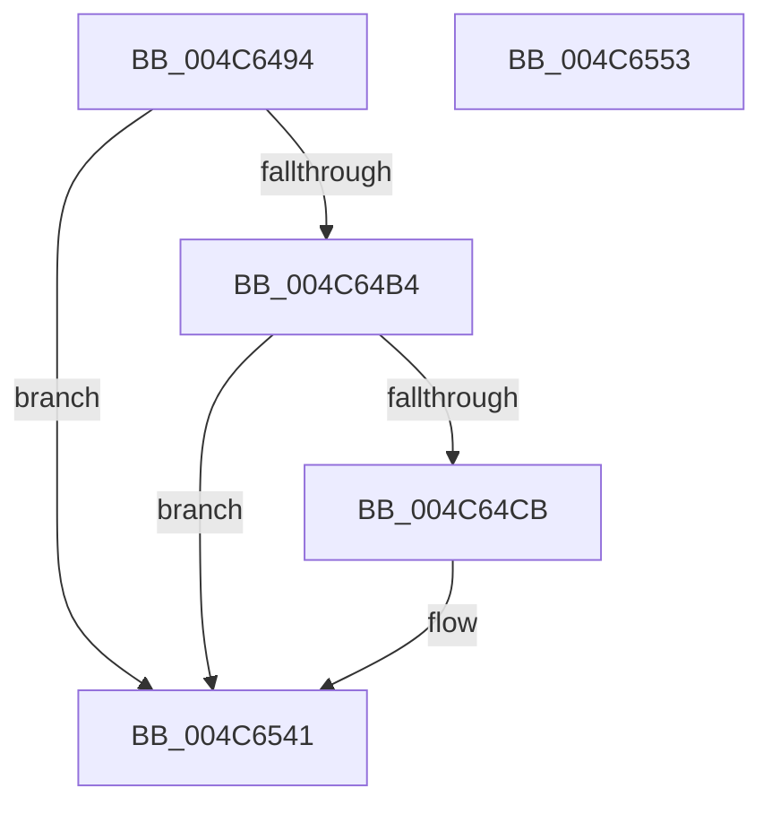

# PpmEventTraceLPIState

- RVA: `0x004C6494`–`0x004C6554` (길이 `192` bytes)
- VA: `0x00000001404C6494`
- 실행 섹션: `.text`
- PDB 이름 있음: `예`; PDB Function 태그: `아니요`
- unwind 정보 RVA: `0x000986E4`
- 디코드: `40`개 명령, `192/192` bytes 표시
- 미해석 바이트: `0` (있으면 어셈블리에 `.byte`로 보존)

> 이 문서는 커널 이미지의 기계어와 PDB 기호를 분석해 생성했습니다. 4번과 5번은 함수 원형과 자료형을 바이너리 사용 방식에서 추정한 C 해석이며 원본 소스 복구 결과는 아닙니다.

## 1. Dependencies

- 직접 호출 지점: **3**; 고유 호출 대상: **3**
- 직접 호출자로 확인된 함수: **1**
- RIP 상대 이미지 참조: **6**

### Outgoing calls
- `0x004C64C2` → [EtwEventEnabled](../39/EtwEventEnabled_function_00392450.md) (function, `0x00392450`)
- `0x004C653C` → [EtwWriteEx](../25/EtwWriteEx_function_0025F0D0.md) (function, `0x0025F0D0`)
- `0x004C6549` → [_security_check_cookie](../6A/_security_check_cookie_function_006AC640.md) (function, `0x006AC640`)

### Direct callers
- [PpmEventTraceControlCallback](../../page/A5/PpmEventTraceControlCallback_function_00A51F60.md) at `0x00A520CA`

### Static image references
- `0x004C6498` → RVA `0x00E0A740` (`.data`; read)
- `0x004C64A7` → RVA `0x00E67A39` (`.data`; read)
- `0x004C64B4` → RVA `0x00F083E8` (`.data`; read)
- `0x004C64BB` → RVA `0x0001E268` (`.rdata`; read)
- `0x004C64CB` → RVA `0x00E67A40` (`.data`; read)
- `0x004C64F1` → RVA `0x00E67A3C` (`.data`; read)

## 2. Other-region calls and transfers

- 다른 실행 섹션으로 향하는 call: **0**
- 별도 외부 분기/꼬리 이동을 확인하지 못했습니다.

## 3. Assembly (complete function range)

```asm
004C6494  48 83 EC 78                     sub rsp, 0x78
004C6498  48 8B 05 A1 42 94 00            mov rax, qword ptr [rip + 0x9442a1]
004C649F  48 33 C4                        xor rax, rsp
004C64A2  48 89 44 24 68                  mov qword ptr [rsp + 0x68], rax
004C64A7  80 3D 8B 15 9A 00 00            cmp byte ptr [rip + 0x9a158b], 0
004C64AE  0F 84 8D 00 00 00               je 0x1404c6541
004C64B4  48 8B 0D 2D 1F A4 00            mov rcx, qword ptr [rip + 0xa41f2d]
004C64BB  48 8D 15 A6 7D B5 FF            lea rdx, [rip - 0x4a825a]
004C64C2  E8 89 BF EC FF                  call 0x140392450
004C64C7  84 C0                           test al, al
004C64C9  74 76                           je 0x1404c6541
004C64CB  8B 05 6F 15 9A 00               mov eax, dword ptr [rip + 0x9a156f]
004C64D1  48 8D 15 90 7D B5 FF            lea rdx, [rip - 0x4a8270]
004C64D8  83 64 24 54 00                  and dword ptr [rsp + 0x54], 0
004C64DD  B9 04 00 00 00                  mov ecx, 4
004C64E2  83 64 24 64 00                  and dword ptr [rsp + 0x64], 0
004C64E7  45 33 C9                        xor r9d, r9d
004C64EA  89 44 24 40                     mov dword ptr [rsp + 0x40], eax
004C64EE  45 33 C0                        xor r8d, r8d
004C64F1  8B 05 45 15 9A 00               mov eax, dword ptr [rip + 0x9a1545]
004C64F7  89 44 24 44                     mov dword ptr [rsp + 0x44], eax
004C64FB  48 8D 44 24 40                  lea rax, [rsp + 0x40]
004C6500  48 89 44 24 48                  mov qword ptr [rsp + 0x48], rax
004C6505  48 8D 44 24 44                  lea rax, [rsp + 0x44]
004C650A  48 89 44 24 58                  mov qword ptr [rsp + 0x58], rax
004C650F  48 8D 44 24 48                  lea rax, [rsp + 0x48]
004C6514  48 89 44 24 38                  mov qword ptr [rsp + 0x38], rax
004C6519  C7 44 24 30 02 00 00 00         mov dword ptr [rsp + 0x30], 2
004C6521  48 83 64 24 28 00               and qword ptr [rsp + 0x28], 0
004C6527  48 83 64 24 20 00               and qword ptr [rsp + 0x20], 0
004C652D  89 4C 24 50                     mov dword ptr [rsp + 0x50], ecx
004C6531  89 4C 24 60                     mov dword ptr [rsp + 0x60], ecx
004C6535  48 8B 0D AC 1E A4 00            mov rcx, qword ptr [rip + 0xa41eac]
004C653C  E8 8F 8B D9 FF                  call 0x14025f0d0
004C6541  48 8B 4C 24 68                  mov rcx, qword ptr [rsp + 0x68]
004C6546  48 33 CC                        xor rcx, rsp
004C6549  E8 F2 60 1E 00                  call 0x1406ac640
004C654E  48 83 C4 78                     add rsp, 0x78
004C6552  C3                              ret
004C6553  CC                              int3
```

## 4. C-style interpretation (structured pseudocode)

```c
__int64 __fastcall PpmEventTraceLPIState(__int64 a1, __int64 a2, int a3, int a4)
{
    __int64 result;
    __int64 v_rsp;
    unsigned __int64 v_stack_m10;
    unsigned int v_stack_m14;
    unsigned int v_stack_m18;
    unsigned __int64 v_stack_m20;
    unsigned int v_stack_m24;
    unsigned int v_stack_m28;
    unsigned __int64 v_stack_m30;
    unsigned int v_stack_m34;
    unsigned int v_stack_m38;
    unsigned __int64 v_stack_m40;
    unsigned int v_stack_m48;
    unsigned __int64 v_stack_m50;
    unsigned __int64 v_stack_m58;

    v_rsp = (v_rsp) - (120);
    result = (*(unsigned __int64 *)(v_rip + 9716385)) ^ (v_rsp);
    v_stack_m10 = result;
    if ((*(unsigned __int8 *)(v_rip + 10098059)) == 0) goto loc_004C6541;
    result = EtwEventEnabled(*(unsigned __int64 *)(v_rip + 10755885), v_rip - 4883034, a3, a4);
    if ((unsigned __int8)(result) != 0) {
        result = *(unsigned int *)(v_rip + 10098031);
        a2 = v_rip - 4883056;
        a1 = 4;
        a4 = 0;
        v_stack_m38 = (unsigned int)(result);
        a3 = 0;
        result = *(unsigned int *)(v_rip + 10097989);
        v_stack_m34 = (unsigned int)(result);
        result = v_stack_m38;
        v_stack_m30 = result;
        result = v_stack_m34;
        v_stack_m20 = result;
        result = v_stack_m30;
        v_stack_m40 = result;
        v_stack_m48 = 2;
        v_stack_m28 = (unsigned int)(a1);
        v_stack_m18 = (unsigned int)(a1);
        a1 = *(unsigned __int64 *)(v_rip + 10755756);
        result = EtwWriteEx(a1, a2, a3, a4);
    }
    a1 = (v_stack_m10) ^ (v_rsp);
    result = _security_check_cookie(a1, a2, a3, a4);
    v_rsp = (v_rsp) + (120);
    return result;
}
```

## 5. (Beta) C Style

```c
int64_t PpmEventTraceLPIState(int64_t Arg1, int64_t Arg2, int32_t Arg3, int32_t Arg4)
{
    int64_t result;
    int64_t local_rsp;
    uint64_t v_stack_m10;
    uint32_t v_stack_m14;
    uint32_t v_stack_m18;
    uint64_t v_stack_m20;
    uint32_t v_stack_m24;
    uint32_t v_stack_m28;
    uint64_t v_stack_m30;
    uint32_t v_stack_m34;
    uint32_t v_stack_m38;
    uint64_t v_stack_m40;
    uint32_t v_stack_m48;
    uint64_t v_stack_m50;
    uint64_t v_stack_m58;

    local_rsp = (local_rsp) - (120);
    result = (*(uint64_t *)(v_rip + 0x9442A1)) ^ (local_rsp);
    v_stack_m10 = result;
    if ((*(uint8_t *)(v_rip + 0x9A158B)) == 0) goto loc_004C6541;
    result = EtwEventEnabled(*(uint64_t *)(v_rip + 0xA41F2D), v_rip - 4883034, Arg3, Arg4);
    if ((uint8_t)(result) != 0) {
        result = *(uint32_t *)(v_rip + 0x9A156F);
        Arg2 = v_rip - 4883056;
        Arg1 = 4;
        Arg4 = 0;
        v_stack_m38 = (uint32_t)(result);
        Arg3 = 0;
        result = *(uint32_t *)(v_rip + 0x9A1545);
        v_stack_m34 = (uint32_t)(result);
        result = v_stack_m38;
        v_stack_m30 = result;
        result = v_stack_m34;
        v_stack_m20 = result;
        result = v_stack_m30;
        v_stack_m40 = result;
        v_stack_m48 = 2;
        v_stack_m28 = (uint32_t)(Arg1);
        v_stack_m18 = (uint32_t)(Arg1);
        Arg1 = *(uint64_t *)(v_rip + 0xA41EAC);
        result = EtwWriteEx(Arg1, Arg2, Arg3, Arg4);
    }
    Arg1 = (v_stack_m10) ^ (local_rsp);
    result = _security_check_cookie(Arg1, Arg2, Arg3, Arg4);
    local_rsp = (local_rsp) + (120);
    return result;
}
```

## 6. Execution-region graph

[열기: 2D/3D 그래프와 함수 탐색 컨트롤 패널](../../../control-panel.html?section=text&rva=0x004C6494&view=graph)

- 2D 그래프는 위에서 아래로 흐르고, 3D 그래프는 빈 공간을 드래그해 회전합니다. Shift+드래그는 이동, 휠은 확대·축소, 함수 노드 선택은 대상 보고서 이동입니다.

### Static fallback


