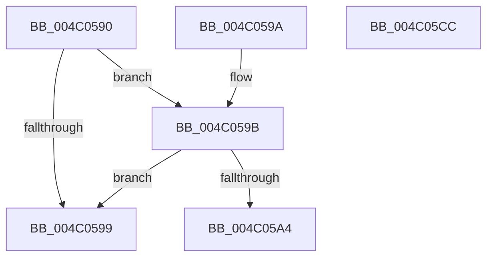

# PpmHeteroAcknowledgeWpsUpdateIntel

- RVA: `0x004C0590`–`0x004C05CD` (길이 `61` bytes)
- VA: `0x00000001404C0590`
- 실행 섹션: `.text`
- PDB 이름 있음: `예`; PDB Function 태그: `아니요`
- unwind 정보 RVA: `0x000DB714`
- 디코드: `18`개 명령, `61/61` bytes 표시
- 미해석 바이트: `0` (있으면 어셈블리에 `.byte`로 보존)

> 이 문서는 커널 이미지의 기계어와 PDB 기호를 분석해 생성했습니다. 4번과 5번은 함수 원형과 자료형을 바이너리 사용 방식에서 추정한 C 해석이며 원본 소스 복구 결과는 아닙니다.

## 1. Dependencies

- 직접 호출 지점: **0**; 고유 호출 대상: **0**
- 직접 호출자로 확인된 함수: **0**
- RIP 상대 이미지 참조: **2**

### Outgoing calls
- 직접 디코드된 call 명령이 없습니다.

### Direct callers
- 이 함수 시작 RVA로 연결되는 직접 call은 확인되지 않았습니다. 간접 호출은 완전히 역산할 수 없습니다.

### Static image references
- `0x004C0590` → RVA `0x00FC6A94` (`ALMOSTRO`; read)
- `0x004C059B` → RVA `0x00FC5003` (`ALMOSTRO`; read)

## 2. Other-region calls and transfers

- 다른 실행 섹션으로 향하는 call: **0**
- 별도 외부 분기/꼬리 이동을 확인하지 못했습니다.

## 3. Assembly (complete function range)

```asm
004C0590  80 3D FD 64 B0 00 00            cmp byte ptr [rip + 0xb064fd], 0
004C0597  75 02                           jne 0x1404c059b
004C0599  C3                              ret
004C059A  CC                              int3
004C059B  80 3D 61 4A B0 00 02            cmp byte ptr [rip + 0xb04a61], 2
004C05A2  75 F5                           jne 0x1404c0599
004C05A4  B9 B1 01 00 00                  mov ecx, 0x1b1
004C05A9  0F 32                           rdmsr
004C05AB  48 C1 E2 20                     shl rdx, 0x20
004C05AF  48 0B C2                        or rax, rdx
004C05B2  48 89 44 24 10                  mov qword ptr [rsp + 0x10], rax
004C05B7  0F BA 74 24 10 1A               btr dword ptr [rsp + 0x10], 0x1a
004C05BD  48 8B 54 24 10                  mov rdx, qword ptr [rsp + 0x10]
004C05C2  48 8B C2                        mov rax, rdx
004C05C5  48 C1 EA 20                     shr rdx, 0x20
004C05C9  0F 30                           wrmsr
004C05CB  C3                              ret
004C05CC  CC                              int3
```

## 4. C-style interpretation (structured pseudocode)

```c
__int64 __fastcall PpmHeteroAcknowledgeWpsUpdateIntel(__int64 a1, __int64 a2)
{
    __int64 result;
    unsigned __int64 v_stack_p10;

    if ((*(unsigned __int8 *)(v_rip + 11560189)) != 0) goto loc_004C059B;
loc_004C0599:
    return result;
loc_004C059B:
    if ((*(unsigned __int8 *)(v_rip + 11553377)) != 2) goto loc_004C0599;
    a2 = (a2) << (32);
    result = (result) | (a2);
    v_stack_p10 = result;
    a2 = (v_stack_p10) >> (32);
    return v_stack_p10;
}
```

## 5. (Beta) C Style

```c
int64_t PpmHeteroAcknowledgeWpsUpdateIntel(int64_t Arg1, int64_t Arg2)
{
    int64_t result;
    uint64_t v_stack_p10;

    if ((*(uint8_t *)(v_rip + 0xB064FD)) != 0) goto loc_004C059B;
loc_004C0599:
    return result;
loc_004C059B:
    if ((*(uint8_t *)(v_rip + 0xB04A61)) != 2) goto loc_004C0599;
    Arg2 = (Arg2) << (32);
    result = (result) | (Arg2);
    v_stack_p10 = result;
    Arg2 = (v_stack_p10) >> (32);
    return v_stack_p10;
}
```

## 6. Execution-region graph

[열기: 2D/3D 그래프와 함수 탐색 컨트롤 패널](../../../control-panel.html?section=text&rva=0x004C0590&view=graph)

- 2D 그래프는 위에서 아래로 흐르고, 3D 그래프는 빈 공간을 드래그해 회전합니다. Shift+드래그는 이동, 휠은 확대·축소, 함수 노드 선택은 대상 보고서 이동입니다.

### Static fallback


