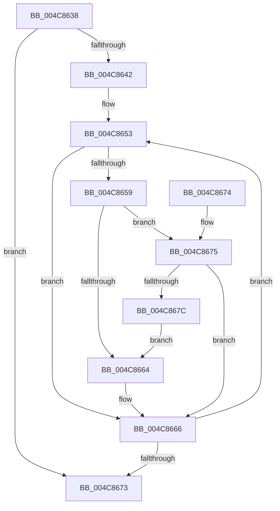

# PpmHeteroHgsEvaluateContainmentMinPolicyDecision

- RVA: `0x004C8638`–`0x004C867E` (길이 `70` bytes)
- VA: `0x00000001404C8638`
- 실행 섹션: `.text`
- PDB 이름 있음: `예`; PDB Function 태그: `아니요`
- unwind 정보 RVA: `0x000DB714`
- 디코드: `21`개 명령, `70/70` bytes 표시
- 미해석 바이트: `0` (있으면 어셈블리에 `.byte`로 보존)

> 이 문서는 커널 이미지의 기계어와 PDB 기호를 분석해 생성했습니다. 4번과 5번은 함수 원형과 자료형을 바이너리 사용 방식에서 추정한 C 해석이며 원본 소스 복구 결과는 아닙니다.

## 1. Dependencies

- 직접 호출 지점: **0**; 고유 호출 대상: **0**
- 직접 호출자로 확인된 함수: **2**
- RIP 상대 이미지 참조: **0**

### Outgoing calls
- 직접 디코드된 call 명령이 없습니다.

### Direct callers
- [PpmHeteroHgsEvaluateContainmentDecision](../4F/PpmHeteroHgsEvaluateContainmentDecision_function_004FBDE4.md) at `0x004FBDF6`
- [PpmEventTraceControlCallback](../../page/A5/PpmEventTraceControlCallback_function_00A51F60.md) at `0x00A5217C`

### Static image references
- 디코드된 RIP-relative 메모리 참조가 없습니다.

## 2. Other-region calls and transfers

- 다른 실행 섹션으로 향하는 call: **0**
- 별도 외부 분기/꼬리 이동을 확인하지 못했습니다.

## 3. Assembly (complete function range)

```asm
004C8638  0F B6 51 0C                     movzx edx, byte ptr [rcx + 0xc]
004C863C  32 C0                           xor al, al
004C863E  84 D2                           test dl, dl
004C8640  74 31                           je 0x1404c8673
004C8642  4C 8B 89 00 05 00 00            mov r9, qword ptr [rcx + 0x500]
004C8649  44 8B C2                        mov r8d, edx
004C864C  48 8B 89 08 05 00 00            mov rcx, qword ptr [rcx + 0x508]
004C8653  66 83 39 00                     cmp word ptr [rcx], 0
004C8657  74 0D                           je 0x1404c8666
004C8659  0F B7 51 02                     movzx edx, word ptr [rcx + 2]
004C865D  66 41 3B 51 08                  cmp dx, word ptr [r9 + 8]
004C8662  76 11                           jbe 0x1404c8675
004C8664  B0 01                           mov al, 1
004C8666  48 81 C1 80 02 00 00            add rcx, 0x280
004C866D  49 83 E8 01                     sub r8, 1
004C8671  75 E0                           jne 0x1404c8653
004C8673  C3                              ret
004C8674  CC                              int3
004C8675  66 41 3B 51 0A                  cmp dx, word ptr [r9 + 0xa]
004C867A  76 EA                           jbe 0x1404c8666
004C867C  EB E6                           jmp 0x1404c8664
```

## 4. C-style interpretation (structured pseudocode)

```c
__int64 __fastcall PpmHeteroHgsEvaluateContainmentMinPolicyDecision(__int64 a1)
{
    __int64 result;

    result = 0;
    if ((unsigned __int8)(*(unsigned __int8 *)(a1 + 12)) == 0) goto loc_004C8673;
loc_004C8653:
    if ((*(unsigned __int16 *)(*(unsigned __int64 *)(a1 + 1288))) == 0) goto loc_004C8666;
    if (((unsigned __int16)(*(unsigned __int16 *)(*(unsigned __int64 *)(a1 + 1288) + 2))) <= (*(unsigned __int16 *)(*(unsigned __int64 *)(a1 + 1280) + 8))) goto loc_004C8675;
loc_004C8664:
loc_004C8666:
    a1 = (*(unsigned __int64 *)(a1 + 1288)) + (640);
    a3 = ((unsigned int)((unsigned int)(*(unsigned __int8 *)(a1 + 12)))) - (1);
    if (condition_is_not_equal) goto loc_004C8653;
loc_004C8673:
    return 1;
loc_004C8675:
    if (((unsigned __int16)(*(unsigned __int16 *)(*(unsigned __int64 *)(a1 + 1288) + 2))) <= (*(unsigned __int16 *)(*(unsigned __int64 *)(a1 + 1280) + 10))) goto loc_004C8666;
    goto loc_004C8664;
}
```

## 5. (Beta) C Style

```c
int64_t PpmHeteroHgsEvaluateContainmentMinPolicyDecision(void *Arg1)
{
    uint8_t *arg1 = (uint8_t *)Arg1;

    int64_t result;

    result = 0;
    if ((uint8_t)(*(uint8_t *)(arg1 + 0xC)) == 0) goto loc_004C8673;
loc_004C8653:
    if ((*(uint16_t *)(*(uint64_t *)(arg1 + 0x508))) == 0) goto loc_004C8666;
    if (((uint16_t)(*(uint16_t *)(*(uint64_t *)(arg1 + 0x508) + 0x2))) <= (*(uint16_t *)(*(uint64_t *)(arg1 + 0x500) + 0x8))) goto loc_004C8675;
loc_004C8664:
loc_004C8666:
    Arg1 = (*(uint64_t *)(arg1 + 0x508)) + (640);
    a3 = ((uint32_t)((uint32_t)(*(uint8_t *)(arg1 + 0xC)))) - (1);
    if (condition_is_not_equal) goto loc_004C8653;
loc_004C8673:
    return 1;
loc_004C8675:
    if (((uint16_t)(*(uint16_t *)(*(uint64_t *)(arg1 + 0x508) + 0x2))) <= (*(uint16_t *)(*(uint64_t *)(arg1 + 0x500) + 0xA))) goto loc_004C8666;
    goto loc_004C8664;
}
```

### 관측된 메모리 오프셋

구조체 형식이 확인되지 않은 접근은 인자 기준의 오프셋으로만 기록했습니다.

| 기준 인자 | 오프셋 표현 | 폭 (bit) | 접근 |
|---|---:|---:|---|
| `Arg1` | `+ 0xC` | `8` | `R` |
| `Arg1` | `+ 0x500` | `64` | `R` |
| `Arg1` | `+ 0x508` | `64` | `R` |

## 6. Execution-region graph

[열기: 2D/3D 그래프와 함수 탐색 컨트롤 패널](../../../control-panel.html?section=text&rva=0x004C8638&view=graph)

- 2D 그래프는 위에서 아래로 흐르고, 3D 그래프는 빈 공간을 드래그해 회전합니다. Shift+드래그는 이동, 휠은 확대·축소, 함수 노드 선택은 대상 보고서 이동입니다.

### Static fallback


