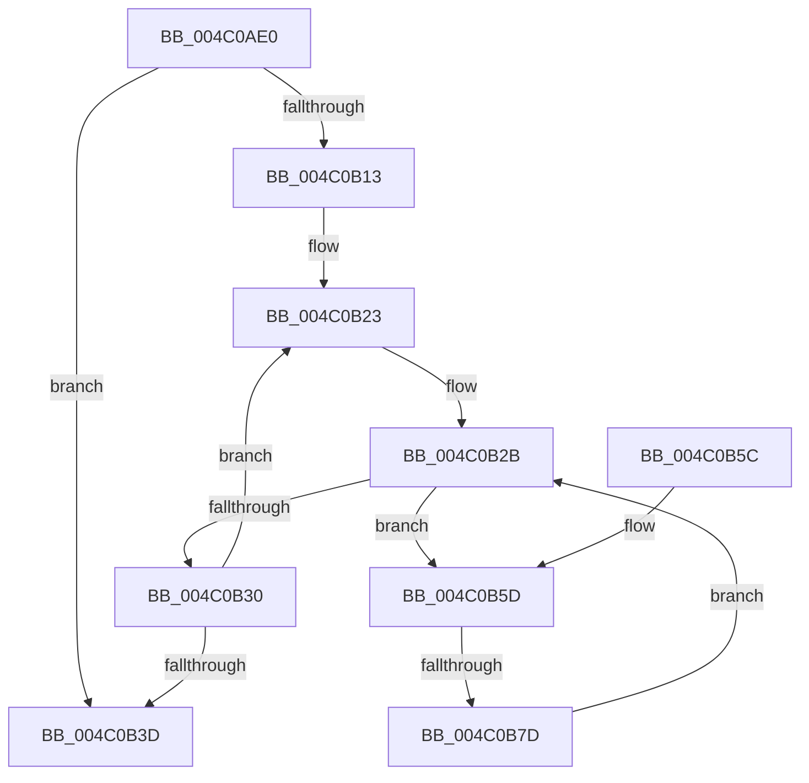

# PpmHeteroHgsGetContainmentType

- RVA: `0x004C0AE0`–`0x004C0B81` (길이 `161` bytes)
- VA: `0x00000001404C0AE0`
- 실행 섹션: `.text`
- PDB 이름 있음: `예`; PDB Function 태그: `예`
- unwind 정보 RVA: `0x000AF1B4`
- 디코드: `46`개 명령, `161/161` bytes 표시
- 미해석 바이트: `0` (있으면 어셈블리에 `.byte`로 보존)

> 이 문서는 커널 이미지의 기계어와 PDB 기호를 분석해 생성했습니다. 4번과 5번은 함수 원형과 자료형을 바이너리 사용 방식에서 추정한 C 해석이며 원본 소스 복구 결과는 아닙니다.

## 1. Dependencies

- 직접 호출 지점: **1**; 고유 호출 대상: **1**
- 직접 호출자로 확인된 함수: **1**
- RIP 상대 이미지 참조: **2**

### Outgoing calls
- `0x004C0B70` → [KeIsSubsetAffinityEx](../2C/KeIsSubsetAffinityEx_function_002CDC80.md) (function, `0x002CDC80`)

### Direct callers
- [PpmHeteroUpdateHgsConfiguration](../3B/PpmHeteroUpdateHgsConfiguration_function_003BF344.md) at `0x003BFC6C`

### Static image references
- `0x004C0B06` → RVA `0x00F083E0` (`.data`; read)
- `0x004C0B13` → RVA `0x00F083D8` (`.data`; read)

## 2. Other-region calls and transfers

- 다른 실행 섹션으로 향하는 call: **0**
- call이 아닌 외부 분기/꼬리 이동: **1**
  - `0x004C0B77` → [sub_006FCC08](../6F/Unknown_function_006FCC08.md) (`tail-transfer`)

## 3. Assembly (complete function range)

```asm
004C0AE0  48 8B C4                        mov rax, rsp
004C0AE3  48 89 58 08                     mov qword ptr [rax + 8], rbx
004C0AE7  48 89 68 10                     mov qword ptr [rax + 0x10], rbp
004C0AEB  48 89 70 18                     mov qword ptr [rax + 0x18], rsi
004C0AEF  48 89 78 20                     mov qword ptr [rax + 0x20], rdi
004C0AF3  41 54                           push r12
004C0AF5  41 56                           push r14
004C0AF7  41 57                           push r15
004C0AF9  48 83 EC 20                     sub rsp, 0x20
004C0AFD  4C 8B F2                        mov r14, rdx
004C0B00  C7 02 03 00 00 00               mov dword ptr [rdx], 3
004C0B06  8B 15 D4 78 A4 00               mov edx, dword ptr [rip + 0xa478d4]
004C0B0C  4C 8B E1                        mov r12, rcx
004C0B0F  85 D2                           test edx, edx
004C0B11  74 2A                           je 0x1404c0b3d
004C0B13  48 8B 35 BE 78 A4 00            mov rsi, qword ptr [rip + 0xa478be]
004C0B1A  8B EA                           mov ebp, edx
004C0B1C  48 81 C6 00 05 00 00            add rsi, 0x500
004C0B23  48 8B 3E                        mov rdi, qword ptr [rsi]
004C0B26  33 DB                           xor ebx, ebx
004C0B28  44 8B 3F                        mov r15d, dword ptr [rdi]
004C0B2B  41 3B DF                        cmp ebx, r15d
004C0B2E  72 2D                           jb 0x1404c0b5d
004C0B30  48 81 C6 10 05 00 00            add rsi, 0x510
004C0B37  48 83 ED 01                     sub rbp, 1
004C0B3B  75 E6                           jne 0x1404c0b23
004C0B3D  48 8B 5C 24 40                  mov rbx, qword ptr [rsp + 0x40]
004C0B42  48 8B 6C 24 48                  mov rbp, qword ptr [rsp + 0x48]
004C0B47  48 8B 74 24 50                  mov rsi, qword ptr [rsp + 0x50]
004C0B4C  48 8B 7C 24 58                  mov rdi, qword ptr [rsp + 0x58]
004C0B51  48 83 C4 20                     add rsp, 0x20
004C0B55  41 5F                           pop r15
004C0B57  41 5E                           pop r14
004C0B59  41 5C                           pop r12
004C0B5B  C3                              ret
004C0B5C  CC                              int3
004C0B5D  8B C3                           mov eax, ebx
004C0B5F  49 8B CC                        mov rcx, r12
004C0B62  48 69 D0 08 01 00 00            imul rdx, rax, 0x108
004C0B69  48 83 C2 10                     add rdx, 0x10
004C0B6D  48 03 D7                        add rdx, rdi
004C0B70  E8 0B D1 E0 FF                  call 0x1402cdc80
004C0B75  85 C0                           test eax, eax
004C0B77  0F 85 8B C0 23 00               jne 0x1406fcc08
004C0B7D  FF C3                           inc ebx
004C0B7F  EB AA                           jmp 0x1404c0b2b
```

## 4. C-style interpretation (structured pseudocode)

```c
__int64 __fastcall PpmHeteroHgsGetContainmentType(__int64 a1, __int64 a2)
{
    __int64 result;
    __int64 v_rbp;
    __int64 v_rbx;
    __int64 v_rsi;
    __int64 v_rsp;
    unsigned __int64 v_stack_p10;
    unsigned __int64 v_stack_p18;
    unsigned __int64 v_stack_p20;
    unsigned __int64 v_stack_p8;

    *(unsigned __int64 *)(v_rsp + 8) = v_rbx;
    *(unsigned __int64 *)(v_rsp + 16) = v_rbp;
    *(unsigned __int64 *)(v_rsp + 24) = v_rsi;
    *(unsigned __int64 *)(v_rsp + 32) = v_rdi;
    v_rsp = (v_rsp) - (32);
    *(unsigned int *)(a2) = 3;
    if ((unsigned int)((unsigned int)(*(unsigned int *)(v_rip + 10778836))) == 0) goto loc_004C0B3D;
    v_rsi = (*(unsigned __int64 *)(v_rip + 10778814)) + (0x500ULL);
loc_004C0B23:
    v_rbx = 0;
loc_004C0B2B:
    if (0 < ((unsigned int)((unsigned int)(*(unsigned int *)(*(unsigned __int64 *)(v_rsi)))))) goto loc_004C0B5D;
    v_rsi = (v_rsi) + (0x510ULL);
    v_rbp = ((unsigned int)((unsigned int)((unsigned int)(*(unsigned int *)(v_rip + 10778836))))) - (1);
    if (condition_is_not_equal) goto loc_004C0B23;
loc_004C0B3D:
    v_rsp = (v_rsp) + (32);
    return v_rsp;
loc_004C0B5D:
    a2 = ((unsigned int)(*(unsigned int *)(v_rip + 10778836))) * ((unsigned int)((unsigned int)(v_stack_p8)));
    a2 = (a2) + (16);
    a2 = (a2) + (v_stack_p20);
    result = KeIsSubsetAffinityEx(a1, a2, a3, a4);
    v_rbx = (unsigned int)((v_stack_p8) + 1);
    goto loc_004C0B2B;
}
```

## 5. (Beta) C Style

```c
int64_t PpmHeteroHgsGetContainmentType(int64_t Arg1, void *Arg2)
{
    uint8_t *arg2 = (uint8_t *)Arg2;

    int64_t result;
    int64_t local_rbp;
    int64_t local_rbx;
    int64_t local_rsi;
    int64_t local_rsp;
    uint64_t v_stack_p10;
    uint64_t v_stack_p18;
    uint64_t v_stack_p20;
    uint64_t v_stack_p8;

    *(uint64_t *)(local_rsp + 0x8) = local_rbx;
    *(uint64_t *)(local_rsp + 0x10) = local_rbp;
    *(uint64_t *)(local_rsp + 0x18) = local_rsi;
    *(uint64_t *)(local_rsp + 0x20) = local_rdi;
    local_rsp = (local_rsp) - (32);
    *(uint32_t *)(arg2) = 3;
    if ((uint32_t)((uint32_t)(*(uint32_t *)(v_rip + 0xA478D4))) == 0) goto loc_004C0B3D;
    local_rsi = (*(uint64_t *)(v_rip + 0xA478BE)) + (0x500ULL);
loc_004C0B23:
    local_rbx = 0;
loc_004C0B2B:
    if (0 < ((uint32_t)((uint32_t)(*(uint32_t *)(*(uint64_t *)(local_rsi)))))) goto loc_004C0B5D;
    local_rsi = (local_rsi) + (0x510ULL);
    local_rbp = ((uint32_t)((uint32_t)((uint32_t)(*(uint32_t *)(v_rip + 0xA478D4))))) - (1);
    if (condition_is_not_equal) goto loc_004C0B23;
loc_004C0B3D:
    local_rsp = (local_rsp) + (32);
    return local_rsp;
loc_004C0B5D:
    Arg2 = ((uint32_t)(*(uint32_t *)(v_rip + 0xA478D4))) * ((uint32_t)((uint32_t)(v_stack_p8)));
    Arg2 = (Arg2) + (16);
    Arg2 = (Arg2) + (v_stack_p20);
    result = KeIsSubsetAffinityEx(Arg1, Arg2, a3, a4);
    local_rbx = (uint32_t)((v_stack_p8) + 1);
    goto loc_004C0B2B;
}
```

### 관측된 메모리 오프셋

구조체 형식이 확인되지 않은 접근은 인자 기준의 오프셋으로만 기록했습니다.

| 기준 인자 | 오프셋 표현 | 폭 (bit) | 접근 |
|---|---:|---:|---|
| `Arg2` | `+ 0x0` | `32` | `W` |

## 6. Execution-region graph

[열기: 2D/3D 그래프와 함수 탐색 컨트롤 패널](../../../control-panel.html?section=text&rva=0x004C0AE0&view=graph)

- 2D 그래프는 위에서 아래로 흐르고, 3D 그래프는 빈 공간을 드래그해 회전합니다. Shift+드래그는 이동, 휠은 확대·축소, 함수 노드 선택은 대상 보고서 이동입니다.

### Static fallback


