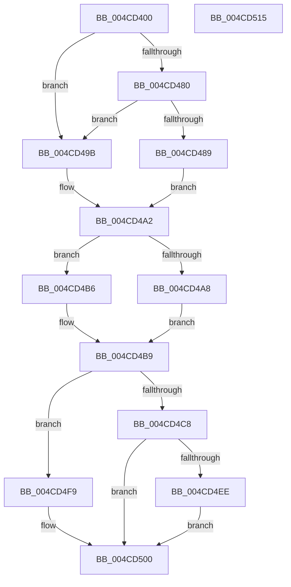

# PpmIdleEvaluateConstraints

- RVA: `0x004CD400`–`0x004CD516` (길이 `278` bytes)
- VA: `0x00000001404CD400`
- 실행 섹션: `.text`
- PDB 이름 있음: `예`; PDB Function 태그: `아니요`
- unwind 정보 RVA: `0x000A9ACC`
- 디코드: `62`개 명령, `278/278` bytes 표시
- 미해석 바이트: `0` (있으면 어셈블리에 `.byte`로 보존)

> 이 문서는 커널 이미지의 기계어와 PDB 기호를 분석해 생성했습니다. 4번과 5번은 함수 원형과 자료형을 바이너리 사용 방식에서 추정한 C 해석이며 원본 소스 복구 결과는 아닙니다.

## 1. Dependencies

- 직접 호출 지점: **2**; 고유 호출 대상: **2**
- 직접 호출자로 확인된 함수: **1**
- RIP 상대 이미지 참조: **3**

### Outgoing calls
- `0x004CD426` → [RtlGetInterruptTimePrecise](../20/RtlGetInterruptTimePrecise_function_0020A4C0.md) (function, `0x0020A4C0`)
- `0x004CD480` → [PoAllProcessorsDeepIdle](../5C/PoAllProcessorsDeepIdle_function_005CF1C4.md) (function, `0x005CF1C4`)

### Direct callers
- [PpmIdleSelectStates](../2C/PpmIdleSelectStates_function_002CFFE8.md) at `0x002D00F3`

### Static image references
- `0x004CD4BF` → RVA `0x00FC6BA6` (`ALMOSTRO`; read)
- `0x004CD4C8` → RVA `0x00E08380` (`.data`; read)
- `0x004CD4CF` → RVA `0x00F0CE0C` (`.data`; read)

## 2. Other-region calls and transfers

- 다른 실행 섹션으로 향하는 call: **0**
- 별도 외부 분기/꼬리 이동을 확인하지 못했습니다.

## 3. Assembly (complete function range)

```asm
004CD400  48 8B C4                        mov rax, rsp
004CD403  48 89 58 10                     mov qword ptr [rax + 0x10], rbx
004CD407  48 89 70 18                     mov qword ptr [rax + 0x18], rsi
004CD40B  57                              push rdi
004CD40C  48 83 EC 20                     sub rsp, 0x20
004CD410  48 8B B1 40 88 00 00            mov rsi, qword ptr [rcx + 0x8840]
004CD417  48 8B F9                        mov rdi, rcx
004CD41A  48 83 60 08 00                  and qword ptr [rax + 8], 0
004CD41F  48 8D 48 08                     lea rcx, [rax + 8]
004CD423  48 8B DA                        mov rbx, rdx
004CD426  E8 95 D0 D3 FF                  call 0x14020a4c0
004CD42B  48 89 03                        mov qword ptr [rbx], rax
004CD42E  48 8B 44 24 30                  mov rax, qword ptr [rsp + 0x30]
004CD433  48 89 86 A0 02 00 00            mov qword ptr [rsi + 0x2a0], rax
004CD43A  48 8B 87 10 89 00 00            mov rax, qword ptr [rdi + 0x8910]
004CD441  48 03 87 58 88 00 00            add rax, qword ptr [rdi + 0x8858]
004CD448  48 89 86 A8 02 00 00            mov qword ptr [rsi + 0x2a8], rax
004CD44F  8A 87 0C 8A 00 00               mov al, byte ptr [rdi + 0x8a0c]
004CD455  88 86 CA 02 00 00               mov byte ptr [rsi + 0x2ca], al
004CD45B  8A 87 84 88 00 00               mov al, byte ptr [rdi + 0x8884]
004CD461  88 86 C8 02 00 00               mov byte ptr [rsi + 0x2c8], al
004CD467  8A 87 85 88 00 00               mov al, byte ptr [rdi + 0x8885]
004CD46D  88 86 C9 02 00 00               mov byte ptr [rsi + 0x2c9], al
004CD473  C6 86 CB 02 00 00 01            mov byte ptr [rsi + 0x2cb], 1
004CD47A  80 7F 21 00                     cmp byte ptr [rdi + 0x21], 0
004CD47E  74 1B                           je 0x1404cd49b
004CD480  E8 3F 1D 10 00                  call 0x1405cf1c4
004CD485  84 C0                           test al, al
004CD487  74 12                           je 0x1404cd49b
004CD489  B8 80 00 00 00                  mov eax, 0x80
004CD48E  C6 86 CC 02 00 00 01            mov byte ptr [rsi + 0x2cc], 1
004CD495  66 09 46 38                     or word ptr [rsi + 0x38], ax
004CD499  EB 07                           jmp 0x1404cd4a2
004CD49B  C6 86 CC 02 00 00 00            mov byte ptr [rsi + 0x2cc], 0
004CD4A2  80 7E 01 00                     cmp byte ptr [rsi + 1], 0
004CD4A6  74 0E                           je 0x1404cd4b6
004CD4A8  B8 00 01 00 00                  mov eax, 0x100
004CD4AD  66 09 46 38                     or word ptr [rsi + 0x38], ax
004CD4B1  8B 46 24                        mov eax, dword ptr [rsi + 0x24]
004CD4B4  EB 03                           jmp 0x1404cd4b9
004CD4B6  83 C8 FF                        or eax, 0xffffffff
004CD4B9  89 86 C0 02 00 00               mov dword ptr [rsi + 0x2c0], eax
004CD4BF  80 3D E0 96 AF 00 00            cmp byte ptr [rip + 0xaf96e0], 0
004CD4C6  74 31                           je 0x1404cd4f9
004CD4C8  48 8B 15 B1 AE 93 00            mov rdx, qword ptr [rip + 0x93aeb1]
004CD4CF  48 63 05 36 F9 A3 00            movsxd rax, dword ptr [rip + 0xa3f936]
004CD4D6  48 69 C8 E8 01 00 00            imul rcx, rax, 0x1e8
004CD4DD  8A 84 11 D6 00 00 00            mov al, byte ptr [rcx + rdx + 0xd6]
004CD4E4  88 86 CE 02 00 00               mov byte ptr [rsi + 0x2ce], al
004CD4EA  84 C0                           test al, al
004CD4EC  74 12                           je 0x1404cd500
004CD4EE  B8 00 40 00 00                  mov eax, 0x4000
004CD4F3  66 09 46 38                     or word ptr [rsi + 0x38], ax
004CD4F7  EB 07                           jmp 0x1404cd500
004CD4F9  C6 86 CE 02 00 00 00            mov byte ptr [rsi + 0x2ce], 0
004CD500  48 8B 44 24 30                  mov rax, qword ptr [rsp + 0x30]
004CD505  48 8B 5C 24 38                  mov rbx, qword ptr [rsp + 0x38]
004CD50A  48 8B 74 24 40                  mov rsi, qword ptr [rsp + 0x40]
004CD50F  48 83 C4 20                     add rsp, 0x20
004CD513  5F                              pop rdi
004CD514  C3                              ret
004CD515  CC                              int3
```

## 4. C-style interpretation (structured pseudocode)

```c
__int64 __fastcall PpmIdleEvaluateConstraints(__int64 a1, __int64 a2)
{
    __int64 result;
    __int64 v_rsp;
    unsigned __int64 v_stack_p10;
    unsigned __int64 v_stack_p18;
    unsigned __int64 v_stack_p8;

    *(unsigned __int64 *)(v_rsp + 16) = v_rbx;
    *(unsigned __int64 *)(v_rsp + 24) = v_rsi;
    v_rsp = (v_rsp) - (32);
    result = RtlGetInterruptTimePrecise(v_rsp + 8, a2, a3, a4);
    *(unsigned __int64 *)(a2) = result;
    *(unsigned __int64 *)(*(unsigned __int64 *)(a1 + 34880) + 672) = v_stack_p8;
    result = (*(unsigned __int64 *)(a1 + 35088)) + (*(unsigned __int64 *)(a1 + 34904));
    *(unsigned __int64 *)(*(unsigned __int64 *)(a1 + 34880) + 680) = result;
    *(unsigned __int8 *)(*(unsigned __int64 *)(a1 + 34880) + 714) = (unsigned __int8)(*(unsigned __int8 *)(a1 + 35340));
    *(unsigned __int8 *)(*(unsigned __int64 *)(a1 + 34880) + 712) = (unsigned __int8)(*(unsigned __int8 *)(a1 + 34948));
    *(unsigned __int8 *)(*(unsigned __int64 *)(a1 + 34880) + 713) = (unsigned __int8)(*(unsigned __int8 *)(a1 + 34949));
    *(unsigned __int8 *)(*(unsigned __int64 *)(a1 + 34880) + 715) = 1;
    if ((*(unsigned __int8 *)(a1 + 33)) == 0) goto loc_004CD49B;
    result = PoAllProcessorsDeepIdle(v_rsp + 8, a2, a3, a4);
    if ((unsigned __int8)(result) == 0) goto loc_004CD49B;
    *(unsigned __int8 *)(*(unsigned __int64 *)(a1 + 34880) + 716) = 1;
    goto loc_004CD4A2;
loc_004CD49B:
    *(unsigned __int8 *)(*(unsigned __int64 *)(a1 + 34880) + 716) = 0;
loc_004CD4A2:
    if ((*(unsigned __int8 *)(*(unsigned __int64 *)(a1 + 34880) + 1)) == 0) goto loc_004CD4B6;
    goto loc_004CD4B9;
loc_004CD4B6:
    result = (unsigned int)(((unsigned int)(*(unsigned int *)(*(unsigned __int64 *)(a1 + 34880) + 36))) | (0xFFFFFFFFULL));
loc_004CD4B9:
    *(unsigned int *)(*(unsigned __int64 *)(a1 + 34880) + 704) = (unsigned int)(result);
    if ((*(unsigned __int8 *)(v_rip + 11507424)) == 0) goto loc_004CD4F9;
    a1 = (v_rsp + 8) * ((int)(*(unsigned int *)(v_rip + 10746166)));
    *(unsigned __int8 *)(*(unsigned __int64 *)(a1 + 34880) + 718) = (unsigned __int8)(*(unsigned __int8 *)(a1 + *(unsigned __int64 *)(v_rip + 9678513) * 1 + 214));
    if ((unsigned __int8)(*(unsigned __int8 *)(a1 + *(unsigned __int64 *)(v_rip + 9678513) * 1 + 214)) == 0) goto loc_004CD500;
    goto loc_004CD500;
loc_004CD4F9:
    *(unsigned __int8 *)(*(unsigned __int64 *)(a1 + 34880) + 718) = 0;
loc_004CD500:
    v_rsp = (v_rsp) + (32);
    return v_stack_p8;
}
```

## 5. (Beta) C Style

```c
int64_t PpmIdleEvaluateConstraints(void *Arg1, void *Arg2)
{
    uint8_t *arg1 = (uint8_t *)Arg1;
    uint8_t *arg2 = (uint8_t *)Arg2;

    int64_t result;
    int64_t local_rsp;
    uint64_t v_stack_p10;
    uint64_t v_stack_p18;
    uint64_t v_stack_p8;

    *(uint64_t *)(local_rsp + 0x10) = local_rbx;
    *(uint64_t *)(local_rsp + 0x18) = local_rsi;
    local_rsp = (local_rsp) - (32);
    result = RtlGetInterruptTimePrecise(local_rsp + 8, Arg2, a3, a4);
    *(uint64_t *)(arg2) = result;
    *(uint64_t *)(*(uint64_t *)(arg1 + 0x8840) + 0x2A0) = v_stack_p8;
    result = (*(uint64_t *)(arg1 + 0x8910)) + (*(uint64_t *)(arg1 + 0x8858));
    *(uint64_t *)(*(uint64_t *)(arg1 + 0x8840) + 0x2A8) = result;
    *(uint8_t *)(*(uint64_t *)(arg1 + 0x8840) + 0x2CA) = (uint8_t)(*(uint8_t *)(arg1 + 0x8A0C));
    *(uint8_t *)(*(uint64_t *)(arg1 + 0x8840) + 0x2C8) = (uint8_t)(*(uint8_t *)(arg1 + 0x8884));
    *(uint8_t *)(*(uint64_t *)(arg1 + 0x8840) + 0x2C9) = (uint8_t)(*(uint8_t *)(arg1 + 0x8885));
    *(uint8_t *)(*(uint64_t *)(arg1 + 0x8840) + 0x2CB) = 1;
    if ((*(uint8_t *)(arg1 + 0x21)) == 0) goto loc_004CD49B;
    result = PoAllProcessorsDeepIdle(local_rsp + 8, Arg2, a3, a4);
    if ((uint8_t)(result) == 0) goto loc_004CD49B;
    *(uint8_t *)(*(uint64_t *)(arg1 + 0x8840) + 0x2CC) = 1;
    goto loc_004CD4A2;
loc_004CD49B:
    *(uint8_t *)(*(uint64_t *)(arg1 + 0x8840) + 0x2CC) = 0;
loc_004CD4A2:
    if ((*(uint8_t *)(*(uint64_t *)(arg1 + 0x8840) + 0x1)) == 0) goto loc_004CD4B6;
    goto loc_004CD4B9;
loc_004CD4B6:
    result = (uint32_t)(((uint32_t)(*(uint32_t *)(*(uint64_t *)(arg1 + 0x8840) + 0x24))) | (0xFFFFFFFFULL));
loc_004CD4B9:
    *(uint32_t *)(*(uint64_t *)(arg1 + 0x8840) + 0x2C0) = (uint32_t)(result);
    if ((*(uint8_t *)(v_rip + 0xAF96E0)) == 0) goto loc_004CD4F9;
    Arg1 = (local_rsp + 8) * ((int32_t)(*(uint32_t *)(v_rip + 0xA3F936)));
    *(uint8_t *)(*(uint64_t *)(arg1 + 0x8840) + 0x2CE) = (uint8_t)(*(uint8_t *)(arg1 + *(uint64_t *)(v_rip + 0x93AEB1) * 1 + 0xD6));
    if ((uint8_t)(*(uint8_t *)(arg1 + *(uint64_t *)(v_rip + 0x93AEB1) * 1 + 0xD6)) == 0) goto loc_004CD500;
    goto loc_004CD500;
loc_004CD4F9:
    *(uint8_t *)(*(uint64_t *)(arg1 + 0x8840) + 0x2CE) = 0;
loc_004CD500:
    local_rsp = (local_rsp) + (32);
    return v_stack_p8;
}
```

### 관측된 메모리 오프셋

구조체 형식이 확인되지 않은 접근은 인자 기준의 오프셋으로만 기록했습니다.

| 기준 인자 | 오프셋 표현 | 폭 (bit) | 접근 |
|---|---:|---:|---|
| `Arg1` | `+ 0x21` | `8` | `R` |
| `Arg1` | `+ 0x8840` | `64` | `R` |
| `Arg1` | `+ 0x8858` | `64` | `R` |
| `Arg1` | `+ 0x8884` | `8` | `R` |
| `Arg1` | `+ 0x8885` | `8` | `R` |
| `Arg1` | `+ 0x8910` | `64` | `R` |
| `Arg1` | `+ 0x8A0C` | `8` | `R` |
| `Arg2` | `+ 0x0` | `64` | `W` |

## 6. Execution-region graph

[열기: 2D/3D 그래프와 함수 탐색 컨트롤 패널](../../../control-panel.html?section=text&rva=0x004CD400&view=graph)

- 2D 그래프는 위에서 아래로 흐르고, 3D 그래프는 빈 공간을 드래그해 회전합니다. Shift+드래그는 이동, 휠은 확대·축소, 함수 노드 선택은 대상 보고서 이동입니다.

### Static fallback


