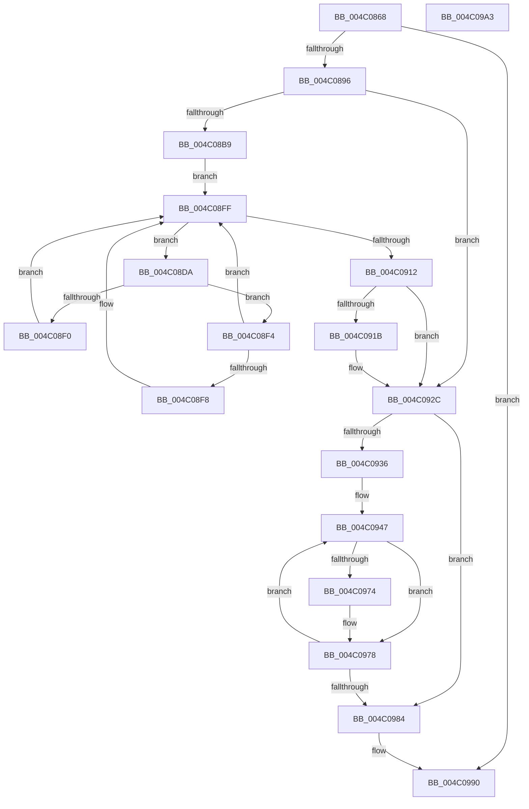

# PpmParkEvalualteSmtUnparkPolicy

- RVA: `0x004C0868`–`0x004C09A4` (길이 `316` bytes)
- VA: `0x00000001404C0868`
- 실행 섹션: `.text`
- PDB 이름 있음: `예`; PDB Function 태그: `아니요`
- unwind 정보 RVA: `0x00099F28`
- 디코드: `79`개 명령, `316/316` bytes 표시
- 미해석 바이트: `0` (있으면 어셈블리에 `.byte`로 보존)

> 이 문서는 커널 이미지의 기계어와 PDB 기호를 분석해 생성했습니다. 4번과 5번은 함수 원형과 자료형을 바이너리 사용 방식에서 추정한 C 해석이며 원본 소스 복구 결과는 아닙니다.

## 1. Dependencies

- 직접 호출 지점: **2**; 고유 호출 대상: **2**
- 직접 호출자로 확인된 함수: **2**
- RIP 상대 이미지 참조: **13**

### Outgoing calls
- `0x004C08DE` → [KeGetPrcb](../2D/KeGetPrcb_function_002D85D0.md) (function, `0x002D85D0`)
- `0x004C0909` → [KeEnumerateNextProcessor](../41/KeEnumerateNextProcessor_function_00415480.md) (function, `0x00415480`)

### Direct callers
- [PpmParkApplyPolicy](../4B/PpmParkApplyPolicy_function_004B613C.md) at `0x004B61AB`
- [PpmParkApplyPolicyEx](../4F/PpmParkApplyPolicyEx_function_004F3090.md) at `0x004F3139`

### Static image references
- `0x004C0880` → RVA `0x00E0B978` (`.data`; read)
- `0x004C0899` → RVA `0x00F083A0` (`.data`; write)
- `0x004C08A7` → RVA `0x00F083A2` (`.data`; write)
- `0x004C08AF` → RVA `0x00F083C1` (`.data`; write)
- `0x004C08B9` → RVA `0x00E0B5A8` (`.data`; read)
- `0x004C08C7` → RVA `0x00E0B5A0` (`.data`; read)
- `0x004C0912` → RVA `0x00F083C1` (`.data`; read)
- `0x004C092C` → RVA `0x00F083E0` (`.data`; read)
- `0x004C0936` → RVA `0x00F083D8` (`.data`; read)
- `0x004C0947` → RVA `0x00FC5100` (`ALMOSTRO`; read)
- `0x004C0968` → RVA `0x00F083A2` (`.data`; read)
- `0x004C0984` → RVA `0x00E0B978` (`.data`; write)
- `0x004C098A` → RVA `0x00F23450` (`.data`; write)

## 2. Other-region calls and transfers

- 다른 실행 섹션으로 향하는 call: **0**
- 별도 외부 분기/꼬리 이동을 확인하지 못했습니다.

## 3. Assembly (complete function range)

```asm
004C0868  48 8B C4                        mov rax, rsp
004C086B  48 89 58 10                     mov qword ptr [rax + 0x10], rbx
004C086F  48 89 68 18                     mov qword ptr [rax + 0x18], rbp
004C0873  56                              push rsi
004C0874  57                              push rdi
004C0875  41 56                           push r14
004C0877  48 83 EC 40                     sub rsp, 0x40
004C087B  33 ED                           xor ebp, ebp
004C087D  0F B6 D9                        movzx ebx, cl
004C0880  39 1D F2 B0 94 00               cmp dword ptr [rip + 0x94b0f2], ebx
004C0886  89 68 DA                        mov dword ptr [rax - 0x26], ebp
004C0889  66 89 68 DE                     mov word ptr [rax - 0x22], bp
004C088D  89 68 08                        mov dword ptr [rax + 8], ebp
004C0890  0F 84 FA 00 00 00               je 0x1404c0990
004C0896  80 FB 02                        cmp bl, 2
004C0899  40 88 2D 00 7B A4 00            mov byte ptr [rip + 0xa47b00], bpl
004C08A0  44 8D 75 01                     lea r14d, [rbp + 1]
004C08A4  0F 92 C0                        setb al
004C08A7  66 44 89 35 F3 7A A4 00         mov word ptr [rip + 0xa47af3], r14w
004C08AF  88 05 0C 7B A4 00               mov byte ptr [rip + 0xa47b0c], al
004C08B5  84 C0                           test al, al
004C08B7  74 73                           je 0x1404c092c
004C08B9  48 8B 05 E8 AC 94 00            mov rax, qword ptr [rip + 0x94ace8]
004C08C0  8B FD                           mov edi, ebp
004C08C2  48 89 44 24 28                  mov qword ptr [rsp + 0x28], rax
004C08C7  48 8D 05 D2 AC 94 00            lea rax, [rip + 0x94acd2]
004C08CE  48 89 44 24 20                  mov qword ptr [rsp + 0x20], rax
004C08D3  66 89 6C 24 30                  mov word ptr [rsp + 0x30], bp
004C08D8  EB 25                           jmp 0x1404c08ff
004C08DA  8B 4C 24 60                     mov ecx, dword ptr [rsp + 0x60]
004C08DE  E8 ED 7C E1 FF                  call 0x1402d85d0
004C08E3  F3 48 0F B8 88 60 8E 00 00      popcnt rcx, qword ptr [rax + 0x8e60]
004C08EC  85 FF                           test edi, edi
004C08EE  75 04                           jne 0x1404c08f4
004C08F0  8B F9                           mov edi, ecx
004C08F2  EB 0B                           jmp 0x1404c08ff
004C08F4  3B F9                           cmp edi, ecx
004C08F6  74 07                           je 0x1404c08ff
004C08F8  40 88 2D C2 7A A4 00            mov byte ptr [rip + 0xa47ac2], bpl
004C08FF  48 8D 54 24 20                  lea rdx, [rsp + 0x20]
004C0904  48 8D 4C 24 60                  lea rcx, [rsp + 0x60]
004C0909  E8 72 4B F5 FF                  call 0x140415480
004C090E  85 C0                           test eax, eax
004C0910  74 C8                           je 0x1404c08da
004C0912  40 38 2D A8 7A A4 00            cmp byte ptr [rip + 0xa47aa8], bpl
004C0919  74 11                           je 0x1404c092c
004C091B  41 3A DE                        cmp bl, r14b
004C091E  66 89 3D 7D 7A A4 00            mov word ptr [rip + 0xa47a7d], di
004C0925  0F 94 05 74 7A A4 00            sete byte ptr [rip + 0xa47a74]
004C092C  8B 0D AE 7A A4 00               mov ecx, dword ptr [rip + 0xa47aae]
004C0932  85 C9                           test ecx, ecx
004C0934  74 4E                           je 0x1404c0984
004C0936  4C 8B 05 9B 7A A4 00            mov r8, qword ptr [rip + 0xa47a9b]
004C093D  44 8B C9                        mov r9d, ecx
004C0940  49 81 C0 9E 04 00 00            add r8, 0x49e
004C0947  44 39 35 B2 47 B0 00            cmp dword ptr [rip + 0xb047b2], r14d
004C094E  41 8B CE                        mov ecx, r14d
004C0951  41 0F B7 80 6C FB FF FF         movzx eax, word ptr [r8 - 0x494]
004C0959  0F 42 0D A0 47 B0 00            cmovb ecx, dword ptr [rip + 0xb047a0]
004C0960  33 D2                           xor edx, edx
004C0962  F7 F1                           div ecx
004C0964  66 41 89 00                     mov word ptr [r8], ax
004C0968  0F B7 0D 33 7A A4 00            movzx ecx, word ptr [rip + 0xa47a33]
004C096F  66 3B C1                        cmp ax, cx
004C0972  73 04                           jae 0x1404c0978
004C0974  66 41 89 08                     mov word ptr [r8], cx
004C0978  49 81 C0 10 05 00 00            add r8, 0x510
004C097F  4D 2B CE                        sub r9, r14
004C0982  75 C3                           jne 0x1404c0947
004C0984  89 1D EE AF 94 00               mov dword ptr [rip + 0x94afee], ebx
004C098A  88 1D C0 2A A6 00               mov byte ptr [rip + 0xa62ac0], bl
004C0990  48 8B 5C 24 68                  mov rbx, qword ptr [rsp + 0x68]
004C0995  48 8B 6C 24 70                  mov rbp, qword ptr [rsp + 0x70]
004C099A  48 83 C4 40                     add rsp, 0x40
004C099E  41 5E                           pop r14
004C09A0  5F                              pop rdi
004C09A1  5E                              pop rsi
004C09A2  C3                              ret
004C09A3  CC                              int3
```

## 4. C-style interpretation (structured pseudocode)

```c
__int64 __fastcall PpmParkEvalualteSmtUnparkPolicy(unsigned __int8 a1)
{
    __int64 result;
    __int64 v_rbp;
    __int64 v_rsp;
    unsigned __int16 v_stack_m28;
    unsigned __int64 v_stack_m30;
    unsigned __int64 v_stack_m38;
    unsigned __int64 v_stack_p10;
    unsigned __int64 v_stack_p18;
    unsigned int v_stack_p8;

    *(unsigned __int64 *)(v_rsp + 16) = v_rbx;
    *(unsigned __int64 *)(v_rsp + 24) = v_rbp;
    v_rsp = (v_rsp) - (64);
    v_rbp = 0;
    *(unsigned int *)(v_rsp - 38) = 0;
    *(unsigned __int16 *)(v_rsp - 34) = 0;
    *(unsigned int *)(v_rsp + 8) = 0;
    if ((*(unsigned int *)(v_rip + 9744626)) == a1) goto loc_004C0990;
    *(unsigned __int8 *)(v_rip + 10779392) = 0;
    result = (a1 < 2) ? 1 : 0;
    *(unsigned __int16 *)(v_rip + 10779379) = (unsigned __int16)(v_rbp + 1);
    *(unsigned __int8 *)(v_rip + 10779404) = (unsigned __int8)(result);
    if ((unsigned __int8)(result) == 0) goto loc_004C092C;
    v_stack_m30 = *(unsigned __int64 *)(v_rip + 9743592);
    v_stack_m38 = v_rip + 9743570;
    v_stack_m28 = 0;
    goto loc_004C08FF;
loc_004C08DA:
    result = KeGetPrcb((unsigned int)(v_stack_p8), a2, a3, a4);
    if (0 != 0) goto loc_004C08F4;
    goto loc_004C08FF;
loc_004C08F4:
    if (((unsigned int)((unsigned int)((unsigned int)((unsigned int)(v_stack_p8))))) != ((unsigned int)((unsigned int)(v_stack_p8)))) {
        *(unsigned __int8 *)(v_rip + 10779330) = 0;
    }
    result = KeEnumerateNextProcessor(v_stack_p8, v_stack_m38, a3, a4);
    if ((unsigned int)(result) == 0) goto loc_004C08DA;
    if ((*(unsigned __int8 *)(v_rip + 10779304)) != 0) {
        *(unsigned __int16 *)(v_rip + 10779261) = (unsigned __int16)((unsigned int)((unsigned int)((unsigned int)(v_stack_p8))));
    }
    if ((unsigned int)((unsigned int)(*(unsigned int *)(v_rip + 10779310))) == 0) goto loc_004C0984;
    a3 = (*(unsigned __int64 *)(v_rip + 10779291)) + (0x49EULL);
loc_004C0947:
    a1 = (unsigned int)((unsigned int)(v_rbp + 1));
    if ((*(unsigned int *)(v_rip + 11552690)) < ((unsigned int)(v_rbp + 1))) { a1 = *(unsigned int *)(v_rip + 11552672); }
    a2 = 0;
    *(unsigned __int16 *)(a3) = (unsigned __int16)(*(unsigned __int16 *)(a3 - 1172));
    if (((unsigned __int16)(*(unsigned __int16 *)(a3 - 1172))) < ((unsigned __int16)(*(unsigned __int16 *)(v_rip + 10779187)))) {
        *(unsigned __int16 *)(a3) = (unsigned __int16)(*(unsigned __int16 *)(v_rip + 10779187));
    }
    a3 = (a3) + (0x510ULL);
    a4 = ((unsigned int)((unsigned int)((unsigned int)(*(unsigned int *)(v_rip + 10779310))))) - (v_rbp + 1);
    if (condition_is_not_equal) goto loc_004C0947;
loc_004C0984:
    *(unsigned int *)(v_rip + 9744366) = a1;
    *(unsigned __int8 *)(v_rip + 10889920) = a1;
loc_004C0990:
    v_rsp = (v_rsp) + (64);
    return *(unsigned __int16 *)(a3 - 1172);
}
```

## 5. (Beta) C Style

```c
int64_t PpmParkEvalualteSmtUnparkPolicy(uint8_t Arg1)
{
    int64_t result;
    int64_t local_rbp;
    int64_t local_rsp;
    uint16_t v_stack_m28;
    uint64_t v_stack_m30;
    uint64_t v_stack_m38;
    uint64_t v_stack_p10;
    uint64_t v_stack_p18;
    uint32_t v_stack_p8;

    *(uint64_t *)(local_rsp + 0x10) = local_rbx;
    *(uint64_t *)(local_rsp + 0x18) = local_rbp;
    local_rsp = (local_rsp) - (64);
    local_rbp = 0;
    *(uint32_t *)(local_rsp - 0x26) = 0;
    *(uint16_t *)(local_rsp - 0x22) = 0;
    *(uint32_t *)(local_rsp + 0x8) = 0;
    if ((*(uint32_t *)(v_rip + 0x94B0F2)) == Arg1) goto loc_004C0990;
    *(uint8_t *)(v_rip + 0xA47B00) = 0;
    result = (Arg1 < 2) ? 1 : 0;
    *(uint16_t *)(v_rip + 0xA47AF3) = (uint16_t)(local_rbp + 1);
    *(uint8_t *)(v_rip + 0xA47B0C) = (uint8_t)(result);
    if ((uint8_t)(result) == 0) goto loc_004C092C;
    v_stack_m30 = *(uint64_t *)(v_rip + 0x94ACE8);
    v_stack_m38 = v_rip + 9743570;
    v_stack_m28 = 0;
    goto loc_004C08FF;
loc_004C08DA:
    result = KeGetPrcb((uint32_t)(v_stack_p8), a2, a3, a4);
    if (0 != 0) goto loc_004C08F4;
    goto loc_004C08FF;
loc_004C08F4:
    if (((uint32_t)((uint32_t)((uint32_t)((uint32_t)(v_stack_p8))))) != ((uint32_t)((uint32_t)(v_stack_p8)))) {
        *(uint8_t *)(v_rip + 0xA47AC2) = 0;
    }
    result = KeEnumerateNextProcessor(v_stack_p8, v_stack_m38, a3, a4);
    if ((uint32_t)(result) == 0) goto loc_004C08DA;
    if ((*(uint8_t *)(v_rip + 0xA47AA8)) != 0) {
        *(uint16_t *)(v_rip + 0xA47A7D) = (uint16_t)((uint32_t)((uint32_t)((uint32_t)(v_stack_p8))));
    }
    if ((uint32_t)((uint32_t)(*(uint32_t *)(v_rip + 0xA47AAE))) == 0) goto loc_004C0984;
    a3 = (*(uint64_t *)(v_rip + 0xA47A9B)) + (0x49EULL);
loc_004C0947:
    Arg1 = (uint32_t)((uint32_t)(local_rbp + 1));
    if ((*(uint32_t *)(v_rip + 0xB047B2)) < ((uint32_t)(local_rbp + 1))) { Arg1 = *(uint32_t *)(v_rip + 0xB047A0); }
    a2 = 0;
    *(uint16_t *)(a3) = (uint16_t)(*(uint16_t *)(a3 - 0x494));
    if (((uint16_t)(*(uint16_t *)(a3 - 0x494))) < ((uint16_t)(*(uint16_t *)(v_rip + 0xA47A33)))) {
        *(uint16_t *)(a3) = (uint16_t)(*(uint16_t *)(v_rip + 0xA47A33));
    }
    a3 = (a3) + (0x510ULL);
    a4 = ((uint32_t)((uint32_t)((uint32_t)(*(uint32_t *)(v_rip + 0xA47AAE))))) - (local_rbp + 1);
    if (condition_is_not_equal) goto loc_004C0947;
loc_004C0984:
    *(uint32_t *)(v_rip + 0x94AFEE) = Arg1;
    *(uint8_t *)(v_rip + 0xA62AC0) = Arg1;
loc_004C0990:
    local_rsp = (local_rsp) + (64);
    return *(uint16_t *)(a3 - 0x494);
}
```

## 6. Execution-region graph

[열기: 2D/3D 그래프와 함수 탐색 컨트롤 패널](../../../control-panel.html?section=text&rva=0x004C0868&view=graph)

- 2D 그래프는 위에서 아래로 흐르고, 3D 그래프는 빈 공간을 드래그해 회전합니다. Shift+드래그는 이동, 휠은 확대·축소, 함수 노드 선택은 대상 보고서 이동입니다.

### Static fallback


