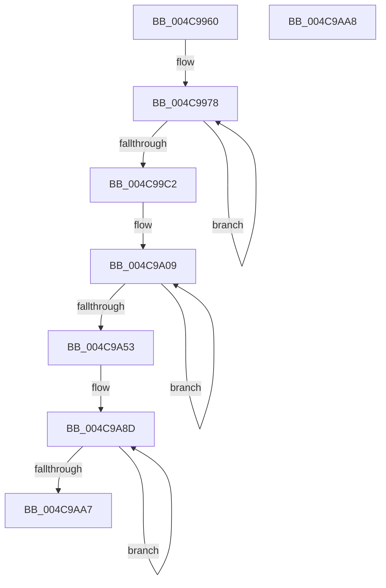

# PpmResetProfileSettings

- RVA: `0x004C9960`–`0x004C9AA9` (길이 `329` bytes)
- VA: `0x00000001404C9960`
- 실행 섹션: `.text`
- PDB 이름 있음: `예`; PDB Function 태그: `아니요`
- unwind 정보 RVA: `0x000DB714`
- 디코드: `86`개 명령, `329/329` bytes 표시
- 미해석 바이트: `0` (있으면 어셈블리에 `.byte`로 보존)

> 이 문서는 커널 이미지의 기계어와 PDB 기호를 분석해 생성했습니다. 4번과 5번은 함수 원형과 자료형을 바이너리 사용 방식에서 추정한 C 해석이며 원본 소스 복구 결과는 아닙니다.

## 1. Dependencies

- 직접 호출 지점: **0**; 고유 호출 대상: **0**
- 직접 호출자로 확인된 함수: **2**
- RIP 상대 이미지 참조: **2**

### Outgoing calls
- 직접 디코드된 call 명령이 없습니다.

### Direct callers
- [PpmDisableProfile](../../page/77/PpmDisableProfile_function_00770858.md) at `0x0077088E`
- [PpmRegisterProfiles](../../page/77/PpmRegisterProfiles_function_007709F0.md) at `0x00770B78`

### Static image references
- `0x004C996A` → RVA `0x00F077E8` (`.data`; read)
- `0x004C9A02` → RVA `0x00F079D0` (`.data`; read)

## 2. Other-region calls and transfers

- 다른 실행 섹션으로 향하는 call: **0**
- 별도 외부 분기/꼬리 이동을 확인하지 못했습니다.

## 3. Assembly (complete function range)

```asm
004C9960  41 B8 03 00 00 00               mov r8d, 3
004C9966  48 8D 51 28                     lea rdx, [rcx + 0x28]
004C996A  48 8D 05 77 DE A3 00            lea rax, [rip + 0xa3de77]
004C9971  45 8B C8                        mov r9d, r8d
004C9974  45 8D 50 7D                     lea r10d, [r8 + 0x7d]
004C9978  0F 10 00                        movups xmm0, xmmword ptr [rax]
004C997B  0F 11 02                        movups xmmword ptr [rdx], xmm0
004C997E  0F 10 48 10                     movups xmm1, xmmword ptr [rax + 0x10]
004C9982  0F 11 4A 10                     movups xmmword ptr [rdx + 0x10], xmm1
004C9986  0F 10 40 20                     movups xmm0, xmmword ptr [rax + 0x20]
004C998A  0F 11 42 20                     movups xmmword ptr [rdx + 0x20], xmm0
004C998E  0F 10 48 30                     movups xmm1, xmmword ptr [rax + 0x30]
004C9992  0F 11 4A 30                     movups xmmword ptr [rdx + 0x30], xmm1
004C9996  0F 10 40 40                     movups xmm0, xmmword ptr [rax + 0x40]
004C999A  0F 11 42 40                     movups xmmword ptr [rdx + 0x40], xmm0
004C999E  0F 10 48 50                     movups xmm1, xmmword ptr [rax + 0x50]
004C99A2  0F 11 4A 50                     movups xmmword ptr [rdx + 0x50], xmm1
004C99A6  0F 10 40 60                     movups xmm0, xmmword ptr [rax + 0x60]
004C99AA  0F 11 42 60                     movups xmmword ptr [rdx + 0x60], xmm0
004C99AE  49 03 D2                        add rdx, r10
004C99B1  0F 10 48 70                     movups xmm1, xmmword ptr [rax + 0x70]
004C99B5  49 03 C2                        add rax, r10
004C99B8  0F 11 4A F0                     movups xmmword ptr [rdx - 0x10], xmm1
004C99BC  49 83 E9 01                     sub r9, 1
004C99C0  75 B6                           jne 0x1404c9978
004C99C2  0F 10 00                        movups xmm0, xmmword ptr [rax]
004C99C5  0F 11 02                        movups xmmword ptr [rdx], xmm0
004C99C8  0F 10 48 10                     movups xmm1, xmmword ptr [rax + 0x10]
004C99CC  0F 11 4A 10                     movups xmmword ptr [rdx + 0x10], xmm1
004C99D0  0F 10 40 20                     movups xmm0, xmmword ptr [rax + 0x20]
004C99D4  0F 11 42 20                     movups xmmword ptr [rdx + 0x20], xmm0
004C99D8  0F 10 48 30                     movups xmm1, xmmword ptr [rax + 0x30]
004C99DC  0F 11 4A 30                     movups xmmword ptr [rdx + 0x30], xmm1
004C99E0  0F 10 40 40                     movups xmm0, xmmword ptr [rax + 0x40]
004C99E4  0F 11 42 40                     movups xmmword ptr [rdx + 0x40], xmm0
004C99E8  0F 10 48 50                     movups xmm1, xmmword ptr [rax + 0x50]
004C99EC  0F 11 4A 50                     movups xmmword ptr [rdx + 0x50], xmm1
004C99F0  48 8B 40 60                     mov rax, qword ptr [rax + 0x60]
004C99F4  48 89 42 60                     mov qword ptr [rdx + 0x60], rax
004C99F8  48 8D 91 10 02 00 00            lea rdx, [rcx + 0x210]
004C99FF  48 8B CA                        mov rcx, rdx
004C9A02  48 8D 05 C7 DF A3 00            lea rax, [rip + 0xa3dfc7]
004C9A09  0F 10 00                        movups xmm0, xmmword ptr [rax]
004C9A0C  0F 11 01                        movups xmmword ptr [rcx], xmm0
004C9A0F  0F 10 48 10                     movups xmm1, xmmword ptr [rax + 0x10]
004C9A13  0F 11 49 10                     movups xmmword ptr [rcx + 0x10], xmm1
004C9A17  0F 10 40 20                     movups xmm0, xmmword ptr [rax + 0x20]
004C9A1B  0F 11 41 20                     movups xmmword ptr [rcx + 0x20], xmm0
004C9A1F  0F 10 48 30                     movups xmm1, xmmword ptr [rax + 0x30]
004C9A23  0F 11 49 30                     movups xmmword ptr [rcx + 0x30], xmm1
004C9A27  0F 10 40 40                     movups xmm0, xmmword ptr [rax + 0x40]
004C9A2B  0F 11 41 40                     movups xmmword ptr [rcx + 0x40], xmm0
004C9A2F  0F 10 48 50                     movups xmm1, xmmword ptr [rax + 0x50]
004C9A33  0F 11 49 50                     movups xmmword ptr [rcx + 0x50], xmm1
004C9A37  0F 10 40 60                     movups xmm0, xmmword ptr [rax + 0x60]
004C9A3B  0F 11 41 60                     movups xmmword ptr [rcx + 0x60], xmm0
004C9A3F  49 03 CA                        add rcx, r10
004C9A42  0F 10 48 70                     movups xmm1, xmmword ptr [rax + 0x70]
004C9A46  49 03 C2                        add rax, r10
004C9A49  0F 11 49 F0                     movups xmmword ptr [rcx - 0x10], xmm1
004C9A4D  49 83 E8 01                     sub r8, 1
004C9A51  75 B6                           jne 0x1404c9a09
004C9A53  0F 10 00                        movups xmm0, xmmword ptr [rax]
004C9A56  0F 11 01                        movups xmmword ptr [rcx], xmm0
004C9A59  0F 10 48 10                     movups xmm1, xmmword ptr [rax + 0x10]
004C9A5D  0F 11 49 10                     movups xmmword ptr [rcx + 0x10], xmm1
004C9A61  0F 10 40 20                     movups xmm0, xmmword ptr [rax + 0x20]
004C9A65  0F 11 41 20                     movups xmmword ptr [rcx + 0x20], xmm0
004C9A69  0F 10 48 30                     movups xmm1, xmmword ptr [rax + 0x30]
004C9A6D  0F 11 49 30                     movups xmmword ptr [rcx + 0x30], xmm1
004C9A71  0F 10 40 40                     movups xmm0, xmmword ptr [rax + 0x40]
004C9A75  0F 11 41 40                     movups xmmword ptr [rcx + 0x40], xmm0
004C9A79  0F 10 48 50                     movups xmm1, xmmword ptr [rax + 0x50]
004C9A7D  0F 11 49 50                     movups xmmword ptr [rcx + 0x50], xmm1
004C9A81  48 8B 40 60                     mov rax, qword ptr [rax + 0x60]
004C9A85  48 89 41 60                     mov qword ptr [rcx + 0x60], rax
004C9A89  41 8D 40 02                     lea eax, [r8 + 2]
004C9A8D  0F 57 C0                        xorps xmm0, xmm0
004C9A90  0F 57 C9                        xorps xmm1, xmm1
004C9A93  0F 11 82 18 FE FF FF            movups xmmword ptr [rdx - 0x1e8], xmm0
004C9A9A  0F 11 0A                        movups xmmword ptr [rdx], xmm1
004C9A9D  48 8D 52 10                     lea rdx, [rdx + 0x10]
004C9AA1  48 83 E8 01                     sub rax, 1
004C9AA5  75 E6                           jne 0x1404c9a8d
004C9AA7  C3                              ret
004C9AA8  CC                              int3
```

## 4. C-style interpretation (structured pseudocode)

```c
__int64 __fastcall PpmResetProfileSettings(__int64 a1)
{
    __int64 result;

loc_004C9978:
    *(unsigned __int64 *)(a1 + 40) = v_xmm0;
    *(unsigned __int64 *)(a1 + 40 + 16) = v_xmm1;
    *(unsigned __int64 *)(a1 + 40 + 32) = v_xmm0;
    *(unsigned __int64 *)(a1 + 40 + 48) = v_xmm1;
    *(unsigned __int64 *)(a1 + 40 + 64) = v_xmm0;
    *(unsigned __int64 *)(a1 + 40 + 80) = v_xmm1;
    *(unsigned __int64 *)(a1 + 40 + 96) = v_xmm0;
    a2 = (a1 + 40) + (3 + 125);
    result = (v_rip + 10739319) + (3 + 125);
    *(unsigned __int64 *)(a2 - 16) = v_xmm1;
    a4 = (3) - (1);
    if (condition_is_not_equal) goto loc_004C9978;
    *(unsigned __int64 *)(a2) = v_xmm0;
    *(unsigned __int64 *)(a2 + 16) = v_xmm1;
    *(unsigned __int64 *)(a2 + 32) = v_xmm0;
    *(unsigned __int64 *)(a2 + 48) = v_xmm1;
    *(unsigned __int64 *)(a2 + 64) = v_xmm0;
    *(unsigned __int64 *)(a2 + 80) = v_xmm1;
    *(unsigned __int64 *)(a2 + 96) = *(unsigned __int64 *)(result + 96);
loc_004C9A09:
    *(unsigned __int64 *)(a1 + 528) = v_xmm0;
    *(unsigned __int64 *)(a1 + 528 + 16) = v_xmm1;
    *(unsigned __int64 *)(a1 + 528 + 32) = v_xmm0;
    *(unsigned __int64 *)(a1 + 528 + 48) = v_xmm1;
    *(unsigned __int64 *)(a1 + 528 + 64) = v_xmm0;
    *(unsigned __int64 *)(a1 + 528 + 80) = v_xmm1;
    *(unsigned __int64 *)(a1 + 528 + 96) = v_xmm0;
    a1 = (a1 + 528) + (3 + 125);
    result = (v_rip + 10739655) + (3 + 125);
    *(unsigned __int64 *)(a1 - 16) = v_xmm1;
    a3 = (3) - (1);
    if (condition_is_not_equal) goto loc_004C9A09;
    *(unsigned __int64 *)(a1) = v_xmm0;
    *(unsigned __int64 *)(a1 + 16) = v_xmm1;
    *(unsigned __int64 *)(a1 + 32) = v_xmm0;
    *(unsigned __int64 *)(a1 + 48) = v_xmm1;
    *(unsigned __int64 *)(a1 + 64) = v_xmm0;
    *(unsigned __int64 *)(a1 + 80) = v_xmm1;
    *(unsigned __int64 *)(a1 + 96) = *(unsigned __int64 *)(result + 96);
loc_004C9A8D:
    *(unsigned __int64 *)(a1 + 528 - 488) = v_xmm0;
    *(unsigned __int64 *)(a1 + 528) = v_xmm1;
    result = (a3 + 2) - (1);
    if (condition_is_not_equal) goto loc_004C9A8D;
    return result;
}
```

## 5. (Beta) C Style

```c
int64_t PpmResetProfileSettings(void *Arg1)
{
    uint8_t *arg1 = (uint8_t *)Arg1;

    int64_t result;

loc_004C9978:
    *(uint64_t *)(arg1 + 0x28) = v_xmm0;
    *(uint64_t *)(arg1 + 0x28 + 0x10) = v_xmm1;
    *(uint64_t *)(arg1 + 0x28 + 0x20) = v_xmm0;
    *(uint64_t *)(arg1 + 0x28 + 0x30) = v_xmm1;
    *(uint64_t *)(arg1 + 0x28 + 0x40) = v_xmm0;
    *(uint64_t *)(arg1 + 0x28 + 0x50) = v_xmm1;
    *(uint64_t *)(arg1 + 0x28 + 0x60) = v_xmm0;
    a2 = (Arg1 + 40) + (3 + 125);
    result = (v_rip + 10739319) + (3 + 125);
    *(uint64_t *)(a2 - 0x10) = v_xmm1;
    a4 = (3) - (1);
    if (condition_is_not_equal) goto loc_004C9978;
    *(uint64_t *)(a2) = v_xmm0;
    *(uint64_t *)(a2 + 0x10) = v_xmm1;
    *(uint64_t *)(a2 + 0x20) = v_xmm0;
    *(uint64_t *)(a2 + 0x30) = v_xmm1;
    *(uint64_t *)(a2 + 0x40) = v_xmm0;
    *(uint64_t *)(a2 + 0x50) = v_xmm1;
    *(uint64_t *)(a2 + 0x60) = *(uint64_t *)(result + 0x60);
loc_004C9A09:
    *(uint64_t *)(arg1 + 0x210) = v_xmm0;
    *(uint64_t *)(arg1 + 0x210 + 0x10) = v_xmm1;
    *(uint64_t *)(arg1 + 0x210 + 0x20) = v_xmm0;
    *(uint64_t *)(arg1 + 0x210 + 0x30) = v_xmm1;
    *(uint64_t *)(arg1 + 0x210 + 0x40) = v_xmm0;
    *(uint64_t *)(arg1 + 0x210 + 0x50) = v_xmm1;
    *(uint64_t *)(arg1 + 0x210 + 0x60) = v_xmm0;
    Arg1 = (Arg1 + 528) + (3 + 125);
    result = (v_rip + 10739655) + (3 + 125);
    *(uint64_t *)(arg1 - 0x10) = v_xmm1;
    a3 = (3) - (1);
    if (condition_is_not_equal) goto loc_004C9A09;
    *(uint64_t *)(arg1) = v_xmm0;
    *(uint64_t *)(arg1 + 0x10) = v_xmm1;
    *(uint64_t *)(arg1 + 0x20) = v_xmm0;
    *(uint64_t *)(arg1 + 0x30) = v_xmm1;
    *(uint64_t *)(arg1 + 0x40) = v_xmm0;
    *(uint64_t *)(arg1 + 0x50) = v_xmm1;
    *(uint64_t *)(arg1 + 0x60) = *(uint64_t *)(result + 0x60);
loc_004C9A8D:
    *(uint64_t *)(arg1 + 0x210 - 0x1E8) = v_xmm0;
    *(uint64_t *)(arg1 + 0x210) = v_xmm1;
    result = (a3 + 2) - (1);
    if (condition_is_not_equal) goto loc_004C9A8D;
    return result;
}
```

### 관측된 메모리 오프셋

구조체 형식이 확인되지 않은 접근은 인자 기준의 오프셋으로만 기록했습니다.

| 기준 인자 | 오프셋 표현 | 폭 (bit) | 접근 |
|---|---:|---:|---|
| `Arg1` | `- 0x1E8` | `128` | `R` |
| `Arg1` | `- 0x10` | `128` | `R` |
| `Arg1` | `+ 0x0` | `128` | `R` |
| `Arg1` | `+ 0x10` | `64` | `R` |
| `Arg1` | `+ 0x10` | `128` | `R` |
| `Arg1` | `+ 0x20` | `128` | `R` |
| `Arg1` | `+ 0x28` | `64` | `R` |
| `Arg1` | `+ 0x30` | `128` | `R` |
| `Arg1` | `+ 0x40` | `128` | `R` |
| `Arg1` | `+ 0x50` | `128` | `R` |
| `Arg1` | `+ 0x60` | `64` | `W` |
| `Arg1` | `+ 0x60` | `128` | `R` |
| `Arg1` | `+ 0x210` | `64` | `R` |

## 6. Execution-region graph

[열기: 2D/3D 그래프와 함수 탐색 컨트롤 패널](../../../control-panel.html?section=text&rva=0x004C9960&view=graph)

- 2D 그래프는 위에서 아래로 흐르고, 3D 그래프는 빈 공간을 드래그해 회전합니다. Shift+드래그는 이동, 휠은 확대·축소, 함수 노드 선택은 대상 보고서 이동입니다.

### Static fallback


