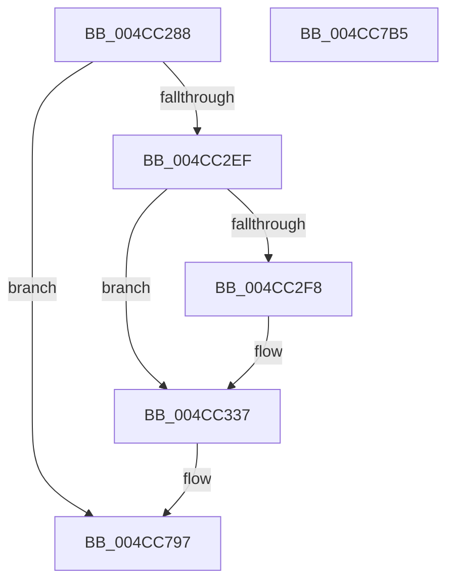

# PrpWriteLogsToRegistry

- RVA: `0x004CC288`–`0x004CC7B6` (길이 `1,326` bytes)
- VA: `0x00000001404CC288`
- 실행 섹션: `.text`
- PDB 이름 있음: `예`; PDB Function 태그: `아니요`
- unwind 정보 RVA: `0x000BD780`
- 디코드: `311`개 명령, `1,326/1,326` bytes 표시
- 미해석 바이트: `0` (있으면 어셈블리에 `.byte`로 보존)

> 이 문서는 커널 이미지의 기계어와 PDB 기호를 분석해 생성했습니다. 4번과 5번은 함수 원형과 자료형을 바이너리 사용 방식에서 추정한 C 해석이며 원본 소스 복구 결과는 아닙니다.

## 1. Dependencies

- 직접 호출 지점: **32**; 고유 호출 대상: **5**
- 직접 호출자로 확인된 함수: **1**
- RIP 상대 이미지 참조: **28**

### Outgoing calls
- `0x004CC2E2` → [ZwOpenKey](../6A/ZwOpenKey_function_006AD310.md) (function, `0x006AD310`)
- `0x004CC303` → [RtlInitUnicodeString](../42/RtlInitUnicodeString_function_0042A780.md) (function, `0x0042A780`)
- `0x004CC32B` → [ZwSetValueKey](../6A/ZwSetValueKey_function_006ADCD0.md) (function, `0x006ADCD0`)
- `0x004CC346` → [wcslen](../50/wcslen_function_00501BA0.md) (function, `0x00501BA0`)
- `0x004CC395` → [ZwSetValueKey](../6A/ZwSetValueKey_function_006ADCD0.md) (function, `0x006ADCD0`)
- `0x004CC3A9` → [wcslen](../50/wcslen_function_00501BA0.md) (function, `0x00501BA0`)
- `0x004CC3E3` → [ZwSetValueKey](../6A/ZwSetValueKey_function_006ADCD0.md) (function, `0x006ADCD0`)
- `0x004CC3F7` → [wcslen](../50/wcslen_function_00501BA0.md) (function, `0x00501BA0`)
- `0x004CC431` → [ZwSetValueKey](../6A/ZwSetValueKey_function_006ADCD0.md) (function, `0x006ADCD0`)
- `0x004CC445` → [wcslen](../50/wcslen_function_00501BA0.md) (function, `0x00501BA0`)
- `0x004CC47F` → [ZwSetValueKey](../6A/ZwSetValueKey_function_006ADCD0.md) (function, `0x006ADCD0`)
- `0x004CC493` → [wcslen](../50/wcslen_function_00501BA0.md) (function, `0x00501BA0`)
- `0x004CC4CD` → [ZwSetValueKey](../6A/ZwSetValueKey_function_006ADCD0.md) (function, `0x006ADCD0`)
- `0x004CC4E1` → [wcslen](../50/wcslen_function_00501BA0.md) (function, `0x00501BA0`)
- `0x004CC51B` → [ZwSetValueKey](../6A/ZwSetValueKey_function_006ADCD0.md) (function, `0x006ADCD0`)
- `0x004CC52F` → [wcslen](../50/wcslen_function_00501BA0.md) (function, `0x00501BA0`)
- `0x004CC569` → [ZwSetValueKey](../6A/ZwSetValueKey_function_006ADCD0.md) (function, `0x006ADCD0`)
- `0x004CC57E` → [wcslen](../50/wcslen_function_00501BA0.md) (function, `0x00501BA0`)
- `0x004CC5B8` → [ZwSetValueKey](../6A/ZwSetValueKey_function_006ADCD0.md) (function, `0x006ADCD0`)
- `0x004CC5CD` → [wcslen](../50/wcslen_function_00501BA0.md) (function, `0x00501BA0`)
- `0x004CC60A` → [ZwSetValueKey](../6A/ZwSetValueKey_function_006ADCD0.md) (function, `0x006ADCD0`)
- `0x004CC61F` → [wcslen](../50/wcslen_function_00501BA0.md) (function, `0x00501BA0`)
- `0x004CC659` → [ZwSetValueKey](../6A/ZwSetValueKey_function_006ADCD0.md) (function, `0x006ADCD0`)
- `0x004CC66E` → [wcslen](../50/wcslen_function_00501BA0.md) (function, `0x00501BA0`)
- `0x004CC6A8` → [ZwSetValueKey](../6A/ZwSetValueKey_function_006ADCD0.md) (function, `0x006ADCD0`)
- `0x004CC6BD` → [wcslen](../50/wcslen_function_00501BA0.md) (function, `0x00501BA0`)
- `0x004CC6F5` → [ZwSetValueKey](../6A/ZwSetValueKey_function_006ADCD0.md) (function, `0x006ADCD0`)
- `0x004CC70A` → [wcslen](../50/wcslen_function_00501BA0.md) (function, `0x00501BA0`)
- `0x004CC73D` → [ZwSetValueKey](../6A/ZwSetValueKey_function_006ADCD0.md) (function, `0x006ADCD0`)
- `0x004CC752` → [wcslen](../50/wcslen_function_00501BA0.md) (function, `0x00501BA0`)
- `0x004CC785` → [ZwSetValueKey](../6A/ZwSetValueKey_function_006ADCD0.md) (function, `0x006ADCD0`)
- `0x004CC790` → [ZwClose](../6A/ZwClose_function_006AD2B0.md) (function, `0x006AD2B0`)

### Direct callers
- [MicrocodeLogRegistry](../66/MicrocodeLogRegistry_function_00667340.md) at `0x006673AD`

### Static image references
- `0x004CC2EF` → RVA `0x00EF7CD0` (`.data`; read)
- `0x004CC2F8` → RVA `0x0003A0A0` (`.rdata`; read)
- `0x004CC330` → RVA `0x00EF7CD0` (`.data`; write)
- `0x004CC337` → RVA `0x0001E5A0` (`.rdata`; read)
- `0x004CC389` → RVA `0x00EF7CA0` (`.data`; read)
- `0x004CC39A` → RVA `0x0001E7B8` (`.rdata`; read)
- `0x004CC3D7` → RVA `0x00EF7CA4` (`.data`; read)
- `0x004CC3E8` → RVA `0x0001E6F8` (`.rdata`; read)
- `0x004CC425` → RVA `0x00EF7CA8` (`.data`; read)
- `0x004CC436` → RVA `0x0001E640` (`.rdata`; read)
- `0x004CC44E` → RVA `0x00EF7CAC` (`.data`; read)
- `0x004CC484` → RVA `0x0001E750` (`.rdata`; read)
- `0x004CC4C1` → RVA `0x00EF7CB0` (`.data`; read)
- `0x004CC4D2` → RVA `0x0001E6C8` (`.rdata`; read)
- `0x004CC4EA` → RVA `0x00EF7CB4` (`.data`; read)
- `0x004CC520` → RVA `0x0001E698` (`.rdata`; read)
- `0x004CC538` → RVA `0x00EF7CB8` (`.data`; read)
- `0x004CC573` → RVA `0x0001E660` (`.rdata`; read)
- `0x004CC5AC` → RVA `0x00EF7CBC` (`.data`; read)
- `0x004CC5C2` → RVA `0x0001E608` (`.rdata`; read)
- `0x004CC5F3` → RVA `0x00EF7CC0` (`.data`; read)
- `0x004CC614` → RVA `0x0001E730` (`.rdata`; read)
- `0x004CC64D` → RVA `0x00EF7CC4` (`.data`; read)
- `0x004CC663` → RVA `0x0001E5C0` (`.rdata`; read)
- `0x004CC69C` → RVA `0x00EF7CC8` (`.data`; read)
- `0x004CC6B2` → RVA `0x0001E5E8` (`.rdata`; read)
- `0x004CC6FF` → RVA `0x0001E568` (`.rdata`; read)
- `0x004CC747` → RVA `0x0001E780` (`.rdata`; read)

## 2. Other-region calls and transfers

- 다른 실행 섹션으로 향하는 call: **0**
- 별도 외부 분기/꼬리 이동을 확인하지 못했습니다.

## 3. Assembly (complete function range)

```asm
004CC288  48 8B C4                        mov rax, rsp
004CC28B  48 89 58 10                     mov qword ptr [rax + 0x10], rbx
004CC28F  48 89 70 18                     mov qword ptr [rax + 0x18], rsi
004CC293  48 89 78 20                     mov qword ptr [rax + 0x20], rdi
004CC297  48 89 48 08                     mov qword ptr [rax + 8], rcx
004CC29B  55                              push rbp
004CC29C  41 54                           push r12
004CC29E  41 55                           push r13
004CC2A0  41 56                           push r14
004CC2A2  41 57                           push r15
004CC2A4  48 8B EC                        mov rbp, rsp
004CC2A7  48 83 EC 70                     sub rsp, 0x70
004CC2AB  0F 57 C0                        xorps xmm0, xmm0
004CC2AE  48 89 55 E0                     mov qword ptr [rbp - 0x20], rdx
004CC2B2  33 DB                           xor ebx, ebx
004CC2B4  48 C7 45 D0 30 00 00 00         mov qword ptr [rbp - 0x30], 0x30
004CC2BC  BA 1F 00 02 00                  mov edx, 0x2001f
004CC2C1  48 89 5D 30                     mov qword ptr [rbp + 0x30], rbx
004CC2C5  4C 8D 45 D0                     lea r8, [rbp - 0x30]
004CC2C9  48 89 5D D8                     mov qword ptr [rbp - 0x28], rbx
004CC2CD  48 8D 4D 30                     lea rcx, [rbp + 0x30]
004CC2D1  48 C7 45 E8 40 02 00 00         mov qword ptr [rbp - 0x18], 0x240
004CC2D9  0F 11 45 C0                     movups xmmword ptr [rbp - 0x40], xmm0
004CC2DD  F3 0F 7F 45 F0                  movdqu xmmword ptr [rbp - 0x10], xmm0
004CC2E2  E8 29 10 1E 00                  call 0x1406ad310
004CC2E7  85 C0                           test eax, eax
004CC2E9  0F 88 A8 04 00 00               js 0x1404cc797
004CC2EF  48 39 1D DA B9 A2 00            cmp qword ptr [rip + 0xa2b9da], rbx
004CC2F6  74 3F                           je 0x1404cc337
004CC2F8  48 8D 15 A1 DD B6 FF            lea rdx, [rip - 0x49225f]
004CC2FF  48 8D 4D C0                     lea rcx, [rbp - 0x40]
004CC303  E8 78 E4 F5 FF                  call 0x14042a780
004CC308  48 8B 4D 30                     mov rcx, qword ptr [rbp + 0x30]
004CC30C  48 8D 05 BD B9 A2 00            lea rax, [rip + 0xa2b9bd]
004CC313  C7 44 24 28 08 00 00 00         mov dword ptr [rsp + 0x28], 8
004CC31B  44 8D 4B 0B                     lea r9d, [rbx + 0xb]
004CC31F  45 33 C0                        xor r8d, r8d
004CC322  48 89 44 24 20                  mov qword ptr [rsp + 0x20], rax
004CC327  48 8D 55 C0                     lea rdx, [rbp - 0x40]
004CC32B  E8 A0 19 1E 00                  call 0x1406adcd0
004CC330  48 89 1D 99 B9 A2 00            mov qword ptr [rip + 0xa2b999], rbx
004CC337  48 8D 0D 62 22 B5 FF            lea rcx, [rip - 0x4add9e]
004CC33E  48 89 5D C0                     mov qword ptr [rbp - 0x40], rbx
004CC342  48 89 4D C8                     mov qword ptr [rbp - 0x38], rcx
004CC346  E8 55 58 03 00                  call 0x140501ba0
004CC34B  48 8B 4D 30                     mov rcx, qword ptr [rbp + 0x30]
004CC34F  48 8D 55 C0                     lea rdx, [rbp - 0x40]
004CC353  48 03 C0                        add rax, rax
004CC356  41 BD FC FF 00 00               mov r13d, 0xfffc
004CC35C  41 BC 04 00 00 00               mov r12d, 4
004CC362  66 41 BE 02 00                  mov r14w, 2
004CC367  44 89 64 24 28                  mov dword ptr [rsp + 0x28], r12d
004CC36C  45 8B CC                        mov r9d, r12d
004CC36F  45 8D 7D 02                     lea r15d, [r13 + 2]
004CC373  49 3B C7                        cmp rax, r15
004CC376  49 0F 43 C5                     cmovae rax, r13
004CC37A  45 33 C0                        xor r8d, r8d
004CC37D  66 89 45 C0                     mov word ptr [rbp - 0x40], ax
004CC381  66 41 03 C6                     add ax, r14w
004CC385  66 89 45 C2                     mov word ptr [rbp - 0x3e], ax
004CC389  48 8D 05 10 B9 A2 00            lea rax, [rip + 0xa2b910]
004CC390  48 89 44 24 20                  mov qword ptr [rsp + 0x20], rax
004CC395  E8 36 19 1E 00                  call 0x1406adcd0
004CC39A  48 8D 0D 17 24 B5 FF            lea rcx, [rip - 0x4adbe9]
004CC3A1  48 89 5D C0                     mov qword ptr [rbp - 0x40], rbx
004CC3A5  48 89 4D C8                     mov qword ptr [rbp - 0x38], rcx
004CC3A9  E8 F2 57 03 00                  call 0x140501ba0
004CC3AE  48 8B 4D 30                     mov rcx, qword ptr [rbp + 0x30]
004CC3B2  48 8D 55 C0                     lea rdx, [rbp - 0x40]
004CC3B6  48 03 C0                        add rax, rax
004CC3B9  44 89 64 24 28                  mov dword ptr [rsp + 0x28], r12d
004CC3BE  49 3B C7                        cmp rax, r15
004CC3C1  45 8B CC                        mov r9d, r12d
004CC3C4  49 0F 43 C5                     cmovae rax, r13
004CC3C8  45 33 C0                        xor r8d, r8d
004CC3CB  66 89 45 C0                     mov word ptr [rbp - 0x40], ax
004CC3CF  66 41 03 C6                     add ax, r14w
004CC3D3  66 89 45 C2                     mov word ptr [rbp - 0x3e], ax
004CC3D7  48 8D 05 C6 B8 A2 00            lea rax, [rip + 0xa2b8c6]
004CC3DE  48 89 44 24 20                  mov qword ptr [rsp + 0x20], rax
004CC3E3  E8 E8 18 1E 00                  call 0x1406adcd0
004CC3E8  48 8D 0D 09 23 B5 FF            lea rcx, [rip - 0x4adcf7]
004CC3EF  48 89 5D C0                     mov qword ptr [rbp - 0x40], rbx
004CC3F3  48 89 4D C8                     mov qword ptr [rbp - 0x38], rcx
004CC3F7  E8 A4 57 03 00                  call 0x140501ba0
004CC3FC  48 8B 4D 30                     mov rcx, qword ptr [rbp + 0x30]
004CC400  48 8D 55 C0                     lea rdx, [rbp - 0x40]
004CC404  48 03 C0                        add rax, rax
004CC407  44 89 64 24 28                  mov dword ptr [rsp + 0x28], r12d
004CC40C  49 3B C7                        cmp rax, r15
004CC40F  45 8B CC                        mov r9d, r12d
004CC412  49 0F 43 C5                     cmovae rax, r13
004CC416  45 33 C0                        xor r8d, r8d
004CC419  66 89 45 C0                     mov word ptr [rbp - 0x40], ax
004CC41D  66 41 03 C6                     add ax, r14w
004CC421  66 89 45 C2                     mov word ptr [rbp - 0x3e], ax
004CC425  48 8D 05 7C B8 A2 00            lea rax, [rip + 0xa2b87c]
004CC42C  48 89 44 24 20                  mov qword ptr [rsp + 0x20], rax
004CC431  E8 9A 18 1E 00                  call 0x1406adcd0
004CC436  48 8D 0D 03 22 B5 FF            lea rcx, [rip - 0x4addfd]
004CC43D  48 89 5D C0                     mov qword ptr [rbp - 0x40], rbx
004CC441  48 89 4D C8                     mov qword ptr [rbp - 0x38], rcx
004CC445  E8 56 57 03 00                  call 0x140501ba0
004CC44A  48 8B 4D 30                     mov rcx, qword ptr [rbp + 0x30]
004CC44E  48 8D 35 57 B8 A2 00            lea rsi, [rip + 0xa2b857]
004CC455  48 03 C0                        add rax, rax
004CC458  44 89 64 24 28                  mov dword ptr [rsp + 0x28], r12d
004CC45D  49 3B C7                        cmp rax, r15
004CC460  48 89 74 24 20                  mov qword ptr [rsp + 0x20], rsi
004CC465  45 8B CC                        mov r9d, r12d
004CC468  48 8D 55 C0                     lea rdx, [rbp - 0x40]
004CC46C  49 0F 43 C5                     cmovae rax, r13
004CC470  45 33 C0                        xor r8d, r8d
004CC473  66 89 45 C0                     mov word ptr [rbp - 0x40], ax
004CC477  66 41 03 C6                     add ax, r14w
004CC47B  66 89 45 C2                     mov word ptr [rbp - 0x3e], ax
004CC47F  E8 4C 18 1E 00                  call 0x1406adcd0
004CC484  48 8D 0D C5 22 B5 FF            lea rcx, [rip - 0x4add3b]
004CC48B  48 89 5D C0                     mov qword ptr [rbp - 0x40], rbx
004CC48F  48 89 4D C8                     mov qword ptr [rbp - 0x38], rcx
004CC493  E8 08 57 03 00                  call 0x140501ba0
004CC498  48 03 C0                        add rax, rax
004CC49B  48 8B 4D 30                     mov rcx, qword ptr [rbp + 0x30]
004CC49F  48 8D 55 C0                     lea rdx, [rbp - 0x40]
004CC4A3  49 3B C7                        cmp rax, r15
004CC4A6  44 89 64 24 28                  mov dword ptr [rsp + 0x28], r12d
004CC4AB  45 8B CC                        mov r9d, r12d
004CC4AE  49 0F 43 C5                     cmovae rax, r13
004CC4B2  45 33 C0                        xor r8d, r8d
004CC4B5  66 89 45 C0                     mov word ptr [rbp - 0x40], ax
004CC4B9  66 41 03 C6                     add ax, r14w
004CC4BD  66 89 45 C2                     mov word ptr [rbp - 0x3e], ax
004CC4C1  48 8D 05 E8 B7 A2 00            lea rax, [rip + 0xa2b7e8]
004CC4C8  48 89 44 24 20                  mov qword ptr [rsp + 0x20], rax
004CC4CD  E8 FE 17 1E 00                  call 0x1406adcd0
004CC4D2  48 8D 0D EF 21 B5 FF            lea rcx, [rip - 0x4ade11]
004CC4D9  48 89 5D C0                     mov qword ptr [rbp - 0x40], rbx
004CC4DD  48 89 4D C8                     mov qword ptr [rbp - 0x38], rcx
004CC4E1  E8 BA 56 03 00                  call 0x140501ba0
004CC4E6  48 8B 4D 30                     mov rcx, qword ptr [rbp + 0x30]
004CC4EA  48 8D 3D C3 B7 A2 00            lea rdi, [rip + 0xa2b7c3]
004CC4F1  48 03 C0                        add rax, rax
004CC4F4  44 89 64 24 28                  mov dword ptr [rsp + 0x28], r12d
004CC4F9  49 3B C7                        cmp rax, r15
004CC4FC  48 89 7C 24 20                  mov qword ptr [rsp + 0x20], rdi
004CC501  45 8B CC                        mov r9d, r12d
004CC504  48 8D 55 C0                     lea rdx, [rbp - 0x40]
004CC508  49 0F 43 C5                     cmovae rax, r13
004CC50C  45 33 C0                        xor r8d, r8d
004CC50F  66 89 45 C0                     mov word ptr [rbp - 0x40], ax
004CC513  66 41 03 C6                     add ax, r14w
004CC517  66 89 45 C2                     mov word ptr [rbp - 0x3e], ax
004CC51B  E8 B0 17 1E 00                  call 0x1406adcd0
004CC520  48 8D 0D 71 21 B5 FF            lea rcx, [rip - 0x4ade8f]
004CC527  48 89 5D C0                     mov qword ptr [rbp - 0x40], rbx
004CC52B  48 89 4D C8                     mov qword ptr [rbp - 0x38], rcx
004CC52F  E8 6C 56 03 00                  call 0x140501ba0
004CC534  48 8B 4D 30                     mov rcx, qword ptr [rbp + 0x30]
004CC538  48 8D 1D 79 B7 A2 00            lea rbx, [rip + 0xa2b779]
004CC53F  48 03 C0                        add rax, rax
004CC542  44 89 64 24 28                  mov dword ptr [rsp + 0x28], r12d
004CC547  49 3B C7                        cmp rax, r15
004CC54A  48 89 5C 24 20                  mov qword ptr [rsp + 0x20], rbx
004CC54F  45 8B CC                        mov r9d, r12d
004CC552  48 8D 55 C0                     lea rdx, [rbp - 0x40]
004CC556  49 0F 43 C5                     cmovae rax, r13
004CC55A  45 33 C0                        xor r8d, r8d
004CC55D  66 89 45 C0                     mov word ptr [rbp - 0x40], ax
004CC561  66 41 03 C6                     add ax, r14w
004CC565  66 89 45 C2                     mov word ptr [rbp - 0x3e], ax
004CC569  E8 62 17 1E 00                  call 0x1406adcd0
004CC56E  48 83 65 C0 00                  and qword ptr [rbp - 0x40], 0
004CC573  48 8D 0D E6 20 B5 FF            lea rcx, [rip - 0x4adf1a]
004CC57A  48 89 4D C8                     mov qword ptr [rbp - 0x38], rcx
004CC57E  E8 1D 56 03 00                  call 0x140501ba0
004CC583  48 8B 4D 30                     mov rcx, qword ptr [rbp + 0x30]
004CC587  48 8D 55 C0                     lea rdx, [rbp - 0x40]
004CC58B  48 03 C0                        add rax, rax
004CC58E  44 89 64 24 28                  mov dword ptr [rsp + 0x28], r12d
004CC593  49 3B C7                        cmp rax, r15
004CC596  45 8B CC                        mov r9d, r12d
004CC599  49 0F 43 C5                     cmovae rax, r13
004CC59D  45 33 C0                        xor r8d, r8d
004CC5A0  66 89 45 C0                     mov word ptr [rbp - 0x40], ax
004CC5A4  66 41 03 C6                     add ax, r14w
004CC5A8  66 89 45 C2                     mov word ptr [rbp - 0x3e], ax
004CC5AC  48 8D 05 09 B7 A2 00            lea rax, [rip + 0xa2b709]
004CC5B3  48 89 44 24 20                  mov qword ptr [rsp + 0x20], rax
004CC5B8  E8 13 17 1E 00                  call 0x1406adcd0
004CC5BD  48 83 65 C0 00                  and qword ptr [rbp - 0x40], 0
004CC5C2  48 8D 0D 3F 20 B5 FF            lea rcx, [rip - 0x4adfc1]
004CC5C9  48 89 4D C8                     mov qword ptr [rbp - 0x38], rcx
004CC5CD  E8 CE 55 03 00                  call 0x140501ba0
004CC5D2  48 03 C0                        add rax, rax
004CC5D5  C7 44 24 28 01 00 00 00         mov dword ptr [rsp + 0x28], 1
004CC5DD  49 3B C7                        cmp rax, r15
004CC5E0  45 8B CC                        mov r9d, r12d
004CC5E3  49 0F 43 C5                     cmovae rax, r13
004CC5E7  66 89 45 C0                     mov word ptr [rbp - 0x40], ax
004CC5EB  66 41 03 C6                     add ax, r14w
004CC5EF  66 89 45 C2                     mov word ptr [rbp - 0x3e], ax
004CC5F3  48 8D 05 C6 B6 A2 00            lea rax, [rip + 0xa2b6c6]
004CC5FA  48 89 44 24 20                  mov qword ptr [rsp + 0x20], rax
004CC5FF  48 8B 4D 30                     mov rcx, qword ptr [rbp + 0x30]
004CC603  48 8D 55 C0                     lea rdx, [rbp - 0x40]
004CC607  45 33 C0                        xor r8d, r8d
004CC60A  E8 C1 16 1E 00                  call 0x1406adcd0
004CC60F  48 83 65 C0 00                  and qword ptr [rbp - 0x40], 0
004CC614  48 8D 0D 15 21 B5 FF            lea rcx, [rip - 0x4adeeb]
004CC61B  48 89 4D C8                     mov qword ptr [rbp - 0x38], rcx
004CC61F  E8 7C 55 03 00                  call 0x140501ba0
004CC624  48 8B 4D 30                     mov rcx, qword ptr [rbp + 0x30]
004CC628  48 8D 55 C0                     lea rdx, [rbp - 0x40]
004CC62C  48 03 C0                        add rax, rax
004CC62F  44 89 64 24 28                  mov dword ptr [rsp + 0x28], r12d
004CC634  49 3B C7                        cmp rax, r15
004CC637  45 8B CC                        mov r9d, r12d
004CC63A  49 0F 43 C5                     cmovae rax, r13
004CC63E  45 33 C0                        xor r8d, r8d
004CC641  66 89 45 C0                     mov word ptr [rbp - 0x40], ax
004CC645  66 41 03 C6                     add ax, r14w
004CC649  66 89 45 C2                     mov word ptr [rbp - 0x3e], ax
004CC64D  48 8D 05 70 B6 A2 00            lea rax, [rip + 0xa2b670]
004CC654  48 89 44 24 20                  mov qword ptr [rsp + 0x20], rax
004CC659  E8 72 16 1E 00                  call 0x1406adcd0
004CC65E  48 83 65 C0 00                  and qword ptr [rbp - 0x40], 0
004CC663  48 8D 0D 56 1F B5 FF            lea rcx, [rip - 0x4ae0aa]
004CC66A  48 89 4D C8                     mov qword ptr [rbp - 0x38], rcx
004CC66E  E8 2D 55 03 00                  call 0x140501ba0
004CC673  48 8B 4D 30                     mov rcx, qword ptr [rbp + 0x30]
004CC677  48 8D 55 C0                     lea rdx, [rbp - 0x40]
004CC67B  48 03 C0                        add rax, rax
004CC67E  44 89 64 24 28                  mov dword ptr [rsp + 0x28], r12d
004CC683  49 3B C7                        cmp rax, r15
004CC686  45 8B CC                        mov r9d, r12d
004CC689  49 0F 43 C5                     cmovae rax, r13
004CC68D  45 33 C0                        xor r8d, r8d
004CC690  66 89 45 C0                     mov word ptr [rbp - 0x40], ax
004CC694  66 41 03 C6                     add ax, r14w
004CC698  66 89 45 C2                     mov word ptr [rbp - 0x3e], ax
004CC69C  48 8D 05 25 B6 A2 00            lea rax, [rip + 0xa2b625]
004CC6A3  48 89 44 24 20                  mov qword ptr [rsp + 0x20], rax
004CC6A8  E8 23 16 1E 00                  call 0x1406adcd0
004CC6AD  48 83 65 C0 00                  and qword ptr [rbp - 0x40], 0
004CC6B2  48 8D 0D 2F 1F B5 FF            lea rcx, [rip - 0x4ae0d1]
004CC6B9  48 89 4D C8                     mov qword ptr [rbp - 0x38], rcx
004CC6BD  E8 DE 54 03 00                  call 0x140501ba0
004CC6C2  48 8B 4D 30                     mov rcx, qword ptr [rbp + 0x30]
004CC6C6  48 8D 55 C0                     lea rdx, [rbp - 0x40]
004CC6CA  48 03 C0                        add rax, rax
004CC6CD  44 89 64 24 28                  mov dword ptr [rsp + 0x28], r12d
004CC6D2  49 3B C7                        cmp rax, r15
004CC6D5  48 89 5C 24 20                  mov qword ptr [rsp + 0x20], rbx
004CC6DA  41 8D 5C 24 FF                  lea ebx, [r12 - 1]
004CC6DF  49 0F 43 C5                     cmovae rax, r13
004CC6E3  44 8B CB                        mov r9d, ebx
004CC6E6  66 89 45 C0                     mov word ptr [rbp - 0x40], ax
004CC6EA  45 33 C0                        xor r8d, r8d
004CC6ED  66 41 03 C6                     add ax, r14w
004CC6F1  66 89 45 C2                     mov word ptr [rbp - 0x3e], ax
004CC6F5  E8 D6 15 1E 00                  call 0x1406adcd0
004CC6FA  48 83 65 C0 00                  and qword ptr [rbp - 0x40], 0
004CC6FF  48 8D 0D 62 1E B5 FF            lea rcx, [rip - 0x4ae19e]
004CC706  48 89 4D C8                     mov qword ptr [rbp - 0x38], rcx
004CC70A  E8 91 54 03 00                  call 0x140501ba0
004CC70F  48 8B 4D 30                     mov rcx, qword ptr [rbp + 0x30]
004CC713  48 8D 55 C0                     lea rdx, [rbp - 0x40]
004CC717  48 03 C0                        add rax, rax
004CC71A  44 89 64 24 28                  mov dword ptr [rsp + 0x28], r12d
004CC71F  49 3B C7                        cmp rax, r15
004CC722  48 89 7C 24 20                  mov qword ptr [rsp + 0x20], rdi
004CC727  44 8B CB                        mov r9d, ebx
004CC72A  49 0F 43 C5                     cmovae rax, r13
004CC72E  45 33 C0                        xor r8d, r8d
004CC731  66 89 45 C0                     mov word ptr [rbp - 0x40], ax
004CC735  66 41 03 C6                     add ax, r14w
004CC739  66 89 45 C2                     mov word ptr [rbp - 0x3e], ax
004CC73D  E8 8E 15 1E 00                  call 0x1406adcd0
004CC742  48 83 65 C0 00                  and qword ptr [rbp - 0x40], 0
004CC747  48 8D 0D 32 20 B5 FF            lea rcx, [rip - 0x4adfce]
004CC74E  48 89 4D C8                     mov qword ptr [rbp - 0x38], rcx
004CC752  E8 49 54 03 00                  call 0x140501ba0
004CC757  48 03 C0                        add rax, rax
004CC75A  49 3B C7                        cmp rax, r15
004CC75D  48 8B 4D 30                     mov rcx, qword ptr [rbp + 0x30]
004CC761  48 8D 55 C0                     lea rdx, [rbp - 0x40]
004CC765  49 0F 43 C5                     cmovae rax, r13
004CC769  44 89 64 24 28                  mov dword ptr [rsp + 0x28], r12d
004CC76E  66 89 45 C0                     mov word ptr [rbp - 0x40], ax
004CC772  45 8B CC                        mov r9d, r12d
004CC775  66 41 03 C6                     add ax, r14w
004CC779  48 89 74 24 20                  mov qword ptr [rsp + 0x20], rsi
004CC77E  45 33 C0                        xor r8d, r8d
004CC781  66 89 45 C2                     mov word ptr [rbp - 0x3e], ax
004CC785  E8 46 15 1E 00                  call 0x1406adcd0
004CC78A  48 8B 4D 30                     mov rcx, qword ptr [rbp + 0x30]
004CC78E  8B D8                           mov ebx, eax
004CC790  E8 1B 0B 1E 00                  call 0x1406ad2b0
004CC795  8B C3                           mov eax, ebx
004CC797  4C 8D 5C 24 70                  lea r11, [rsp + 0x70]
004CC79C  49 8B 5B 38                     mov rbx, qword ptr [r11 + 0x38]
004CC7A0  49 8B 73 40                     mov rsi, qword ptr [r11 + 0x40]
004CC7A4  49 8B 7B 48                     mov rdi, qword ptr [r11 + 0x48]
004CC7A8  49 8B E3                        mov rsp, r11
004CC7AB  41 5F                           pop r15
004CC7AD  41 5E                           pop r14
004CC7AF  41 5D                           pop r13
004CC7B1  41 5C                           pop r12
004CC7B3  5D                              pop rbp
004CC7B4  C3                              ret
004CC7B5  CC                              int3
```

## 4. C-style interpretation (structured pseudocode)

```c
__int64 __fastcall PrpWriteLogsToRegistry(__int64 a1, __int64 a2)
{
    __int64 result;
    __int64 v_rbx;
    __int64 v_rsp;
    unsigned __int64 v_stack_m28;
    unsigned __int64 v_stack_m38;
    unsigned __int64 v_stack_m40;
    unsigned __int64 v_stack_m48;
    unsigned __int64 v_stack_m50;
    unsigned __int64 v_stack_m58;
    unsigned __int64 v_stack_m60;
    unsigned __int16 v_stack_m66;
    unsigned __int64 v_stack_m68;
    unsigned int v_stack_m70;
    unsigned __int64 v_stack_m78;
    unsigned __int64 v_stack_p8;

    *(unsigned __int64 *)(v_rsp + 16) = v_rbx;
    *(unsigned __int64 *)(v_rsp + 24) = v_rsi;
    *(unsigned __int64 *)(v_rsp + 32) = v_rdi;
    *(unsigned __int64 *)(v_rsp + 8) = a1;
    v_rsp = (v_rsp) - (112);
    v_stack_m48 = a2;
    v_rbx = 0;
    v_stack_m58 = 48;
    v_stack_p8 = 0;
    v_stack_m50 = 0;
    v_stack_m40 = 576;
    v_stack_m68 = v_xmm0;
    v_stack_m38 = v_xmm0;
    result = ZwOpenKey(v_stack_p8, (unsigned int)(0x2001FULL), v_stack_m58, a4);
    if (sign_flag) goto loc_004CC797;
    if ((*(unsigned __int64 *)(v_rip + 10664410)) != 0) {
        a2 = v_rip - 4792927;
        a1 = v_stack_m68;
        result = RtlInitUnicodeString(a1, a2, v_stack_m58, a4);
        a1 = v_stack_p8;
        result = v_rip + 10664381;
        v_stack_m70 = 8;
        a4 = v_rbx + 11;
        a3 = 0;
        v_stack_m78 = result;
        a2 = v_stack_m68;
        result = ZwSetValueKey(a1, a2, a3, a4);
        *(unsigned __int64 *)(v_rip + 10664345) = 0;
    }
    v_stack_m68 = 0;
    v_stack_m60 = v_rip - 4906398;
    result = wcslen(v_rip - 4906398, a2, a3, a4);
    result = (result) + (result);
    v_stack_m70 = 4;
    if (result >= ((unsigned int)(0xFFFCULL) + 2)) { result = (unsigned int)(0xFFFCULL); }
    a3 = 0;
    v_stack_m68 = (unsigned __int16)(result);
    result = (unsigned __int16)((result) + (2));
    v_stack_m66 = (unsigned __int16)(result);
    v_stack_m78 = v_rip + 10664208;
    result = ZwSetValueKey(v_stack_p8, v_stack_m68, a3, 4);
    v_stack_m68 = 0;
    v_stack_m60 = v_rip - 4905961;
    result = wcslen(v_rip - 4905961, v_stack_m68, a3, 4);
    result = (result) + (result);
    v_stack_m70 = 4;
    if (result >= ((unsigned int)(0xFFFCULL) + 2)) { result = (unsigned int)(0xFFFCULL); }
    a3 = 0;
    v_stack_m68 = (unsigned __int16)(result);
    result = (unsigned __int16)((result) + (2));
    v_stack_m66 = (unsigned __int16)(result);
    v_stack_m78 = v_rip + 10664134;
    result = ZwSetValueKey(v_stack_p8, v_stack_m68, a3, 4);
    v_stack_m68 = 0;
    v_stack_m60 = v_rip - 4906231;
    result = wcslen(v_rip - 4906231, v_stack_m68, a3, 4);
    result = (result) + (result);
    v_stack_m70 = 4;
    if (result >= ((unsigned int)(0xFFFCULL) + 2)) { result = (unsigned int)(0xFFFCULL); }
    a3 = 0;
    v_stack_m68 = (unsigned __int16)(result);
    result = (unsigned __int16)((result) + (2));
    v_stack_m66 = (unsigned __int16)(result);
    v_stack_m78 = v_rip + 10664060;
    result = ZwSetValueKey(v_stack_p8, v_stack_m68, a3, 4);
    v_stack_m68 = 0;
    v_stack_m60 = v_rip - 4906493;
    result = wcslen(v_rip - 4906493, v_stack_m68, a3, 4);
    result = (result) + (result);
    v_stack_m70 = 4;
    v_stack_m78 = v_rip + 10664023;
    if (result >= ((unsigned int)(0xFFFCULL) + 2)) { result = (unsigned int)(0xFFFCULL); }
    a3 = 0;
    v_stack_m68 = (unsigned __int16)(result);
    result = (unsigned __int16)((result) + (2));
    v_stack_m66 = (unsigned __int16)(result);
    result = ZwSetValueKey(v_stack_p8, v_stack_m68, a3, 4);
    v_stack_m68 = 0;
    v_stack_m60 = v_rip - 4906299;
    result = wcslen(v_rip - 4906299, v_stack_m68, a3, 4);
    result = (result) + (result);
    v_stack_m70 = 4;
    if (result >= ((unsigned int)(0xFFFCULL) + 2)) { result = (unsigned int)(0xFFFCULL); }
    a3 = 0;
    v_stack_m68 = (unsigned __int16)(result);
    result = (unsigned __int16)((result) + (2));
    v_stack_m66 = (unsigned __int16)(result);
    v_stack_m78 = v_rip + 10663912;
    result = ZwSetValueKey(v_stack_p8, v_stack_m68, a3, 4);
    v_stack_m68 = 0;
    v_stack_m60 = v_rip - 4906513;
    result = wcslen(v_rip - 4906513, v_stack_m68, a3, 4);
    result = (result) + (result);
    v_stack_m70 = 4;
    v_stack_m78 = v_rip + 10663875;
    if (result >= ((unsigned int)(0xFFFCULL) + 2)) { result = (unsigned int)(0xFFFCULL); }
    a3 = 0;
    v_stack_m68 = (unsigned __int16)(result);
    result = (unsigned __int16)((result) + (2));
    v_stack_m66 = (unsigned __int16)(result);
    result = ZwSetValueKey(v_stack_p8, v_stack_m68, a3, 4);
    v_stack_m68 = 0;
    v_stack_m60 = v_rip - 4906639;
    result = wcslen(v_rip - 4906639, v_stack_m68, a3, 4);
    result = (result) + (result);
    v_stack_m70 = 4;
    v_stack_m78 = v_rip + 10663801;
    if (result >= ((unsigned int)(0xFFFCULL) + 2)) { result = (unsigned int)(0xFFFCULL); }
    a3 = 0;
    v_stack_m68 = (unsigned __int16)(result);
    result = (unsigned __int16)((result) + (2));
    v_stack_m66 = (unsigned __int16)(result);
    result = ZwSetValueKey(v_stack_p8, v_stack_m68, a3, 4);
    v_stack_m60 = v_rip - 4906778;
    result = wcslen(v_rip - 4906778, v_stack_m68, a3, 4);
    result = (result) + (result);
    v_stack_m70 = 4;
    if (result >= ((unsigned int)(0xFFFCULL) + 2)) { result = (unsigned int)(0xFFFCULL); }
    a3 = 0;
    v_stack_m68 = (unsigned __int16)(result);
    result = (unsigned __int16)((result) + (2));
    v_stack_m66 = (unsigned __int16)(result);
    v_stack_m78 = v_rip + 10663689;
    result = ZwSetValueKey(v_stack_p8, v_stack_m68, a3, 4);
    v_stack_m60 = v_rip - 4906945;
    result = wcslen(v_rip - 4906945, v_stack_m68, a3, 4);
    result = (result) + (result);
    v_stack_m70 = 1;
    if (result >= ((unsigned int)(0xFFFCULL) + 2)) { result = (unsigned int)(0xFFFCULL); }
    v_stack_m68 = (unsigned __int16)(result);
    result = (unsigned __int16)((result) + (2));
    v_stack_m66 = (unsigned __int16)(result);
    v_stack_m78 = v_rip + 10663622;
    a3 = 0;
    result = ZwSetValueKey(v_stack_p8, v_stack_m68, a3, 4);
    v_stack_m60 = v_rip - 4906731;
    result = wcslen(v_rip - 4906731, v_stack_m68, a3, 4);
    result = (result) + (result);
    v_stack_m70 = 4;
    if (result >= ((unsigned int)(0xFFFCULL) + 2)) { result = (unsigned int)(0xFFFCULL); }
    a3 = 0;
    v_stack_m68 = (unsigned __int16)(result);
    result = (unsigned __int16)((result) + (2));
    v_stack_m66 = (unsigned __int16)(result);
    v_stack_m78 = v_rip + 10663536;
    result = ZwSetValueKey(v_stack_p8, v_stack_m68, a3, 4);
    v_stack_m60 = v_rip - 4907178;
    result = wcslen(v_rip - 4907178, v_stack_m68, a3, 4);
    result = (result) + (result);
    v_stack_m70 = 4;
    if (result >= ((unsigned int)(0xFFFCULL) + 2)) { result = (unsigned int)(0xFFFCULL); }
    a3 = 0;
    v_stack_m68 = (unsigned __int16)(result);
    result = (unsigned __int16)((result) + (2));
    v_stack_m66 = (unsigned __int16)(result);
    v_stack_m78 = v_rip + 10663461;
    result = ZwSetValueKey(v_stack_p8, v_stack_m68, a3, 4);
    v_stack_m60 = v_rip - 4907217;
    result = wcslen(v_rip - 4907217, v_stack_m68, a3, 4);
    result = (result) + (result);
    v_stack_m70 = 4;
    v_stack_m78 = v_rip + 10663801;
    if (result >= ((unsigned int)(0xFFFCULL) + 2)) { result = (unsigned int)(0xFFFCULL); }
    v_stack_m68 = (unsigned __int16)(result);
    a3 = 0;
    result = (unsigned __int16)((result) + (2));
    v_stack_m66 = (unsigned __int16)(result);
    result = ZwSetValueKey(v_stack_p8, v_stack_m68, a3, (unsigned int)((unsigned int)(4 - 1)));
    v_stack_m60 = v_rip - 4907422;
    result = wcslen(v_rip - 4907422, v_stack_m68, a3, (unsigned int)((unsigned int)(4 - 1)));
    result = (result) + (result);
    v_stack_m70 = 4;
    v_stack_m78 = v_rip + 10663875;
    if (result >= ((unsigned int)(0xFFFCULL) + 2)) { result = (unsigned int)(0xFFFCULL); }
    a3 = 0;
    v_stack_m68 = (unsigned __int16)(result);
    result = (unsigned __int16)((result) + (2));
    v_stack_m66 = (unsigned __int16)(result);
    result = ZwSetValueKey(v_stack_p8, v_stack_m68, a3, (unsigned int)((unsigned int)(4 - 1)));
    v_stack_m60 = v_rip - 4906958;
    result = wcslen(v_rip - 4906958, v_stack_m68, a3, (unsigned int)((unsigned int)(4 - 1)));
    result = (result) + (result);
    if (result >= ((unsigned int)(0xFFFCULL) + 2)) { result = (unsigned int)(0xFFFCULL); }
    v_stack_m70 = 4;
    v_stack_m68 = (unsigned __int16)(result);
    result = (unsigned __int16)((result) + (2));
    v_stack_m78 = v_rip + 10664023;
    a3 = 0;
    v_stack_m66 = (unsigned __int16)(result);
    result = ZwSetValueKey(v_stack_p8, v_stack_m68, a3, 4);
    result = ZwClose(v_stack_p8, v_stack_m68, a3, 4);
loc_004CC797:
    return (unsigned int)((unsigned int)((unsigned int)((unsigned int)(result))));
}
```

## 5. (Beta) C Style

```c
int64_t PrpWriteLogsToRegistry(int64_t Arg1, int64_t Arg2)
{
    int64_t result;
    int64_t local_rbx;
    int64_t local_rsp;
    uint64_t v_stack_m28;
    uint64_t v_stack_m38;
    uint64_t v_stack_m40;
    uint64_t v_stack_m48;
    uint64_t v_stack_m50;
    uint64_t v_stack_m58;
    uint64_t v_stack_m60;
    uint16_t v_stack_m66;
    uint64_t v_stack_m68;
    uint32_t v_stack_m70;
    uint64_t v_stack_m78;
    uint64_t v_stack_p8;

    *(uint64_t *)(local_rsp + 0x10) = local_rbx;
    *(uint64_t *)(local_rsp + 0x18) = local_rsi;
    *(uint64_t *)(local_rsp + 0x20) = local_rdi;
    *(uint64_t *)(local_rsp + 0x8) = Arg1;
    local_rsp = (local_rsp) - (112);
    v_stack_m48 = Arg2;
    local_rbx = 0;
    v_stack_m58 = 48;
    v_stack_p8 = 0;
    v_stack_m50 = 0;
    v_stack_m40 = 576;
    v_stack_m68 = v_xmm0;
    v_stack_m38 = v_xmm0;
    result = ZwOpenKey(v_stack_p8, (uint32_t)(0x2001FULL), v_stack_m58, a4);
    if (sign_flag) goto loc_004CC797;
    if ((*(uint64_t *)(v_rip + 0xA2B9DA)) != 0) {
        Arg2 = v_rip - 4792927;
        Arg1 = v_stack_m68;
        result = RtlInitUnicodeString(Arg1, Arg2, v_stack_m58, a4);
        Arg1 = v_stack_p8;
        result = v_rip + 10664381;
        v_stack_m70 = 8;
        a4 = local_rbx + 11;
        a3 = 0;
        v_stack_m78 = result;
        Arg2 = v_stack_m68;
        result = ZwSetValueKey(Arg1, Arg2, a3, a4);
        *(uint64_t *)(v_rip + 0xA2B999) = 0;
    }
    v_stack_m68 = 0;
    v_stack_m60 = v_rip - 4906398;
    result = wcslen(v_rip - 4906398, Arg2, a3, a4);
    result = (result) + (result);
    v_stack_m70 = 4;
    if (result >= ((uint32_t)(0xFFFCULL) + 2)) { result = (uint32_t)(0xFFFCULL); }
    a3 = 0;
    v_stack_m68 = (uint16_t)(result);
    result = (uint16_t)((result) + (2));
    v_stack_m66 = (uint16_t)(result);
    v_stack_m78 = v_rip + 10664208;
    result = ZwSetValueKey(v_stack_p8, v_stack_m68, a3, 4);
    v_stack_m68 = 0;
    v_stack_m60 = v_rip - 4905961;
    result = wcslen(v_rip - 4905961, v_stack_m68, a3, 4);
    result = (result) + (result);
    v_stack_m70 = 4;
    if (result >= ((uint32_t)(0xFFFCULL) + 2)) { result = (uint32_t)(0xFFFCULL); }
    a3 = 0;
    v_stack_m68 = (uint16_t)(result);
    result = (uint16_t)((result) + (2));
    v_stack_m66 = (uint16_t)(result);
    v_stack_m78 = v_rip + 10664134;
    result = ZwSetValueKey(v_stack_p8, v_stack_m68, a3, 4);
    v_stack_m68 = 0;
    v_stack_m60 = v_rip - 4906231;
    result = wcslen(v_rip - 4906231, v_stack_m68, a3, 4);
    result = (result) + (result);
    v_stack_m70 = 4;
    if (result >= ((uint32_t)(0xFFFCULL) + 2)) { result = (uint32_t)(0xFFFCULL); }
    a3 = 0;
    v_stack_m68 = (uint16_t)(result);
    result = (uint16_t)((result) + (2));
    v_stack_m66 = (uint16_t)(result);
    v_stack_m78 = v_rip + 10664060;
    result = ZwSetValueKey(v_stack_p8, v_stack_m68, a3, 4);
    v_stack_m68 = 0;
    v_stack_m60 = v_rip - 4906493;
    result = wcslen(v_rip - 4906493, v_stack_m68, a3, 4);
    result = (result) + (result);
    v_stack_m70 = 4;
    v_stack_m78 = v_rip + 10664023;
    if (result >= ((uint32_t)(0xFFFCULL) + 2)) { result = (uint32_t)(0xFFFCULL); }
    a3 = 0;
    v_stack_m68 = (uint16_t)(result);
    result = (uint16_t)((result) + (2));
    v_stack_m66 = (uint16_t)(result);
    result = ZwSetValueKey(v_stack_p8, v_stack_m68, a3, 4);
    v_stack_m68 = 0;
    v_stack_m60 = v_rip - 4906299;
    result = wcslen(v_rip - 4906299, v_stack_m68, a3, 4);
    result = (result) + (result);
    v_stack_m70 = 4;
    if (result >= ((uint32_t)(0xFFFCULL) + 2)) { result = (uint32_t)(0xFFFCULL); }
    a3 = 0;
    v_stack_m68 = (uint16_t)(result);
    result = (uint16_t)((result) + (2));
    v_stack_m66 = (uint16_t)(result);
    v_stack_m78 = v_rip + 10663912;
    result = ZwSetValueKey(v_stack_p8, v_stack_m68, a3, 4);
    v_stack_m68 = 0;
    v_stack_m60 = v_rip - 4906513;
    result = wcslen(v_rip - 4906513, v_stack_m68, a3, 4);
    result = (result) + (result);
    v_stack_m70 = 4;
    v_stack_m78 = v_rip + 10663875;
    if (result >= ((uint32_t)(0xFFFCULL) + 2)) { result = (uint32_t)(0xFFFCULL); }
    a3 = 0;
    v_stack_m68 = (uint16_t)(result);
    result = (uint16_t)((result) + (2));
    v_stack_m66 = (uint16_t)(result);
    result = ZwSetValueKey(v_stack_p8, v_stack_m68, a3, 4);
    v_stack_m68 = 0;
    v_stack_m60 = v_rip - 4906639;
    result = wcslen(v_rip - 4906639, v_stack_m68, a3, 4);
    result = (result) + (result);
    v_stack_m70 = 4;
    v_stack_m78 = v_rip + 10663801;
    if (result >= ((uint32_t)(0xFFFCULL) + 2)) { result = (uint32_t)(0xFFFCULL); }
    a3 = 0;
    v_stack_m68 = (uint16_t)(result);
    result = (uint16_t)((result) + (2));
    v_stack_m66 = (uint16_t)(result);
    result = ZwSetValueKey(v_stack_p8, v_stack_m68, a3, 4);
    v_stack_m60 = v_rip - 4906778;
    result = wcslen(v_rip - 4906778, v_stack_m68, a3, 4);
    result = (result) + (result);
    v_stack_m70 = 4;
    if (result >= ((uint32_t)(0xFFFCULL) + 2)) { result = (uint32_t)(0xFFFCULL); }
    a3 = 0;
    v_stack_m68 = (uint16_t)(result);
    result = (uint16_t)((result) + (2));
    v_stack_m66 = (uint16_t)(result);
    v_stack_m78 = v_rip + 10663689;
    result = ZwSetValueKey(v_stack_p8, v_stack_m68, a3, 4);
    v_stack_m60 = v_rip - 4906945;
    result = wcslen(v_rip - 4906945, v_stack_m68, a3, 4);
    result = (result) + (result);
    v_stack_m70 = 1;
    if (result >= ((uint32_t)(0xFFFCULL) + 2)) { result = (uint32_t)(0xFFFCULL); }
    v_stack_m68 = (uint16_t)(result);
    result = (uint16_t)((result) + (2));
    v_stack_m66 = (uint16_t)(result);
    v_stack_m78 = v_rip + 10663622;
    a3 = 0;
    result = ZwSetValueKey(v_stack_p8, v_stack_m68, a3, 4);
    v_stack_m60 = v_rip - 4906731;
    result = wcslen(v_rip - 4906731, v_stack_m68, a3, 4);
    result = (result) + (result);
    v_stack_m70 = 4;
    if (result >= ((uint32_t)(0xFFFCULL) + 2)) { result = (uint32_t)(0xFFFCULL); }
    a3 = 0;
    v_stack_m68 = (uint16_t)(result);
    result = (uint16_t)((result) + (2));
    v_stack_m66 = (uint16_t)(result);
    v_stack_m78 = v_rip + 10663536;
    result = ZwSetValueKey(v_stack_p8, v_stack_m68, a3, 4);
    v_stack_m60 = v_rip - 4907178;
    result = wcslen(v_rip - 4907178, v_stack_m68, a3, 4);
    result = (result) + (result);
    v_stack_m70 = 4;
    if (result >= ((uint32_t)(0xFFFCULL) + 2)) { result = (uint32_t)(0xFFFCULL); }
    a3 = 0;
    v_stack_m68 = (uint16_t)(result);
    result = (uint16_t)((result) + (2));
    v_stack_m66 = (uint16_t)(result);
    v_stack_m78 = v_rip + 10663461;
    result = ZwSetValueKey(v_stack_p8, v_stack_m68, a3, 4);
    v_stack_m60 = v_rip - 4907217;
    result = wcslen(v_rip - 4907217, v_stack_m68, a3, 4);
    result = (result) + (result);
    v_stack_m70 = 4;
    v_stack_m78 = v_rip + 10663801;
    if (result >= ((uint32_t)(0xFFFCULL) + 2)) { result = (uint32_t)(0xFFFCULL); }
    v_stack_m68 = (uint16_t)(result);
    a3 = 0;
    result = (uint16_t)((result) + (2));
    v_stack_m66 = (uint16_t)(result);
    result = ZwSetValueKey(v_stack_p8, v_stack_m68, a3, (uint32_t)((uint32_t)(4 - 1)));
    v_stack_m60 = v_rip - 4907422;
    result = wcslen(v_rip - 4907422, v_stack_m68, a3, (uint32_t)((uint32_t)(4 - 1)));
    result = (result) + (result);
    v_stack_m70 = 4;
    v_stack_m78 = v_rip + 10663875;
    if (result >= ((uint32_t)(0xFFFCULL) + 2)) { result = (uint32_t)(0xFFFCULL); }
    a3 = 0;
    v_stack_m68 = (uint16_t)(result);
    result = (uint16_t)((result) + (2));
    v_stack_m66 = (uint16_t)(result);
    result = ZwSetValueKey(v_stack_p8, v_stack_m68, a3, (uint32_t)((uint32_t)(4 - 1)));
    v_stack_m60 = v_rip - 4906958;
    result = wcslen(v_rip - 4906958, v_stack_m68, a3, (uint32_t)((uint32_t)(4 - 1)));
    result = (result) + (result);
    if (result >= ((uint32_t)(0xFFFCULL) + 2)) { result = (uint32_t)(0xFFFCULL); }
    v_stack_m70 = 4;
    v_stack_m68 = (uint16_t)(result);
    result = (uint16_t)((result) + (2));
    v_stack_m78 = v_rip + 10664023;
    a3 = 0;
    v_stack_m66 = (uint16_t)(result);
    result = ZwSetValueKey(v_stack_p8, v_stack_m68, a3, 4);
    result = ZwClose(v_stack_p8, v_stack_m68, a3, 4);
loc_004CC797:
    return (uint32_t)((uint32_t)((uint32_t)((uint32_t)(result))));
}
```

## 6. Execution-region graph

[열기: 2D/3D 그래프와 함수 탐색 컨트롤 패널](../../../control-panel.html?section=text&rva=0x004CC288&view=graph)

- 2D 그래프는 위에서 아래로 흐르고, 3D 그래프는 빈 공간을 드래그해 회전합니다. Shift+드래그는 이동, 휠은 확대·축소, 함수 노드 선택은 대상 보고서 이동입니다.

### Static fallback


