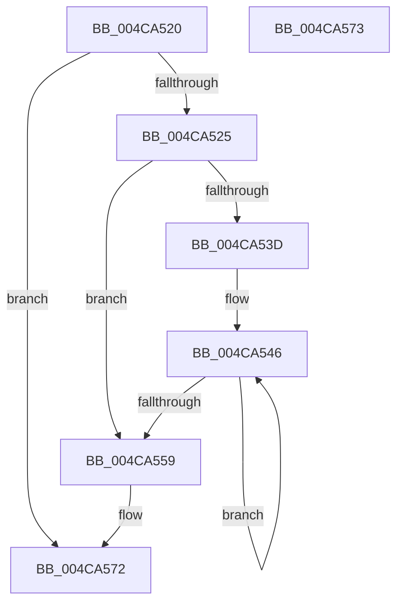

# PsFreeEnclaveModuleInfo

- RVA: `0x004CA520`–`0x004CA574` (길이 `84` bytes)
- VA: `0x00000001404CA520`
- 실행 섹션: `.text`
- PDB 이름 있음: `예`; PDB Function 태그: `아니요`
- unwind 정보 RVA: `0x000ADC24`
- 디코드: `28`개 명령, `84/84` bytes 표시
- 미해석 바이트: `0` (있으면 어셈블리에 `.byte`로 보존)

> 이 문서는 커널 이미지의 기계어와 PDB 기호를 분석해 생성했습니다. 4번과 5번은 함수 원형과 자료형을 바이너리 사용 방식에서 추정한 C 해석이며 원본 소스 복구 결과는 아닙니다.

## 1. Dependencies

- 직접 호출 지점: **2**; 고유 호출 대상: **1**
- 직접 호출자로 확인된 함수: **2**
- RIP 상대 이미지 참조: **0**

### Outgoing calls
- `0x004CA54F` → [ExFreePoolWithTag](../../poolcode/B8/ExFreePoolWithTag_function_00B82870.md) (function, `0x00B82870`)
- `0x004CA55E` → [ExFreePoolWithTag](../../poolcode/B8/ExFreePoolWithTag_function_00B82870.md) (function, `0x00B82870`)

### Direct callers
- [PsGetProcessEnclaveModuleInfo](PsGetProcessEnclaveModuleInfo_function_004CA2E0.md) at `0x004CA4FB`
- [sub_00B3E1FA](../../page/B3/Unknown_function_00B3E1FA.md) at `0x00B3E223`

### Static image references
- 디코드된 RIP-relative 메모리 참조가 없습니다.

## 2. Other-region calls and transfers

- 다른 실행 섹션으로 향하는 call: **2**
  - `0x004CA54F` → [ExFreePoolWithTag](../../poolcode/B8/ExFreePoolWithTag_function_00B82870.md) (`.text` → `POOLCODE`)
  - `0x004CA55E` → [ExFreePoolWithTag](../../poolcode/B8/ExFreePoolWithTag_function_00B82870.md) (`.text` → `POOLCODE`)
- 별도 외부 분기/꼬리 이동을 확인하지 못했습니다.

## 3. Assembly (complete function range)

```asm
004CA520  48 85 C9                        test rcx, rcx
004CA523  74 4D                           je 0x1404ca572
004CA525  48 89 5C 24 08                  mov qword ptr [rsp + 8], rbx
004CA52A  48 89 74 24 10                  mov qword ptr [rsp + 0x10], rsi
004CA52F  57                              push rdi
004CA530  48 83 EC 20                     sub rsp, 0x20
004CA534  8B FA                           mov edi, edx
004CA536  48 8B F1                        mov rsi, rcx
004CA539  85 D2                           test edx, edx
004CA53B  74 1C                           je 0x1404ca559
004CA53D  8B DF                           mov ebx, edi
004CA53F  48 C1 E3 04                     shl rbx, 4
004CA543  48 03 D9                        add rbx, rcx
004CA546  48 8D 5B F0                     lea rbx, [rbx - 0x10]
004CA54A  33 D2                           xor edx, edx
004CA54C  48 8B 0B                        mov rcx, qword ptr [rbx]
004CA54F  E8 1C 83 6B 00                  call 0x140b82870
004CA554  83 C7 FF                        add edi, -1
004CA557  75 ED                           jne 0x1404ca546
004CA559  33 D2                           xor edx, edx
004CA55B  48 8B CE                        mov rcx, rsi
004CA55E  E8 0D 83 6B 00                  call 0x140b82870
004CA563  48 8B 5C 24 30                  mov rbx, qword ptr [rsp + 0x30]
004CA568  48 8B 74 24 38                  mov rsi, qword ptr [rsp + 0x38]
004CA56D  48 83 C4 20                     add rsp, 0x20
004CA571  5F                              pop rdi
004CA572  C3                              ret
004CA573  CC                              int3
```

## 4. C-style interpretation (structured pseudocode)

```c
__int64 __fastcall PsFreeEnclaveModuleInfo(__int64 a1, int a2)
{
    __int64 result;
    __int64 v_rbx;
    __int64 v_rdi;
    __int64 v_rsp;
    unsigned __int64 v_stack_p10;
    unsigned __int64 v_stack_p8;

    if (a1 == 0) goto loc_004CA572;
    v_stack_p8 = v_rbx;
    v_stack_p10 = v_rsi;
    v_rsp = (v_rsp) - (32);
    if (a2 == 0) goto loc_004CA559;
    v_rbx = ((unsigned int)((unsigned int)((unsigned int)(a2)))) << (4);
    v_rbx = (v_rbx) + (a1);
loc_004CA546:
    a2 = 0;
    result = ExFreePoolWithTag(*(unsigned __int64 *)(v_rbx - 16), a2, a3, a4);
    v_rdi = (unsigned int)(((unsigned int)(a2)) + (-1));
    if (condition_is_not_equal) goto loc_004CA546;
loc_004CA559:
    a2 = 0;
    result = ExFreePoolWithTag(a1, a2, a3, a4);
    v_rsp = (v_rsp) + (32);
loc_004CA572:
    return result;
}
```

## 5. (Beta) C Style

```c
int64_t PsFreeEnclaveModuleInfo(int64_t Arg1, int32_t Arg2)
{
    int64_t result;
    int64_t local_rbx;
    int64_t local_rdi;
    int64_t local_rsp;
    uint64_t v_stack_p10;
    uint64_t v_stack_p8;

    if (Arg1 == 0) goto loc_004CA572;
    v_stack_p8 = local_rbx;
    v_stack_p10 = local_rsi;
    local_rsp = (local_rsp) - (32);
    if (Arg2 == 0) goto loc_004CA559;
    local_rbx = ((uint32_t)((uint32_t)((uint32_t)(Arg2)))) << (4);
    local_rbx = (local_rbx) + (Arg1);
loc_004CA546:
    Arg2 = 0;
    result = ExFreePoolWithTag(*(uint64_t *)(local_rbx - 0x10), Arg2, a3, a4);
    local_rdi = (uint32_t)(((uint32_t)(Arg2)) + (-1));
    if (condition_is_not_equal) goto loc_004CA546;
loc_004CA559:
    Arg2 = 0;
    result = ExFreePoolWithTag(Arg1, Arg2, a3, a4);
    local_rsp = (local_rsp) + (32);
loc_004CA572:
    return result;
}
```

## 6. Execution-region graph

[열기: 2D/3D 그래프와 함수 탐색 컨트롤 패널](../../../control-panel.html?section=text&rva=0x004CA520&view=graph)

- 2D 그래프는 위에서 아래로 흐르고, 3D 그래프는 빈 공간을 드래그해 회전합니다. Shift+드래그는 이동, 휠은 확대·축소, 함수 노드 선택은 대상 보고서 이동입니다.

### Static fallback


