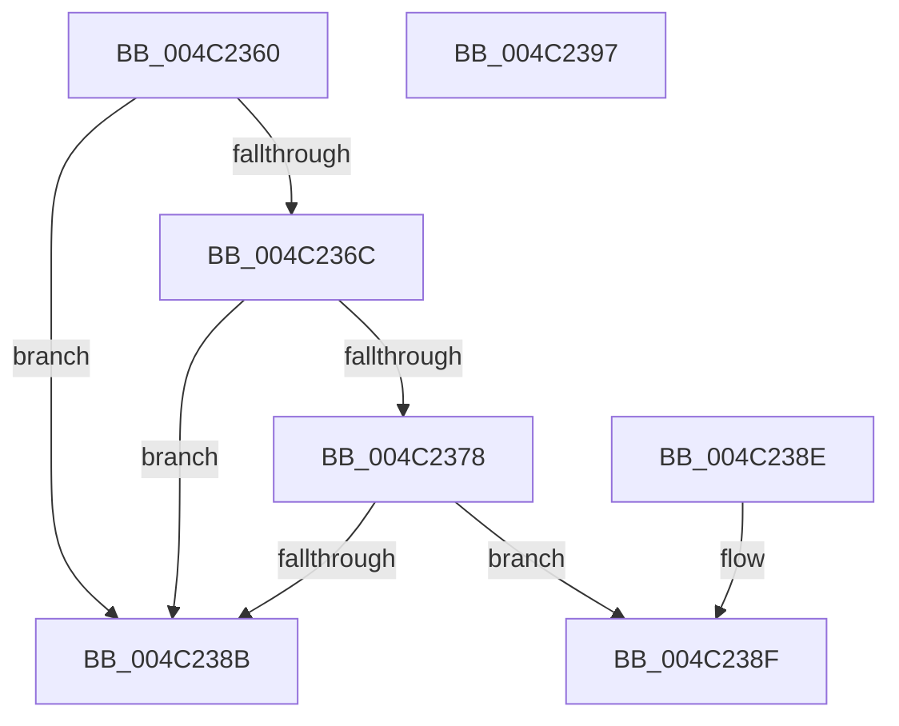

# PsGetProcessCommonJob

- RVA: `0x004C2360`–`0x004C2398` (길이 `56` bytes)
- VA: `0x00000001404C2360`
- 실행 섹션: `.text`
- PDB 이름 있음: `예`; PDB Function 태그: `아니요`
- unwind 정보 RVA: `0x000DB714`
- 디코드: `16`개 명령, `56/56` bytes 표시
- 미해석 바이트: `0` (있으면 어셈블리에 `.byte`로 보존)

> 이 문서는 커널 이미지의 기계어와 PDB 기호를 분석해 생성했습니다. 4번과 5번은 함수 원형과 자료형을 바이너리 사용 방식에서 추정한 C 해석이며 원본 소스 복구 결과는 아닙니다.

## 1. Dependencies

- 직접 호출 지점: **0**; 고유 호출 대상: **0**
- 직접 호출자로 확인된 함수: **0**
- RIP 상대 이미지 참조: **0**

### Outgoing calls
- 직접 디코드된 call 명령이 없습니다.

### Direct callers
- 이 함수 시작 RVA로 연결되는 직접 call은 확인되지 않았습니다. 간접 호출은 완전히 역산할 수 없습니다.

### Static image references
- 디코드된 RIP-relative 메모리 참조가 없습니다.

## 2. Other-region calls and transfers

- 다른 실행 섹션으로 향하는 call: **0**
- 별도 외부 분기/꼬리 이동을 확인하지 못했습니다.

## 3. Assembly (complete function range)

```asm
004C2360  48 8B 81 A0 02 00 00            mov rax, qword ptr [rcx + 0x2a0]
004C2367  48 85 C0                        test rax, rax
004C236A  74 1F                           je 0x1404c238b
004C236C  48 8B 92 A0 02 00 00            mov rdx, qword ptr [rdx + 0x2a0]
004C2373  48 85 D2                        test rdx, rdx
004C2376  74 13                           je 0x1404c238b
004C2378  48 8B 92 20 05 00 00            mov rdx, qword ptr [rdx + 0x520]
004C237F  48 8B 88 20 05 00 00            mov rcx, qword ptr [rax + 0x520]
004C2386  48 3B CA                        cmp rcx, rdx
004C2389  74 04                           je 0x1404c238f
004C238B  33 C0                           xor eax, eax
004C238D  C3                              ret
004C238E  CC                              int3
004C238F  48 8B 80 20 05 00 00            mov rax, qword ptr [rax + 0x520]
004C2396  C3                              ret
004C2397  CC                              int3
```

## 4. C-style interpretation (structured pseudocode)

```c
__int64 __fastcall PsGetProcessCommonJob(__int64 a1, __int64 a2)
{
    __int64 result;

    if (*(unsigned __int64 *)(a1 + 672) == 0) goto loc_004C238B;
    if (*(unsigned __int64 *)(a2 + 672) == 0) goto loc_004C238B;
    if ((*(unsigned __int64 *)(*(unsigned __int64 *)(a1 + 672) + 1312)) == (*(unsigned __int64 *)(*(unsigned __int64 *)(a2 + 672) + 1312))) goto loc_004C238F;
loc_004C238B:
    result = 0;
    return result;
loc_004C238F:
    return *(unsigned __int64 *)(result + 1312);
}
```

## 5. (Beta) C Style

```c
int64_t PsGetProcessCommonJob(void *Arg1, void *Arg2)
{
    uint8_t *arg1 = (uint8_t *)Arg1;
    uint8_t *arg2 = (uint8_t *)Arg2;

    int64_t result;

    if (*(uint64_t *)(arg1 + 0x2A0) == 0) goto loc_004C238B;
    if (*(uint64_t *)(arg2 + 0x2A0) == 0) goto loc_004C238B;
    if ((*(uint64_t *)(*(uint64_t *)(arg1 + 0x2A0) + 0x520)) == (*(uint64_t *)(*(uint64_t *)(arg2 + 0x2A0) + 0x520))) goto loc_004C238F;
loc_004C238B:
    result = 0;
    return result;
loc_004C238F:
    return *(uint64_t *)(result + 0x520);
}
```

### 관측된 메모리 오프셋

구조체 형식이 확인되지 않은 접근은 인자 기준의 오프셋으로만 기록했습니다.

| 기준 인자 | 오프셋 표현 | 폭 (bit) | 접근 |
|---|---:|---:|---|
| `Arg1` | `+ 0x2A0` | `64` | `R` |
| `Arg2` | `+ 0x2A0` | `64` | `R` |

## 6. Execution-region graph

[열기: 2D/3D 그래프와 함수 탐색 컨트롤 패널](../../../control-panel.html?section=text&rva=0x004C2360&view=graph)

- 2D 그래프는 위에서 아래로 흐르고, 3D 그래프는 빈 공간을 드래그해 회전합니다. Shift+드래그는 이동, 휠은 확대·축소, 함수 노드 선택은 대상 보고서 이동입니다.

### Static fallback


