# PsGetProcessEnclaveModuleInfo

- RVA: `0x004CA2E0`–`0x004CA519` (길이 `569` bytes)
- VA: `0x00000001404CA2E0`
- 실행 섹션: `.text`
- PDB 이름 있음: `예`; PDB Function 태그: `아니요`
- unwind 정보 RVA: `0x000BD538`
- 디코드: `166`개 명령, `569/569` bytes 표시
- 미해석 바이트: `0` (있으면 어셈블리에 `.byte`로 보존)

> 이 문서는 커널 이미지의 기계어와 PDB 기호를 분석해 생성했습니다. 4번과 5번은 함수 원형과 자료형을 바이너리 사용 방식에서 추정한 C 해석이며 원본 소스 복구 결과는 아닙니다.

## 1. Dependencies

- 직접 호출 지점: **8**; 고유 호출 대상: **8**
- 직접 호출자로 확인된 함수: **1**
- RIP 상대 이미지 참조: **0**

### Outgoing calls
- `0x004CA336` → [KeAbPreAcquire](../21/KeAbPreAcquire_function_00210230.md) (function, `0x00210230`)
- `0x004CA350` → [ExfAcquirePushLockExclusiveEx](../20/ExfAcquirePushLockExclusiveEx_function_0020FC90.md) (function, `0x0020FC90`)
- `0x004CA3F6` → [ExAllocatePool2](../../poolcode/B8/ExAllocatePool2_function_00B820F0.md) (function, `0x00B820F0`)
- `0x004CA491` → [MmGetEnclaveModuleList](../68/MmGetEnclaveModuleList_function_0068719C.md) (function, `0x0068719C`)
- `0x004CA4CD` → [ExfTryToWakePushLock](../26/ExfTryToWakePushLock_function_00265DD0.md) (function, `0x00265DD0`)
- `0x004CA4D5` → [KeAbPostRelease](../2E/KeAbPostRelease_function_002E1600.md) (function, `0x002E1600`)
- `0x004CA4DA` → [KeLeaveCriticalRegion](../25/KeLeaveCriticalRegion_function_0025D8B0.md) (function, `0x0025D8B0`)
- `0x004CA4FB` → [PsFreeEnclaveModuleInfo](PsFreeEnclaveModuleInfo_function_004CA520.md) (function, `0x004CA520`)

### Direct callers
- [DbgkpPostModuleMessages](../../page/A5/DbgkpPostModuleMessages_function_00A5F86C.md) at `0x00A5F9EF`

### Static image references
- 디코드된 RIP-relative 메모리 참조가 없습니다.

## 2. Other-region calls and transfers

- 다른 실행 섹션으로 향하는 call: **1**
  - `0x004CA3F6` → [ExAllocatePool2](../../poolcode/B8/ExAllocatePool2_function_00B820F0.md) (`.text` → `POOLCODE`)
- 별도 외부 분기/꼬리 이동을 확인하지 못했습니다.

## 3. Assembly (complete function range)

```asm
004CA2E0  48 89 5C 24 20                  mov qword ptr [rsp + 0x20], rbx
004CA2E5  4C 89 44 24 18                  mov qword ptr [rsp + 0x18], r8
004CA2EA  48 89 54 24 10                  mov qword ptr [rsp + 0x10], rdx
004CA2EF  55                              push rbp
004CA2F0  56                              push rsi
004CA2F1  57                              push rdi
004CA2F2  41 54                           push r12
004CA2F4  41 55                           push r13
004CA2F6  41 56                           push r14
004CA2F8  41 57                           push r15
004CA2FA  48 83 EC 20                     sub rsp, 0x20
004CA2FE  33 C0                           xor eax, eax
004CA300  48 8D A9 58 06 00 00            lea rbp, [rcx + 0x658]
004CA307  44 8B E0                        mov r12d, eax
004CA30A  89 44 24 60                     mov dword ptr [rsp + 0x60], eax
004CA30E  44 8B F0                        mov r14d, eax
004CA311  44 8B E8                        mov r13d, eax
004CA314  8B F0                           mov esi, eax
004CA316  4C 8B F9                        mov r15, rcx
004CA319  65 48 8B 04 25 88 01 00 00      mov rax, qword ptr gs:[0x188]
004CA322  48 83 CB FF                     or rbx, 0xffffffffffffffff
004CA326  45 33 C0                        xor r8d, r8d
004CA329  33 D2                           xor edx, edx
004CA32B  48 8B CD                        mov rcx, rbp
004CA32E  66 01 98 E4 01 00 00            add word ptr [rax + 0x1e4], bx
004CA335  90                              nop
004CA336  E8 F5 5E D4 FF                  call 0x140210230
004CA33B  F0 48 0F BA 6D 00 00            lock bts qword ptr [rbp], 0
004CA342  48 8B F8                        mov rdi, rax
004CA345  73 0E                           jae 0x1404ca355
004CA347  4C 8B C5                        mov r8, rbp
004CA34A  48 8B D0                        mov rdx, rax
004CA34D  48 8B CD                        mov rcx, rbp
004CA350  E8 3B 59 D4 FF                  call 0x14020fc90
004CA355  45 33 D2                        xor r10d, r10d
004CA358  48 85 FF                        test rdi, rdi
004CA35B  74 04                           je 0x1404ca361
004CA35D  C6 47 0A 01                     mov byte ptr [rdi + 0xa], 1
004CA361  4D 8B 87 48 06 00 00            mov r8, qword ptr [r15 + 0x648]
004CA368  4D 85 C0                        test r8, r8
004CA36B  0F 84 4B 01 00 00               je 0x1404ca4bc
004CA371  49 8B 50 08                     mov rdx, qword ptr [r8 + 8]
004CA375  49 B9 02 00 00 00 00 00 00 80   movabs r9, 0x8000000000000002
004CA37F  48 8B CA                        mov rcx, rdx
004CA382  48 85 C9                        test rcx, rcx
004CA385  74 16                           je 0x1404ca39d
004CA387  48 8B 01                        mov rax, qword ptr [rcx]
004CA38A  49 23 C1                        and rax, r9
004CA38D  49 3B C1                        cmp rax, r9
004CA390  75 03                           jne 0x1404ca395
004CA392  49 8B 02                        mov rax, qword ptr [r10]
004CA395  48 8B 09                        mov rcx, qword ptr [rcx]
004CA398  F6 C1 01                        test cl, 1
004CA39B  74 31                           je 0x1404ca3ce
004CA39D  41 8B 48 04                     mov ecx, dword ptr [r8 + 4]
004CA3A1  48 83 C2 08                     add rdx, 8
004CA3A5  49 8B 40 08                     mov rax, qword ptr [r8 + 8]
004CA3A9  48 C1 E9 05                     shr rcx, 5
004CA3AD  4C 8D 0C C8                     lea r9, [rax + rcx*8]
004CA3B1  49 3B D1                        cmp rdx, r9
004CA3B4  73 25                           jae 0x1404ca3db
004CA3B6  48 8B 0A                        mov rcx, qword ptr [rdx]
004CA3B9  F6 C1 01                        test cl, 1
004CA3BC  74 06                           je 0x1404ca3c4
004CA3BE  48 83 C2 08                     add rdx, 8
004CA3C2  EB ED                           jmp 0x1404ca3b1
004CA3C4  49 B9 02 00 00 00 00 00 00 80   movabs r9, 0x8000000000000002
004CA3CE  48 8B C1                        mov rax, rcx
004CA3D1  48 85 C0                        test rax, rax
004CA3D4  74 05                           je 0x1404ca3db
004CA3D6  41 FF C6                        inc r14d
004CA3D9  EB A7                           jmp 0x1404ca382
004CA3DB  45 85 F6                        test r14d, r14d
004CA3DE  0F 84 D8 00 00 00               je 0x1404ca4bc
004CA3E4  41 8B D6                        mov edx, r14d
004CA3E7  B9 00 01 00 00                  mov ecx, 0x100
004CA3EC  48 C1 E2 04                     shl rdx, 4
004CA3F0  41 B8 50 53 45 56               mov r8d, 0x56455350
004CA3F6  E8 F5 7C 6B 00                  call 0x140b820f0
004CA3FB  45 33 D2                        xor r10d, r10d
004CA3FE  4C 8B E8                        mov r13, rax
004CA401  48 85 C0                        test rax, rax
004CA404  75 0B                           jne 0x1404ca411
004CA406  41 BC 17 00 00 C0               mov r12d, 0xc0000017
004CA40C  E9 AB 00 00 00                  jmp 0x1404ca4bc
004CA411  4D 8B BF 48 06 00 00            mov r15, qword ptr [r15 + 0x648]
004CA418  49 8B 77 08                     mov rsi, qword ptr [r15 + 8]
004CA41C  48 8B FE                        mov rdi, rsi
004CA41F  45 85 F6                        test r14d, r14d
004CA422  0F 84 91 00 00 00               je 0x1404ca4b9
004CA428  48 BB 02 00 00 00 00 00 00 80   movabs rbx, 0x8000000000000002
004CA432  48 85 FF                        test rdi, rdi
004CA435  74 17                           je 0x1404ca44e
004CA437  48 8B 07                        mov rax, qword ptr [rdi]
004CA43A  48 23 C3                        and rax, rbx
004CA43D  48 3B C3                        cmp rax, rbx
004CA440  75 03                           jne 0x1404ca445
004CA442  49 8B 02                        mov rax, qword ptr [r10]
004CA445  48 8B 3F                        mov rdi, qword ptr [rdi]
004CA448  40 F6 C7 01                     test dil, 1
004CA44C  74 28                           je 0x1404ca476
004CA44E  41 8B 4F 04                     mov ecx, dword ptr [r15 + 4]
004CA452  48 83 C6 08                     add rsi, 8
004CA456  49 8B 47 08                     mov rax, qword ptr [r15 + 8]
004CA45A  48 C1 E9 05                     shr rcx, 5
004CA45E  48 8D 14 C8                     lea rdx, [rax + rcx*8]
004CA462  48 3B F2                        cmp rsi, rdx
004CA465  73 48                           jae 0x1404ca4af
004CA467  48 8B 3E                        mov rdi, qword ptr [rsi]
004CA46A  40 F6 C7 01                     test dil, 1
004CA46E  74 06                           je 0x1404ca476
004CA470  48 83 C6 08                     add rsi, 8
004CA474  EB EC                           jmp 0x1404ca462
004CA476  48 8B CF                        mov rcx, rdi
004CA479  48 85 C9                        test rcx, rcx
004CA47C  74 31                           je 0x1404ca4af
004CA47E  8B 54 24 60                     mov edx, dword ptr [rsp + 0x60]
004CA482  48 8B 49 20                     mov rcx, qword ptr [rcx + 0x20]
004CA486  48 C1 E2 04                     shl rdx, 4
004CA48A  49 03 D5                        add rdx, r13
004CA48D  4C 8D 42 08                     lea r8, [rdx + 8]
004CA491  E8 06 CD 1B 00                  call 0x14068719c
004CA496  45 33 D2                        xor r10d, r10d
004CA499  44 8B E0                        mov r12d, eax
004CA49C  85 C0                           test eax, eax
004CA49E  78 0F                           js 0x1404ca4af
004CA4A0  8B 44 24 60                     mov eax, dword ptr [rsp + 0x60]
004CA4A4  FF C0                           inc eax
004CA4A6  89 44 24 60                     mov dword ptr [rsp + 0x60], eax
004CA4AA  41 3B C6                        cmp eax, r14d
004CA4AD  72 83                           jb 0x1404ca432
004CA4AF  8B 74 24 60                     mov esi, dword ptr [rsp + 0x60]
004CA4B3  48 83 CB FF                     or rbx, 0xffffffffffffffff
004CA4B7  EB 03                           jmp 0x1404ca4bc
004CA4B9  41 8B F2                        mov esi, r10d
004CA4BC  F0 48 0F C1 5D 00               lock xadd qword ptr [rbp], rbx
004CA4C2  80 E3 06                        and bl, 6
004CA4C5  80 FB 02                        cmp bl, 2
004CA4C8  75 08                           jne 0x1404ca4d2
004CA4CA  48 8B CD                        mov rcx, rbp
004CA4CD  E8 FE B8 D9 FF                  call 0x140265dd0
004CA4D2  48 8B CD                        mov rcx, rbp
004CA4D5  E8 26 71 E1 FF                  call 0x1402e1600
004CA4DA  E8 D1 33 D9 FF                  call 0x14025d8b0
004CA4DF  45 85 E4                        test r12d, r12d
004CA4E2  78 12                           js 0x1404ca4f6
004CA4E4  48 8B 44 24 68                  mov rax, qword ptr [rsp + 0x68]
004CA4E9  4C 89 28                        mov qword ptr [rax], r13
004CA4EC  48 8B 44 24 70                  mov rax, qword ptr [rsp + 0x70]
004CA4F1  44 89 30                        mov dword ptr [rax], r14d
004CA4F4  EB 0A                           jmp 0x1404ca500
004CA4F6  8B D6                           mov edx, esi
004CA4F8  49 8B CD                        mov rcx, r13
004CA4FB  E8 20 00 00 00                  call 0x1404ca520
004CA500  48 8B 5C 24 78                  mov rbx, qword ptr [rsp + 0x78]
004CA505  41 8B C4                        mov eax, r12d
004CA508  48 83 C4 20                     add rsp, 0x20
004CA50C  41 5F                           pop r15
004CA50E  41 5E                           pop r14
004CA510  41 5D                           pop r13
004CA512  41 5C                           pop r12
004CA514  5F                              pop rdi
004CA515  5E                              pop rsi
004CA516  5D                              pop rbp
004CA517  C3                              ret
004CA518  CC                              int3
```

## 4. C-style interpretation (structured pseudocode)

```c
__int64 __fastcall PsGetProcessEnclaveModuleInfo(__int64 a1, __int64 a2, __int64 a3)
{
    __int64 result;
    __int64 v_r10;
    __int64 v_r14;
    __int64 v_rbx;
    __int64 v_rsi;
    __int64 v_rsp;
    unsigned __int64 v_stack_p10;
    unsigned __int64 v_stack_p18;
    unsigned __int64 v_stack_p20;
    unsigned int v_stack_p8;

    v_stack_p20 = v_rbx;
    v_stack_p18 = a3;
    v_stack_p10 = a2;
    v_rsp = (v_rsp) - (32);
    result = 0;
    v_stack_p8 = 0;
    v_rbx = (v_rbx) | (-1);
    a3 = 0;
    a2 = 0;
    result = KeAbPreAcquire(a1 + 1624, a2, a3, a4);
    if (!(condition_is_above_or_equal)) {
        a3 = a1 + 1624;
        a2 = result;
        a1 = a1 + 1624;
        result = ExfAcquirePushLockExclusiveEx(a1, a2, a3, a4);
    }
    v_r10 = 0;
    if (result != 0) {
        *(unsigned __int8 *)(result + 10) = 1;
    }
    if (*(unsigned __int64 *)(a1 + 1608) == 0) goto loc_004CA4BC;
loc_004CA382:
    if (*(unsigned __int64 *)(*(unsigned __int64 *)(a1 + 1608) + 8) == 0) goto loc_004CA39D;
    result = (*(unsigned __int64 *)(*(unsigned __int64 *)(*(unsigned __int64 *)(a1 + 1608) + 8))) & (a4);
    if (result == a4) {
        result = *(unsigned __int64 *)(v_r10);
    }
    if ((((unsigned __int8)(*(unsigned __int64 *)(*(unsigned __int64 *)(*(unsigned __int64 *)(a1 + 1608) + 8)))) & (1)) == 0) goto loc_004CA3CE;
loc_004CA39D:
    a2 = (*(unsigned __int64 *)(*(unsigned __int64 *)(a1 + 1608) + 8)) + (8);
    a1 = ((unsigned int)(*(unsigned int *)(*(unsigned __int64 *)(a1 + 1608) + 4))) >> (5);
loc_004CA3B1:
    if (a2 >= (*(unsigned __int64 *)(*(unsigned __int64 *)(a1 + 1608) + 8) + a1 * 8)) goto loc_004CA3DB;
    if ((((unsigned __int8)(*(unsigned __int64 *)(a2))) & (1)) == 0) goto loc_004CA3C4;
    a2 = (a2) + (8);
    goto loc_004CA3B1;
loc_004CA3C4:
loc_004CA3CE:
    if (*(unsigned __int64 *)(a2) == 0) goto loc_004CA3DB;
    v_r14 = (unsigned int)((0) + 1);
    goto loc_004CA382;
loc_004CA3DB:
    if ((unsigned int)(v_r14) == 0) goto loc_004CA4BC;
    a2 = ((unsigned int)((unsigned int)(v_r14))) << (4);
    result = ExAllocatePool2(256, a2, (unsigned int)(0x56455350ULL), *(unsigned __int64 *)(*(unsigned __int64 *)(a1 + 1608) + 8) + a1 * 8);
    v_r10 = 0;
    if (result != 0) goto loc_004CA411;
    goto loc_004CA4BC;
loc_004CA411:
    if ((unsigned int)(v_r14) == 0) goto loc_004CA4B9;
loc_004CA432:
    if (*(unsigned __int64 *)(*(unsigned __int64 *)(a1 + 1608) + 8) == 0) goto loc_004CA44E;
    result = (*(unsigned __int64 *)(*(unsigned __int64 *)(*(unsigned __int64 *)(a1 + 1608) + 8))) & (v_rbx);
    if (result == v_rbx) {
        result = *(unsigned __int64 *)(v_r10);
    }
    if ((((unsigned __int8)(*(unsigned __int64 *)(*(unsigned __int64 *)(*(unsigned __int64 *)(a1 + 1608) + 8)))) & (1)) == 0) goto loc_004CA476;
loc_004CA44E:
    v_rsi = (*(unsigned __int64 *)(*(unsigned __int64 *)(a1 + 1608) + 8)) + (8);
    a1 = ((unsigned int)(*(unsigned int *)(*(unsigned __int64 *)(a1 + 1608) + 4))) >> (5);
loc_004CA462:
    if (v_rsi >= (*(unsigned __int64 *)(*(unsigned __int64 *)(a1 + 1608) + 8) + a1 * 8)) goto loc_004CA4AF;
    if ((((unsigned __int8)(*(unsigned __int64 *)(v_rsi))) & (1)) == 0) goto loc_004CA476;
    v_rsi = (v_rsi) + (8);
    goto loc_004CA462;
loc_004CA476:
    if (*(unsigned __int64 *)(v_rsi) == 0) goto loc_004CA4AF;
    a2 = ((unsigned int)(v_stack_p8)) << (4);
    a2 = (a2) + (result);
    result = MmGetEnclaveModuleList(*(unsigned __int64 *)(*(unsigned __int64 *)(v_rsi) + 32), a2, a2 + 8, *(unsigned __int64 *)(*(unsigned __int64 *)(a1 + 1608) + 8) + a1 * 8);
    v_r10 = 0;
    if (sign_flag) goto loc_004CA4AF;
    result = (unsigned int)(((unsigned int)(v_stack_p8)) + 1);
    v_stack_p8 = (unsigned int)(result);
    if (((unsigned int)(result)) < ((unsigned int)(v_r14))) goto loc_004CA432;
loc_004CA4AF:
    v_rbx = (v_rbx) | (-1);
    goto loc_004CA4BC;
loc_004CA4B9:
loc_004CA4BC:
    v_rbx = (unsigned __int8)((v_rbx) & (6));
    if (((unsigned __int8)(v_rbx)) == 2) {
        a1 = a1 + 1624;
        result = ExfTryToWakePushLock(a1, a2, a2 + 8, *(unsigned __int64 *)(*(unsigned __int64 *)(a1 + 1608) + 8) + a1 * 8);
    }
    result = KeAbPostRelease(a1 + 1624, a2, a2 + 8, *(unsigned __int64 *)(*(unsigned __int64 *)(a1 + 1608) + 8) + a1 * 8);
    result = KeLeaveCriticalRegion(a1 + 1624, a2, a2 + 8, *(unsigned __int64 *)(*(unsigned __int64 *)(a1 + 1608) + 8) + a1 * 8);
    if (sign_flag) goto loc_004CA4F6;
    *(unsigned __int64 *)(v_stack_p10) = result;
    *(unsigned int *)(v_stack_p18) = (unsigned int)(v_r14);
    goto loc_004CA500;
loc_004CA4F6:
    result = PsFreeEnclaveModuleInfo(result, 0, a2 + 8, *(unsigned __int64 *)(*(unsigned __int64 *)(a1 + 1608) + 8) + a1 * 8);
loc_004CA500:
    v_rsp = (v_rsp) + (32);
    return (unsigned int)((unsigned int)((unsigned int)((unsigned int)(result))));
}
```

## 5. (Beta) C Style

```c
int64_t PsGetProcessEnclaveModuleInfo(void *Arg1, int64_t Arg2, int64_t Arg3)
{
    uint8_t *arg1 = (uint8_t *)Arg1;

    int64_t result;
    int64_t local_r10;
    int64_t local_r14;
    int64_t local_rbx;
    int64_t local_rsi;
    int64_t local_rsp;
    uint64_t v_stack_p10;
    uint64_t v_stack_p18;
    uint64_t v_stack_p20;
    uint32_t v_stack_p8;

    v_stack_p20 = local_rbx;
    v_stack_p18 = Arg3;
    v_stack_p10 = Arg2;
    local_rsp = (local_rsp) - (32);
    result = 0;
    v_stack_p8 = 0;
    local_rbx = (local_rbx) | (-1);
    Arg3 = 0;
    Arg2 = 0;
    result = KeAbPreAcquire(Arg1 + 1624, Arg2, Arg3, a4);
    if (!(condition_is_above_or_equal)) {
        Arg3 = Arg1 + 1624;
        Arg2 = result;
        Arg1 = Arg1 + 1624;
        result = ExfAcquirePushLockExclusiveEx(Arg1, Arg2, Arg3, a4);
    }
    local_r10 = 0;
    if (result != 0) {
        *(uint8_t *)(result + 0xA) = 1;
    }
    if (*(uint64_t *)(arg1 + 0x648) == 0) goto loc_004CA4BC;
loc_004CA382:
    if (*(uint64_t *)(*(uint64_t *)(arg1 + 0x648) + 0x8) == 0) goto loc_004CA39D;
    result = (*(uint64_t *)(*(uint64_t *)(*(uint64_t *)(arg1 + 0x648) + 0x8))) & (a4);
    if (result == a4) {
        result = *(uint64_t *)(local_r10);
    }
    if ((((uint8_t)(*(uint64_t *)(*(uint64_t *)(*(uint64_t *)(arg1 + 0x648) + 0x8)))) & (1)) == 0) goto loc_004CA3CE;
loc_004CA39D:
    Arg2 = (*(uint64_t *)(*(uint64_t *)(arg1 + 0x648) + 0x8)) + (8);
    Arg1 = ((uint32_t)(*(uint32_t *)(*(uint64_t *)(arg1 + 0x648) + 0x4))) >> (5);
loc_004CA3B1:
    if (Arg2 >= (*(uint64_t *)(*(uint64_t *)(arg1 + 0x648) + 0x8) + Arg1 * 8)) goto loc_004CA3DB;
    if ((((uint8_t)(*(uint64_t *)(Arg2))) & (1)) == 0) goto loc_004CA3C4;
    Arg2 = (Arg2) + (8);
    goto loc_004CA3B1;
loc_004CA3C4:
loc_004CA3CE:
    if (*(uint64_t *)(Arg2) == 0) goto loc_004CA3DB;
    local_r14 = (uint32_t)((0) + 1);
    goto loc_004CA382;
loc_004CA3DB:
    if ((uint32_t)(local_r14) == 0) goto loc_004CA4BC;
    Arg2 = ((uint32_t)((uint32_t)(local_r14))) << (4);
    result = ExAllocatePool2(256, Arg2, (uint32_t)(0x56455350ULL), *(uint64_t *)(*(uint64_t *)(arg1 + 0x648) + 0x8) + Arg1 * 8);
    local_r10 = 0;
    if (result != 0) goto loc_004CA411;
    goto loc_004CA4BC;
loc_004CA411:
    if ((uint32_t)(local_r14) == 0) goto loc_004CA4B9;
loc_004CA432:
    if (*(uint64_t *)(*(uint64_t *)(arg1 + 0x648) + 0x8) == 0) goto loc_004CA44E;
    result = (*(uint64_t *)(*(uint64_t *)(*(uint64_t *)(arg1 + 0x648) + 0x8))) & (local_rbx);
    if (result == local_rbx) {
        result = *(uint64_t *)(local_r10);
    }
    if ((((uint8_t)(*(uint64_t *)(*(uint64_t *)(*(uint64_t *)(arg1 + 0x648) + 0x8)))) & (1)) == 0) goto loc_004CA476;
loc_004CA44E:
    local_rsi = (*(uint64_t *)(*(uint64_t *)(arg1 + 0x648) + 0x8)) + (8);
    Arg1 = ((uint32_t)(*(uint32_t *)(*(uint64_t *)(arg1 + 0x648) + 0x4))) >> (5);
loc_004CA462:
    if (local_rsi >= (*(uint64_t *)(*(uint64_t *)(arg1 + 0x648) + 0x8) + Arg1 * 8)) goto loc_004CA4AF;
    if ((((uint8_t)(*(uint64_t *)(local_rsi))) & (1)) == 0) goto loc_004CA476;
    local_rsi = (local_rsi) + (8);
    goto loc_004CA462;
loc_004CA476:
    if (*(uint64_t *)(local_rsi) == 0) goto loc_004CA4AF;
    Arg2 = ((uint32_t)(v_stack_p8)) << (4);
    Arg2 = (Arg2) + (result);
    result = MmGetEnclaveModuleList(*(uint64_t *)(*(uint64_t *)(local_rsi) + 0x20), Arg2, Arg2 + 8, *(uint64_t *)(*(uint64_t *)(arg1 + 0x648) + 0x8) + Arg1 * 8);
    local_r10 = 0;
    if (sign_flag) goto loc_004CA4AF;
    result = (uint32_t)(((uint32_t)(v_stack_p8)) + 1);
    v_stack_p8 = (uint32_t)(result);
    if (((uint32_t)(result)) < ((uint32_t)(local_r14))) goto loc_004CA432;
loc_004CA4AF:
    local_rbx = (local_rbx) | (-1);
    goto loc_004CA4BC;
loc_004CA4B9:
loc_004CA4BC:
    local_rbx = (uint8_t)((local_rbx) & (6));
    if (((uint8_t)(local_rbx)) == 2) {
        Arg1 = Arg1 + 1624;
        result = ExfTryToWakePushLock(Arg1, Arg2, Arg2 + 8, *(uint64_t *)(*(uint64_t *)(arg1 + 0x648) + 0x8) + Arg1 * 8);
    }
    result = KeAbPostRelease(Arg1 + 1624, Arg2, Arg2 + 8, *(uint64_t *)(*(uint64_t *)(arg1 + 0x648) + 0x8) + Arg1 * 8);
    result = KeLeaveCriticalRegion(Arg1 + 1624, Arg2, Arg2 + 8, *(uint64_t *)(*(uint64_t *)(arg1 + 0x648) + 0x8) + Arg1 * 8);
    if (sign_flag) goto loc_004CA4F6;
    *(uint64_t *)(v_stack_p10) = result;
    *(uint32_t *)(v_stack_p18) = (uint32_t)(local_r14);
    goto loc_004CA500;
loc_004CA4F6:
    result = PsFreeEnclaveModuleInfo(result, 0, Arg2 + 8, *(uint64_t *)(*(uint64_t *)(arg1 + 0x648) + 0x8) + Arg1 * 8);
loc_004CA500:
    local_rsp = (local_rsp) + (32);
    return (uint32_t)((uint32_t)((uint32_t)((uint32_t)(result))));
}
```

### 관측된 메모리 오프셋

구조체 형식이 확인되지 않은 접근은 인자 기준의 오프셋으로만 기록했습니다.

| 기준 인자 | 오프셋 표현 | 폭 (bit) | 접근 |
|---|---:|---:|---|
| `Arg1` | `+ 0x0` | `64` | `R/W` |
| `Arg1` | `+ 0x648` | `64` | `R` |
| `Arg1` | `+ 0x658` | `64` | `R` |

## 6. Execution-region graph

[열기: 2D/3D 그래프와 함수 탐색 컨트롤 패널](../../../control-panel.html?section=text&rva=0x004CA2E0&view=graph)

- 2D 그래프는 위에서 아래로 흐르고, 3D 그래프는 빈 공간을 드래그해 회전합니다. Shift+드래그는 이동, 휠은 확대·축소, 함수 노드 선택은 대상 보고서 이동입니다.

### Static fallback

```mermaid
flowchart TD
  bb_004CA2E0[BB_004CA2E0]
  bb_004CA347[BB_004CA347]
  bb_004CA355[BB_004CA355]
  bb_004CA35D[BB_004CA35D]
  bb_004CA361[BB_004CA361]
  bb_004CA371[BB_004CA371]
  bb_004CA382[BB_004CA382]
  bb_004CA387[BB_004CA387]
  bb_004CA392[BB_004CA392]
  bb_004CA395[BB_004CA395]
  bb_004CA39D[BB_004CA39D]
  bb_004CA3B1[BB_004CA3B1]
  bb_004CA3B6[BB_004CA3B6]
  bb_004CA3BE[BB_004CA3BE]
  bb_004CA3C4[BB_004CA3C4]
  bb_004CA3CE[BB_004CA3CE]
  bb_004CA3D6[BB_004CA3D6]
  bb_004CA3DB[BB_004CA3DB]
  bb_004CA3E4[BB_004CA3E4]
  bb_004CA406[BB_004CA406]
  bb_004CA411[BB_004CA411]
  bb_004CA428[BB_004CA428]
  bb_004CA432[BB_004CA432]
  bb_004CA437[BB_004CA437]
  bb_004CA442[BB_004CA442]
  bb_004CA445[BB_004CA445]
  bb_004CA44E[BB_004CA44E]
  bb_004CA462[BB_004CA462]
  bb_004CA467[BB_004CA467]
  bb_004CA470[BB_004CA470]
  bb_004CA476[BB_004CA476]
  bb_004CA47E[BB_004CA47E]
  bb_004CA4A0[BB_004CA4A0]
  bb_004CA4AF[BB_004CA4AF]
  bb_004CA4B9[BB_004CA4B9]
  bb_004CA4BC[BB_004CA4BC]
  bb_004CA4CA[BB_004CA4CA]
  bb_004CA4D2[BB_004CA4D2]
  bb_004CA4E4[BB_004CA4E4]
  bb_004CA4F6[BB_004CA4F6]
  bb_004CA500[BB_004CA500]
  bb_004CA518[BB_004CA518]
  bb_004CA2E0 -->|branch| bb_004CA355
  bb_004CA2E0 -->|fallthrough| bb_004CA347
  bb_004CA347 -->|flow| bb_004CA355
  bb_004CA355 -->|branch| bb_004CA361
  bb_004CA355 -->|fallthrough| bb_004CA35D
  bb_004CA35D -->|flow| bb_004CA361
  bb_004CA361 -->|branch| bb_004CA4BC
  bb_004CA361 -->|fallthrough| bb_004CA371
  bb_004CA371 -->|flow| bb_004CA382
  bb_004CA382 -->|branch| bb_004CA39D
  bb_004CA382 -->|fallthrough| bb_004CA387
  bb_004CA387 -->|branch| bb_004CA395
  bb_004CA387 -->|fallthrough| bb_004CA392
  bb_004CA392 -->|flow| bb_004CA395
  bb_004CA395 -->|branch| bb_004CA3CE
  bb_004CA395 -->|fallthrough| bb_004CA39D
  bb_004CA39D -->|flow| bb_004CA3B1
  bb_004CA3B1 -->|branch| bb_004CA3DB
  bb_004CA3B1 -->|fallthrough| bb_004CA3B6
  bb_004CA3B6 -->|branch| bb_004CA3C4
  bb_004CA3B6 -->|fallthrough| bb_004CA3BE
  bb_004CA3BE -->|branch| bb_004CA3B1
  bb_004CA3C4 -->|flow| bb_004CA3CE
  bb_004CA3CE -->|branch| bb_004CA3DB
  bb_004CA3CE -->|fallthrough| bb_004CA3D6
  bb_004CA3D6 -->|branch| bb_004CA382
  bb_004CA3DB -->|branch| bb_004CA4BC
  bb_004CA3DB -->|fallthrough| bb_004CA3E4
  bb_004CA3E4 -->|branch| bb_004CA411
  bb_004CA3E4 -->|fallthrough| bb_004CA406
  bb_004CA406 -->|branch| bb_004CA4BC
  bb_004CA411 -->|branch| bb_004CA4B9
  bb_004CA411 -->|fallthrough| bb_004CA428
  bb_004CA428 -->|flow| bb_004CA432
  bb_004CA432 -->|branch| bb_004CA44E
  bb_004CA432 -->|fallthrough| bb_004CA437
  bb_004CA437 -->|branch| bb_004CA445
  bb_004CA437 -->|fallthrough| bb_004CA442
  bb_004CA442 -->|flow| bb_004CA445
  bb_004CA445 -->|branch| bb_004CA476
  bb_004CA445 -->|fallthrough| bb_004CA44E
  bb_004CA44E -->|flow| bb_004CA462
  bb_004CA462 -->|branch| bb_004CA4AF
  bb_004CA462 -->|fallthrough| bb_004CA467
  bb_004CA467 -->|branch| bb_004CA476
  bb_004CA467 -->|fallthrough| bb_004CA470
  bb_004CA470 -->|branch| bb_004CA462
  bb_004CA476 -->|branch| bb_004CA4AF
  bb_004CA476 -->|fallthrough| bb_004CA47E
  bb_004CA47E -->|branch| bb_004CA4AF
  bb_004CA47E -->|fallthrough| bb_004CA4A0
  bb_004CA4A0 -->|branch| bb_004CA432
  bb_004CA4A0 -->|fallthrough| bb_004CA4AF
  bb_004CA4AF -->|branch| bb_004CA4BC
  bb_004CA4B9 -->|flow| bb_004CA4BC
  bb_004CA4BC -->|branch| bb_004CA4D2
  bb_004CA4BC -->|fallthrough| bb_004CA4CA
  bb_004CA4CA -->|flow| bb_004CA4D2
  bb_004CA4D2 -->|branch| bb_004CA4F6
  bb_004CA4D2 -->|fallthrough| bb_004CA4E4
  bb_004CA4E4 -->|branch| bb_004CA500
  bb_004CA4F6 -->|flow| bb_004CA500
```


