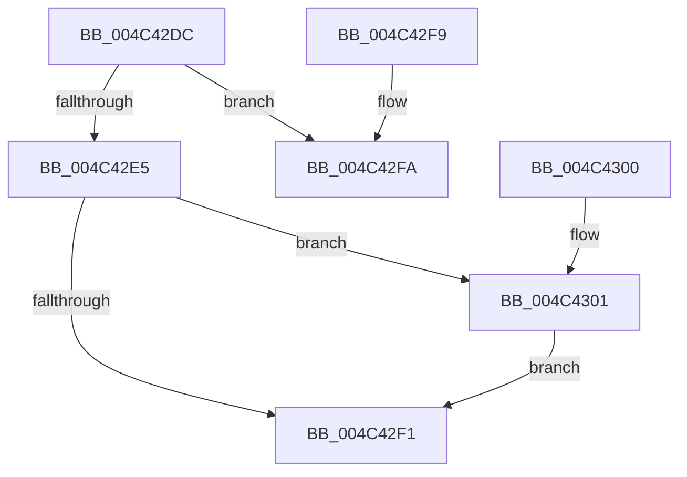

# PsTransferProcessQuotaToSharedQuota

- RVA: `0x004C42DC`–`0x004C430E` (길이 `50` bytes)
- VA: `0x00000001404C42DC`
- 실행 섹션: `.text`
- PDB 이름 있음: `예`; PDB Function 태그: `아니요`
- unwind 정보 RVA: `0x000DB714`
- 디코드: `14`개 명령, `50/50` bytes 표시
- 미해석 바이트: `0` (있으면 어셈블리에 `.byte`로 보존)

> 이 문서는 커널 이미지의 기계어와 PDB 기호를 분석해 생성했습니다. 4번과 5번은 함수 원형과 자료형을 바이너리 사용 방식에서 추정한 C 해석이며 원본 소스 복구 결과는 아닙니다.

## 1. Dependencies

- 직접 호출 지점: **0**; 고유 호출 대상: **0**
- 직접 호출자로 확인된 함수: **1**
- RIP 상대 이미지 참조: **1**

### Outgoing calls
- 직접 디코드된 call 명령이 없습니다.

### Direct callers
- [sub_00B19664](../../page/B1/Unknown_function_00B19664.md) at `0x00B19664`

### Static image references
- `0x004C42DC` → RVA `0x00FC6AB0` (`ALMOSTRO`; read)

## 2. Other-region calls and transfers

- 다른 실행 섹션으로 향하는 call: **0**
- 별도 외부 분기/꼬리 이동을 확인하지 못했습니다.

## 3. Assembly (complete function range)

```asm
004C42DC  48 3B 0D CD 27 B0 00            cmp rcx, qword ptr [rip + 0xb027cd]
004C42E3  74 15                           je 0x1404c42fa
004C42E5  48 8B 81 F8 02 00 00            mov rax, qword ptr [rcx + 0x2f8]
004C42EC  48 85 D2                        test rdx, rdx
004C42EF  75 10                           jne 0x1404c4301
004C42F1  F0 FF 80 00 02 00 00            lock inc dword ptr [rax + 0x200]
004C42F8  C3                              ret
004C42F9  CC                              int3
004C42FA  B8 01 00 00 00                  mov eax, 1
004C42FF  C3                              ret
004C4300  CC                              int3
004C4301  48 F7 DA                        neg rdx
004C4304  F0 48 01 91 08 02 00 00         lock add qword ptr [rcx + 0x208], rdx
004C430C  EB E3                           jmp 0x1404c42f1
```

## 4. C-style interpretation (structured pseudocode)

```c
__int64 __fastcall PsTransferProcessQuotaToSharedQuota(__int64 a1, __int64 a2)
{
    if (a1 == (*(unsigned __int64 *)(v_rip + 11544525))) goto loc_004C42FA;
    if (a2 != 0) goto loc_004C4301;
loc_004C42F1:
    return *(unsigned __int64 *)(a1 + 760);
loc_004C42FA:
    return 1;
loc_004C4301:
    a2 = -(a2);
    goto loc_004C42F1;
}
```

## 5. (Beta) C Style

```c
int64_t PsTransferProcessQuotaToSharedQuota(int64_t Arg1, int64_t Arg2)
{
    if (Arg1 == (*(uint64_t *)(v_rip + 0xB027CD))) goto loc_004C42FA;
    if (Arg2 != 0) goto loc_004C4301;
loc_004C42F1:
    return *(uint64_t *)(Arg1 + 0x2F8);
loc_004C42FA:
    return 1;
loc_004C4301:
    Arg2 = -(Arg2);
    goto loc_004C42F1;
}
```

## 6. Execution-region graph

[열기: 2D/3D 그래프와 함수 탐색 컨트롤 패널](../../../control-panel.html?section=text&rva=0x004C42DC&view=graph)

- 2D 그래프는 위에서 아래로 흐르고, 3D 그래프는 빈 공간을 드래그해 회전합니다. Shift+드래그는 이동, 휠은 확대·축소, 함수 노드 선택은 대상 보고서 이동입니다.

### Static fallback


