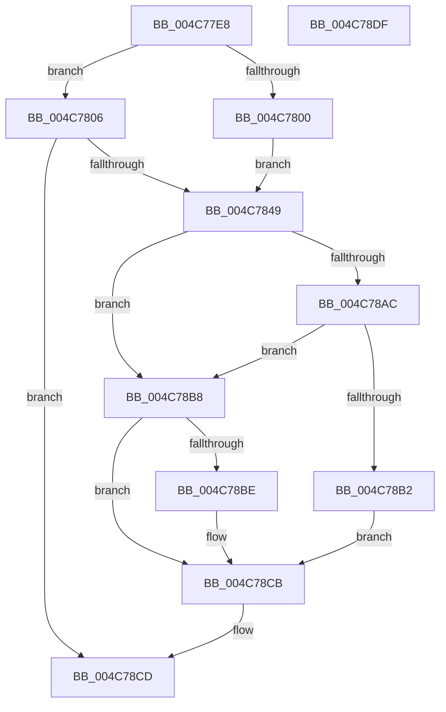

# PspMapView

- RVA: `0x004C77E8`–`0x004C78E0` (길이 `248` bytes)
- VA: `0x00000001404C77E8`
- 실행 섹션: `.text`
- PDB 이름 있음: `예`; PDB Function 태그: `아니요`
- unwind 정보 RVA: `0x000BD228`
- 디코드: `60`개 명령, `248/248` bytes 표시
- 미해석 바이트: `0` (있으면 어셈블리에 `.byte`로 보존)

> 이 문서는 커널 이미지의 기계어와 PDB 기호를 분석해 생성했습니다. 4번과 5번은 함수 원형과 자료형을 바이너리 사용 방식에서 추정한 C 해석이며 원본 소스 복구 결과는 아닙니다.

## 1. Dependencies

- 직접 호출 지점: **3**; 고유 호출 대상: **3**
- 직접 호출자로 확인된 함수: **1**
- RIP 상대 이미지 참조: **1**

### Outgoing calls
- `0x004C7834` → [ObReferenceObjectByHandle](../../page/86/ObReferenceObjectByHandle_function_00868DB0.md) (function, `0x00868DB0`)
- `0x004C78A1` → [MiMapViewOfSectionExCommon](../../page/9A/MiMapViewOfSectionExCommon_function_009A1C60.md) (function, `0x009A1C60`)
- `0x004C78C6` → [ObfDereferenceObjectWithTag](../2F/ObfDereferenceObjectWithTag_function_002F78E0.md) (function, `0x002F78E0`)

### Direct callers
- [sub_006F88AE](../6F/Unknown_function_006F88AE.md) at `0x006F8D7B`

### Static image references
- `0x004C7819` → RVA `0x00FC6BD8` (`ALMOSTRO`; read)

## 2. Other-region calls and transfers

- 다른 실행 섹션으로 향하는 call: **2**
  - `0x004C7834` → [ObReferenceObjectByHandle](../../page/86/ObReferenceObjectByHandle_function_00868DB0.md) (`.text` → `PAGE`)
  - `0x004C78A1` → [MiMapViewOfSectionExCommon](../../page/9A/MiMapViewOfSectionExCommon_function_009A1C60.md) (`.text` → `PAGE`)
- 별도 외부 분기/꼬리 이동을 확인하지 못했습니다.

## 3. Assembly (complete function range)

```asm
004C77E8  48 89 5C 24 10                  mov qword ptr [rsp + 0x10], rbx
004C77ED  48 89 74 24 18                  mov qword ptr [rsp + 0x18], rsi
004C77F2  57                              push rdi
004C77F3  48 83 EC 70                     sub rsp, 0x70
004C77F7  80 79 3D 00                     cmp byte ptr [rcx + 0x3d], 0
004C77FB  48 8B D9                        mov rbx, rcx
004C77FE  74 06                           je 0x1404c7806
004C7800  48 8B 79 18                     mov rdi, qword ptr [rcx + 0x18]
004C7804  EB 43                           jmp 0x1404c7849
004C7806  44 8A 49 3C                     mov r9b, byte ptr [rcx + 0x3c]
004C780A  48 8D 84 24 80 00 00 00         lea rax, [rsp + 0x80]
004C7812  8B 51 38                        mov edx, dword ptr [rcx + 0x38]
004C7815  48 8B 49 18                     mov rcx, qword ptr [rcx + 0x18]
004C7819  4C 8B 05 B8 F3 AF 00            mov r8, qword ptr [rip + 0xaff3b8]
004C7820  48 83 64 24 28 00               and qword ptr [rsp + 0x28], 0
004C7826  48 83 A4 24 80 00 00 00 00      and qword ptr [rsp + 0x80], 0
004C782F  48 89 44 24 20                  mov qword ptr [rsp + 0x20], rax
004C7834  E8 77 15 3A 00                  call 0x140868db0
004C7839  48 8B BC 24 80 00 00 00         mov rdi, qword ptr [rsp + 0x80]
004C7841  85 C0                           test eax, eax
004C7843  0F 88 84 00 00 00               js 0x1404c78cd
004C7849  44 8B 43 0C                     mov r8d, dword ptr [rbx + 0xc]
004C784D  48 8D 43 30                     lea rax, [rbx + 0x30]
004C7851  44 8B 53 08                     mov r10d, dword ptr [rbx + 8]
004C7855  48 8D 4B 28                     lea rcx, [rbx + 0x28]
004C7859  48 8B 53 10                     mov rdx, qword ptr [rbx + 0x10]
004C785D  4C 8D 4B 20                     lea r9, [rbx + 0x20]
004C7861  C7 44 24 68 00 00 00 02         mov dword ptr [rsp + 0x68], 0x2000000
004C7869  C6 44 24 60 00                  mov byte ptr [rsp + 0x60], 0
004C786E  48 83 64 24 58 00               and qword ptr [rsp + 0x58], 0
004C7874  83 64 24 50 00                  and dword ptr [rsp + 0x50], 0
004C7879  83 64 24 48 00                  and dword ptr [rsp + 0x48], 0
004C787E  48 83 64 24 40 00               and qword ptr [rsp + 0x40], 0
004C7884  44 89 44 24 38                  mov dword ptr [rsp + 0x38], r8d
004C7889  41 B8 01 00 00 00               mov r8d, 1
004C788F  44 89 54 24 30                  mov dword ptr [rsp + 0x30], r10d
004C7894  48 89 44 24 28                  mov qword ptr [rsp + 0x28], rax
004C7899  48 89 4C 24 20                  mov qword ptr [rsp + 0x20], rcx
004C789E  48 8B CF                        mov rcx, rdi
004C78A1  E8 BA A3 4D 00                  call 0x1409a1c60
004C78A6  8B F0                           mov esi, eax
004C78A8  85 C0                           test eax, eax
004C78AA  78 0C                           js 0x1404c78b8
004C78AC  80 7B 3E 00                     cmp byte ptr [rbx + 0x3e], 0
004C78B0  74 06                           je 0x1404c78b8
004C78B2  48 89 7B 18                     mov qword ptr [rbx + 0x18], rdi
004C78B6  EB 13                           jmp 0x1404c78cb
004C78B8  80 7B 3D 00                     cmp byte ptr [rbx + 0x3d], 0
004C78BC  75 0D                           jne 0x1404c78cb
004C78BE  BA 44 66 6C 74                  mov edx, 0x746c6644
004C78C3  48 8B CF                        mov rcx, rdi
004C78C6  E8 15 00 E3 FF                  call 0x1402f78e0
004C78CB  8B C6                           mov eax, esi
004C78CD  4C 8D 5C 24 70                  lea r11, [rsp + 0x70]
004C78D2  49 8B 5B 18                     mov rbx, qword ptr [r11 + 0x18]
004C78D6  49 8B 73 20                     mov rsi, qword ptr [r11 + 0x20]
004C78DA  49 8B E3                        mov rsp, r11
004C78DD  5F                              pop rdi
004C78DE  C3                              ret
004C78DF  CC                              int3
```

## 4. C-style interpretation (structured pseudocode)

```c
__int64 __fastcall PspMapView(__int64 a1)
{
    __int64 result;
    __int64 v_rsp;
    unsigned int v_stack_m10;
    unsigned __int8 v_stack_m18;
    unsigned __int64 v_stack_m20;
    unsigned int v_stack_m28;
    unsigned int v_stack_m30;
    unsigned __int64 v_stack_m38;
    unsigned int v_stack_m40;
    unsigned int v_stack_m48;
    unsigned __int64 v_stack_m50;
    unsigned __int64 v_stack_m58;
    unsigned __int64 v_stack_m8;
    unsigned __int64 v_stack_p10;
    unsigned __int64 v_stack_p18;
    unsigned __int64 v_stack_p8;

    v_stack_p10 = v_rbx;
    v_stack_p18 = v_rsi;
    v_rsp = (v_rsp) - (112);
    if ((*(unsigned __int8 *)(a1 + 61)) == 0) goto loc_004C7806;
    goto loc_004C7849;
loc_004C7806:
    v_stack_m58 = v_stack_p8;
    result = ObReferenceObjectByHandle(*(unsigned __int64 *)(a1 + 24), (unsigned int)(*(unsigned int *)(a1 + 56)), *(unsigned __int64 *)(v_rip + 11531192), *(unsigned __int8 *)(a1 + 60));
    if (sign_flag) goto loc_004C78CD;
loc_004C7849:
    v_stack_m10 = 0x2000000ULL;
    v_stack_m18 = 0;
    v_stack_m40 = (unsigned int)((unsigned int)(*(unsigned int *)(a1 + 12)));
    v_stack_m48 = (unsigned int)((unsigned int)(*(unsigned int *)(a1 + 8)));
    v_stack_m50 = a1 + 48;
    v_stack_m58 = a1 + 40;
    result = MiMapViewOfSectionExCommon(v_stack_p8, *(unsigned __int64 *)(a1 + 16), 1, a1 + 32);
    if (sign_flag) goto loc_004C78B8;
    if ((*(unsigned __int8 *)(a1 + 62)) == 0) goto loc_004C78B8;
    *(unsigned __int64 *)(a1 + 24) = v_stack_p8;
    goto loc_004C78CB;
loc_004C78B8:
    if ((*(unsigned __int8 *)(a1 + 61)) == 0) {
        a2 = 0x746C6644ULL;
        a1 = v_stack_p8;
        result = ObfDereferenceObjectWithTag(a1, a2, 1, a1 + 32);
    }
loc_004C78CD:
    return (unsigned int)((unsigned int)((unsigned int)((unsigned int)(result))));
}
```

## 5. (Beta) C Style

```c
int64_t PspMapView(void *Arg1)
{
    uint8_t *arg1 = (uint8_t *)Arg1;

    int64_t result;
    int64_t local_rsp;
    uint32_t v_stack_m10;
    uint8_t v_stack_m18;
    uint64_t v_stack_m20;
    uint32_t v_stack_m28;
    uint32_t v_stack_m30;
    uint64_t v_stack_m38;
    uint32_t v_stack_m40;
    uint32_t v_stack_m48;
    uint64_t v_stack_m50;
    uint64_t v_stack_m58;
    uint64_t v_stack_m8;
    uint64_t v_stack_p10;
    uint64_t v_stack_p18;
    uint64_t v_stack_p8;

    v_stack_p10 = local_rbx;
    v_stack_p18 = local_rsi;
    local_rsp = (local_rsp) - (112);
    if ((*(uint8_t *)(arg1 + 0x3D)) == 0) goto loc_004C7806;
    goto loc_004C7849;
loc_004C7806:
    v_stack_m58 = v_stack_p8;
    result = ObReferenceObjectByHandle(*(uint64_t *)(arg1 + 0x18), (uint32_t)(*(uint32_t *)(arg1 + 0x38)), *(uint64_t *)(v_rip + 0xAFF3B8), *(uint8_t *)(arg1 + 0x3C));
    if (sign_flag) goto loc_004C78CD;
loc_004C7849:
    v_stack_m10 = 0x2000000ULL;
    v_stack_m18 = 0;
    v_stack_m40 = (uint32_t)((uint32_t)(*(uint32_t *)(arg1 + 0xC)));
    v_stack_m48 = (uint32_t)((uint32_t)(*(uint32_t *)(arg1 + 0x8)));
    v_stack_m50 = Arg1 + 48;
    v_stack_m58 = Arg1 + 40;
    result = MiMapViewOfSectionExCommon(v_stack_p8, *(uint64_t *)(arg1 + 0x10), 1, Arg1 + 32);
    if (sign_flag) goto loc_004C78B8;
    if ((*(uint8_t *)(arg1 + 0x3E)) == 0) goto loc_004C78B8;
    *(uint64_t *)(arg1 + 0x18) = v_stack_p8;
    goto loc_004C78CB;
loc_004C78B8:
    if ((*(uint8_t *)(arg1 + 0x3D)) == 0) {
        a2 = 0x746C6644ULL;
        Arg1 = v_stack_p8;
        result = ObfDereferenceObjectWithTag(Arg1, a2, 1, Arg1 + 32);
    }
loc_004C78CD:
    return (uint32_t)((uint32_t)((uint32_t)((uint32_t)(result))));
}
```

### 관측된 메모리 오프셋

구조체 형식이 확인되지 않은 접근은 인자 기준의 오프셋으로만 기록했습니다.

| 기준 인자 | 오프셋 표현 | 폭 (bit) | 접근 |
|---|---:|---:|---|
| `Arg1` | `+ 0x8` | `32` | `R` |
| `Arg1` | `+ 0xC` | `32` | `R` |
| `Arg1` | `+ 0x10` | `64` | `R` |
| `Arg1` | `+ 0x18` | `64` | `R` |
| `Arg1` | `+ 0x18` | `64` | `W` |
| `Arg1` | `+ 0x20` | `64` | `R` |
| `Arg1` | `+ 0x28` | `64` | `R` |
| `Arg1` | `+ 0x30` | `64` | `R` |
| `Arg1` | `+ 0x38` | `32` | `R` |
| `Arg1` | `+ 0x3C` | `8` | `R` |
| `Arg1` | `+ 0x3D` | `8` | `R` |
| `Arg1` | `+ 0x3E` | `8` | `R` |

## 6. Execution-region graph

[열기: 2D/3D 그래프와 함수 탐색 컨트롤 패널](../../../control-panel.html?section=text&rva=0x004C77E8&view=graph)

- 2D 그래프는 위에서 아래로 흐르고, 3D 그래프는 빈 공간을 드래그해 회전합니다. Shift+드래그는 이동, 휠은 확대·축소, 함수 노드 선택은 대상 보고서 이동입니다.

### Static fallback


