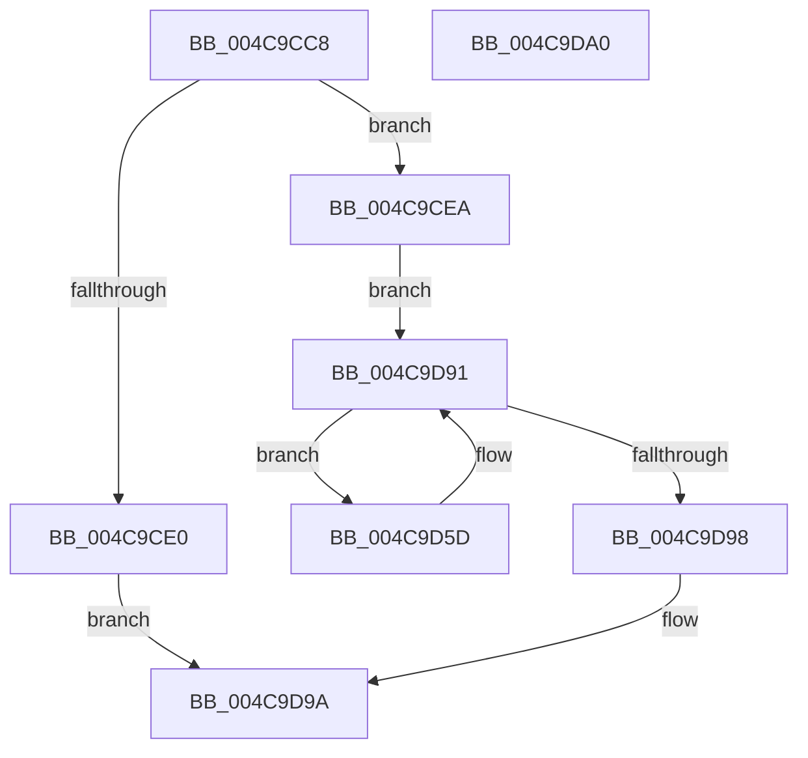

# RaspScaleCoordinates

- RVA: `0x004C9CC8`–`0x004C9DA1` (길이 `217` bytes)
- VA: `0x00000001404C9CC8`
- 실행 섹션: `.text`
- PDB 이름 있음: `예`; PDB Function 태그: `아니요`
- unwind 정보 RVA: `0x00071750`
- 디코드: `61`개 명령, `217/217` bytes 표시
- 미해석 바이트: `0` (있으면 어셈블리에 `.byte`로 보존)

> 이 문서는 커널 이미지의 기계어와 PDB 기호를 분석해 생성했습니다. 4번과 5번은 함수 원형과 자료형을 바이너리 사용 방식에서 추정한 C 해석이며 원본 소스 복구 결과는 아닙니다.

## 1. Dependencies

- 직접 호출 지점: **0**; 고유 호출 대상: **0**
- 직접 호출자로 확인된 함수: **1**
- RIP 상대 이미지 참조: **0**

### Outgoing calls
- 직접 디코드된 call 명령이 없습니다.

### Direct callers
- [RaspRasterize](../6A/RaspRasterize_function_006A2AA4.md) at `0x006A2AFA`

### Static image references
- 디코드된 RIP-relative 메모리 참조가 없습니다.

## 2. Other-region calls and transfers

- 다른 실행 섹션으로 향하는 call: **0**
- 별도 외부 분기/꼬리 이동을 확인하지 못했습니다.

## 3. Assembly (complete function range)

```asm
004C9CC8  48 89 5C 24 08                  mov qword ptr [rsp + 8], rbx
004C9CCD  48 8B 41 08                     mov rax, qword ptr [rcx + 8]
004C9CD1  4C 8B D2                        mov r10, rdx
004C9CD4  45 33 C9                        xor r9d, r9d
004C9CD7  0F B7 50 78                     movzx edx, word ptr [rax + 0x78]
004C9CDB  66 85 D2                        test dx, dx
004C9CDE  75 0A                           jne 0x1404c9cea
004C9CE0  B8 01 00 00 C0                  mov eax, 0xc0000001
004C9CE5  E9 B0 00 00 00                  jmp 0x1404c9d9a
004C9CEA  44 8B 58 60                     mov r11d, dword ptr [rax + 0x60]
004C9CEE  48 8D 1C D2                     lea rbx, [rdx + rdx*8]
004C9CF2  8B 41 10                        mov eax, dword ptr [rcx + 0x10]
004C9CF5  4C 0F AF D8                     imul r11, rax
004C9CF9  49 0F BF 42 02                  movsx rax, word ptr [r10 + 2]
004C9CFE  49 C1 E3 06                     shl r11, 6
004C9D02  49 0F AF C3                     imul rax, r11
004C9D06  48 C1 E3 03                     shl rbx, 3
004C9D0A  48 99                           cqo
004C9D0C  48 F7 FB                        idiv rbx
004C9D0F  41 89 42 02                     mov dword ptr [r10 + 2], eax
004C9D13  49 0F BF 42 06                  movsx rax, word ptr [r10 + 6]
004C9D18  49 0F AF C3                     imul rax, r11
004C9D1C  48 99                           cqo
004C9D1E  48 F7 FB                        idiv rbx
004C9D21  41 89 42 06                     mov dword ptr [r10 + 6], eax
004C9D25  49 0F BF 42 0A                  movsx rax, word ptr [r10 + 0xa]
004C9D2A  49 0F AF C3                     imul rax, r11
004C9D2E  48 99                           cqo
004C9D30  48 F7 FB                        idiv rbx
004C9D33  41 89 42 0A                     mov dword ptr [r10 + 0xa], eax
004C9D37  49 0F BF 42 0E                  movsx rax, word ptr [r10 + 0xe]
004C9D3C  49 0F AF C3                     imul rax, r11
004C9D40  48 99                           cqo
004C9D42  48 F7 FB                        idiv rbx
004C9D45  41 89 42 0E                     mov dword ptr [r10 + 0xe], eax
004C9D49  49 0F BF 42 12                  movsx rax, word ptr [r10 + 0x12]
004C9D4E  49 0F AF C3                     imul rax, r11
004C9D52  48 99                           cqo
004C9D54  48 F7 FB                        idiv rbx
004C9D57  41 89 42 12                     mov dword ptr [r10 + 0x12], eax
004C9D5B  EB 34                           jmp 0x1404c9d91
004C9D5D  49 8B 4A 32                     mov rcx, qword ptr [r10 + 0x32]
004C9D61  45 0F B7 C1                     movzx r8d, r9w
004C9D65  4A 0F BF 04 81                  movsx rax, word ptr [rcx + r8*4]
004C9D6A  49 0F AF C3                     imul rax, r11
004C9D6E  48 99                           cqo
004C9D70  48 F7 FB                        idiv rbx
004C9D73  42 89 04 81                     mov dword ptr [rcx + r8*4], eax
004C9D77  49 8B 4A 3A                     mov rcx, qword ptr [r10 + 0x3a]
004C9D7B  4A 0F BF 04 81                  movsx rax, word ptr [rcx + r8*4]
004C9D80  49 0F AF C3                     imul rax, r11
004C9D84  48 99                           cqo
004C9D86  48 F7 FB                        idiv rbx
004C9D89  66 41 FF C1                     inc r9w
004C9D8D  42 89 04 81                     mov dword ptr [rcx + r8*4], eax
004C9D91  66 45 3B 4A 18                  cmp r9w, word ptr [r10 + 0x18]
004C9D96  72 C5                           jb 0x1404c9d5d
004C9D98  33 C0                           xor eax, eax
004C9D9A  48 8B 5C 24 08                  mov rbx, qword ptr [rsp + 8]
004C9D9F  C3                              ret
004C9DA0  CC                              int3
```

## 4. C-style interpretation (structured pseudocode)

```c
__int64 __fastcall RaspScaleCoordinates(__int64 a1, __int64 a2, __int64 a3, int a4)
{
    __int64 result;
    __int64 v_r11;
    __int64 v_rbx;
    unsigned __int64 v_stack_p8;

    v_stack_p8 = v_rbx;
    a4 = 0;
    if ((unsigned __int16)(*(unsigned __int16 *)(*(unsigned __int64 *)(a1 + 8) + 120)) != 0) goto loc_004C9CEA;
    goto loc_004C9D9A;
loc_004C9CEA:
    v_r11 = ((unsigned int)(*(unsigned int *)((unsigned int)(0xC0000001ULL) + 96))) * ((unsigned int)(*(unsigned int *)(a1 + 16)));
    v_r11 = (v_r11) << (6);
    result = ((__int16)(*(unsigned __int16 *)(a2 + 2))) * (v_r11);
    v_rbx = (*(unsigned __int16 *)(*(unsigned __int64 *)(a1 + 8) + 120) + *(unsigned __int16 *)(*(unsigned __int64 *)(a1 + 8) + 120) * 8) << (3);
    *(unsigned int *)(a2 + 2) = (unsigned int)(result);
    result = ((__int16)(*(unsigned __int16 *)(a2 + 6))) * (v_r11);
    *(unsigned int *)(a2 + 6) = (unsigned int)(result);
    result = ((__int16)(*(unsigned __int16 *)(a2 + 10))) * (v_r11);
    *(unsigned int *)(a2 + 10) = (unsigned int)(result);
    result = ((__int16)(*(unsigned __int16 *)(a2 + 14))) * (v_r11);
    *(unsigned int *)(a2 + 14) = (unsigned int)(result);
    result = ((__int16)(*(unsigned __int16 *)(a2 + 18))) * (v_r11);
    *(unsigned int *)(a2 + 18) = (unsigned int)(result);
    goto loc_004C9D91;
loc_004C9D5D:
    result = ((__int16)(*(unsigned __int16 *)(*(unsigned __int64 *)(a2 + 50) + 0 * 4))) * (v_r11);
    *(unsigned int *)(*(unsigned __int64 *)(a2 + 50) + 0 * 4) = (unsigned int)(result);
    result = ((__int16)(*(unsigned __int16 *)(*(unsigned __int64 *)(a2 + 58) + 0 * 4))) * (v_r11);
    a4 = (unsigned __int16)((a4) + 1);
    *(unsigned int *)(*(unsigned __int64 *)(a2 + 58) + 0 * 4) = (unsigned int)(result);
loc_004C9D91:
    if (((unsigned __int16)(a4)) < (*(unsigned __int16 *)(a2 + 24))) goto loc_004C9D5D;
    result = 0;
loc_004C9D9A:
    return result;
}
```

## 5. (Beta) C Style

```c
int64_t RaspScaleCoordinates(void *Arg1, void *Arg2, int64_t Arg3, int32_t Arg4)
{
    uint8_t *arg1 = (uint8_t *)Arg1;
    uint8_t *arg2 = (uint8_t *)Arg2;

    int64_t result;
    int64_t local_r11;
    int64_t local_rbx;
    uint64_t v_stack_p8;

    v_stack_p8 = local_rbx;
    Arg4 = 0;
    if ((uint16_t)(*(uint16_t *)(*(uint64_t *)(arg1 + 0x8) + 0x78)) != 0) goto loc_004C9CEA;
    goto loc_004C9D9A;
loc_004C9CEA:
    local_r11 = ((uint32_t)(*(uint32_t *)((uint32_t)(0xC0000001ULL) + 0x60))) * ((uint32_t)(*(uint32_t *)(arg1 + 0x10)));
    local_r11 = (local_r11) << (6);
    result = ((int16_t)(*(uint16_t *)(arg2 + 0x2))) * (local_r11);
    local_rbx = (*(uint16_t *)(*(uint64_t *)(arg1 + 0x8) + 0x78) + *(uint16_t *)(*(uint64_t *)(arg1 + 0x8) + 0x78) * 8) << (3);
    *(uint32_t *)(arg2 + 0x2) = (uint32_t)(result);
    result = ((int16_t)(*(uint16_t *)(arg2 + 0x6))) * (local_r11);
    *(uint32_t *)(arg2 + 0x6) = (uint32_t)(result);
    result = ((int16_t)(*(uint16_t *)(arg2 + 0xA))) * (local_r11);
    *(uint32_t *)(arg2 + 0xA) = (uint32_t)(result);
    result = ((int16_t)(*(uint16_t *)(arg2 + 0xE))) * (local_r11);
    *(uint32_t *)(arg2 + 0xE) = (uint32_t)(result);
    result = ((int16_t)(*(uint16_t *)(arg2 + 0x12))) * (local_r11);
    *(uint32_t *)(arg2 + 0x12) = (uint32_t)(result);
    goto loc_004C9D91;
loc_004C9D5D:
    result = ((int16_t)(*(uint16_t *)(*(uint64_t *)(arg2 + 0x32) + 0x0 * 4))) * (local_r11);
    *(uint32_t *)(*(uint64_t *)(arg2 + 0x32) + 0x0 * 4) = (uint32_t)(result);
    result = ((int16_t)(*(uint16_t *)(*(uint64_t *)(arg2 + 0x3A) + 0x0 * 4))) * (local_r11);
    Arg4 = (uint16_t)((Arg4) + 1);
    *(uint32_t *)(*(uint64_t *)(arg2 + 0x3A) + 0x0 * 4) = (uint32_t)(result);
loc_004C9D91:
    if (((uint16_t)(Arg4)) < (*(uint16_t *)(arg2 + 0x18))) goto loc_004C9D5D;
    result = 0;
loc_004C9D9A:
    return result;
}
```

### 관측된 메모리 오프셋

구조체 형식이 확인되지 않은 접근은 인자 기준의 오프셋으로만 기록했습니다.

| 기준 인자 | 오프셋 표현 | 폭 (bit) | 접근 |
|---|---:|---:|---|
| `Arg1` | `+ 0x8` | `64` | `R` |
| `Arg1` | `+ 0x10` | `32` | `R` |
| `Arg2` | `+ 0x2` | `16` | `R` |
| `Arg2` | `+ 0x2` | `32` | `W` |
| `Arg2` | `+ 0x6` | `16` | `R` |
| `Arg2` | `+ 0x6` | `32` | `W` |
| `Arg2` | `+ 0xA` | `16` | `R` |
| `Arg2` | `+ 0xA` | `32` | `W` |
| `Arg2` | `+ 0xE` | `16` | `R` |
| `Arg2` | `+ 0xE` | `32` | `W` |
| `Arg2` | `+ 0x12` | `16` | `R` |
| `Arg2` | `+ 0x12` | `32` | `W` |
| `Arg2` | `+ 0x18` | `16` | `R` |
| `Arg2` | `+ 0x32` | `64` | `R` |
| `Arg2` | `+ 0x3A` | `64` | `R` |

## 6. Execution-region graph

[열기: 2D/3D 그래프와 함수 탐색 컨트롤 패널](../../../control-panel.html?section=text&rva=0x004C9CC8&view=graph)

- 2D 그래프는 위에서 아래로 흐르고, 3D 그래프는 빈 공간을 드래그해 회전합니다. Shift+드래그는 이동, 휠은 확대·축소, 함수 노드 선택은 대상 보고서 이동입니다.

### Static fallback


