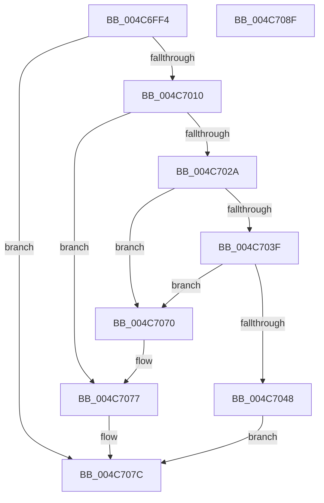

# RawCheckForDeleteVolume

- RVA: `0x004C6FF4`–`0x004C7090` (길이 `156` bytes)
- VA: `0x00000001404C6FF4`
- 실행 섹션: `.text`
- PDB 이름 있음: `예`; PDB Function 태그: `아니요`
- unwind 정보 RVA: `0x00060BC4`
- 디코드: `44`개 명령, `156/156` bytes 표시
- 미해석 바이트: `0` (있으면 어셈블리에 `.byte`로 보존)

> 이 문서는 커널 이미지의 기계어와 PDB 기호를 분석해 생성했습니다. 4번과 5번은 함수 원형과 자료형을 바이너리 사용 방식에서 추정한 C 해석이며 원본 소스 복구 결과는 아닙니다.

## 1. Dependencies

- 직접 호출 지점: **6**; 고유 호출 대상: **5**
- 직접 호출자로 확인된 함수: **1**
- RIP 상대 이미지 참조: **0**

### Outgoing calls
- `0x004C7015` → [KeAcquireQueuedSpinLock](../27/KeAcquireQueuedSpinLock_function_00273D80.md) (function, `0x00273D80`)
- `0x004C702A` → [KeReleaseQueuedSpinLock](../27/KeReleaseQueuedSpinLock_function_00272540.md) (function, `0x00272540`)
- `0x004C7056` → [ExReleaseFastMutex](../25/ExReleaseFastMutex_function_002519C0.md) (function, `0x002519C0`)
- `0x004C705E` → [RawCleanupVcb](../../page/9A/RawCleanupVcb_function_009A5C44.md) (function, `0x009A5C44`)
- `0x004C7066` → [RawDeleteVcb](../../page/A8/RawDeleteVcb_function_00A87C14.md) (function, `0x00A87C14`)
- `0x004C7077` → [KeReleaseQueuedSpinLock](../27/KeReleaseQueuedSpinLock_function_00272540.md) (function, `0x00272540`)

### Direct callers
- [sub_00B2D5A6](../../page/B2/Unknown_function_00B2D5A6.md) at `0x00B2D5CA`

### Static image references
- 디코드된 RIP-relative 메모리 참조가 없습니다.

## 2. Other-region calls and transfers

- 다른 실행 섹션으로 향하는 call: **2**
  - `0x004C705E` → [RawCleanupVcb](../../page/9A/RawCleanupVcb_function_009A5C44.md) (`.text` → `PAGE`)
  - `0x004C7066` → [RawDeleteVcb](../../page/A8/RawDeleteVcb_function_00A87C14.md) (`.text` → `PAGE`)
- 별도 외부 분기/꼬리 이동을 확인하지 못했습니다.

## 3. Assembly (complete function range)

```asm
004C6FF4  48 89 5C 24 08                  mov qword ptr [rsp + 8], rbx
004C6FF9  48 89 74 24 10                  mov qword ptr [rsp + 0x10], rsi
004C6FFE  57                              push rdi
004C6FFF  48 83 EC 20                     sub rsp, 0x20
004C7003  33 FF                           xor edi, edi
004C7005  48 8B D9                        mov rbx, rcx
004C7008  39 B9 80 00 00 00               cmp dword ptr [rcx + 0x80], edi
004C700E  75 6C                           jne 0x1404c707c
004C7010  8D 77 09                        lea esi, [rdi + 9]
004C7013  8B CE                           mov ecx, esi
004C7015  E8 66 CD DA FF                  call 0x140273d80
004C701A  8A D0                           mov dl, al
004C701C  8B CE                           mov ecx, esi
004C701E  48 8B 83 C8 00 00 00            mov rax, qword ptr [rbx + 0xc8]
004C7025  39 78 1C                        cmp dword ptr [rax + 0x1c], edi
004C7028  75 4D                           jne 0x1404c7077
004C702A  E8 11 B5 DA FF                  call 0x140272540
004C702F  48 8D 83 B0 00 00 00            lea rax, [rbx + 0xb0]
004C7036  48 8B 10                        mov rdx, qword ptr [rax]
004C7039  48 39 42 08                     cmp qword ptr [rdx + 8], rax
004C703D  75 31                           jne 0x1404c7070
004C703F  48 8B 48 08                     mov rcx, qword ptr [rax + 8]
004C7043  48 39 01                        cmp qword ptr [rcx], rax
004C7046  75 28                           jne 0x1404c7070
004C7048  48 89 11                        mov qword ptr [rcx], rdx
004C704B  48 89 4A 08                     mov qword ptr [rdx + 8], rcx
004C704F  48 8D 8B F0 00 00 00            lea rcx, [rbx + 0xf0]
004C7056  E8 65 A9 D8 FF                  call 0x1402519c0
004C705B  48 8B CB                        mov rcx, rbx
004C705E  E8 E1 EB 4D 00                  call 0x1409a5c44
004C7063  48 8B CB                        mov rcx, rbx
004C7066  E8 A9 0B 5C 00                  call 0x140a87c14
004C706B  40 B7 01                        mov dil, 1
004C706E  EB 0C                           jmp 0x1404c707c
004C7070  B9 03 00 00 00                  mov ecx, 3
004C7075  CD 29                           int 0x29
004C7077  E8 C4 B4 DA FF                  call 0x140272540
004C707C  48 8B 5C 24 30                  mov rbx, qword ptr [rsp + 0x30]
004C7081  40 8A C7                        mov al, dil
004C7084  48 8B 74 24 38                  mov rsi, qword ptr [rsp + 0x38]
004C7089  48 83 C4 20                     add rsp, 0x20
004C708D  5F                              pop rdi
004C708E  C3                              ret
004C708F  CC                              int3
```

## 4. C-style interpretation (structured pseudocode)

```c
__int64 __fastcall RawCheckForDeleteVolume(__int64 a1)
{
    __int64 result;
    __int64 v_rdi;
    __int64 v_rsp;
    unsigned __int64 v_stack_p10;
    unsigned __int64 v_stack_p8;

    v_stack_p8 = v_rbx;
    v_stack_p10 = v_rsi;
    v_rsp = (v_rsp) - (32);
    v_rdi = 0;
    if ((*(unsigned int *)(a1 + 128)) != 0) goto loc_004C707C;
    result = KeAcquireQueuedSpinLock((unsigned int)((unsigned int)(v_rdi + 9)), a2, a3, a4);
    if ((*(unsigned int *)(*(unsigned __int64 *)(a1 + 200) + 28)) != 0) goto loc_004C7077;
    result = KeReleaseQueuedSpinLock((unsigned int)((unsigned int)(v_rdi + 9)), (unsigned __int8)(result), a3, a4);
    if ((*(unsigned __int64 *)(*(unsigned __int64 *)(a1 + 176) + 8)) != (a1 + 176)) goto loc_004C7070;
    if ((*(unsigned __int64 *)(*(unsigned __int64 *)(a1 + 176 + 8))) != (a1 + 176)) goto loc_004C7070;
    *(unsigned __int64 *)(*(unsigned __int64 *)(a1 + 176 + 8)) = *(unsigned __int64 *)(a1 + 176);
    *(unsigned __int64 *)(*(unsigned __int64 *)(a1 + 176) + 8) = *(unsigned __int64 *)(a1 + 176 + 8);
    result = ExReleaseFastMutex(a1 + 240, *(unsigned __int64 *)(a1 + 176), a3, a4);
    result = RawCleanupVcb(a1, *(unsigned __int64 *)(a1 + 176), a3, a4);
    result = RawDeleteVcb(a1, *(unsigned __int64 *)(a1 + 176), a3, a4);
    goto loc_004C707C;
loc_004C7070:
loc_004C7077:
    result = KeReleaseQueuedSpinLock(3, *(unsigned __int64 *)(a1 + 176), a3, a4);
loc_004C707C:
    v_rsp = (v_rsp) + (32);
    return 1;
}
```

## 5. (Beta) C Style

```c
int64_t RawCheckForDeleteVolume(void *Arg1)
{
    uint8_t *arg1 = (uint8_t *)Arg1;

    int64_t result;
    int64_t local_rdi;
    int64_t local_rsp;
    uint64_t v_stack_p10;
    uint64_t v_stack_p8;

    v_stack_p8 = local_rbx;
    v_stack_p10 = local_rsi;
    local_rsp = (local_rsp) - (32);
    local_rdi = 0;
    if ((*(uint32_t *)(arg1 + 0x80)) != 0) goto loc_004C707C;
    result = KeAcquireQueuedSpinLock((uint32_t)((uint32_t)(local_rdi + 9)), a2, a3, a4);
    if ((*(uint32_t *)(*(uint64_t *)(arg1 + 0xC8) + 0x1C)) != 0) goto loc_004C7077;
    result = KeReleaseQueuedSpinLock((uint32_t)((uint32_t)(local_rdi + 9)), (uint8_t)(result), a3, a4);
    if ((*(uint64_t *)(*(uint64_t *)(arg1 + 0xB0) + 0x8)) != (Arg1 + 176)) goto loc_004C7070;
    if ((*(uint64_t *)(*(uint64_t *)(arg1 + 0xB0 + 0x8))) != (Arg1 + 176)) goto loc_004C7070;
    *(uint64_t *)(*(uint64_t *)(arg1 + 0xB0 + 0x8)) = *(uint64_t *)(arg1 + 0xB0);
    *(uint64_t *)(*(uint64_t *)(arg1 + 0xB0) + 0x8) = *(uint64_t *)(arg1 + 0xB0 + 0x8);
    result = ExReleaseFastMutex(Arg1 + 240, *(uint64_t *)(arg1 + 0xB0), a3, a4);
    result = RawCleanupVcb(Arg1, *(uint64_t *)(arg1 + 0xB0), a3, a4);
    result = RawDeleteVcb(Arg1, *(uint64_t *)(arg1 + 0xB0), a3, a4);
    goto loc_004C707C;
loc_004C7070:
loc_004C7077:
    result = KeReleaseQueuedSpinLock(3, *(uint64_t *)(arg1 + 0xB0), a3, a4);
loc_004C707C:
    local_rsp = (local_rsp) + (32);
    return 1;
}
```

### 관측된 메모리 오프셋

구조체 형식이 확인되지 않은 접근은 인자 기준의 오프셋으로만 기록했습니다.

| 기준 인자 | 오프셋 표현 | 폭 (bit) | 접근 |
|---|---:|---:|---|
| `Arg1` | `+ 0x0` | `64` | `R` |
| `Arg1` | `+ 0x8` | `64` | `R` |
| `Arg1` | `+ 0x80` | `32` | `R` |
| `Arg1` | `+ 0xB0` | `64` | `R` |
| `Arg1` | `+ 0xC8` | `64` | `R` |
| `Arg1` | `+ 0xF0` | `64` | `R` |

## 6. Execution-region graph

[열기: 2D/3D 그래프와 함수 탐색 컨트롤 패널](../../../control-panel.html?section=text&rva=0x004C6FF4&view=graph)

- 2D 그래프는 위에서 아래로 흐르고, 3D 그래프는 빈 공간을 드래그해 회전합니다. Shift+드래그는 이동, 휠은 확대·축소, 함수 노드 선택은 대상 보고서 이동입니다.

### Static fallback


