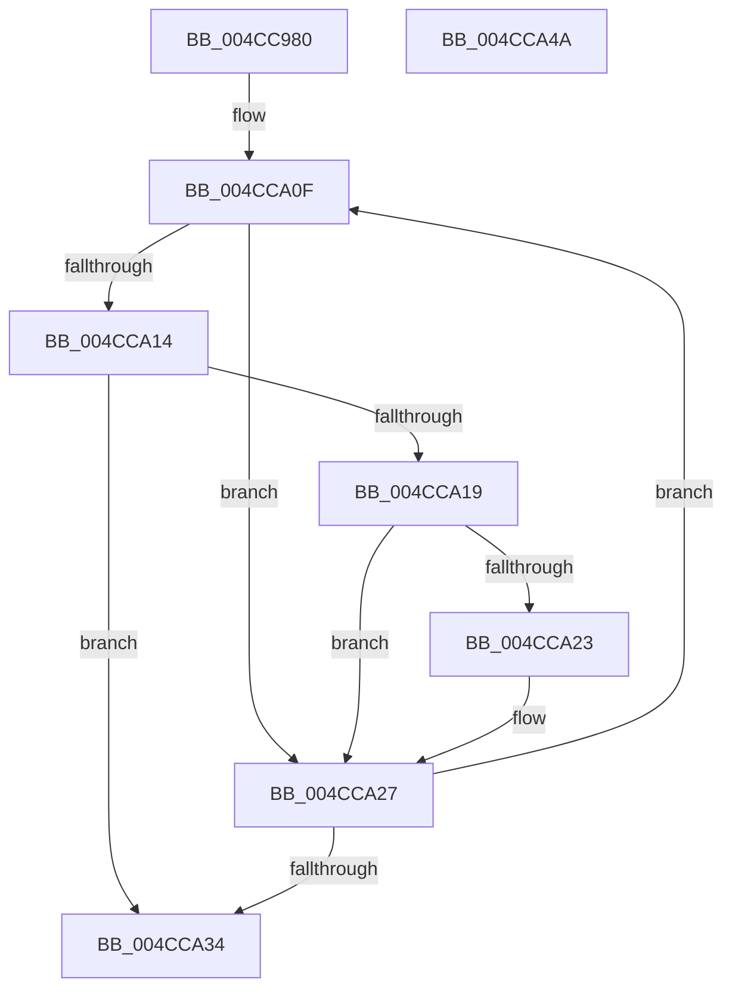

# RtlApplySwitchJumpRelocationToPage

- RVA: `0x004CC980`–`0x004CCA4B` (길이 `203` bytes)
- VA: `0x00000001404CC980`
- 실행 섹션: `.text`
- PDB 이름 있음: `예`; PDB Function 태그: `아니요`
- unwind 정보 RVA: `0x000A6470`
- 디코드: `61`개 명령, `203/203` bytes 표시
- 미해석 바이트: `0` (있으면 어셈블리에 `.byte`로 보존)

> 이 문서는 커널 이미지의 기계어와 PDB 기호를 분석해 생성했습니다. 4번과 5번은 함수 원형과 자료형을 바이너리 사용 방식에서 추정한 C 해석이며 원본 소스 복구 결과는 아닙니다.

## 1. Dependencies

- 직접 호출 지점: **2**; 고유 호출 대상: **2**
- 직접 호출자로 확인된 함수: **1**
- RIP 상대 이미지 참조: **1**

### Outgoing calls
- `0x004CC9F6` → [RtlpConstructSwitchJumpRelocationFixup](RtlpConstructSwitchJumpRelocationFixup_function_004CCA54.md) (function, `0x004CCA54`)
- `0x004CCA3C` → [_security_check_cookie](../6A/_security_check_cookie_function_006AC640.md) (function, `0x006AC640`)

### Direct callers
- [MiApplyDynamicRelocationFixups](../44/MiApplyDynamicRelocationFixups_function_0044A1CC.md) at `0x0044A352`
- [MiApplyDynamicRelocationFixups](../44/MiApplyDynamicRelocationFixups_function_0044A1CC.md) at `0x0044A3AC`

### Static image references
- `0x004CC989` → RVA `0x00E0A740` (`.data`; read)

## 2. Other-region calls and transfers

- 다른 실행 섹션으로 향하는 call: **0**
- 별도 외부 분기/꼬리 이동을 확인하지 못했습니다.

## 3. Assembly (complete function range)

```asm
004CC980  40 53                           push rbx
004CC982  55                              push rbp
004CC983  56                              push rsi
004CC984  57                              push rdi
004CC985  48 83 EC 58                     sub rsp, 0x58
004CC989  48 8B 05 B0 DD 93 00            mov rax, qword ptr [rip + 0x93ddb0]
004CC990  48 33 C4                        xor rax, rsp
004CC993  48 89 44 24 40                  mov qword ptr [rsp + 0x40], rax
004CC998  33 C0                           xor eax, eax
004CC99A  48 8B E9                        mov rbp, rcx
004CC99D  4D 8B D9                        mov r11, r9
004CC9A0  48 89 44 24 30                  mov qword ptr [rsp + 0x30], rax
004CC9A5  4C 8B 8C 24 A0 00 00 00         mov r9, qword ptr [rsp + 0xa0]
004CC9AD  4D 8B D0                        mov r10, r8
004CC9B0  89 44 24 38                     mov dword ptr [rsp + 0x38], eax
004CC9B4  8B FA                           mov edi, edx
004CC9B6  66 89 44 24 3C                  mov word ptr [rsp + 0x3c], ax
004CC9BB  33 F6                           xor esi, esi
004CC9BD  48 8D 44 24 30                  lea rax, [rsp + 0x30]
004CC9C2  4D 8B C3                        mov r8, r11
004CC9C5  41 0F B7 09                     movzx ecx, word ptr [r9]
004CC9C9  81 E1 FF 0F 00 00               and ecx, 0xfff
004CC9CF  48 89 44 24 28                  mov qword ptr [rsp + 0x28], rax
004CC9D4  8B 84 24 A8 00 00 00            mov eax, dword ptr [rsp + 0xa8]
004CC9DB  03 CA                           add ecx, edx
004CC9DD  39 B4 24 B0 00 00 00            cmp dword ptr [rsp + 0xb0], esi
004CC9E4  49 8B D2                        mov rdx, r10
004CC9E7  89 44 24 20                     mov dword ptr [rsp + 0x20], eax
004CC9EB  8D 99 00 F0 FF FF               lea ebx, [rcx - 0x1000]
004CC9F1  0F 44 D9                        cmove ebx, ecx
004CC9F4  8B CB                           mov ecx, ebx
004CC9F6  E8 59 00 00 00                  call 0x1404cca54
004CC9FB  2B DF                           sub ebx, edi
004CC9FD  4C 8D 85 00 10 00 00            lea r8, [rbp + 0x1000]
004CCA04  48 63 CB                        movsxd rcx, ebx
004CCA07  48 8D 54 24 32                  lea rdx, [rsp + 0x32]
004CCA0C  48 03 CD                        add rcx, rbp
004CCA0F  48 3B CD                        cmp rcx, rbp
004CCA12  72 13                           jb 0x1404cca27
004CCA14  49 3B C8                        cmp rcx, r8
004CCA17  73 1B                           jae 0x1404cca34
004CCA19  0F B7 44 24 30                  movzx eax, word ptr [rsp + 0x30]
004CCA1E  0F A3 F0                        bt eax, esi
004CCA21  73 04                           jae 0x1404cca27
004CCA23  8A 02                           mov al, byte ptr [rdx]
004CCA25  88 01                           mov byte ptr [rcx], al
004CCA27  FF C6                           inc esi
004CCA29  48 FF C1                        inc rcx
004CCA2C  48 FF C2                        inc rdx
004CCA2F  83 FE 0C                        cmp esi, 0xc
004CCA32  72 DB                           jb 0x1404cca0f
004CCA34  48 8B 4C 24 40                  mov rcx, qword ptr [rsp + 0x40]
004CCA39  48 33 CC                        xor rcx, rsp
004CCA3C  E8 FF FB 1D 00                  call 0x1406ac640
004CCA41  48 83 C4 58                     add rsp, 0x58
004CCA45  5F                              pop rdi
004CCA46  5E                              pop rsi
004CCA47  5D                              pop rbp
004CCA48  5B                              pop rbx
004CCA49  C3                              ret
004CCA4A  CC                              int3
```

## 4. C-style interpretation (structured pseudocode)

```c
__int64 __fastcall RtlApplySwitchJumpRelocationToPage(__int64 a1, int a2, __int64 a3, __int64 a4, __int64 a5, unsigned int a6, unsigned int a7)
{
    __int64 result;
    __int64 v_rbx;
    __int64 v_rsi;
    __int64 v_rsp;
    unsigned __int64 v_stack_m38;
    unsigned __int16 v_stack_m3C;
    unsigned int v_stack_m40;
    unsigned __int64 v_stack_m46;
    unsigned __int64 v_stack_m48;
    unsigned __int64 v_stack_m50;
    unsigned int v_stack_m58;

    v_rsp = (v_rsp) - (88);
    result = (*(unsigned __int64 *)(v_rip + 9690544)) ^ (v_rsp);
    v_stack_m38 = result;
    result = 0;
    v_stack_m48 = 0;
    v_stack_m40 = 0;
    v_stack_m3C = 0;
    v_rsi = 0;
    a1 = (unsigned int)((*(unsigned __int16 *)(a5)) & (0xFFFULL));
    v_stack_m50 = v_stack_m48;
    a1 = (unsigned int)((a1) + (a2));
    v_stack_m58 = (unsigned int)((unsigned int)(a6));
    v_rbx = a1 - 4096;
    if (a7 == 0) { v_rbx = (unsigned int)(a1); }
    result = RtlpConstructSwitchJumpRelocationFixup((unsigned int)((unsigned int)(v_rbx)), a3, a4, a5);
    v_rbx = (unsigned int)((v_rbx) - ((unsigned int)((unsigned int)(a2))));
    a1 = ((int)((unsigned int)(v_rbx))) + (a1);
loc_004CCA0F:
    if (a1 < a1) goto loc_004CCA27;
    if (a1 >= (a1 + 4096)) goto loc_004CCA34;
    result = v_stack_m48;
    if (a1 < (a1 + 4096)) {
        result = *(unsigned __int8 *)(v_stack_m46);
        *(unsigned __int8 *)(a1) = (unsigned __int8)(result);
    }
    v_rsi = (unsigned int)((v_rsi) + 1);
    a1 = (a1) + 1;
    a2 = (v_stack_m46) + 1;
    if (((unsigned int)(v_rsi)) < 12) goto loc_004CCA0F;
loc_004CCA34:
    a1 = (v_stack_m38) ^ (v_rsp);
    result = _security_check_cookie(a1, a2, a1 + 4096, a5);
    v_rsp = (v_rsp) + (88);
    return result;
}
```

## 5. (Beta) C Style

```c
int64_t RtlApplySwitchJumpRelocationToPage(void *Arg1, int32_t Arg2, int64_t Arg3, int64_t Arg4, void *Arg5, uint32_t Arg6, uint32_t Arg7)
{
    uint8_t *arg1 = (uint8_t *)Arg1;
    uint8_t *arg5 = (uint8_t *)Arg5;

    int64_t result;
    int64_t local_rbx;
    int64_t local_rsi;
    int64_t local_rsp;
    uint64_t v_stack_m38;
    uint16_t v_stack_m3C;
    uint32_t v_stack_m40;
    uint64_t v_stack_m46;
    uint64_t v_stack_m48;
    uint64_t v_stack_m50;
    uint32_t v_stack_m58;

    local_rsp = (local_rsp) - (88);
    result = (*(uint64_t *)(v_rip + 0x93DDB0)) ^ (local_rsp);
    v_stack_m38 = result;
    result = 0;
    v_stack_m48 = 0;
    v_stack_m40 = 0;
    v_stack_m3C = 0;
    local_rsi = 0;
    Arg1 = (uint32_t)((*(uint16_t *)(arg5)) & (0xFFFULL));
    v_stack_m50 = v_stack_m48;
    Arg1 = (uint32_t)((Arg1) + (Arg2));
    v_stack_m58 = (uint32_t)((uint32_t)(Arg6));
    local_rbx = Arg1 - 4096;
    if (Arg7 == 0) { local_rbx = (uint32_t)(Arg1); }
    result = RtlpConstructSwitchJumpRelocationFixup((uint32_t)((uint32_t)(local_rbx)), Arg3, Arg4, Arg5);
    local_rbx = (uint32_t)((local_rbx) - ((uint32_t)((uint32_t)(Arg2))));
    Arg1 = ((int32_t)((uint32_t)(local_rbx))) + (Arg1);
loc_004CCA0F:
    if (Arg1 < Arg1) goto loc_004CCA27;
    if (Arg1 >= (Arg1 + 4096)) goto loc_004CCA34;
    result = v_stack_m48;
    if (Arg1 < (Arg1 + 4096)) {
        result = *(uint8_t *)(v_stack_m46);
        *(uint8_t *)(arg1) = (uint8_t)(result);
    }
    local_rsi = (uint32_t)((local_rsi) + 1);
    Arg1 = (Arg1) + 1;
    Arg2 = (v_stack_m46) + 1;
    if (((uint32_t)(local_rsi)) < 12) goto loc_004CCA0F;
loc_004CCA34:
    Arg1 = (v_stack_m38) ^ (local_rsp);
    result = _security_check_cookie(Arg1, Arg2, Arg1 + 4096, Arg5);
    local_rsp = (local_rsp) + (88);
    return result;
}
```

### 관측된 메모리 오프셋

구조체 형식이 확인되지 않은 접근은 인자 기준의 오프셋으로만 기록했습니다.

| 기준 인자 | 오프셋 표현 | 폭 (bit) | 접근 |
|---|---:|---:|---|
| `Arg1` | `+ 0x1000` | `64` | `R` |
| `Arg5` | `+ 0x0` | `16` | `R` |

## 6. Execution-region graph

[열기: 2D/3D 그래프와 함수 탐색 컨트롤 패널](../../../control-panel.html?section=text&rva=0x004CC980&view=graph)

- 2D 그래프는 위에서 아래로 흐르고, 3D 그래프는 빈 공간을 드래그해 회전합니다. Shift+드래그는 이동, 휠은 확대·축소, 함수 노드 선택은 대상 보고서 이동입니다.

### Static fallback


