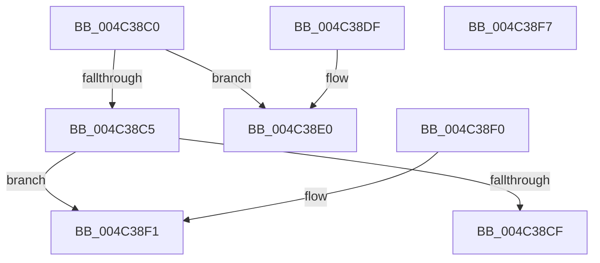

# RtlCompressWorkSpaceSizeXpressLz

- RVA: `0x004C38C0`–`0x004C38F8` (길이 `56` bytes)
- VA: `0x00000001404C38C0`
- 실행 섹션: `.text`
- PDB 이름 있음: `예`; PDB Function 태그: `아니요`
- unwind 정보 RVA: `0x000DB714`
- 디코드: `18`개 명령, `56/56` bytes 표시
- 미해석 바이트: `0` (있으면 어셈블리에 `.byte`로 보존)

> 이 문서는 커널 이미지의 기계어와 PDB 기호를 분석해 생성했습니다. 4번과 5번은 함수 원형과 자료형을 바이너리 사용 방식에서 추정한 C 해석이며 원본 소스 복구 결과는 아닙니다.

## 1. Dependencies

- 직접 호출 지점: **0**; 고유 호출 대상: **0**
- 직접 호출자로 확인된 함수: **0**
- RIP 상대 이미지 참조: **0**

### Outgoing calls
- 직접 디코드된 call 명령이 없습니다.

### Direct callers
- 이 함수 시작 RVA로 연결되는 직접 call은 확인되지 않았습니다. 간접 호출은 완전히 역산할 수 없습니다.

### Static image references
- 디코드된 RIP-relative 메모리 참조가 없습니다.

## 2. Other-region calls and transfers

- 다른 실행 섹션으로 향하는 call: **0**
- 별도 외부 분기/꼬리 이동을 확인하지 못했습니다.

## 3. Assembly (complete function range)

```asm
004C38C0  66 85 C9                        test cx, cx
004C38C3  74 1B                           je 0x1404c38e0
004C38C5  B8 00 01 00 00                  mov eax, 0x100
004C38CA  66 3B C8                        cmp cx, ax
004C38CD  75 22                           jne 0x1404c38f1
004C38CF  C7 02 07 00 06 00               mov dword ptr [rdx], 0x60007
004C38D5  33 C0                           xor eax, eax
004C38D7  41 C7 00 00 00 00 00            mov dword ptr [r8], 0
004C38DE  C3                              ret
004C38DF  CC                              int3
004C38E0  C7 02 27 EF 00 00               mov dword ptr [rdx], 0xef27
004C38E6  33 C0                           xor eax, eax
004C38E8  41 C7 00 00 00 00 00            mov dword ptr [r8], 0
004C38EF  C3                              ret
004C38F0  CC                              int3
004C38F1  B8 BB 00 00 C0                  mov eax, 0xc00000bb
004C38F6  C3                              ret
004C38F7  CC                              int3
```

## 4. C-style interpretation (structured pseudocode)

```c
__int64 __fastcall RtlCompressWorkSpaceSizeXpressLz(unsigned __int16 a1, __int64 a2, __int64 a3)
{
    __int64 result;

    if (a1 == 0) goto loc_004C38E0;
    if (a1 != 256) goto loc_004C38F1;
    *(unsigned int *)(a2) = 0x60007ULL;
    result = 0;
    *(unsigned int *)(a3) = 0;
    return result;
loc_004C38E0:
    *(unsigned int *)(a2) = 0xEF27ULL;
    result = 0;
    *(unsigned int *)(a3) = 0;
    return result;
loc_004C38F1:
    return (unsigned int)(0xC00000BBULL);
}
```

## 5. (Beta) C Style

```c
int64_t RtlCompressWorkSpaceSizeXpressLz(uint16_t Arg1, void *Arg2, void *Arg3)
{
    uint8_t *arg2 = (uint8_t *)Arg2;
    uint8_t *arg3 = (uint8_t *)Arg3;

    int64_t result;

    if (Arg1 == 0) goto loc_004C38E0;
    if (Arg1 != 256) goto loc_004C38F1;
    *(uint32_t *)(arg2) = 0x60007ULL;
    result = 0;
    *(uint32_t *)(arg3) = 0;
    return result;
loc_004C38E0:
    *(uint32_t *)(arg2) = 0xEF27ULL;
    result = 0;
    *(uint32_t *)(arg3) = 0;
    return result;
loc_004C38F1:
    return (uint32_t)(0xC00000BBULL);
}
```

### 관측된 메모리 오프셋

구조체 형식이 확인되지 않은 접근은 인자 기준의 오프셋으로만 기록했습니다.

| 기준 인자 | 오프셋 표현 | 폭 (bit) | 접근 |
|---|---:|---:|---|
| `Arg2` | `+ 0x0` | `32` | `W` |
| `Arg3` | `+ 0x0` | `32` | `W` |

## 6. Execution-region graph

[열기: 2D/3D 그래프와 함수 탐색 컨트롤 패널](../../../control-panel.html?section=text&rva=0x004C38C0&view=graph)

- 2D 그래프는 위에서 아래로 흐르고, 3D 그래프는 빈 공간을 드래그해 회전합니다. Shift+드래그는 이동, 휠은 확대·축소, 함수 노드 선택은 대상 보고서 이동입니다.

### Static fallback


