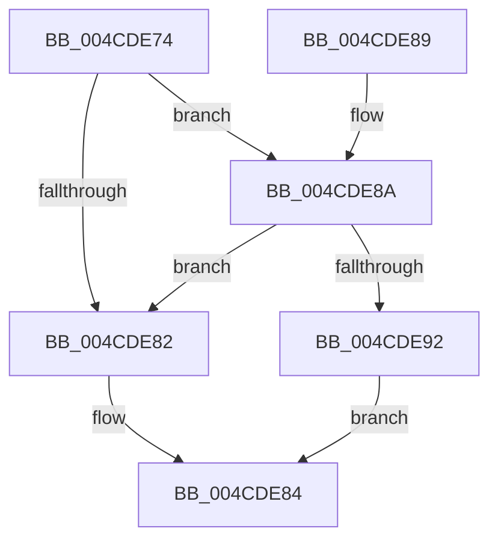

# RtlIsImageFullyRetpolined

- RVA: `0x004CDE74`–`0x004CDEA0` (길이 `44` bytes)
- VA: `0x00000001404CDE74`
- 실행 섹션: `.text`
- PDB 이름 있음: `예`; PDB Function 태그: `아니요`
- unwind 정보 RVA: `0x00068370`
- 디코드: `14`개 명령, `44/44` bytes 표시
- 미해석 바이트: `0` (있으면 어셈블리에 `.byte`로 보존)

> 이 문서는 커널 이미지의 기계어와 PDB 기호를 분석해 생성했습니다. 4번과 5번은 함수 원형과 자료형을 바이너리 사용 방식에서 추정한 C 해석이며 원본 소스 복구 결과는 아닙니다.

## 1. Dependencies

- 직접 호출 지점: **1**; 고유 호출 대상: **1**
- 직접 호출자로 확인된 함수: **5**
- RIP 상대 이미지 참조: **0**

### Outgoing calls
- `0x004CDE78` → [LdrImageDirectoryEntryToLoadConfig](../../page/A8/LdrImageDirectoryEntryToLoadConfig_function_00A8F564.md) (function, `0x00A8F564`)

### Direct callers
- [MiLogRetpolineImageLoadEvents](../../page/A9/MiLogRetpolineImageLoadEvents_function_00A996F0.md) at `0x00A996FD`
- [MiIsImageFullyRetpolined](../../page/AB/MiIsImageFullyRetpolined_function_00AB01D4.md) at `0x00AB0208`
- [MiApplyRetpolineToBootDriver](../../init/C6/MiApplyRetpolineToBootDriver_function_00C66264.md) at `0x00C663C9`
- [MiInitializeRetpoline](../../init/C6/MiInitializeRetpoline_function_00C66544.md) at `0x00C665EF`
- [MiIsBootImageTargetFullyRetpolined](../../init/C6/MiIsBootImageTargetFullyRetpolined_function_00C66670.md) at `0x00C666A5`

### Static image references
- 디코드된 RIP-relative 메모리 참조가 없습니다.

## 2. Other-region calls and transfers

- 다른 실행 섹션으로 향하는 call: **1**
  - `0x004CDE78` → [LdrImageDirectoryEntryToLoadConfig](../../page/A8/LdrImageDirectoryEntryToLoadConfig_function_00A8F564.md) (`.text` → `PAGE`)
- 별도 외부 분기/꼬리 이동을 확인하지 못했습니다.

## 3. Assembly (complete function range)

```asm
004CDE74  48 83 EC 28                     sub rsp, 0x28
004CDE78  E8 E7 16 5C 00                  call 0x140a8f564
004CDE7D  48 85 C0                        test rax, rax
004CDE80  75 08                           jne 0x1404cde8a
004CDE82  33 C0                           xor eax, eax
004CDE84  48 83 C4 28                     add rsp, 0x28
004CDE88  C3                              ret
004CDE89  CC                              int3
004CDE8A  81 38 94 00 00 00               cmp dword ptr [rax], 0x94
004CDE90  72 F0                           jb 0x1404cde82
004CDE92  8B 80 90 00 00 00               mov eax, dword ptr [rax + 0x90]
004CDE98  C1 E8 14                        shr eax, 0x14
004CDE9B  83 E0 01                        and eax, 1
004CDE9E  EB E4                           jmp 0x1404cde84
```

## 4. C-style interpretation (structured pseudocode)

```c
__int64 __fastcall RtlIsImageFullyRetpolined(void)
{
    __int64 result;
    __int64 v_rsp;

    v_rsp = (v_rsp) - (40);
    result = LdrImageDirectoryEntryToLoadConfig(a1, a2, a3, a4);
    if (result != 0) goto loc_004CDE8A;
loc_004CDE82:
    result = 0;
loc_004CDE84:
    v_rsp = (v_rsp) + (40);
    return result;
loc_004CDE8A:
    if ((*(unsigned int *)(result)) < 148) goto loc_004CDE82;
    result = (unsigned int)(((unsigned int)(*(unsigned int *)(result + 144))) >> (20));
    result = (unsigned int)((result) & (1));
    goto loc_004CDE84;
}
```

## 5. (Beta) C Style

```c
void RtlIsImageFullyRetpolined(void)
{
    int64_t result;
    int64_t local_rsp;

    local_rsp = (local_rsp) - (40);
    result = LdrImageDirectoryEntryToLoadConfig(a1, a2, a3, a4);
    if (result != 0) goto loc_004CDE8A;
loc_004CDE82:
    result = 0;
loc_004CDE84:
    local_rsp = (local_rsp) + (40);
    return result;
loc_004CDE8A:
    if ((*(uint32_t *)(result)) < 148) goto loc_004CDE82;
    result = (uint32_t)(((uint32_t)(*(uint32_t *)(result + 0x90))) >> (20));
    result = (uint32_t)((result) & (1));
    goto loc_004CDE84;
}
```

## 6. Execution-region graph

[열기: 2D/3D 그래프와 함수 탐색 컨트롤 패널](../../../control-panel.html?section=text&rva=0x004CDE74&view=graph)

- 2D 그래프는 위에서 아래로 흐르고, 3D 그래프는 빈 공간을 드래그해 회전합니다. Shift+드래그는 이동, 휠은 확대·축소, 함수 노드 선택은 대상 보고서 이동입니다.

### Static fallback


