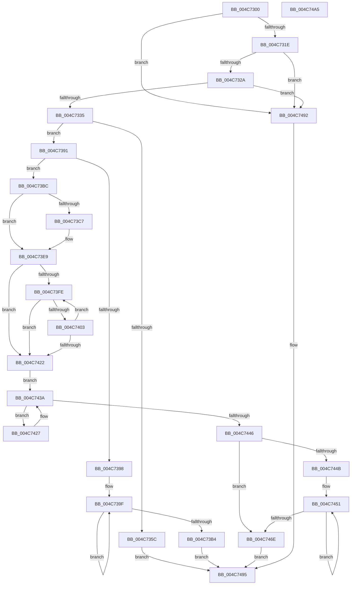

# RtlNumberOfSetBitsInRange

- RVA: `0x004C7300`–`0x004C74A6` (길이 `422` bytes)
- VA: `0x00000001404C7300`
- 실행 섹션: `.text`
- PDB 이름 있음: `예`; PDB Function 태그: `아니요`
- unwind 정보 RVA: `0x00069588`
- 디코드: `117`개 명령, `422/422` bytes 표시
- 미해석 바이트: `0` (있으면 어셈블리에 `.byte`로 보존)

> 이 문서는 커널 이미지의 기계어와 PDB 기호를 분석해 생성했습니다. 4번과 5번은 함수 원형과 자료형을 바이너리 사용 방식에서 추정한 C 해석이며 원본 소스 복구 결과는 아닙니다.

## 1. Dependencies

- 직접 호출 지점: **0**; 고유 호출 대상: **0**
- 직접 호출자로 확인된 함수: **2**
- RIP 상대 이미지 참조: **1**

### Outgoing calls
- 직접 디코드된 call 명령이 없습니다.

### Direct callers
- [RtlNumberOfClearBitsInRange](../5E/RtlNumberOfClearBitsInRange_function_005E6390.md) at `0x005E6399`
- [KiTpIsExcludedKernelTracepointLocation](../../page/74/KiTpIsExcludedKernelTracepointLocation_function_007487D0.md) at `0x0074889E`

### Static image references
- `0x004C7363` → RVA `0x00000000` (`image boundary/outside`; read)

## 2. Other-region calls and transfers

- 다른 실행 섹션으로 향하는 call: **0**
- 별도 외부 분기/꼬리 이동을 확인하지 못했습니다.

## 3. Assembly (complete function range)

```asm
004C7300  48 89 5C 24 08                  mov qword ptr [rsp + 8], rbx
004C7305  48 89 74 24 10                  mov qword ptr [rsp + 0x10], rsi
004C730A  48 89 7C 24 18                  mov qword ptr [rsp + 0x18], rdi
004C730F  41 8B C0                        mov eax, r8d
004C7312  44 8B 01                        mov r8d, dword ptr [rcx]
004C7315  41 3B D0                        cmp edx, r8d
004C7318  0F 83 74 01 00 00               jae 0x1404c7492
004C731E  44 2B C2                        sub r8d, edx
004C7321  44 3B C0                        cmp r8d, eax
004C7324  0F 82 68 01 00 00               jb 0x1404c7492
004C732A  45 33 C9                        xor r9d, r9d
004C732D  85 C0                           test eax, eax
004C732F  0F 84 5D 01 00 00               je 0x1404c7492
004C7335  8D 72 FF                        lea esi, [rdx - 1]
004C7338  44 8B D2                        mov r10d, edx
004C733B  03 F0                           add esi, eax
004C733D  41 C1 EA 03                     shr r10d, 3
004C7341  44 8B DE                        mov r11d, esi
004C7344  45 8B C2                        mov r8d, r10d
004C7347  4C 03 41 08                     add r8, qword ptr [rcx + 8]
004C734B  8B FA                           mov edi, edx
004C734D  41 C1 EB 03                     shr r11d, 3
004C7351  83 E7 07                        and edi, 7
004C7354  83 E6 07                        and esi, 7
004C7357  45 3B D3                        cmp r10d, r11d
004C735A  75 35                           jne 0x1404c7391
004C735C  45 0F B6 00                     movzx r8d, byte ptr [r8]
004C7360  8D 46 01                        lea eax, [rsi + 1]
004C7363  48 8D 1D 96 8C B3 FF            lea rbx, [rip - 0x4c736a]
004C736A  0F B6 94 18 90 C8 02 00         movzx edx, byte ptr [rax + rbx + 0x2c890]
004C7372  0F B6 84 1F 20 2D 01 00         movzx eax, byte ptr [rdi + rbx + 0x12d20]
004C737A  23 D0                           and edx, eax
004C737C  41 23 D0                        and edx, r8d
004C737F  F7 D2                           not edx
004C7381  0F B6 C2                        movzx eax, dl
004C7384  0F B6 84 18 40 41 03 00         movzx eax, byte ptr [rax + rbx + 0x34140]
004C738C  E9 04 01 00 00                  jmp 0x1404c7495
004C7391  0B D0                           or edx, eax
004C7393  F6 C2 3F                        test dl, 0x3f
004C7396  75 24                           jne 0x1404c73bc
004C7398  FF C8                           dec eax
004C739A  C1 E8 06                        shr eax, 6
004C739D  FF C0                           inc eax
004C739F  49 8B 08                        mov rcx, qword ptr [r8]
004C73A2  4D 8D 40 08                     lea r8, [r8 + 8]
004C73A6  F3 48 0F B8 C9                  popcnt rcx, rcx
004C73AB  44 03 C9                        add r9d, ecx
004C73AE  48 83 E8 01                     sub rax, 1
004C73B2  75 EB                           jne 0x1404c739f
004C73B4  41 8B C1                        mov eax, r9d
004C73B7  E9 D9 00 00 00                  jmp 0x1404c7495
004C73BC  48 8D 1D 3D 8C B3 FF            lea rbx, [rip - 0x4c73c3]
004C73C3  85 FF                           test edi, edi
004C73C5  74 22                           je 0x1404c73e9
004C73C7  41 0F B6 10                     movzx edx, byte ptr [r8]
004C73CB  49 FF C0                        inc r8
004C73CE  0F B6 8C 1F 20 2D 01 00         movzx ecx, byte ptr [rdi + rbx + 0x12d20]
004C73D6  23 CA                           and ecx, edx
004C73D8  F7 D1                           not ecx
004C73DA  41 FF C2                        inc r10d
004C73DD  0F B6 C1                        movzx eax, cl
004C73E0  44 0F B6 8C 18 40 41 03 00      movzx r9d, byte ptr [rax + rbx + 0x34140]
004C73E9  41 8B C2                        mov eax, r10d
004C73EC  BA 08 00 00 00                  mov edx, 8
004C73F1  83 E0 07                        and eax, 7
004C73F4  2B D0                           sub edx, eax
004C73F6  F7 C2 F7 FF FF FF               test edx, 0xfffffff7
004C73FC  74 24                           je 0x1404c7422
004C73FE  45 3B D3                        cmp r10d, r11d
004C7401  73 1F                           jae 0x1404c7422
004C7403  41 0F B6 08                     movzx ecx, byte ptr [r8]
004C7407  41 FF C2                        inc r10d
004C740A  F7 D1                           not ecx
004C740C  49 FF C0                        inc r8
004C740F  0F B6 C1                        movzx eax, cl
004C7412  0F B6 84 18 40 41 03 00         movzx eax, byte ptr [rax + rbx + 0x34140]
004C741A  44 03 C8                        add r9d, eax
004C741D  83 C2 FF                        add edx, -1
004C7420  75 DC                           jne 0x1404c73fe
004C7422  41 8B CB                        mov ecx, r11d
004C7425  EB 13                           jmp 0x1404c743a
004C7427  49 8B 00                        mov rax, qword ptr [r8]
004C742A  49 83 C0 08                     add r8, 8
004C742E  F3 48 0F B8 C0                  popcnt rax, rax
004C7433  44 03 C8                        add r9d, eax
004C7436  41 83 C2 08                     add r10d, 8
004C743A  41 8B C2                        mov eax, r10d
004C743D  48 83 C0 08                     add rax, 8
004C7441  48 3B C1                        cmp rax, rcx
004C7444  76 E1                           jbe 0x1404c7427
004C7446  45 3B D3                        cmp r10d, r11d
004C7449  73 23                           jae 0x1404c746e
004C744B  45 2B DA                        sub r11d, r10d
004C744E  41 8B D3                        mov edx, r11d
004C7451  41 0F B6 08                     movzx ecx, byte ptr [r8]
004C7455  49 FF C0                        inc r8
004C7458  F7 D1                           not ecx
004C745A  0F B6 C1                        movzx eax, cl
004C745D  0F B6 84 18 40 41 03 00         movzx eax, byte ptr [rax + rbx + 0x34140]
004C7465  44 03 C8                        add r9d, eax
004C7468  48 83 EA 01                     sub rdx, 1
004C746C  75 E3                           jne 0x1404c7451
004C746E  45 0F B6 00                     movzx r8d, byte ptr [r8]
004C7472  8D 46 01                        lea eax, [rsi + 1]
004C7475  0F B6 94 18 90 C8 02 00         movzx edx, byte ptr [rax + rbx + 0x2c890]
004C747D  41 23 D0                        and edx, r8d
004C7480  F7 D2                           not edx
004C7482  0F B6 C2                        movzx eax, dl
004C7485  0F B6 84 18 40 41 03 00         movzx eax, byte ptr [rax + rbx + 0x34140]
004C748D  41 03 C1                        add eax, r9d
004C7490  EB 03                           jmp 0x1404c7495
004C7492  83 C8 FF                        or eax, 0xffffffff
004C7495  48 8B 5C 24 08                  mov rbx, qword ptr [rsp + 8]
004C749A  48 8B 74 24 10                  mov rsi, qword ptr [rsp + 0x10]
004C749F  48 8B 7C 24 18                  mov rdi, qword ptr [rsp + 0x18]
004C74A4  C3                              ret
004C74A5  CC                              int3
```

## 4. C-style interpretation (structured pseudocode)

```c
__int64 __fastcall RtlNumberOfSetBitsInRange(__int64 a1, __int64 a2, int a3, int a4)
{
    __int64 result;
    __int64 v_r10;
    __int64 v_r11;
    __int64 v_rdi;
    __int64 v_rsi;
    unsigned __int64 v_stack_p10;
    unsigned __int64 v_stack_p18;
    unsigned __int64 v_stack_p8;

    v_stack_p8 = v_rbx;
    v_stack_p10 = v_rsi;
    v_stack_p18 = v_rdi;
    if (((unsigned int)(a2)) >= ((unsigned int)((unsigned int)(*(unsigned int *)(a1))))) goto loc_004C7492;
    a3 = (unsigned int)(((unsigned int)(*(unsigned int *)(a1))) - ((unsigned int)(a2)));
    if (a3 < ((unsigned int)((unsigned int)(a3)))) goto loc_004C7492;
    a4 = 0;
    if ((unsigned int)((unsigned int)(a3)) == 0) goto loc_004C7492;
    v_rsi = (unsigned int)((a2 - 1) + ((unsigned int)((unsigned int)(a3))));
    v_r10 = (unsigned int)(((unsigned int)((unsigned int)(a2))) >> (3));
    a3 = ((unsigned int)((unsigned int)(v_r10))) + (*(unsigned __int64 *)(a1 + 8));
    v_r11 = (unsigned int)(((unsigned int)((unsigned int)(v_rsi))) >> (3));
    v_rdi = (unsigned int)(((unsigned int)((unsigned int)(a2))) & (7));
    v_rsi = (unsigned int)((v_rsi) & (7));
    if (((unsigned int)(v_r10)) != ((unsigned int)(v_r11))) goto loc_004C7391;
    a2 = (unsigned int)((*(unsigned __int8 *)(v_rsi + 1 + v_rip - 5010282 * 1 + 182416)) & ((unsigned int)(*(unsigned __int8 *)(v_rdi + v_rip - 5010282 * 1 + 77088))));
    a2 = (unsigned int)((a2) & ((unsigned int)(*(unsigned __int8 *)(a3))));
    a2 = (unsigned int)(~(a2));
    goto loc_004C7495;
loc_004C7391:
    a2 = (unsigned int)((a2) | ((unsigned int)(*(unsigned __int8 *)((unsigned __int8)(a2) + v_rip - 5010282 * 1 + 213312))));
    if ((((unsigned __int8)(a2)) & (63)) != 0) goto loc_004C73BC;
    result = (unsigned int)((*(unsigned __int8 *)((unsigned __int8)(a2) + v_rip - 5010282 * 1 + 213312)) - 1);
    result = (unsigned int)((result) >> (6));
    result = (unsigned int)((result) + 1);
loc_004C739F:
    a4 = (unsigned int)((a4) + ((unsigned int)(*(unsigned __int64 *)(*(unsigned __int8 *)(a3)))));
    result = (result) - (1);
    if (condition_is_not_equal) goto loc_004C739F;
    goto loc_004C7495;
loc_004C73BC:
    result = (unsigned int)(a4);
    if ((unsigned int)(v_rdi) != 0) {
        a2 = *(unsigned __int8 *)(*(unsigned __int8 *)(a3) + 8);
        a3 = (*(unsigned __int8 *)(a3) + 8) + 1;
        a1 = *(unsigned __int8 *)(v_rdi + v_rip - 5010371 * 1 + 77088);
        a1 = (unsigned int)((a1) & ((unsigned int)(a2)));
        a1 = (unsigned int)(~(a1));
        v_r10 = (unsigned int)((v_r10) + 1);
        result = (unsigned __int8)(a1);
        a4 = *(unsigned __int8 *)(result + v_rip - 5010371 * 1 + 213312);
    }
    result = (unsigned int)(((unsigned int)((unsigned int)(v_r10))) & (7));
    a2 = (unsigned int)((8) - ((unsigned int)(result)));
    if ((((unsigned int)(a2)) & (0xFFFFFFF7ULL)) == 0) goto loc_004C7422;
loc_004C73FE:
    if (((unsigned int)(v_r10)) >= ((unsigned int)(v_r11))) goto loc_004C7422;
    v_r10 = (unsigned int)((v_r10) + 1);
    a1 = (unsigned int)(~(*(unsigned __int8 *)(a3)));
    a3 = (a3) + 1;
    a4 = (unsigned int)((a4) + ((unsigned int)(*(unsigned __int8 *)((unsigned __int8)(a1) + v_rip - 5010371 * 1 + 213312))));
    a2 = (unsigned int)((a2) + (-1));
    if (condition_is_not_equal) goto loc_004C73FE;
loc_004C7422:
    goto loc_004C743A;
loc_004C7427:
    a3 = (a3) + (8);
    a4 = (unsigned int)((a4) + ((unsigned int)(*(unsigned __int64 *)(a3))));
    v_r10 = (unsigned int)((v_r10) + (8));
loc_004C743A:
    result = ((unsigned int)((unsigned int)(v_r10))) + (8);
    if (result <= ((unsigned int)((unsigned int)(v_r11)))) goto loc_004C7427;
    if (((unsigned int)(v_r10)) >= ((unsigned int)(v_r11))) goto loc_004C746E;
    v_r11 = (unsigned int)((v_r11) - ((unsigned int)(v_r10)));
loc_004C7451:
    a3 = (a3) + 1;
    a1 = (unsigned int)(~(*(unsigned __int8 *)(a3)));
    a4 = (unsigned int)((a4) + ((unsigned int)(*(unsigned __int8 *)((unsigned __int8)(a1) + v_rip - 5010371 * 1 + 213312))));
    a2 = ((unsigned int)((unsigned int)(v_r11))) - (1);
    if (condition_is_not_equal) goto loc_004C7451;
loc_004C746E:
    a2 = (unsigned int)((*(unsigned __int8 *)(v_rsi + 1 + v_rip - 5010371 * 1 + 182416)) & ((unsigned int)(*(unsigned __int8 *)(a3))));
    a2 = (unsigned int)(~(a2));
    result = (unsigned int)((*(unsigned __int8 *)((unsigned __int8)(a2) + v_rip - 5010371 * 1 + 213312)) + (a4));
    goto loc_004C7495;
loc_004C7492:
    result = (unsigned int)((result) | (0xFFFFFFFFULL));
loc_004C7495:
    return result;
}
```

## 5. (Beta) C Style

```c
int64_t RtlNumberOfSetBitsInRange(void *Arg1, int64_t Arg2, int32_t Arg3, int32_t Arg4)
{
    uint8_t *arg1 = (uint8_t *)Arg1;

    int64_t result;
    int64_t local_r10;
    int64_t local_r11;
    int64_t local_rdi;
    int64_t local_rsi;
    uint64_t v_stack_p10;
    uint64_t v_stack_p18;
    uint64_t v_stack_p8;

    v_stack_p8 = local_rbx;
    v_stack_p10 = local_rsi;
    v_stack_p18 = local_rdi;
    if (((uint32_t)(Arg2)) >= ((uint32_t)((uint32_t)(*(uint32_t *)(arg1))))) goto loc_004C7492;
    Arg3 = (uint32_t)(((uint32_t)(*(uint32_t *)(arg1))) - ((uint32_t)(Arg2)));
    if (Arg3 < ((uint32_t)((uint32_t)(Arg3)))) goto loc_004C7492;
    Arg4 = 0;
    if ((uint32_t)((uint32_t)(Arg3)) == 0) goto loc_004C7492;
    local_rsi = (uint32_t)((Arg2 - 1) + ((uint32_t)((uint32_t)(Arg3))));
    local_r10 = (uint32_t)(((uint32_t)((uint32_t)(Arg2))) >> (3));
    Arg3 = ((uint32_t)((uint32_t)(local_r10))) + (*(uint64_t *)(arg1 + 0x8));
    local_r11 = (uint32_t)(((uint32_t)((uint32_t)(local_rsi))) >> (3));
    local_rdi = (uint32_t)(((uint32_t)((uint32_t)(Arg2))) & (7));
    local_rsi = (uint32_t)((local_rsi) & (7));
    if (((uint32_t)(local_r10)) != ((uint32_t)(local_r11))) goto loc_004C7391;
    Arg2 = (uint32_t)((*(uint8_t *)(local_rsi + 0x1 + v_rip - 0x4C736A * 1 + 0x2C890)) & ((uint32_t)(*(uint8_t *)(local_rdi + v_rip - 0x4C736A * 1 + 0x12D20))));
    Arg2 = (uint32_t)((Arg2) & ((uint32_t)(*(uint8_t *)(Arg3))));
    Arg2 = (uint32_t)(~(Arg2));
    goto loc_004C7495;
loc_004C7391:
    Arg2 = (uint32_t)((Arg2) | ((uint32_t)(*(uint8_t *)((uint8_t)(Arg2) + v_rip - 0x4C736A * 1 + 0x34140))));
    if ((((uint8_t)(Arg2)) & (63)) != 0) goto loc_004C73BC;
    result = (uint32_t)((*(uint8_t *)((uint8_t)(Arg2) + v_rip - 0x4C736A * 1 + 0x34140)) - 1);
    result = (uint32_t)((result) >> (6));
    result = (uint32_t)((result) + 1);
loc_004C739F:
    Arg4 = (uint32_t)((Arg4) + ((uint32_t)(*(uint64_t *)(*(uint8_t *)(Arg3)))));
    result = (result) - (1);
    if (condition_is_not_equal) goto loc_004C739F;
    goto loc_004C7495;
loc_004C73BC:
    result = (uint32_t)(Arg4);
    if ((uint32_t)(local_rdi) != 0) {
        Arg2 = *(uint8_t *)(*(uint8_t *)(Arg3) + 0x8);
        Arg3 = (*(uint8_t *)(Arg3) + 8) + 1;
        Arg1 = *(uint8_t *)(local_rdi + v_rip - 0x4C73C3 * 1 + 0x12D20);
        Arg1 = (uint32_t)((Arg1) & ((uint32_t)(Arg2)));
        Arg1 = (uint32_t)(~(Arg1));
        local_r10 = (uint32_t)((local_r10) + 1);
        result = (uint8_t)(Arg1);
        Arg4 = *(uint8_t *)(result + v_rip - 0x4C73C3 * 1 + 0x34140);
    }
    result = (uint32_t)(((uint32_t)((uint32_t)(local_r10))) & (7));
    Arg2 = (uint32_t)((8) - ((uint32_t)(result)));
    if ((((uint32_t)(Arg2)) & (0xFFFFFFF7ULL)) == 0) goto loc_004C7422;
loc_004C73FE:
    if (((uint32_t)(local_r10)) >= ((uint32_t)(local_r11))) goto loc_004C7422;
    local_r10 = (uint32_t)((local_r10) + 1);
    Arg1 = (uint32_t)(~(*(uint8_t *)(Arg3)));
    Arg3 = (Arg3) + 1;
    Arg4 = (uint32_t)((Arg4) + ((uint32_t)(*(uint8_t *)((uint8_t)(arg1) + v_rip - 0x4C73C3 * 1 + 0x34140))));
    Arg2 = (uint32_t)((Arg2) + (-1));
    if (condition_is_not_equal) goto loc_004C73FE;
loc_004C7422:
    goto loc_004C743A;
loc_004C7427:
    Arg3 = (Arg3) + (8);
    Arg4 = (uint32_t)((Arg4) + ((uint32_t)(*(uint64_t *)(Arg3))));
    local_r10 = (uint32_t)((local_r10) + (8));
loc_004C743A:
    result = ((uint32_t)((uint32_t)(local_r10))) + (8);
    if (result <= ((uint32_t)((uint32_t)(local_r11)))) goto loc_004C7427;
    if (((uint32_t)(local_r10)) >= ((uint32_t)(local_r11))) goto loc_004C746E;
    local_r11 = (uint32_t)((local_r11) - ((uint32_t)(local_r10)));
loc_004C7451:
    Arg3 = (Arg3) + 1;
    Arg1 = (uint32_t)(~(*(uint8_t *)(Arg3)));
    Arg4 = (uint32_t)((Arg4) + ((uint32_t)(*(uint8_t *)((uint8_t)(arg1) + v_rip - 0x4C73C3 * 1 + 0x34140))));
    Arg2 = ((uint32_t)((uint32_t)(local_r11))) - (1);
    if (condition_is_not_equal) goto loc_004C7451;
loc_004C746E:
    Arg2 = (uint32_t)((*(uint8_t *)(local_rsi + 0x1 + v_rip - 0x4C73C3 * 1 + 0x2C890)) & ((uint32_t)(*(uint8_t *)(Arg3))));
    Arg2 = (uint32_t)(~(Arg2));
    result = (uint32_t)((*(uint8_t *)((uint8_t)(Arg2) + v_rip - 0x4C73C3 * 1 + 0x34140)) + (Arg4));
    goto loc_004C7495;
loc_004C7492:
    result = (uint32_t)((result) | (0xFFFFFFFFULL));
loc_004C7495:
    return result;
}
```

### 관측된 메모리 오프셋

구조체 형식이 확인되지 않은 접근은 인자 기준의 오프셋으로만 기록했습니다.

| 기준 인자 | 오프셋 표현 | 폭 (bit) | 접근 |
|---|---:|---:|---|
| `Arg1` | `+ 0x0` | `32` | `R` |
| `Arg1` | `+ 0x8` | `64` | `R` |

## 6. Execution-region graph

[열기: 2D/3D 그래프와 함수 탐색 컨트롤 패널](../../../control-panel.html?section=text&rva=0x004C7300&view=graph)

- 2D 그래프는 위에서 아래로 흐르고, 3D 그래프는 빈 공간을 드래그해 회전합니다. Shift+드래그는 이동, 휠은 확대·축소, 함수 노드 선택은 대상 보고서 이동입니다.

### Static fallback


