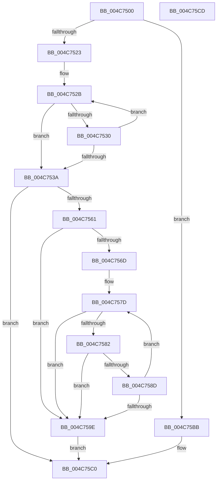

# RtlStringCchCatW

- RVA: `0x004C7500`–`0x004C75CE` (길이 `206` bytes)
- VA: `0x00000001404C7500`
- 실행 섹션: `.text`
- PDB 이름 있음: `예`; PDB Function 태그: `아니요`
- unwind 정보 RVA: `0x000950EC`
- 디코드: `62`개 명령, `206/206` bytes 표시
- 미해석 바이트: `0` (있으면 어셈블리에 `.byte`로 보존)

> 이 문서는 커널 이미지의 기계어와 PDB 기호를 분석해 생성했습니다. 4번과 5번은 함수 원형과 자료형을 바이너리 사용 방식에서 추정한 C 해석이며 원본 소스 복구 결과는 아닙니다.

## 1. Dependencies

- 직접 호출 지점: **0**; 고유 호출 대상: **0**
- 직접 호출자로 확인된 함수: **7**
- RIP 상대 이미지 참조: **0**

### Outgoing calls
- 직접 디코드된 call 명령이 없습니다.

### Direct callers
- [SdbpGetCustomSdbFileName](../../page/81/SdbpGetCustomSdbFileName_function_00817DA0.md) at `0x00817DF8`
- [AslPathCombine](../../page/81/AslPathCombine_function_0081B100.md) at `0x0081B20C`
- [AslPathCombine](../../page/81/AslPathCombine_function_0081B100.md) at `0x0081B220`
- [AslPathToSystemPathBuf](../../page/81/AslPathToSystemPathBuf_function_0081B430.md) at `0x0081B49D`
- [AslpEnvResolveVars](../../page/81/AslpEnvResolveVars_function_0081D608.md) at `0x0081D71B`
- [AslpEnvResolveVars](../../page/81/AslpEnvResolveVars_function_0081D608.md) at `0x0081D74B`
- [AslpEnvResolveVars](../../page/81/AslpEnvResolveVars_function_0081D608.md) at `0x0081D7FB`
- [AslpFileQueryVersionString](../../page/82/AslpFileQueryVersionString_function_0082113C.md) at `0x008211D7`
- [sub_00B488F0](../../page/B4/Unknown_function_00B488F0.md) at `0x00B4894F`
- [BapdpProcessVsmKeyBlobs](../../init/C4/BapdpProcessVsmKeyBlobs_function_00C4FD60.md) at `0x00C50089`

### Static image references
- 디코드된 RIP-relative 메모리 참조가 없습니다.

## 2. Other-region calls and transfers

- 다른 실행 섹션으로 향하는 call: **0**
- 별도 외부 분기/꼬리 이동을 확인하지 못했습니다.

## 3. Assembly (complete function range)

```asm
004C7500  48 89 5C 24 08                  mov qword ptr [rsp + 8], rbx
004C7505  48 89 7C 24 10                  mov qword ptr [rsp + 0x10], rdi
004C750A  48 8D 42 FF                     lea rax, [rdx - 1]
004C750E  4D 8B D8                        mov r11, r8
004C7511  4C 8B CA                        mov r9, rdx
004C7514  48 8B D9                        mov rbx, rcx
004C7517  48 3D FE FF FF 7F               cmp rax, 0x7ffffffe
004C751D  0F 87 98 00 00 00               ja 0x1404c75bb
004C7523  4C 8B D2                        mov r10, rdx
004C7526  48 8B C1                        mov rax, rcx
004C7529  33 FF                           xor edi, edi
004C752B  66 39 38                        cmp word ptr [rax], di
004C752E  74 0A                           je 0x1404c753a
004C7530  48 83 C0 02                     add rax, 2
004C7534  49 83 EA 01                     sub r10, 1
004C7538  75 F1                           jne 0x1404c752b
004C753A  49 8B C2                        mov rax, r10
004C753D  49 8B C9                        mov rcx, r9
004C7540  48 F7 D8                        neg rax
004C7543  49 8B C2                        mov rax, r10
004C7546  1B D2                           sbb edx, edx
004C7548  49 2B CA                        sub rcx, r10
004C754B  F7 D2                           not edx
004C754D  81 E2 0D 00 00 C0               and edx, 0xc000000d
004C7553  48 F7 D8                        neg rax
004C7556  4D 1B C0                        sbb r8, r8
004C7559  4C 23 C1                        and r8, rcx
004C755C  4D 85 D2                        test r10, r10
004C755F  74 5F                           je 0x1404c75c0
004C7561  49 8B C9                        mov rcx, r9
004C7564  4A 8D 14 43                     lea rdx, [rbx + r8*2]
004C7568  49 2B C8                        sub rcx, r8
004C756B  74 31                           je 0x1404c759e
004C756D  4D 2B C1                        sub r8, r9
004C7570  49 8D 80 FE FF FF 7F            lea rax, [r8 + 0x7ffffffe]
004C7577  48 03 C1                        add rax, rcx
004C757A  4C 2B DA                        sub r11, rdx
004C757D  48 85 C0                        test rax, rax
004C7580  74 1C                           je 0x1404c759e
004C7582  45 0F B7 04 13                  movzx r8d, word ptr [r11 + rdx]
004C7587  66 45 85 C0                     test r8w, r8w
004C758B  74 11                           je 0x1404c759e
004C758D  66 44 89 02                     mov word ptr [rdx], r8w
004C7591  48 FF C8                        dec rax
004C7594  48 83 C2 02                     add rdx, 2
004C7598  48 83 E9 01                     sub rcx, 1
004C759C  75 DF                           jne 0x1404c757d
004C759E  48 8D 42 FE                     lea rax, [rdx - 2]
004C75A2  48 85 C9                        test rcx, rcx
004C75A5  48 0F 45 C2                     cmovne rax, rdx
004C75A9  48 F7 D9                        neg rcx
004C75AC  1B D2                           sbb edx, edx
004C75AE  F7 D2                           not edx
004C75B0  81 E2 05 00 00 80               and edx, 0x80000005
004C75B6  66 89 38                        mov word ptr [rax], di
004C75B9  EB 05                           jmp 0x1404c75c0
004C75BB  BA 0D 00 00 C0                  mov edx, 0xc000000d
004C75C0  48 8B 5C 24 08                  mov rbx, qword ptr [rsp + 8]
004C75C5  8B C2                           mov eax, edx
004C75C7  48 8B 7C 24 10                  mov rdi, qword ptr [rsp + 0x10]
004C75CC  C3                              ret
004C75CD  CC                              int3
```

## 4. C-style interpretation (structured pseudocode)

```c
__int64 __fastcall RtlStringCchCatW(__int64 a1, __int64 a2, __int64 a3)
{
    __int64 result;
    __int64 v_r10;
    __int64 v_r11;
    __int64 v_rdi;
    unsigned __int64 v_stack_p10;
    unsigned __int64 v_stack_p8;

    v_stack_p8 = v_rbx;
    v_stack_p10 = v_rdi;
    if ((a2 - 1) > 0x7FFFFFFEULL) goto loc_004C75BB;
    v_rdi = 0;
loc_004C752B:
    if ((*(unsigned __int16 *)(a1)) == 0) goto loc_004C753A;
    result = (a1) + (2);
    v_r10 = (a2) - (1);
    if (condition_is_not_equal) goto loc_004C752B;
loc_004C753A:
    result = -(v_r10);
    a1 = (a2) - (v_r10);
    a2 = (unsigned int)(~(a2));
    a2 = (unsigned int)((a2) & (0xC000000DULL));
    result = -(v_r10);
    a3 = (a3) & (a1);
    if (v_r10 == 0) goto loc_004C75C0;
    a1 = (a2) - (a3);
    if (condition_is_equal) goto loc_004C759E;
    a3 = (a3) - (a2);
    result = (a3 + 2147483646) + (a1);
    v_r11 = (a3) - (a1 + a3 * 2);
loc_004C757D:
    if (result == 0) goto loc_004C759E;
    if ((unsigned __int16)(*(unsigned __int16 *)(v_r11 + a1 + a3 * 2 * 1)) == 0) goto loc_004C759E;
    *(unsigned __int16 *)(a1 + a3 * 2) = (unsigned __int16)(*(unsigned __int16 *)(v_r11 + a1 + a3 * 2 * 1));
    result = (result) - 1;
    a2 = (a1 + a3 * 2) + (2);
    a1 = (a1) - (1);
    if (condition_is_not_equal) goto loc_004C757D;
loc_004C759E:
    result = a2 - 2;
    if (a1 != 0) { result = a2; }
    a1 = -(a1);
    a2 = (unsigned int)(~(a2));
    a2 = (unsigned int)((a2) & (0x80000005ULL));
    *(unsigned __int16 *)(result) = 0;
    goto loc_004C75C0;
loc_004C75BB:
loc_004C75C0:
    return (unsigned int)((unsigned int)((unsigned int)(0xC000000DULL)));
}
```

## 5. (Beta) C Style

```c
int64_t RtlStringCchCatW(void *Arg1, void *Arg2, void *Arg3)
{
    uint8_t *arg1 = (uint8_t *)Arg1;
    uint8_t *arg2 = (uint8_t *)Arg2;
    uint8_t *arg3 = (uint8_t *)Arg3;

    int64_t result;
    int64_t local_r10;
    int64_t local_r11;
    int64_t local_rdi;
    uint64_t v_stack_p10;
    uint64_t v_stack_p8;

    v_stack_p8 = local_rbx;
    v_stack_p10 = local_rdi;
    if ((Arg2 - 1) > 0x7FFFFFFEULL) goto loc_004C75BB;
    local_rdi = 0;
loc_004C752B:
    if ((*(uint16_t *)(arg1)) == 0) goto loc_004C753A;
    result = (Arg1) + (2);
    local_r10 = (Arg2) - (1);
    if (condition_is_not_equal) goto loc_004C752B;
loc_004C753A:
    result = -(local_r10);
    Arg1 = (Arg2) - (local_r10);
    Arg2 = (uint32_t)(~(Arg2));
    Arg2 = (uint32_t)((Arg2) & (0xC000000DULL));
    result = -(local_r10);
    Arg3 = (Arg3) & (Arg1);
    if (local_r10 == 0) goto loc_004C75C0;
    Arg1 = (Arg2) - (Arg3);
    if (condition_is_equal) goto loc_004C759E;
    Arg3 = (Arg3) - (Arg2);
    result = (Arg3 + 2147483646) + (Arg1);
    local_r11 = (Arg3) - (Arg1 + Arg3 * 2);
loc_004C757D:
    if (result == 0) goto loc_004C759E;
    if ((uint16_t)(*(uint16_t *)(local_r11 + arg1 + arg3 * 2 * 1)) == 0) goto loc_004C759E;
    *(uint16_t *)(arg1 + arg3 * 2) = (uint16_t)(*(uint16_t *)(local_r11 + arg1 + arg3 * 2 * 1));
    result = (result) - 1;
    Arg2 = (Arg1 + Arg3 * 2) + (2);
    Arg1 = (Arg1) - (1);
    if (condition_is_not_equal) goto loc_004C757D;
loc_004C759E:
    result = Arg2 - 2;
    if (Arg1 != NULL) { result = Arg2; }
    Arg1 = -(Arg1);
    Arg2 = (uint32_t)(~(Arg2));
    Arg2 = (uint32_t)((Arg2) & (0x80000005ULL));
    *(uint16_t *)(result) = 0;
    goto loc_004C75C0;
loc_004C75BB:
loc_004C75C0:
    return (uint32_t)((uint32_t)((uint32_t)(0xC000000DULL)));
}
```

### 관측된 메모리 오프셋

구조체 형식이 확인되지 않은 접근은 인자 기준의 오프셋으로만 기록했습니다.

| 기준 인자 | 오프셋 표현 | 폭 (bit) | 접근 |
|---|---:|---:|---|
| `Arg1` | `- 0x2` | `64` | `R` |
| `Arg1` | `+ 0x0` | `16` | `R` |
| `Arg1` | `+ 0x0` | `16` | `W` |
| `Arg1` | `+ 0x0 + r8*2` | `64` | `R` |
| `Arg2` | `- 0x1` | `64` | `R` |
| `Arg3` | `+ 0x0 + rdx*1` | `16` | `R` |

## 6. Execution-region graph

[열기: 2D/3D 그래프와 함수 탐색 컨트롤 패널](../../../control-panel.html?section=text&rva=0x004C7500&view=graph)

- 2D 그래프는 위에서 아래로 흐르고, 3D 그래프는 빈 공간을 드래그해 회전합니다. Shift+드래그는 이동, 휠은 확대·축소, 함수 노드 선택은 대상 보고서 이동입니다.

### Static fallback


