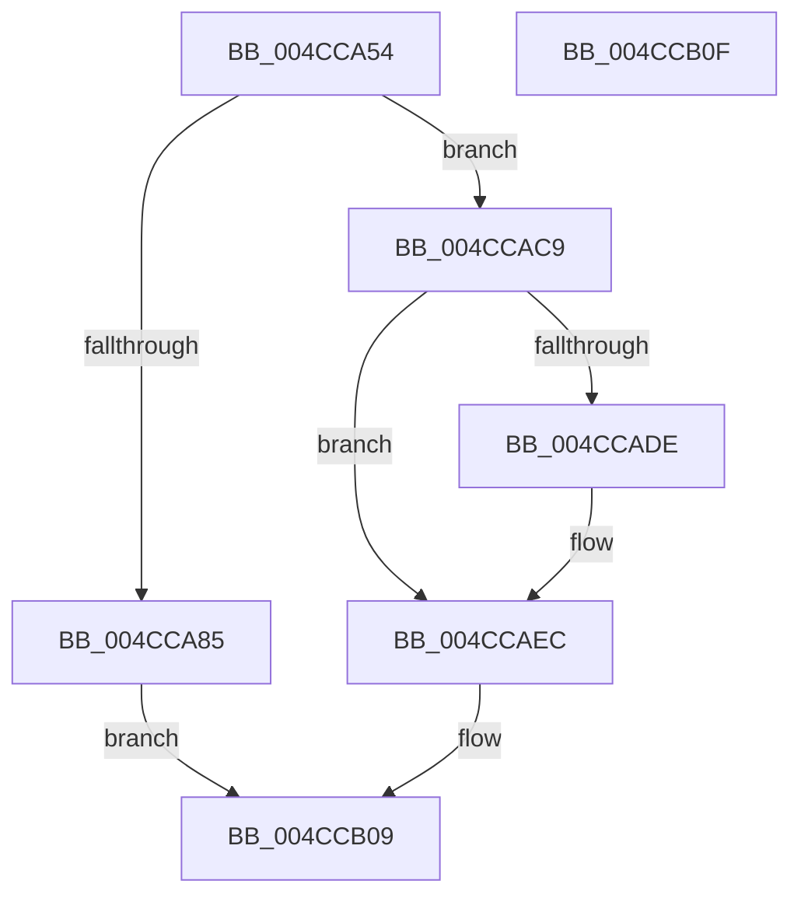

# RtlpConstructSwitchJumpRelocationFixup

- RVA: `0x004CCA54`–`0x004CCB10` (길이 `188` bytes)
- VA: `0x00000001404CCA54`
- 실행 섹션: `.text`
- PDB 이름 있음: `예`; PDB Function 태그: `아니요`
- unwind 정보 RVA: `0x00071750`
- 디코드: `49`개 명령, `188/188` bytes 표시
- 미해석 바이트: `0` (있으면 어셈블리에 `.byte`로 보존)

> 이 문서는 커널 이미지의 기계어와 PDB 기호를 분석해 생성했습니다. 4번과 5번은 함수 원형과 자료형을 바이너리 사용 방식에서 추정한 C 해석이며 원본 소스 복구 결과는 아닙니다.

## 1. Dependencies

- 직접 호출 지점: **0**; 고유 호출 대상: **0**
- 직접 호출자로 확인된 함수: **2**
- RIP 상대 이미지 참조: **0**

### Outgoing calls
- 직접 디코드된 call 명령이 없습니다.

### Direct callers
- [RtlApplySwitchJumpRelocationToPage](RtlApplySwitchJumpRelocationToPage_function_004CC980.md) at `0x004CC9F6`
- [RtlApplySwitchJumpRelocationToImage](../6A/RtlApplySwitchJumpRelocationToImage_function_006A9A38.md) at `0x006A9A9E`

### Static image references
- 디코드된 RIP-relative 메모리 참조가 없습니다.

## 2. Other-region calls and transfers

- 다른 실행 섹션으로 향하는 call: **0**
- 별도 외부 분기/꼬리 이동을 확인하지 못했습니다.

## 3. Assembly (complete function range)

```asm
004CCA54  48 89 5C 24 08                  mov qword ptr [rsp + 8], rbx
004CCA59  4C 8B 54 24 30                  mov r10, qword ptr [rsp + 0x30]
004CCA5E  48 B8 CC CC CC CC CC CC CC CC   movabs rax, 0xcccccccccccccccc
004CCA68  45 33 DB                        xor r11d, r11d
004CCA6B  48 8B DA                        mov rbx, rdx
004CCA6E  66 45 89 1A                     mov word ptr [r10], r11w
004CCA72  49 89 42 02                     mov qword ptr [r10 + 2], rax
004CCA76  41 89 42 0A                     mov dword ptr [r10 + 0xa], eax
004CCA7A  41 0F B7 01                     movzx eax, word ptr [r9]
004CCA7E  44 39 5C 24 28                  cmp dword ptr [rsp + 0x28], r11d
004CCA83  74 44                           je 0x1404ccac9
004CCA85  48 C1 E8 0C                     shr rax, 0xc
004CCA89  83 C1 05                        add ecx, 5
004CCA8C  41 8B 14 80                     mov edx, dword ptr [r8 + rax*4]
004CCA90  48 63 43 30                     movsxd rax, dword ptr [rbx + 0x30]
004CCA94  48 2B D1                        sub rdx, rcx
004CCA97  48 03 D0                        add rdx, rax
004CCA9A  66 41 C7 02 3F 00               mov word ptr [r10], 0x3f
004CCAA0  8B C2                           mov eax, edx
004CCAA2  41 88 52 03                     mov byte ptr [r10 + 3], dl
004CCAA6  C1 E8 08                        shr eax, 8
004CCAA9  41 88 42 04                     mov byte ptr [r10 + 4], al
004CCAAD  8B C2                           mov eax, edx
004CCAAF  C1 E8 10                        shr eax, 0x10
004CCAB2  C1 EA 18                        shr edx, 0x18
004CCAB5  41 88 52 06                     mov byte ptr [r10 + 6], dl
004CCAB9  41 C6 42 02 E8                  mov byte ptr [r10 + 2], 0xe8
004CCABE  41 88 42 05                     mov byte ptr [r10 + 5], al
004CCAC2  41 C6 42 07 CC                  mov byte ptr [r10 + 7], 0xcc
004CCAC7  EB 40                           jmp 0x1404ccb09
004CCAC9  BA 00 F0 00 00                  mov edx, 0xf000
004CCACE  49 8B CB                        mov rcx, r11
004CCAD1  66 23 C2                        and ax, dx
004CCAD4  BA 00 80 00 00                  mov edx, 0x8000
004CCAD9  66 3B C2                        cmp ax, dx
004CCADC  72 0E                           jb 0x1404ccaec
004CCADE  41 BB 01 00 00 00               mov r11d, 1
004CCAE4  41 C6 42 02 41                  mov byte ptr [r10 + 2], 0x41
004CCAE9  41 8B CB                        mov ecx, r11d
004CCAEC  42 C6 44 11 02 FF               mov byte ptr [rcx + r10 + 2], 0xff
004CCAF2  41 0F B7 01                     movzx eax, word ptr [r9]
004CCAF6  66 C1 E8 0C                     shr ax, 0xc
004CCAFA  24 07                           and al, 7
004CCAFC  0C E0                           or al, 0xe0
004CCAFE  43 88 44 13 03                  mov byte ptr [r11 + r10 + 3], al
004CCB03  66 41 C7 02 3F 00               mov word ptr [r10], 0x3f
004CCB09  48 8B 5C 24 08                  mov rbx, qword ptr [rsp + 8]
004CCB0E  C3                              ret
004CCB0F  CC                              int3
```

## 4. C-style interpretation (structured pseudocode)

```c
__int64 __fastcall RtlpConstructSwitchJumpRelocationFixup(int a1, __int64 a2, __int64 a3, __int64 a4, unsigned int a5, __int64 a6)
{
    __int64 result;
    __int64 v_r11;
    unsigned __int64 v_stack_p8;

    v_stack_p8 = v_rbx;
    v_r11 = 0;
    *(unsigned __int16 *)(a6) = 0;
    *(unsigned __int64 *)(a6 + 2) = result;
    *(unsigned int *)(a6 + 10) = (unsigned int)(result);
    if (a5 == 0) goto loc_004CCAC9;
    result = (*(unsigned __int16 *)(a4)) >> (12);
    a1 = (unsigned int)((a1) + (5));
    a2 = ((unsigned int)(*(unsigned int *)(a3 + result * 4))) - (a1);
    a2 = (a2) + ((int)(*(unsigned int *)(a2 + 48)));
    *(unsigned __int16 *)(a6) = 63;
    *(unsigned __int8 *)(a6 + 3) = (unsigned __int8)(a2);
    result = (unsigned int)(((unsigned int)((unsigned int)(a2))) >> (8));
    *(unsigned __int8 *)(a6 + 4) = (unsigned __int8)(result);
    result = (unsigned int)(((unsigned int)((unsigned int)(a2))) >> (16));
    a2 = (unsigned int)((a2) >> (24));
    *(unsigned __int8 *)(a6 + 6) = (unsigned __int8)(a2);
    *(unsigned __int8 *)(a6 + 2) = 232;
    *(unsigned __int8 *)(a6 + 5) = (unsigned __int8)(result);
    *(unsigned __int8 *)(a6 + 7) = 204;
    goto loc_004CCB09;
loc_004CCAC9:
    result = (unsigned __int16)((result) & ((unsigned __int16)((unsigned int)(0xF000ULL))));
    if (((unsigned __int16)(result)) >= ((unsigned __int16)((unsigned int)(0x8000ULL)))) {
        v_r11 = 1;
        *(unsigned __int8 *)(a6 + 2) = 65;
        a1 = (unsigned int)(v_r11);
    }
    *(unsigned __int8 *)(a1 + a6 * 1 + 2) = 255;
    result = (unsigned __int16)((*(unsigned __int16 *)(a4)) >> (12));
    result = (unsigned __int8)((result) & (7));
    result = (unsigned __int8)((result) | (224));
    *(unsigned __int8 *)(v_r11 + a6 * 1 + 3) = (unsigned __int8)(result);
    *(unsigned __int16 *)(a6) = 63;
loc_004CCB09:
    return result;
}
```

## 5. (Beta) C Style

```c
int64_t RtlpConstructSwitchJumpRelocationFixup(int32_t Arg1, void *Arg2, void *Arg3, void *Arg4, uint32_t Arg5, void *Arg6)
{
    uint8_t *arg2 = (uint8_t *)Arg2;
    uint8_t *arg3 = (uint8_t *)Arg3;
    uint8_t *arg4 = (uint8_t *)Arg4;
    uint8_t *arg6 = (uint8_t *)Arg6;

    int64_t result;
    int64_t local_r11;
    uint64_t v_stack_p8;

    v_stack_p8 = local_rbx;
    local_r11 = 0;
    *(uint16_t *)(arg6) = 0;
    *(uint64_t *)(arg6 + 0x2) = result;
    *(uint32_t *)(arg6 + 0xA) = (uint32_t)(result);
    if (Arg5 == 0) goto loc_004CCAC9;
    result = (*(uint16_t *)(arg4)) >> (12);
    Arg1 = (uint32_t)((Arg1) + (5));
    Arg2 = ((uint32_t)(*(uint32_t *)(arg3 + result * 4))) - (Arg1);
    Arg2 = (Arg2) + ((int32_t)(*(uint32_t *)(arg2 + 0x30)));
    *(uint16_t *)(arg6) = 63;
    *(uint8_t *)(arg6 + 0x3) = (uint8_t)(Arg2);
    result = (uint32_t)(((uint32_t)((uint32_t)(Arg2))) >> (8));
    *(uint8_t *)(arg6 + 0x4) = (uint8_t)(result);
    result = (uint32_t)(((uint32_t)((uint32_t)(Arg2))) >> (16));
    Arg2 = (uint32_t)((Arg2) >> (24));
    *(uint8_t *)(arg6 + 0x6) = (uint8_t)(Arg2);
    *(uint8_t *)(arg6 + 0x2) = 232;
    *(uint8_t *)(arg6 + 0x5) = (uint8_t)(result);
    *(uint8_t *)(arg6 + 0x7) = 204;
    goto loc_004CCB09;
loc_004CCAC9:
    result = (uint16_t)((result) & ((uint16_t)((uint32_t)(0xF000ULL))));
    if (((uint16_t)(result)) >= ((uint16_t)((uint32_t)(0x8000ULL)))) {
        local_r11 = 1;
        *(uint8_t *)(arg6 + 0x2) = 65;
        Arg1 = (uint32_t)(local_r11);
    }
    *(uint8_t *)(Arg1 + arg6 * 1 + 0x2) = 255;
    result = (uint16_t)((*(uint16_t *)(arg4)) >> (12));
    result = (uint8_t)((result) & (7));
    result = (uint8_t)((result) | (224));
    *(uint8_t *)(local_r11 + arg6 * 1 + 0x3) = (uint8_t)(result);
    *(uint16_t *)(arg6) = 63;
loc_004CCB09:
    return result;
}
```

### 관측된 메모리 오프셋

구조체 형식이 확인되지 않은 접근은 인자 기준의 오프셋으로만 기록했습니다.

| 기준 인자 | 오프셋 표현 | 폭 (bit) | 접근 |
|---|---:|---:|---|
| `Arg2` | `+ 0x30` | `32` | `R` |
| `Arg3` | `+ 0x0 + rax*4` | `32` | `R` |
| `Arg4` | `+ 0x0` | `16` | `R` |
| `Arg6` | `+ 0x0` | `16` | `W` |
| `Arg6` | `+ 0x2` | `8` | `W` |
| `Arg6` | `+ 0x2` | `64` | `W` |
| `Arg6` | `+ 0x3` | `8` | `W` |
| `Arg6` | `+ 0x4` | `8` | `W` |
| `Arg6` | `+ 0x5` | `8` | `W` |
| `Arg6` | `+ 0x6` | `8` | `W` |
| `Arg6` | `+ 0x7` | `8` | `W` |
| `Arg6` | `+ 0xA` | `32` | `W` |

## 6. Execution-region graph

[열기: 2D/3D 그래프와 함수 탐색 컨트롤 패널](../../../control-panel.html?section=text&rva=0x004CCA54&view=graph)

- 2D 그래프는 위에서 아래로 흐르고, 3D 그래프는 빈 공간을 드래그해 회전합니다. Shift+드래그는 이동, 휠은 확대·축소, 함수 노드 선택은 대상 보고서 이동입니다.

### Static fallback


