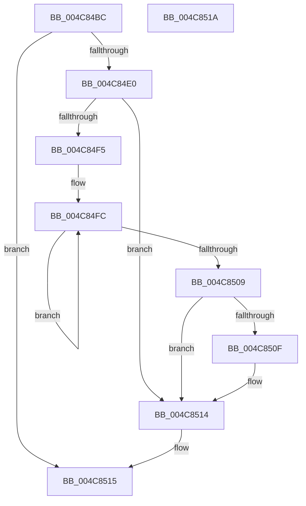

# RtlpFcWriteHighLowHigh

- RVA: `0x004C84BC`–`0x004C851B` (길이 `95` bytes)
- VA: `0x00000001404C84BC`
- 실행 섹션: `.text`
- PDB 이름 있음: `예`; PDB Function 태그: `아니요`
- unwind 정보 RVA: `0x00085914`
- 디코드: `27`개 명령, `95/95` bytes 표시
- 미해석 바이트: `0` (있으면 어셈블리에 `.byte`로 보존)

> 이 문서는 커널 이미지의 기계어와 PDB 기호를 분석해 생성했습니다. 4번과 5번은 함수 원형과 자료형을 바이너리 사용 방식에서 추정한 C 해석이며 원본 소스 복구 결과는 아닙니다.

## 1. Dependencies

- 직접 호출 지점: **2**; 고유 호출 대상: **2**
- 직접 호출자로 확인된 함수: **5**
- RIP 상대 이미지 참조: **0**

### Outgoing calls
- `0x004C84CB` → [KeDisableInterrupts](../21/KeDisableInterrupts_function_00217BE0.md) (function, `0x00217BE0`)
- `0x004C850F` → [KiRemoveSystemWorkPriorityKick](../26/KiRemoveSystemWorkPriorityKick_function_002631D0.md) (function, `0x002631D0`)

### Direct callers
- [CmFcManagerOverwriteFeatureConfigurationSection](../../page/7F/CmFcManagerOverwriteFeatureConfigurationSection_function_007F4450.md) at `0x007F4857`
- [CmFcManagerOverwriteFeatureConfigurationSection](../../page/7F/CmFcManagerOverwriteFeatureConfigurationSection_function_007F4450.md) at `0x007F486D`
- [CmFcManagerUpdateFeatureConfigurations](../../page/7F/CmFcManagerUpdateFeatureConfigurations_function_007F4CF4.md) at `0x007F520D`
- [CmFcManagerUpdateFeatureConfigurations](../../page/7F/CmFcManagerUpdateFeatureConfigurations_function_007F4CF4.md) at `0x007F5223`
- [CmFcManagerUpdateFeatureUsageSubscriptions](../../page/A4/CmFcManagerUpdateFeatureUsageSubscriptions_function_00A4490C.md) at `0x00A44AA4`
- [CmFcManagerUpdateFeatureUsageSubscriptions](../../page/A4/CmFcManagerUpdateFeatureUsageSubscriptions_function_00A4490C.md) at `0x00A44ABA`
- [CmFcManagerStartBootPhase](../../init/C5/CmFcManagerStartBootPhase_function_00C5DB98.md) at `0x00C5DC20`
- [CmFcManagerStartRuntimePhase](../../init/C5/CmFcManagerStartRuntimePhase_function_00C5DC70.md) at `0x00C5DEB5`

### Static image references
- 디코드된 RIP-relative 메모리 참조가 없습니다.

## 2. Other-region calls and transfers

- 다른 실행 섹션으로 향하는 call: **0**
- 별도 외부 분기/꼬리 이동을 확인하지 못했습니다.

## 3. Assembly (complete function range)

```asm
004C84BC  48 89 54 24 10                  mov qword ptr [rsp + 0x10], rdx
004C84C1  48 83 EC 28                     sub rsp, 0x28
004C84C5  4C 8B D2                        mov r10, rdx
004C84C8  4C 8B C9                        mov r9, rcx
004C84CB  E8 10 F7 D4 FF                  call 0x140217be0
004C84D0  44 8B 44 24 3C                  mov r8d, dword ptr [rsp + 0x3c]
004C84D5  45 89 41 08                     mov dword ptr [r9 + 8], r8d
004C84D9  4D 89 11                        mov qword ptr [r9], r10
004C84DC  84 C0                           test al, al
004C84DE  74 35                           je 0x1404c8515
004C84E0  65 48 8B 0C 25 20 00 00 00      mov rcx, qword ptr gs:[0x20]
004C84E9  4C 8B 81 B8 8E 00 00            mov r8, qword ptr [rcx + 0x8eb8]
004C84F0  4D 85 C0                        test r8, r8
004C84F3  74 1F                           je 0x1404c8514
004C84F5  41 0F 0D 08                     prefetchw byte ptr [r8]
004C84F9  41 8B 00                        mov eax, dword ptr [r8]
004C84FC  8B D0                           mov edx, eax
004C84FE  0F BA F2 15                     btr edx, 0x15
004C8502  F0 41 0F B1 10                  lock cmpxchg dword ptr [r8], edx
004C8507  75 F3                           jne 0x1404c84fc
004C8509  0F BA E0 15                     bt eax, 0x15
004C850D  73 05                           jae 0x1404c8514
004C850F  E8 BC AC D9 FF                  call 0x1402631d0
004C8514  FB                              sti
004C8515  48 83 C4 28                     add rsp, 0x28
004C8519  C3                              ret
004C851A  CC                              int3
```

## 4. C-style interpretation (structured pseudocode)

```c
__int64 __fastcall RtlpFcWriteHighLowHigh(__int64 a1, __int64 a2)
{
    __int64 result;
    __int64 v_rsp;
    unsigned __int64 v_stack_p10;
    unsigned int v_stack_p14;

    v_stack_p10 = a2;
    v_rsp = (v_rsp) - (40);
    result = KeDisableInterrupts(a1, a2, a3, a1);
    *(unsigned int *)(a1 + 8) = (unsigned int)((unsigned int)(v_stack_p14));
    *(unsigned __int64 *)(a1) = a2;
    if ((unsigned __int8)(result) == 0) goto loc_004C8515;
    if (*(unsigned __int64 *)(*(unsigned __int64 *)(gs_base + (0 + 32)) + 36536) == 0) goto loc_004C8514;
loc_004C84FC:
    if (*(unsigned __int64 *)(*(unsigned __int64 *)(gs_base + (0 + 32)) + 36536) != 0) goto loc_004C84FC;
    result = (unsigned int)(*(unsigned int *)(*(unsigned __int64 *)(*(unsigned __int64 *)(gs_base + (0 + 32)) + 36536)));
    if (!(condition_is_above_or_equal)) {
        result = KiRemoveSystemWorkPriorityKick(*(unsigned __int64 *)(gs_base + (0 + 32)), (unsigned int)((unsigned int)((unsigned int)(*(unsigned int *)(*(unsigned __int64 *)(*(unsigned __int64 *)(gs_base + (0 + 32)) + 36536))))), *(unsigned __int64 *)(*(unsigned __int64 *)(gs_base + (0 + 32)) + 36536), a1);
    }
loc_004C8515:
    v_rsp = (v_rsp) + (40);
    return result;
}
```

## 5. (Beta) C Style

```c
int64_t RtlpFcWriteHighLowHigh(int64_t Arg1, int64_t Arg2)
{
    int64_t result;
    int64_t local_rsp;
    uint64_t v_stack_p10;
    uint32_t v_stack_p14;

    v_stack_p10 = Arg2;
    local_rsp = (local_rsp) - (40);
    result = KeDisableInterrupts(Arg1, Arg2, a3, Arg1);
    *(uint32_t *)(Arg1 + 0x8) = (uint32_t)((uint32_t)(v_stack_p14));
    *(uint64_t *)(Arg1) = Arg2;
    if ((uint8_t)(result) == 0) goto loc_004C8515;
    if (*(uint64_t *)(*(uint64_t *)(gs_base + (0 + 0x20)) + 0x8EB8) == 0) goto loc_004C8514;
loc_004C84FC:
    if (*(uint64_t *)(*(uint64_t *)(gs_base + (0 + 0x20)) + 0x8EB8) != 0) goto loc_004C84FC;
    result = (uint32_t)(*(uint32_t *)(*(uint64_t *)(*(uint64_t *)(gs_base + (0 + 0x20)) + 0x8EB8)));
    if (!(condition_is_above_or_equal)) {
        result = KiRemoveSystemWorkPriorityKick(*(uint64_t *)(gs_base + (0 + 0x20)), (uint32_t)((uint32_t)((uint32_t)(*(uint32_t *)(*(uint64_t *)(*(uint64_t *)(gs_base + (0 + 0x20)) + 0x8EB8))))), *(uint64_t *)(*(uint64_t *)(gs_base + (0 + 0x20)) + 0x8EB8), Arg1);
    }
loc_004C8515:
    local_rsp = (local_rsp) + (40);
    return result;
}
```

## 6. Execution-region graph

[열기: 2D/3D 그래프와 함수 탐색 컨트롤 패널](../../../control-panel.html?section=text&rva=0x004C84BC&view=graph)

- 2D 그래프는 위에서 아래로 흐르고, 3D 그래프는 빈 공간을 드래그해 회전합니다. Shift+드래그는 이동, 휠은 확대·축소, 함수 노드 선택은 대상 보고서 이동입니다.

### Static fallback


