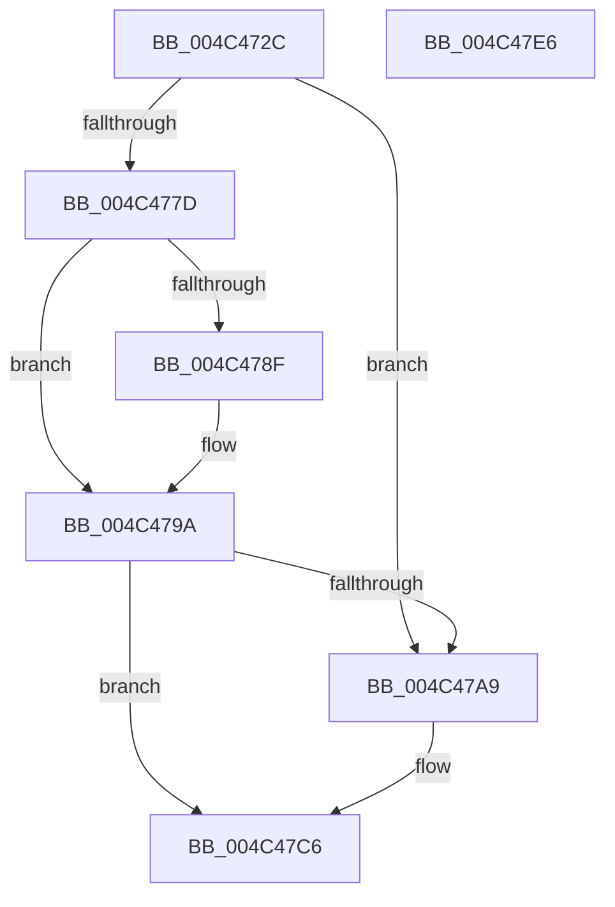

# RtlpHpLfhContextMetadataAllocate

- RVA: `0x004C472C`–`0x004C47E7` (길이 `187` bytes)
- VA: `0x00000001404C472C`
- 실행 섹션: `.text`
- PDB 이름 있음: `예`; PDB Function 태그: `아니요`
- unwind 정보 RVA: `0x000BCD84`
- 디코드: `48`개 명령, `187/187` bytes 표시
- 미해석 바이트: `0` (있으면 어셈블리에 `.byte`로 보존)

> 이 문서는 커널 이미지의 기계어와 PDB 기호를 분석해 생성했습니다. 4번과 5번은 함수 원형과 자료형을 바이너리 사용 방식에서 추정한 C 해석이며 원본 소스 복구 결과는 아닙니다.

## 1. Dependencies

- 직접 호출 지점: **4**; 고유 호출 대상: **4**
- 직접 호출자로 확인된 함수: **3**
- RIP 상대 이미지 참조: **3**

### Outgoing calls
- `0x004C477D` → [RtlpHpLfhContextLockExtension](../60/RtlpHpLfhContextLockExtension_function_00604A50.md) (function, `0x00604A50`)
- `0x004C479F` → [RtlpHpLfhContextUnlockExtension](../60/RtlpHpLfhContextUnlockExtension_function_00604C1C.md) (function, `0x00604C1C`)
- `0x004C47BE` → [guard_dispatch_icall](../6B/guard_dispatch_icall_function_006BAAD0.md) (function, `0x006BAAD0`)
- `0x004C47D1` → [_security_check_cookie](../6A/_security_check_cookie_function_006AC640.md) (function, `0x006AC640`)

### Direct callers
- [RtlpHpLfhSlotAllocateSlow](../2E/RtlpHpLfhSlotAllocateSlow_function_002E8FBC.md) at `0x002E975C`
- [RtlpHpLfhContextSlotAllocate](RtlpHpLfhContextSlotAllocate_function_004C45BC.md) at `0x004C46EB`
- [RtlpHpLfhPrivateSlotCreate](../60/RtlpHpLfhPrivateSlotCreate_function_00604D50.md) at `0x00604DB7`

### Static image references
- `0x004C473B` → RVA `0x00E0A740` (`.data`; read)
- `0x004C475D` → RVA `0x00F059A0` (`.data`; read)
- `0x004C47AD` → RVA `0x00E28300` (`.data`; read)

## 2. Other-region calls and transfers

- 다른 실행 섹션으로 향하는 call: **0**
- 별도 외부 분기/꼬리 이동을 확인하지 못했습니다.

## 3. Assembly (complete function range)

```asm
004C472C  48 89 5C 24 18                  mov qword ptr [rsp + 0x18], rbx
004C4731  48 89 74 24 20                  mov qword ptr [rsp + 0x20], rsi
004C4736  57                              push rdi
004C4737  48 83 EC 40                     sub rsp, 0x40
004C473B  48 8B 05 FE 5F 94 00            mov rax, qword ptr [rip + 0x945ffe]
004C4742  48 33 C4                        xor rax, rsp
004C4745  48 89 44 24 30                  mov qword ptr [rsp + 0x30], rax
004C474A  B8 00 01 00 00                  mov eax, 0x100
004C474F  48 63 F2                        movsxd rsi, edx
004C4752  89 44 24 20                     mov dword ptr [rsp + 0x20], eax
004C4756  48 8B D9                        mov rbx, rcx
004C4759  89 44 24 24                     mov dword ptr [rsp + 0x24], eax
004C475D  8B 05 3D 12 A4 00               mov eax, dword ptr [rip + 0xa4123d]
004C4763  C1 E8 07                        shr eax, 7
004C4766  83 E0 01                        and eax, 1
004C4769  FF C0                           inc eax
004C476B  C1 E0 06                        shl eax, 6
004C476E  48 83 BC F1 88 00 00 00 00      cmp qword ptr [rcx + rsi*8 + 0x88], 0
004C4777  89 44 24 28                     mov dword ptr [rsp + 0x28], eax
004C477B  74 2C                           je 0x1404c47a9
004C477D  E8 CE 02 14 00                  call 0x140604a50
004C4782  48 8B BC F3 88 00 00 00         mov rdi, qword ptr [rbx + rsi*8 + 0x88]
004C478A  48 85 FF                        test rdi, rdi
004C478D  74 0B                           je 0x1404c479a
004C478F  48 8B 0F                        mov rcx, qword ptr [rdi]
004C4792  48 89 8C F3 88 00 00 00         mov qword ptr [rbx + rsi*8 + 0x88], rcx
004C479A  8A D0                           mov dl, al
004C479C  48 8B CB                        mov rcx, rbx
004C479F  E8 78 04 14 00                  call 0x140604c1c
004C47A4  48 85 FF                        test rdi, rdi
004C47A7  75 1D                           jne 0x1404c47c6
004C47A9  48 8B 43 28                     mov rax, qword ptr [rbx + 0x28]
004C47AD  48 33 05 4C 3B 96 00            xor rax, qword ptr [rip + 0x963b4c]
004C47B4  48 8B 0B                        mov rcx, qword ptr [rbx]
004C47B7  48 33 C3                        xor rax, rbx
004C47BA  8B 54 B4 20                     mov edx, dword ptr [rsp + rsi*4 + 0x20]
004C47BE  E8 0D 63 1F 00                  call 0x1406baad0
004C47C3  48 8B F8                        mov rdi, rax
004C47C6  48 8B C7                        mov rax, rdi
004C47C9  48 8B 4C 24 30                  mov rcx, qword ptr [rsp + 0x30]
004C47CE  48 33 CC                        xor rcx, rsp
004C47D1  E8 6A 7E 1E 00                  call 0x1406ac640
004C47D6  48 8B 5C 24 60                  mov rbx, qword ptr [rsp + 0x60]
004C47DB  48 8B 74 24 68                  mov rsi, qword ptr [rsp + 0x68]
004C47E0  48 83 C4 40                     add rsp, 0x40
004C47E4  5F                              pop rdi
004C47E5  C3                              ret
004C47E6  CC                              int3
```

## 4. C-style interpretation (structured pseudocode)

```c
__int64 __fastcall RtlpHpLfhContextMetadataAllocate(__int64 a1, int a2)
{
    __int64 result;
    __int64 v_rdi;
    __int64 v_rsp;
    unsigned __int64 v_stack_m18;
    unsigned int v_stack_m20;
    unsigned int v_stack_m24;
    unsigned int v_stack_m28;
    unsigned __int64 v_stack_p18;
    unsigned __int64 v_stack_p20;

    v_stack_p18 = v_rbx;
    v_stack_p20 = v_rsi;
    v_rsp = (v_rsp) - (64);
    result = (*(unsigned __int64 *)(v_rip + 9723902)) ^ (v_rsp);
    v_stack_m18 = result;
    v_stack_m28 = 256;
    v_stack_m24 = 256;
    result = (unsigned int)(((unsigned int)(*(unsigned int *)(v_rip + 10752573))) >> (7));
    result = (unsigned int)((result) & (1));
    result = (unsigned int)((result) + 1);
    result = (unsigned int)((result) << (6));
    v_stack_m20 = (unsigned int)(result);
    if ((*(unsigned __int64 *)(a1 + (int)(a2) * 8 + 136)) == 0) goto loc_004C47A9;
    result = RtlpHpLfhContextLockExtension(a1, a2, a3, a4);
    if (*(unsigned __int64 *)(a1 + (int)(a2) * 8 + 136) != 0) {
        a1 = *(unsigned __int64 *)(*(unsigned __int64 *)(a1 + (int)(a2) * 8 + 136));
        *(unsigned __int64 *)(a1 + (int)(a2) * 8 + 136) = a1;
    }
    result = RtlpHpLfhContextUnlockExtension(a1, (unsigned __int8)(result), a3, a4);
    v_rdi = *(unsigned __int64 *)(a1 + (int)(a2) * 8 + 136);
    if (*(unsigned __int64 *)(a1 + (int)(a2) * 8 + 136) == 0) {
        result = *(unsigned __int64 *)(a1 + 40);
        result = (result) ^ (*(unsigned __int64 *)(v_rip + 9845580));
        a1 = *(unsigned __int64 *)(a1);
        result = (result) ^ (a1);
        a2 = *(unsigned int *)(v_rsp + (int)(a2) * 4 + 32);
        result = guard_dispatch_icall(a1, a2, a3, a4);
        v_rdi = result;
    }
    a1 = (v_stack_m18) ^ (v_rsp);
    result = _security_check_cookie(a1, a2, a3, a4);
    v_rsp = (v_rsp) + (64);
    return result;
}
```

## 5. (Beta) C Style

```c
int64_t RtlpHpLfhContextMetadataAllocate(void *Arg1, int32_t Arg2)
{
    uint8_t *arg1 = (uint8_t *)Arg1;

    int64_t result;
    int64_t local_rdi;
    int64_t local_rsp;
    uint64_t v_stack_m18;
    uint32_t v_stack_m20;
    uint32_t v_stack_m24;
    uint32_t v_stack_m28;
    uint64_t v_stack_p18;
    uint64_t v_stack_p20;

    v_stack_p18 = local_rbx;
    v_stack_p20 = local_rsi;
    local_rsp = (local_rsp) - (64);
    result = (*(uint64_t *)(v_rip + 0x945FFE)) ^ (local_rsp);
    v_stack_m18 = result;
    v_stack_m28 = 256;
    v_stack_m24 = 256;
    result = (uint32_t)(((uint32_t)(*(uint32_t *)(v_rip + 0xA4123D))) >> (7));
    result = (uint32_t)((result) & (1));
    result = (uint32_t)((result) + 1);
    result = (uint32_t)((result) << (6));
    v_stack_m20 = (uint32_t)(result);
    if ((*(uint64_t *)(arg1 + (int32_t)(Arg2) * 8 + 0x88)) == 0) goto loc_004C47A9;
    result = RtlpHpLfhContextLockExtension(Arg1, Arg2, a3, a4);
    if (*(uint64_t *)(arg1 + (int32_t)(Arg2) * 8 + 0x88) != 0) {
        Arg1 = *(uint64_t *)(*(uint64_t *)(arg1 + (int32_t)(Arg2) * 8 + 0x88));
        *(void **)(arg1 + (int32_t)(Arg2) * 8 + 0x88) = Arg1;
    }
    result = RtlpHpLfhContextUnlockExtension(Arg1, (uint8_t)(result), a3, a4);
    local_rdi = *(uint64_t *)(arg1 + (int32_t)(Arg2) * 8 + 0x88);
    if (*(uint64_t *)(arg1 + (int32_t)(Arg2) * 8 + 0x88) == 0) {
        result = *(uint64_t *)(arg1 + 0x28);
        result = (result) ^ (*(uint64_t *)(v_rip + 0x963B4C));
        Arg1 = *(uint64_t *)(arg1);
        result = (result) ^ (Arg1);
        Arg2 = *(uint32_t *)(local_rsp + (int32_t)(Arg2) * 4 + 0x20);
        result = guard_dispatch_icall(Arg1, Arg2, a3, a4);
        local_rdi = result;
    }
    Arg1 = (v_stack_m18) ^ (local_rsp);
    result = _security_check_cookie(Arg1, Arg2, a3, a4);
    local_rsp = (local_rsp) + (64);
    return result;
}
```

### 관측된 메모리 오프셋

구조체 형식이 확인되지 않은 접근은 인자 기준의 오프셋으로만 기록했습니다.

| 기준 인자 | 오프셋 표현 | 폭 (bit) | 접근 |
|---|---:|---:|---|
| `Arg1` | `+ 0x0` | `64` | `R` |
| `Arg1` | `+ 0x28` | `64` | `R` |
| `Arg1` | `+ 0x88 + rsi*8` | `64` | `R` |
| `Arg1` | `+ 0x88 + rsi*8` | `64` | `W` |

## 6. Execution-region graph

[열기: 2D/3D 그래프와 함수 탐색 컨트롤 패널](../../../control-panel.html?section=text&rva=0x004C472C&view=graph)

- 2D 그래프는 위에서 아래로 흐르고, 3D 그래프는 빈 공간을 드래그해 회전합니다. Shift+드래그는 이동, 휠은 확대·축소, 함수 노드 선택은 대상 보고서 이동입니다.

### Static fallback


