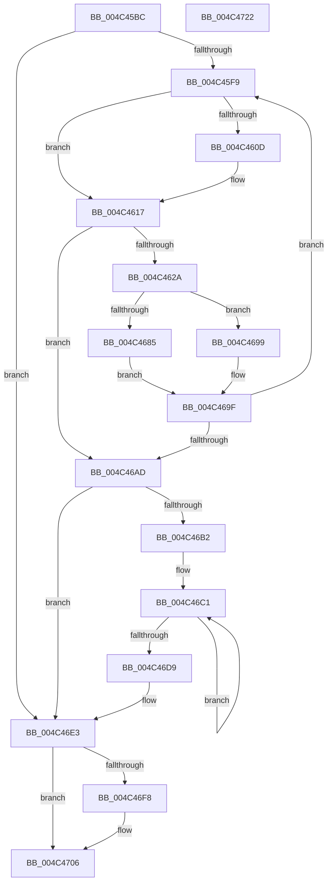

# RtlpHpLfhContextSlotAllocate

- RVA: `0x004C45BC`–`0x004C4723` (길이 `359` bytes)
- VA: `0x00000001404C45BC`
- 실행 섹션: `.text`
- PDB 이름 있음: `예`; PDB Function 태그: `아니요`
- unwind 정보 RVA: `0x00084C9C`
- 디코드: `96`개 명령, `359/359` bytes 표시
- 미해석 바이트: `0` (있으면 어셈블리에 `.byte`로 보존)

> 이 문서는 커널 이미지의 기계어와 PDB 기호를 분석해 생성했습니다. 4번과 5번은 함수 원형과 자료형을 바이너리 사용 방식에서 추정한 C 해석이며 원본 소스 복구 결과는 아닙니다.

## 1. Dependencies

- 직접 호출 지점: **10**; 고유 호출 대상: **8**
- 직접 호출자로 확인된 함수: **2**
- RIP 상대 이미지 참조: **0**

### Outgoing calls
- `0x004C45FC` → [RtlpHpLfhContextLockExtension](../60/RtlpHpLfhContextLockExtension_function_00604A50.md) (function, `0x00604A50`)
- `0x004C461C` → [RtlpHpLfhContextUnlockExtension](../60/RtlpHpLfhContextUnlockExtension_function_00604C1C.md) (function, `0x00604C1C`)
- `0x004C4645` → [RtlpHpLfhOwnerFreeListProcess](../2E/RtlpHpLfhOwnerFreeListProcess_function_002E8BA0.md) (function, `0x002E8BA0`)
- `0x004C4657` → [RtlpHpLfhHeatMapQuery](../2E/RtlpHpLfhHeatMapQuery_function_002E7790.md) (function, `0x002E7790`)
- `0x004C4677` → [RtlpHpLfhBucketAddSubsegment](../2E/RtlpHpLfhBucketAddSubsegment_function_002E8CD8.md) (function, `0x002E8CD8`)
- `0x004C4692` → [RtlpHpLfhContextMetadataFree](../60/RtlpHpLfhContextMetadataFree_function_00604B04.md) (function, `0x00604B04`)
- `0x004C46B5` → [RtlpHpLfhContextLockExtension](../60/RtlpHpLfhContextLockExtension_function_00604A50.md) (function, `0x00604A50`)
- `0x004C46DE` → [RtlpHpLfhContextUnlockExtension](../60/RtlpHpLfhContextUnlockExtension_function_00604C1C.md) (function, `0x00604C1C`)
- `0x004C46EB` → [RtlpHpLfhContextMetadataAllocate](RtlpHpLfhContextMetadataAllocate_function_004C472C.md) (function, `0x004C472C`)
- `0x004C4701` → [RtlpHpLfhSlotInitialize](RtlpHpLfhSlotInitialize_function_004CE094.md) (function, `0x004CE094`)

### Direct callers
- [RtlpHpLfhBucketUpdateAffinityMapping](../4D/RtlpHpLfhBucketUpdateAffinityMapping_function_004D0008.md) at `0x004D01E0`
- [RtlpHpLfhPrivateSlotCreate](../60/RtlpHpLfhPrivateSlotCreate_function_00604D50.md) at `0x00604D7A`

### Static image references
- 디코드된 RIP-relative 메모리 참조가 없습니다.

## 2. Other-region calls and transfers

- 다른 실행 섹션으로 향하는 call: **0**
- 별도 외부 분기/꼬리 이동을 확인하지 못했습니다.

## 3. Assembly (complete function range)

```asm
004C45BC  4C 8B DC                        mov r11, rsp
004C45BF  49 89 5B 08                     mov qword ptr [r11 + 8], rbx
004C45C3  49 89 6B 10                     mov qword ptr [r11 + 0x10], rbp
004C45C7  49 89 73 18                     mov qword ptr [r11 + 0x18], rsi
004C45CB  57                              push rdi
004C45CC  41 56                           push r14
004C45CE  41 57                           push r15
004C45D0  48 83 EC 30                     sub rsp, 0x30
004C45D4  49 8D 43 D8                     lea rax, [r11 - 0x28]
004C45D8  33 DB                           xor ebx, ebx
004C45DA  4C 8B FA                        mov r15, rdx
004C45DD  49 89 43 E0                     mov qword ptr [r11 - 0x20], rax
004C45E1  49 8D 43 D8                     lea rax, [r11 - 0x28]
004C45E5  48 8B F1                        mov rsi, rcx
004C45E8  49 89 43 D8                     mov qword ptr [r11 - 0x28], rax
004C45EC  48 39 99 A0 00 00 00            cmp qword ptr [rcx + 0xa0], rbx
004C45F3  0F 84 EA 00 00 00               je 0x1404c46e3
004C45F9  48 8B CE                        mov rcx, rsi
004C45FC  E8 4F 04 14 00                  call 0x140604a50
004C4601  4C 8B B6 A0 00 00 00            mov r14, qword ptr [rsi + 0xa0]
004C4608  4D 85 F6                        test r14, r14
004C460B  74 0A                           je 0x1404c4617
004C460D  49 8B 0E                        mov rcx, qword ptr [r14]
004C4610  48 89 8E A0 00 00 00            mov qword ptr [rsi + 0xa0], rcx
004C4617  8A D0                           mov dl, al
004C4619  48 8B CE                        mov rcx, rsi
004C461C  E8 FB 05 14 00                  call 0x140604c1c
004C4621  4D 85 F6                        test r14, r14
004C4624  0F 84 83 00 00 00               je 0x1404c46ad
004C462A  41 0F B7 7E F2                  movzx edi, word ptr [r14 - 0xe]
004C462F  4C 8D 44 24 20                  lea r8, [rsp + 0x20]
004C4634  48 C1 E7 06                     shl rdi, 6
004C4638  49 8D 56 F0                     lea rdx, [r14 - 0x10]
004C463C  45 33 C9                        xor r9d, r9d
004C463F  48 8B CE                        mov rcx, rsi
004C4642  48 03 FE                        add rdi, rsi
004C4645  E8 56 45 E2 FF                  call 0x1402e8ba0
004C464A  48 8D 96 C0 00 00 00            lea rdx, [rsi + 0xc0]
004C4651  4C 8B C7                        mov r8, rdi
004C4654  48 8B CE                        mov rcx, rsi
004C4657  E8 34 31 E2 FF                  call 0x1402e7790
004C465C  B9 04 00 00 00                  mov ecx, 4
004C4661  4C 8D 44 24 20                  lea r8, [rsp + 0x20]
004C4666  83 F8 01                        cmp eax, 1
004C4669  48 8B D7                        mov rdx, rdi
004C466C  44 8D 49 04                     lea r9d, [rcx + 4]
004C4670  44 0F 4C C9                     cmovl r9d, ecx
004C4674  48 8B CE                        mov rcx, rsi
004C4677  E8 5C 46 E2 FF                  call 0x1402e8cd8
004C467C  49 8D 46 18                     lea rax, [r14 + 0x18]
004C4680  48 39 00                        cmp qword ptr [rax], rax
004C4683  75 14                           jne 0x1404c4699
004C4685  41 B8 02 00 00 00               mov r8d, 2
004C468B  49 8D 56 F0                     lea rdx, [r14 - 0x10]
004C468F  48 8B CE                        mov rcx, rsi
004C4692  E8 6D 04 14 00                  call 0x140604b04
004C4697  EB 06                           jmp 0x1404c469f
004C4699  49 89 1E                        mov qword ptr [r14], rbx
004C469C  49 8B DE                        mov rbx, r14
004C469F  48 83 BE A0 00 00 00 00         cmp qword ptr [rsi + 0xa0], 0
004C46A7  0F 85 4C FF FF FF               jne 0x1404c45f9
004C46AD  48 85 DB                        test rbx, rbx
004C46B0  74 31                           je 0x1404c46e3
004C46B2  48 8B CE                        mov rcx, rsi
004C46B5  E8 96 03 14 00                  call 0x140604a50
004C46BA  4C 8B 86 A0 00 00 00            mov r8, qword ptr [rsi + 0xa0]
004C46C1  48 8B CB                        mov rcx, rbx
004C46C4  48 8B 1B                        mov rbx, qword ptr [rbx]
004C46C7  4C 89 01                        mov qword ptr [rcx], r8
004C46CA  4C 8B C1                        mov r8, rcx
004C46CD  48 89 8E A0 00 00 00            mov qword ptr [rsi + 0xa0], rcx
004C46D4  48 85 DB                        test rbx, rbx
004C46D7  75 E8                           jne 0x1404c46c1
004C46D9  8A D0                           mov dl, al
004C46DB  48 8B CE                        mov rcx, rsi
004C46DE  E8 39 05 14 00                  call 0x140604c1c
004C46E3  BA 02 00 00 00                  mov edx, 2
004C46E8  48 8B CE                        mov rcx, rsi
004C46EB  E8 3C 00 00 00                  call 0x1404c472c
004C46F0  48 8B D8                        mov rbx, rax
004C46F3  48 85 C0                        test rax, rax
004C46F6  74 0E                           je 0x1404c4706
004C46F8  4C 8B C6                        mov r8, rsi
004C46FB  49 8B D7                        mov rdx, r15
004C46FE  48 8B C8                        mov rcx, rax
004C4701  E8 8E 99 00 00                  call 0x1404ce094
004C4706  48 8B 6C 24 58                  mov rbp, qword ptr [rsp + 0x58]
004C470B  48 8B C3                        mov rax, rbx
004C470E  48 8B 5C 24 50                  mov rbx, qword ptr [rsp + 0x50]
004C4713  48 8B 74 24 60                  mov rsi, qword ptr [rsp + 0x60]
004C4718  48 83 C4 30                     add rsp, 0x30
004C471C  41 5F                           pop r15
004C471E  41 5E                           pop r14
004C4720  5F                              pop rdi
004C4721  C3                              ret
004C4722  CC                              int3
```

## 4. C-style interpretation (structured pseudocode)

```c
__int64 __fastcall RtlpHpLfhContextSlotAllocate(__int64 a1, __int64 a2, __int64 a3, int a4)
{
    __int64 result;
    __int64 v_rbx;
    __int64 v_rdi;
    __int64 v_rsp;
    unsigned __int64 v_stack_m28;
    unsigned __int64 v_stack_p10;
    unsigned __int64 v_stack_p18;
    unsigned __int64 v_stack_p8;

    *(unsigned __int64 *)(v_rsp + 8) = v_rbx;
    *(unsigned __int64 *)(v_rsp + 16) = v_rbp;
    *(unsigned __int64 *)(v_rsp + 24) = v_rsi;
    v_rsp = (v_rsp) - (48);
    v_rbx = 0;
    *(unsigned __int64 *)(v_rsp - 32) = v_rsp - 40;
    *(unsigned __int64 *)(v_rsp - 40) = v_rsp - 40;
    if ((*(unsigned __int64 *)(a1 + 160)) == 0) goto loc_004C46E3;
loc_004C45F9:
    result = RtlpHpLfhContextLockExtension(a1, a2, a3, a4);
    if (*(unsigned __int64 *)(a1 + 160) != 0) {
        a1 = *(unsigned __int64 *)(*(unsigned __int64 *)(a1 + 160));
        *(unsigned __int64 *)(a1 + 160) = a1;
    }
    result = RtlpHpLfhContextUnlockExtension(a1, (unsigned __int8)(result), a3, a4);
    if (*(unsigned __int64 *)(a1 + 160) == 0) goto loc_004C46AD;
    v_rdi = (*(unsigned __int16 *)(*(unsigned __int64 *)(a1 + 160) - 14)) << (6);
    a4 = 0;
    v_rdi = (v_rdi) + (a1);
    result = RtlpHpLfhOwnerFreeListProcess(a1, *(unsigned __int64 *)(a1 + 160) - 16, v_stack_m28, a4);
    result = RtlpHpLfhHeatMapQuery(a1, a1 + 192, v_rdi, a4);
    a4 = 4 + 4;
    if (((unsigned int)(result)) < 1) { a4 = 4; }
    result = RtlpHpLfhBucketAddSubsegment(a1, v_rdi, v_stack_m28, a4);
    if ((*(unsigned __int64 *)(*(unsigned __int64 *)(a1 + 160) + 24)) != (*(unsigned __int64 *)(a1 + 160) + 24)) goto loc_004C4699;
    result = RtlpHpLfhContextMetadataFree(a1, *(unsigned __int64 *)(a1 + 160) - 16, 2, a4);
    goto loc_004C469F;
loc_004C4699:
    *(unsigned __int64 *)(*(unsigned __int64 *)(a1 + 160)) = 0;
loc_004C469F:
    if ((*(unsigned __int64 *)(a1 + 160)) != 0) goto loc_004C45F9;
loc_004C46AD:
    if (*(unsigned __int64 *)(a1 + 160) == 0) goto loc_004C46E3;
    result = RtlpHpLfhContextLockExtension(a1, *(unsigned __int64 *)(a1 + 160) - 16, 2, a4);
loc_004C46C1:
    *(unsigned __int64 *)(*(unsigned __int64 *)(a1 + 160)) = *(unsigned __int64 *)(a1 + 160);
    *(unsigned __int64 *)(a1 + 160) = *(unsigned __int64 *)(a1 + 160);
    if (*(unsigned __int64 *)(*(unsigned __int64 *)(a1 + 160)) != 0) goto loc_004C46C1;
    result = RtlpHpLfhContextUnlockExtension(a1, (unsigned __int8)(result), *(unsigned __int64 *)(a1 + 160), a4);
loc_004C46E3:
    result = RtlpHpLfhContextMetadataAllocate(a1, 2, *(unsigned __int64 *)(a1 + 160), a4);
    if (result != 0) {
        a3 = a1;
        a2 = a2;
        a1 = result;
        result = RtlpHpLfhSlotInitialize(a1, a2, a3, a4);
    }
    v_rsp = (v_rsp) + (48);
    return result;
}
```

## 5. (Beta) C Style

```c
int64_t RtlpHpLfhContextSlotAllocate(void *Arg1, int64_t Arg2, int64_t Arg3, int32_t Arg4)
{
    uint8_t *arg1 = (uint8_t *)Arg1;

    int64_t result;
    int64_t local_rbx;
    int64_t local_rdi;
    int64_t local_rsp;
    uint64_t v_stack_m28;
    uint64_t v_stack_p10;
    uint64_t v_stack_p18;
    uint64_t v_stack_p8;

    *(uint64_t *)(local_rsp + 0x8) = local_rbx;
    *(uint64_t *)(local_rsp + 0x10) = local_rbp;
    *(uint64_t *)(local_rsp + 0x18) = local_rsi;
    local_rsp = (local_rsp) - (48);
    local_rbx = 0;
    *(uint64_t *)(local_rsp - 0x20) = local_rsp - 40;
    *(uint64_t *)(local_rsp - 0x28) = local_rsp - 40;
    if ((*(uint64_t *)(arg1 + 0xA0)) == 0) goto loc_004C46E3;
loc_004C45F9:
    result = RtlpHpLfhContextLockExtension(Arg1, Arg2, Arg3, Arg4);
    if (*(uint64_t *)(arg1 + 0xA0) != 0) {
        Arg1 = *(uint64_t *)(*(uint64_t *)(arg1 + 0xA0));
        *(void **)(arg1 + 0xA0) = Arg1;
    }
    result = RtlpHpLfhContextUnlockExtension(Arg1, (uint8_t)(result), Arg3, Arg4);
    if (*(uint64_t *)(arg1 + 0xA0) == 0) goto loc_004C46AD;
    local_rdi = (*(uint16_t *)(*(uint64_t *)(arg1 + 0xA0) - 0xE)) << (6);
    Arg4 = 0;
    local_rdi = (local_rdi) + (Arg1);
    result = RtlpHpLfhOwnerFreeListProcess(Arg1, *(uint64_t *)(arg1 + 0xA0) - 16, v_stack_m28, Arg4);
    result = RtlpHpLfhHeatMapQuery(Arg1, Arg1 + 192, local_rdi, Arg4);
    Arg4 = 4 + 4;
    if (((uint32_t)(result)) < 1) { Arg4 = 4; }
    result = RtlpHpLfhBucketAddSubsegment(Arg1, local_rdi, v_stack_m28, Arg4);
    if ((*(uint64_t *)(*(uint64_t *)(arg1 + 0xA0) + 0x18)) != (*(uint64_t *)(arg1 + 0xA0) + 24)) goto loc_004C4699;
    result = RtlpHpLfhContextMetadataFree(Arg1, *(uint64_t *)(arg1 + 0xA0) - 16, 2, Arg4);
    goto loc_004C469F;
loc_004C4699:
    *(uint64_t *)(*(uint64_t *)(arg1 + 0xA0)) = 0;
loc_004C469F:
    if ((*(uint64_t *)(arg1 + 0xA0)) != 0) goto loc_004C45F9;
loc_004C46AD:
    if (*(uint64_t *)(arg1 + 0xA0) == 0) goto loc_004C46E3;
    result = RtlpHpLfhContextLockExtension(Arg1, *(uint64_t *)(arg1 + 0xA0) - 16, 2, Arg4);
loc_004C46C1:
    *(uint64_t *)(*(uint64_t *)(arg1 + 0xA0)) = *(uint64_t *)(arg1 + 0xA0);
    *(uint64_t *)(arg1 + 0xA0) = *(uint64_t *)(arg1 + 0xA0);
    if (*(uint64_t *)(*(uint64_t *)(arg1 + 0xA0)) != 0) goto loc_004C46C1;
    result = RtlpHpLfhContextUnlockExtension(Arg1, (uint8_t)(result), *(uint64_t *)(arg1 + 0xA0), Arg4);
loc_004C46E3:
    result = RtlpHpLfhContextMetadataAllocate(Arg1, 2, *(uint64_t *)(arg1 + 0xA0), Arg4);
    if (result != 0) {
        Arg3 = Arg1;
        Arg2 = Arg2;
        Arg1 = result;
        result = RtlpHpLfhSlotInitialize(Arg1, Arg2, Arg3, Arg4);
    }
    local_rsp = (local_rsp) + (48);
    return result;
}
```

### 관측된 메모리 오프셋

구조체 형식이 확인되지 않은 접근은 인자 기준의 오프셋으로만 기록했습니다.

| 기준 인자 | 오프셋 표현 | 폭 (bit) | 접근 |
|---|---:|---:|---|
| `Arg1` | `+ 0xA0` | `64` | `R` |
| `Arg1` | `+ 0xA0` | `64` | `W` |
| `Arg1` | `+ 0xC0` | `64` | `R` |

## 6. Execution-region graph

[열기: 2D/3D 그래프와 함수 탐색 컨트롤 패널](../../../control-panel.html?section=text&rva=0x004C45BC&view=graph)

- 2D 그래프는 위에서 아래로 흐르고, 3D 그래프는 빈 공간을 드래그해 회전합니다. Shift+드래그는 이동, 휠은 확대·축소, 함수 노드 선택은 대상 보고서 이동입니다.

### Static fallback


