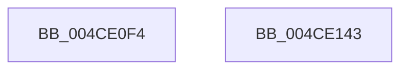

# RtlpHpLfhOwnerInitialize

- RVA: `0x004CE0F4`–`0x004CE144` (길이 `80` bytes)
- VA: `0x00000001404CE0F4`
- 실행 섹션: `.text`
- PDB 이름 있음: `예`; PDB Function 태그: `아니요`
- unwind 정보 RVA: `0x0005C788`
- 디코드: `24`개 명령, `80/80` bytes 표시
- 미해석 바이트: `0` (있으면 어셈블리에 `.byte`로 보존)

> 이 문서는 커널 이미지의 기계어와 PDB 기호를 분석해 생성했습니다. 4번과 5번은 함수 원형과 자료형을 바이너리 사용 방식에서 추정한 C 해석이며 원본 소스 복구 결과는 아닙니다.

## 1. Dependencies

- 직접 호출 지점: **1**; 고유 호출 대상: **1**
- 직접 호출자로 확인된 함수: **2**
- RIP 상대 이미지 참조: **0**

### Outgoing calls
- `0x004CE123` → [RtlpHpInitializeLock](../2E/RtlpHpInitializeLock_function_002E8054.md) (function, `0x002E8054`)

### Direct callers
- [RtlpHpLfhSlotInitialize](RtlpHpLfhSlotInitialize_function_004CE094.md) at `0x004CE0C5`
- [RtlpHpLfhBucketInitialize](../60/RtlpHpLfhBucketInitialize_function_0060475C.md) at `0x0060476C`

### Static image references
- 디코드된 RIP-relative 메모리 참조가 없습니다.

## 2. Other-region calls and transfers

- 다른 실행 섹션으로 향하는 call: **0**
- 별도 외부 분기/꼬리 이동을 확인하지 못했습니다.

## 3. Assembly (complete function range)

```asm
004CE0F4  48 83 EC 28                     sub rsp, 0x28
004CE0F8  0F 57 C0                        xorps xmm0, xmm0
004CE0FB  02 D2                           add dl, dl
004CE0FD  0F 11 01                        movups xmmword ptr [rcx], xmm0
004CE100  41 80 E0 01                     and r8b, 1
004CE104  33 C0                           xor eax, eax
004CE106  0F 11 41 10                     movups xmmword ptr [rcx + 0x10], xmm0
004CE10A  41 0A D0                        or dl, r8b
004CE10D  4C 8B D1                        mov r10, rcx
004CE110  0F 11 41 20                     movups xmmword ptr [rcx + 0x20], xmm0
004CE114  48 89 41 30                     mov qword ptr [rcx + 0x30], rax
004CE118  88 11                           mov byte ptr [rcx], dl
004CE11A  48 83 C1 10                     add rcx, 0x10
004CE11E  41 0F B6 51 41                  movzx edx, byte ptr [r9 + 0x41]
004CE123  E8 2C 9F E1 FF                  call 0x1402e8054
004CE128  49 8D 4A 18                     lea rcx, [r10 + 0x18]
004CE12C  49 8D 42 28                     lea rax, [r10 + 0x28]
004CE130  48 89 49 08                     mov qword ptr [rcx + 8], rcx
004CE134  48 89 09                        mov qword ptr [rcx], rcx
004CE137  48 89 40 08                     mov qword ptr [rax + 8], rax
004CE13B  48 89 00                        mov qword ptr [rax], rax
004CE13E  48 83 C4 28                     add rsp, 0x28
004CE142  C3                              ret
004CE143  CC                              int3
```

## 4. C-style interpretation (structured pseudocode)

```c
__int64 __fastcall RtlpHpLfhOwnerInitialize(__int64 a1, unsigned __int8 a2, unsigned __int8 a3, __int64 a4)
{
    __int64 result;
    __int64 v_rsp;

    v_rsp = (v_rsp) - (40);
    a2 = (unsigned __int8)((a2) + (a2));
    *(unsigned __int64 *)(a1) = v_xmm0;
    a3 = (unsigned __int8)((a3) & (1));
    result = 0;
    *(unsigned __int64 *)(a1 + 16) = v_xmm0;
    a2 = (unsigned __int8)((a2) | (a3));
    *(unsigned __int64 *)(a1 + 32) = v_xmm0;
    *(unsigned __int64 *)(a1 + 48) = 0;
    *(unsigned __int8 *)(a1) = a2;
    a1 = (a1) + (16);
    result = RtlpHpInitializeLock(a1, *(unsigned __int8 *)(a4 + 65), a3, a4);
    *(unsigned __int64 *)(a1 + 24 + 8) = a1 + 24;
    *(unsigned __int64 *)(a1 + 24) = a1 + 24;
    *(unsigned __int64 *)(a1 + 40 + 8) = a1 + 40;
    *(unsigned __int64 *)(a1 + 40) = a1 + 40;
    v_rsp = (v_rsp) + (40);
    return a1 + 40;
}
```

## 5. (Beta) C Style

```c
void *RtlpHpLfhOwnerInitialize(void *Arg1, uint8_t Arg2, uint8_t Arg3, void *Arg4)
{
    uint8_t *arg1 = (uint8_t *)Arg1;
    uint8_t *arg4 = (uint8_t *)Arg4;

    int64_t result;
    int64_t local_rsp;

    local_rsp = (local_rsp) - (40);
    Arg2 = (uint8_t)((Arg2) + (Arg2));
    *(uint64_t *)(arg1) = v_xmm0;
    Arg3 = (uint8_t)((Arg3) & (1));
    result = 0;
    *(uint64_t *)(arg1 + 0x10) = v_xmm0;
    Arg2 = (uint8_t)((Arg2) | (Arg3));
    *(uint64_t *)(arg1 + 0x20) = v_xmm0;
    *(uint64_t *)(arg1 + 0x30) = 0;
    *(uint8_t *)(arg1) = Arg2;
    Arg1 = (Arg1) + (16);
    result = RtlpHpInitializeLock(Arg1, *(uint8_t *)(arg4 + 0x41), Arg3, Arg4);
    *(void **)(arg1 + 0x18 + 0x8) = Arg1 + 24;
    *(void **)(arg1 + 0x18) = Arg1 + 24;
    *(void **)(arg1 + 0x28 + 0x8) = Arg1 + 40;
    *(void **)(arg1 + 0x28) = Arg1 + 40;
    local_rsp = (local_rsp) + (40);
    return Arg1 + 40;
}
```

### 관측된 메모리 오프셋

구조체 형식이 확인되지 않은 접근은 인자 기준의 오프셋으로만 기록했습니다.

| 기준 인자 | 오프셋 표현 | 폭 (bit) | 접근 |
|---|---:|---:|---|
| `Arg1` | `+ 0x0` | `8` | `W` |
| `Arg1` | `+ 0x0` | `128` | `R` |
| `Arg1` | `+ 0x10` | `128` | `R` |
| `Arg1` | `+ 0x20` | `128` | `R` |
| `Arg1` | `+ 0x30` | `64` | `W` |
| `Arg4` | `+ 0x41` | `8` | `R` |

## 6. Execution-region graph

[열기: 2D/3D 그래프와 함수 탐색 컨트롤 패널](../../../control-panel.html?section=text&rva=0x004CE0F4&view=graph)

- 2D 그래프는 위에서 아래로 흐르고, 3D 그래프는 빈 공간을 드래그해 회전합니다. Shift+드래그는 이동, 휠은 확대·축소, 함수 노드 선택은 대상 보고서 이동입니다.

### Static fallback


