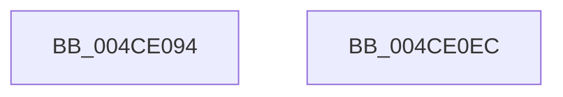

# RtlpHpLfhSlotInitialize

- RVA: `0x004CE094`–`0x004CE0ED` (길이 `89` bytes)
- VA: `0x00000001404CE094`
- 실행 섹션: `.text`
- PDB 이름 있음: `예`; PDB Function 태그: `아니요`
- unwind 정보 RVA: `0x00060BC4`
- 디코드: `26`개 명령, `89/89` bytes 표시
- 미해석 바이트: `0` (있으면 어셈블리에 `.byte`로 보존)

> 이 문서는 커널 이미지의 기계어와 PDB 기호를 분석해 생성했습니다. 4번과 5번은 함수 원형과 자료형을 바이너리 사용 방식에서 추정한 C 해석이며 원본 소스 복구 결과는 아닙니다.

## 1. Dependencies

- 직접 호출 지점: **2**; 고유 호출 대상: **2**
- 직접 호출자로 확인된 함수: **2**
- RIP 상대 이미지 참조: **0**

### Outgoing calls
- `0x004CE0B2` → [memset](../6C/memset_function_006C6C40.md) (function, `0x006C6C40`)
- `0x004CE0C5` → [RtlpHpLfhOwnerInitialize](RtlpHpLfhOwnerInitialize_function_004CE0F4.md) (function, `0x004CE0F4`)

### Direct callers
- [RtlpHpLfhContextSlotAllocate](RtlpHpLfhContextSlotAllocate_function_004C45BC.md) at `0x004C4701`
- [RtlpHpLfhBucketActivate](../60/RtlpHpLfhBucketActivate_function_0060453C.md) at `0x00604641`

### Static image references
- 디코드된 RIP-relative 메모리 참조가 없습니다.

## 2. Other-region calls and transfers

- 다른 실행 섹션으로 향하는 call: **0**
- 별도 외부 분기/꼬리 이동을 확인하지 못했습니다.

## 3. Assembly (complete function range)

```asm
004CE094  48 89 5C 24 08                  mov qword ptr [rsp + 8], rbx
004CE099  48 89 74 24 10                  mov qword ptr [rsp + 0x10], rsi
004CE09E  57                              push rdi
004CE09F  48 83 EC 20                     sub rsp, 0x20
004CE0A3  48 8B FA                        mov rdi, rdx
004CE0A6  49 8B D8                        mov rbx, r8
004CE0A9  33 D2                           xor edx, edx
004CE0AB  48 8B F1                        mov rsi, rcx
004CE0AE  44 8D 42 40                     lea r8d, [rdx + 0x40]
004CE0B2  E8 89 8B 1F 00                  call 0x1406c6c40
004CE0B7  0F B6 17                        movzx edx, byte ptr [rdi]
004CE0BA  4C 8B CB                        mov r9, rbx
004CE0BD  D1 EA                           shr edx, 1
004CE0BF  45 33 C0                        xor r8d, r8d
004CE0C2  48 8B CE                        mov rcx, rsi
004CE0C5  E8 2A 00 00 00                  call 0x1404ce0f4
004CE0CA  48 2B FB                        sub rdi, rbx
004CE0CD  C7 46 04 00 00 03 00            mov dword ptr [rsi + 4], 0x30000
004CE0D4  48 8B 5C 24 30                  mov rbx, qword ptr [rsp + 0x30]
004CE0D9  48 C1 EF 06                     shr rdi, 6
004CE0DD  66 89 7E 02                     mov word ptr [rsi + 2], di
004CE0E1  48 8B 74 24 38                  mov rsi, qword ptr [rsp + 0x38]
004CE0E6  48 83 C4 20                     add rsp, 0x20
004CE0EA  5F                              pop rdi
004CE0EB  C3                              ret
004CE0EC  CC                              int3
```

## 4. C-style interpretation (structured pseudocode)

```c
__int64 __fastcall RtlpHpLfhSlotInitialize(__int64 a1, __int64 a2, __int64 a3)
{
    __int64 result;
    __int64 v_rdi;
    __int64 v_rsp;
    unsigned __int64 v_stack_p10;
    unsigned __int64 v_stack_p8;

    v_stack_p8 = v_rbx;
    v_stack_p10 = v_rsi;
    v_rsp = (v_rsp) - (32);
    a2 = 0;
    result = memset(a1, a2, a2 + 64, a4);
    a2 = (unsigned int)((*(unsigned __int8 *)(a2)) >> (1));
    a3 = 0;
    result = RtlpHpLfhOwnerInitialize(a1, a2, a3, a3);
    v_rdi = (a2) - (0);
    *(unsigned int *)(a1 + 4) = 0x30000ULL;
    v_rdi = (v_rdi) >> (6);
    *(unsigned __int16 *)(a1 + 2) = (unsigned __int16)(v_rdi);
    v_rsp = (v_rsp) + (32);
    return result;
}
```

## 5. (Beta) C Style

```c
int64_t RtlpHpLfhSlotInitialize(void *Arg1, void *Arg2, int64_t Arg3)
{
    uint8_t *arg1 = (uint8_t *)Arg1;
    uint8_t *arg2 = (uint8_t *)Arg2;

    int64_t result;
    int64_t local_rdi;
    int64_t local_rsp;
    uint64_t v_stack_p10;
    uint64_t v_stack_p8;

    v_stack_p8 = local_rbx;
    v_stack_p10 = local_rsi;
    local_rsp = (local_rsp) - (32);
    Arg2 = 0;
    result = memset(Arg1, Arg2, Arg2 + 64, a4);
    Arg2 = (uint32_t)((*(uint8_t *)(arg2)) >> (1));
    Arg3 = 0;
    result = RtlpHpLfhOwnerInitialize(Arg1, Arg2, Arg3, Arg3);
    local_rdi = (Arg2) - (0);
    *(uint32_t *)(arg1 + 0x4) = 0x30000ULL;
    local_rdi = (local_rdi) >> (6);
    *(uint16_t *)(arg1 + 0x2) = (uint16_t)(local_rdi);
    local_rsp = (local_rsp) + (32);
    return result;
}
```

### 관측된 메모리 오프셋

구조체 형식이 확인되지 않은 접근은 인자 기준의 오프셋으로만 기록했습니다.

| 기준 인자 | 오프셋 표현 | 폭 (bit) | 접근 |
|---|---:|---:|---|
| `Arg1` | `+ 0x2` | `16` | `W` |
| `Arg1` | `+ 0x4` | `32` | `W` |
| `Arg2` | `+ 0x0` | `8` | `R` |

## 6. Execution-region graph

[열기: 2D/3D 그래프와 함수 탐색 컨트롤 패널](../../../control-panel.html?section=text&rva=0x004CE094&view=graph)

- 2D 그래프는 위에서 아래로 흐르고, 3D 그래프는 빈 공간을 드래그해 회전합니다. Shift+드래그는 이동, 휠은 확대·축소, 함수 노드 선택은 대상 보고서 이동입니다.

### Static fallback


