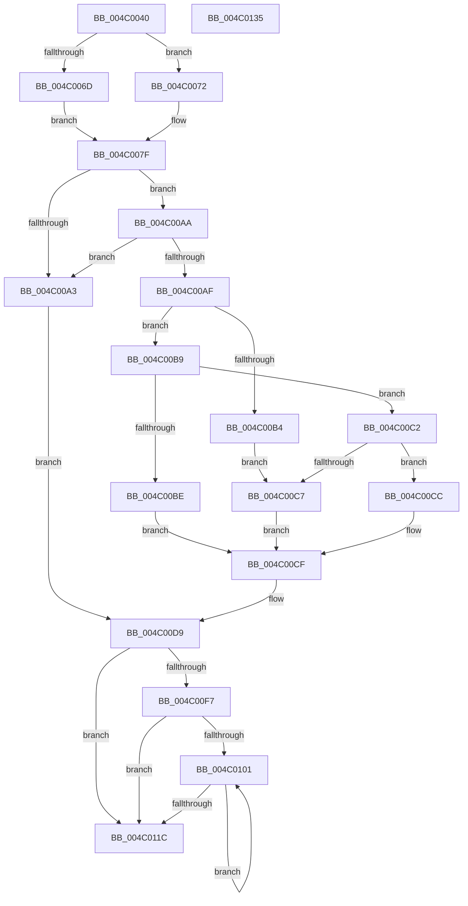

# SMKM_STORE_MGR&lt;SM_TRAITS&gt;::SmCompressManagerUpdateMemoryCondition

- RVA: `0x004C0040`–`0x004C0136` (길이 `246` bytes)
- VA: `0x00000001404C0040`
- 실행 섹션: `.text`
- PDB 이름 있음: `예`; PDB Function 태그: `아니요`
- unwind 정보 RVA: `0x00060300`
- 디코드: `76`개 명령, `246/246` bytes 표시
- 미해석 바이트: `0` (있으면 어셈블리에 `.byte`로 보존)

> 이 문서는 커널 이미지의 기계어와 PDB 기호를 분석해 생성했습니다. 4번과 5번은 함수 원형과 자료형을 바이너리 사용 방식에서 추정한 C 해석이며 원본 소스 복구 결과는 아닙니다.

## 1. Dependencies

- 직접 호출 지점: **3**; 고유 호출 대상: **3**
- 직접 호출자로 확인된 함수: **1**
- RIP 상대 이미지 참조: **1**

### Outgoing calls
- `0x004C0083` → [ExAcquireSpinLockShared](../24/ExAcquireSpinLockShared_function_0024DCE0.md) (function, `0x0024DCE0`)
- `0x004C00EA` → [ExReleaseSpinLockShared](../2F/ExReleaseSpinLockShared_function_002F0EF0.md) (function, `0x002F0EF0`)
- `0x004C010A` → [SMKM_STORE_MGR<SM_TRAITS>::SmCompressCtxUpdatePriority](../4B/SMKM_STORE_MGR_SM_TRAITS_SmCompressCtxUpdatePriority_function_004BD314.md) (function, `0x004BD314`)

### Direct callers
- [SMKM_STORE_MGR&lt;SM_TRAITS&gt;::SmUpdateMemoryConditions](../34/SMKM_STORE_MGR_SM_TRAITS_SmUpdateMemoryConditions_function_0034BD60.md) at `0x0034BD8A`

### Static image references
- `0x004C0075` → RVA `0x00038018` (`.rdata`; read)

## 2. Other-region calls and transfers

- 다른 실행 섹션으로 향하는 call: **0**
- 별도 외부 분기/꼬리 이동을 확인하지 못했습니다.

## 3. Assembly (complete function range)

```asm
004C0040  48 89 5C 24 08                  mov qword ptr [rsp + 8], rbx
004C0045  48 89 6C 24 10                  mov qword ptr [rsp + 0x10], rbp
004C004A  48 89 74 24 18                  mov qword ptr [rsp + 0x18], rsi
004C004F  57                              push rdi
004C0050  41 56                           push r14
004C0052  41 57                           push r15
004C0054  48 83 EC 20                     sub rsp, 0x20
004C0058  48 8B 01                        mov rax, qword ptr [rcx]
004C005B  45 8B F0                        mov r14d, r8d
004C005E  48 8B F9                        mov rdi, rcx
004C0061  48 8B B0 E0 07 00 00            mov rsi, qword ptr [rax + 0x7e0]
004C0068  83 FA 04                        cmp edx, 4
004C006B  75 05                           jne 0x1404c0072
004C006D  8D 5A 03                        lea ebx, [rdx + 3]
004C0070  EB 0D                           jmp 0x1404c007f
004C0072  48 63 C2                        movsxd rax, edx
004C0075  48 8D 1D 9C 7F B7 FF            lea rbx, [rip - 0x488064]
004C007C  8B 1C 83                        mov ebx, dword ptr [rbx + rax*4]
004C007F  48 83 C1 08                     add rcx, 8
004C0083  E8 58 DC D8 FF                  call 0x14024dce0
004C0088  48 8B 0F                        mov rcx, qword ptr [rdi]
004C008B  44 8A C0                        mov r8b, al
004C008E  8B 97 38 01 00 00               mov edx, dword ptr [rdi + 0x138]
004C0094  8B A9 D4 07 00 00               mov ebp, dword ptr [rcx + 0x7d4]
004C009A  8B 4E 34                        mov ecx, dword ptr [rsi + 0x34]
004C009D  33 F6                           xor esi, esi
004C009F  85 C9                           test ecx, ecx
004C00A1  74 07                           je 0x1404c00aa
004C00A3  BA 01 00 00 00                  mov edx, 1
004C00A8  EB 2F                           jmp 0x1404c00d9
004C00AA  45 85 F6                        test r14d, r14d
004C00AD  74 F4                           je 0x1404c00a3
004C00AF  83 FB 07                        cmp ebx, 7
004C00B2  7F 05                           jg 0x1404c00b9
004C00B4  8D 14 52                        lea edx, [rdx + rdx*2]
004C00B7  EB 0E                           jmp 0x1404c00c7
004C00B9  83 FB 08                        cmp ebx, 8
004C00BC  7F 04                           jg 0x1404c00c2
004C00BE  D1 EA                           shr edx, 1
004C00C0  EB 0D                           jmp 0x1404c00cf
004C00C2  83 FB 0A                        cmp ebx, 0xa
004C00C5  7F 05                           jg 0x1404c00cc
004C00C7  C1 EA 02                        shr edx, 2
004C00CA  EB 03                           jmp 0x1404c00cf
004C00CC  C1 EA 03                        shr edx, 3
004C00CF  B8 10 00 00 00                  mov eax, 0x10
004C00D4  3B D0                           cmp edx, eax
004C00D6  0F 43 D0                        cmovae edx, eax
004C00D9  3B D5                           cmp edx, ebp
004C00DB  48 8D 4F 08                     lea rcx, [rdi + 8]
004C00DF  8B C5                           mov eax, ebp
004C00E1  0F 47 C2                        cmova eax, edx
004C00E4  41 8A D0                        mov dl, r8b
004C00E7  89 47 28                        mov dword ptr [rdi + 0x28], eax
004C00EA  E8 01 0E E3 FF                  call 0x1402f0ef0
004C00EF  39 9F 3C 01 00 00               cmp dword ptr [rdi + 0x13c], ebx
004C00F5  74 25                           je 0x1404c011c
004C00F7  89 9F 3C 01 00 00               mov dword ptr [rdi + 0x13c], ebx
004C00FD  85 ED                           test ebp, ebp
004C00FF  74 1B                           je 0x1404c011c
004C0101  48 8B 4F 10                     mov rcx, qword ptr [rdi + 0x10]
004C0105  8B D3                           mov edx, ebx
004C0107  48 03 CE                        add rcx, rsi
004C010A  E8 05 D2 FF FF                  call 0x1404bd314
004C010F  48 81 C6 B0 00 00 00            add rsi, 0xb0
004C0116  48 83 ED 01                     sub rbp, 1
004C011A  75 E5                           jne 0x1404c0101
004C011C  48 8B 5C 24 40                  mov rbx, qword ptr [rsp + 0x40]
004C0121  48 8B 6C 24 48                  mov rbp, qword ptr [rsp + 0x48]
004C0126  48 8B 74 24 50                  mov rsi, qword ptr [rsp + 0x50]
004C012B  48 83 C4 20                     add rsp, 0x20
004C012F  41 5F                           pop r15
004C0131  41 5E                           pop r14
004C0133  5F                              pop rdi
004C0134  C3                              ret
004C0135  CC                              int3
```

## 4. C-style interpretation (structured pseudocode)

```c
__int64 __fastcall SMKM_STORE_MGR_SM_TRAITS___SmCompressManagerUpdateMemoryCondition(__int64 a1, __int64 a2, int a3)
{
    __int64 result;
    __int64 v_rbp;
    __int64 v_rsi;
    __int64 v_rsp;
    unsigned __int64 v_stack_p10;
    unsigned __int64 v_stack_p18;
    unsigned __int64 v_stack_p8;

    v_stack_p8 = v_rbx;
    v_stack_p10 = v_rbp;
    v_stack_p18 = v_rsi;
    v_rsp = (v_rsp) - (32);
    if (((unsigned int)(a2)) != 4) goto loc_004C0072;
    goto loc_004C007F;
loc_004C0072:
loc_004C007F:
    a1 = (a1) + (8);
    result = ExAcquireSpinLockShared(a1, a2, a3, a4);
    v_rsi = 0;
    if ((unsigned int)((unsigned int)(*(unsigned int *)(*(unsigned __int64 *)(*(unsigned __int64 *)(a1) + 2016) + 52))) == 0) goto loc_004C00AA;
loc_004C00A3:
    goto loc_004C00D9;
loc_004C00AA:
    if ((unsigned int)((unsigned int)(a3)) == 0) goto loc_004C00A3;
    if (((unsigned int)((unsigned int)(*(unsigned int *)(v_rip - 4751460 + (int)((unsigned int)(a2)) * 4)))) > 7) goto loc_004C00B9;
    goto loc_004C00C7;
loc_004C00B9:
    if (((unsigned int)((unsigned int)(*(unsigned int *)(v_rip - 4751460 + (int)((unsigned int)(a2)) * 4)))) > 8) goto loc_004C00C2;
    a2 = (unsigned int)((1 + 1 * 2) >> (1));
    goto loc_004C00CF;
loc_004C00C2:
    if (((unsigned int)((unsigned int)(*(unsigned int *)(v_rip - 4751460 + (int)((unsigned int)(a2)) * 4)))) > 10) goto loc_004C00CC;
loc_004C00C7:
    a2 = (unsigned int)((a2) >> (2));
    goto loc_004C00CF;
loc_004C00CC:
    a2 = (unsigned int)((a2) >> (3));
loc_004C00CF:
    if (((unsigned int)(a2)) >= 16) { a2 = 16; }
loc_004C00D9:
    result = (unsigned int)((unsigned int)((unsigned int)(*(unsigned int *)(*(unsigned __int64 *)(a1) + 2004))));
    if (((unsigned int)(a2)) > ((unsigned int)((unsigned int)(*(unsigned int *)(*(unsigned __int64 *)(a1) + 2004))))) { result = (unsigned int)(a2); }
    *(unsigned int *)(a1 + 40) = (unsigned int)(result);
    result = ExReleaseSpinLockShared(a1 + 8, (unsigned __int8)((unsigned __int8)(result)), (unsigned __int8)(result), a4);
    if ((*(unsigned int *)(a1 + 316)) == ((unsigned int)((unsigned int)(*(unsigned int *)(v_rip - 4751460 + (int)((unsigned int)(a2)) * 4))))) goto loc_004C011C;
    *(unsigned int *)(a1 + 316) = (unsigned int)((unsigned int)(*(unsigned int *)(v_rip - 4751460 + (int)((unsigned int)(a2)) * 4)));
    if ((unsigned int)((unsigned int)(*(unsigned int *)(*(unsigned __int64 *)(a1) + 2004))) == 0) goto loc_004C011C;
loc_004C0101:
    a1 = (*(unsigned __int64 *)(a1 + 16)) + (0);
    result = SMKM_STORE_MGR_SM_TRAITS___SmCompressCtxUpdatePriority(a1, (unsigned int)((unsigned int)((unsigned int)(*(unsigned int *)(v_rip - 4751460 + (int)((unsigned int)(a2)) * 4)))), (unsigned __int8)(result), a4);
    v_rsi = (v_rsi) + (176);
    v_rbp = ((unsigned int)(*(unsigned int *)(*(unsigned __int64 *)(a1) + 2004))) - (1);
    if (condition_is_not_equal) goto loc_004C0101;
loc_004C011C:
    v_rsp = (v_rsp) + (32);
    return result;
}
```

## 5. (Beta) C Style

```c
int64_t SMKM_STORE_MGR_SM_TRAITS___SmCompressManagerUpdateMemoryCondition(void *Arg1, int64_t Arg2, int32_t Arg3)
{
    uint8_t *arg1 = (uint8_t *)Arg1;

    int64_t result;
    int64_t local_rbp;
    int64_t local_rsi;
    int64_t local_rsp;
    uint64_t v_stack_p10;
    uint64_t v_stack_p18;
    uint64_t v_stack_p8;

    v_stack_p8 = local_rbx;
    v_stack_p10 = local_rbp;
    v_stack_p18 = local_rsi;
    local_rsp = (local_rsp) - (32);
    if (((uint32_t)(Arg2)) != 4) goto loc_004C0072;
    goto loc_004C007F;
loc_004C0072:
loc_004C007F:
    Arg1 = (Arg1) + (8);
    result = ExAcquireSpinLockShared(Arg1, Arg2, Arg3, a4);
    local_rsi = 0;
    if ((uint32_t)((uint32_t)(*(uint32_t *)(*(uint64_t *)(*(uint64_t *)(arg1) + 0x7E0) + 0x34))) == 0) goto loc_004C00AA;
loc_004C00A3:
    goto loc_004C00D9;
loc_004C00AA:
    if ((uint32_t)((uint32_t)(Arg3)) == 0) goto loc_004C00A3;
    if (((uint32_t)((uint32_t)(*(uint32_t *)(v_rip - 0x488064 + (int32_t)((uint32_t)(Arg2)) * 4)))) > 7) goto loc_004C00B9;
    goto loc_004C00C7;
loc_004C00B9:
    if (((uint32_t)((uint32_t)(*(uint32_t *)(v_rip - 0x488064 + (int32_t)((uint32_t)(Arg2)) * 4)))) > 8) goto loc_004C00C2;
    Arg2 = (uint32_t)((1 + 1 * 2) >> (1));
    goto loc_004C00CF;
loc_004C00C2:
    if (((uint32_t)((uint32_t)(*(uint32_t *)(v_rip - 0x488064 + (int32_t)((uint32_t)(Arg2)) * 4)))) > 10) goto loc_004C00CC;
loc_004C00C7:
    Arg2 = (uint32_t)((Arg2) >> (2));
    goto loc_004C00CF;
loc_004C00CC:
    Arg2 = (uint32_t)((Arg2) >> (3));
loc_004C00CF:
    if (((uint32_t)(Arg2)) >= 16) { Arg2 = 16; }
loc_004C00D9:
    result = (uint32_t)((uint32_t)((uint32_t)(*(uint32_t *)(*(uint64_t *)(arg1) + 0x7D4))));
    if (((uint32_t)(Arg2)) > ((uint32_t)((uint32_t)(*(uint32_t *)(*(uint64_t *)(arg1) + 0x7D4))))) { result = (uint32_t)(Arg2); }
    *(uint32_t *)(arg1 + 0x28) = (uint32_t)(result);
    result = ExReleaseSpinLockShared(Arg1 + 8, (uint8_t)((uint8_t)(result)), (uint8_t)(result), a4);
    if ((*(uint32_t *)(arg1 + 0x13C)) == ((uint32_t)((uint32_t)(*(uint32_t *)(v_rip - 0x488064 + (int32_t)((uint32_t)(Arg2)) * 4))))) goto loc_004C011C;
    *(uint32_t *)(arg1 + 0x13C) = (uint32_t)((uint32_t)(*(uint32_t *)(v_rip - 0x488064 + (int32_t)((uint32_t)(Arg2)) * 4)));
    if ((uint32_t)((uint32_t)(*(uint32_t *)(*(uint64_t *)(arg1) + 0x7D4))) == 0) goto loc_004C011C;
loc_004C0101:
    Arg1 = (*(uint64_t *)(arg1 + 0x10)) + (0);
    result = SMKM_STORE_MGR_SM_TRAITS___SmCompressCtxUpdatePriority(Arg1, (uint32_t)((uint32_t)((uint32_t)(*(uint32_t *)(v_rip - 0x488064 + (int32_t)((uint32_t)(Arg2)) * 4)))), (uint8_t)(result), a4);
    local_rsi = (local_rsi) + (176);
    local_rbp = ((uint32_t)(*(uint32_t *)(*(uint64_t *)(arg1) + 0x7D4))) - (1);
    if (condition_is_not_equal) goto loc_004C0101;
loc_004C011C:
    local_rsp = (local_rsp) + (32);
    return result;
}
```

### 관측된 메모리 오프셋

구조체 형식이 확인되지 않은 접근은 인자 기준의 오프셋으로만 기록했습니다.

| 기준 인자 | 오프셋 표현 | 폭 (bit) | 접근 |
|---|---:|---:|---|
| `Arg1` | `+ 0x0` | `64` | `R` |
| `Arg1` | `+ 0x8` | `64` | `R` |
| `Arg1` | `+ 0x10` | `64` | `R` |
| `Arg1` | `+ 0x28` | `32` | `W` |
| `Arg1` | `+ 0x138` | `32` | `R` |
| `Arg1` | `+ 0x13C` | `32` | `R` |
| `Arg1` | `+ 0x13C` | `32` | `W` |

## 6. Execution-region graph

[열기: 2D/3D 그래프와 함수 탐색 컨트롤 패널](../../../control-panel.html?section=text&rva=0x004C0040&view=graph)

- 2D 그래프는 위에서 아래로 흐르고, 3D 그래프는 빈 공간을 드래그해 회전합니다. Shift+드래그는 이동, 휠은 확대·축소, 함수 노드 선택은 대상 보고서 이동입니다.

### Static fallback


