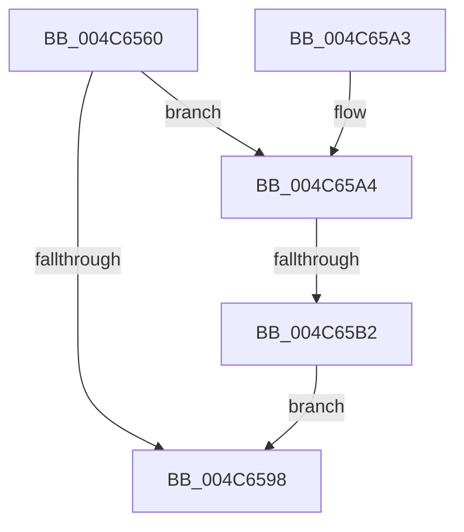

# SMKM_STORE_MGR&lt;SM_TRAITS&gt;::SmHighMemPriorityWatchdogTimerCallback

- RVA: `0x004C6560`–`0x004C65C6` (길이 `102` bytes)
- VA: `0x00000001404C6560`
- 실행 섹션: `.text`
- PDB 이름 있음: `예`; PDB Function 태그: `예`
- unwind 정보 RVA: `0x000687A0`
- 디코드: `26`개 명령, `102/102` bytes 표시
- 미해석 바이트: `0` (있으면 어셈블리에 `.byte`로 보존)

> 이 문서는 커널 이미지의 기계어와 PDB 기호를 분석해 생성했습니다. 4번과 5번은 함수 원형과 자료형을 바이너리 사용 방식에서 추정한 C 해석이며 원본 소스 복구 결과는 아닙니다.

## 1. Dependencies

- 직접 호출 지점: **2**; 고유 호출 대상: **2**
- 직접 호출자로 확인된 함수: **0**
- RIP 상대 이미지 참조: **0**

### Outgoing calls
- `0x004C658F` → [guard_dispatch_icall](../6B/guard_dispatch_icall_function_006BAAD0.md) (function, `0x006BAAD0`)
- `0x004C65BF` → [SmQueueExWorkItem](../4B/SmQueueExWorkItem_function_004B400C.md) (function, `0x004B400C`)

### Direct callers
- 이 함수 시작 RVA로 연결되는 직접 call은 확인되지 않았습니다. 간접 호출은 완전히 역산할 수 없습니다.

### Static image references
- 디코드된 RIP-relative 메모리 참조가 없습니다.

## 2. Other-region calls and transfers

- 다른 실행 섹션으로 향하는 call: **0**
- call이 아닌 외부 분기/꼬리 이동: **1**
  - `0x004C65AC` → [sub_006FCC46](../6F/Unknown_function_006FCC46.md) (`tail-transfer`)

## 3. Assembly (complete function range)

```asm
004C6560  48 89 5C 24 08                  mov qword ptr [rsp + 8], rbx
004C6565  57                              push rdi
004C6566  48 83 EC 20                     sub rsp, 0x20
004C656A  48 8B 82 D8 07 00 00            mov rax, qword ptr [rdx + 0x7d8]
004C6571  48 8D 9A A8 07 00 00            lea rbx, [rdx + 0x7a8]
004C6578  48 83 64 24 38 00               and qword ptr [rsp + 0x38], 0
004C657E  48 8B FA                        mov rdi, rdx
004C6581  48 8B CF                        mov rcx, rdi
004C6584  48 8D 54 24 38                  lea rdx, [rsp + 0x38]
004C6589  41 B8 08 00 00 00               mov r8d, 8
004C658F  E8 3C 45 1F 00                  call 0x1406baad0
004C6594  85 C0                           test eax, eax
004C6596  79 0C                           jns 0x1404c65a4
004C6598  48 8B 5C 24 30                  mov rbx, qword ptr [rsp + 0x30]
004C659D  48 83 C4 20                     add rsp, 0x20
004C65A1  5F                              pop rdi
004C65A2  C3                              ret
004C65A3  CC                              int3
004C65A4  33 C0                           xor eax, eax
004C65A6  F0 48 0F B1 5B 18               lock cmpxchg qword ptr [rbx + 0x18], rbx
004C65AC  0F 85 94 66 23 00               jne 0x1406fcc46
004C65B2  4C 8B 44 24 38                  mov r8, qword ptr [rsp + 0x38]
004C65B7  BA 03 00 00 00                  mov edx, 3
004C65BC  48 8B CB                        mov rcx, rbx
004C65BF  E8 48 DA FE FF                  call 0x1404b400c
004C65C4  EB D2                           jmp 0x1404c6598
```

## 4. C-style interpretation (structured pseudocode)

```c
__int64 __fastcall SMKM_STORE_MGR_SM_TRAITS___SmHighMemPriorityWatchdogTimerCallback(__int64 a1, __int64 a2)
{
    __int64 result;
    __int64 v_rsp;
    unsigned __int64 v_stack_p10;
    unsigned __int64 v_stack_p38;
    unsigned __int64 v_stack_p8;

    v_stack_p8 = v_rbx;
    v_rsp = (v_rsp) - (32);
    result = guard_dispatch_icall(a2, v_stack_p10, 8, a4);
    if (!sign_flag) goto loc_004C65A4;
loc_004C6598:
    v_rsp = (v_rsp) + (32);
    return result;
loc_004C65A4:
    result = 0;
    result = SmQueueExWorkItem(v_stack_p8, 3, v_stack_p38, a4);
    goto loc_004C6598;
}
```

## 5. (Beta) C Style

```c
int64_t SMKM_STORE_MGR_SM_TRAITS___SmHighMemPriorityWatchdogTimerCallback(int64_t Arg1, void *Arg2)
{
    uint8_t *arg2 = (uint8_t *)Arg2;

    int64_t result;
    int64_t local_rsp;
    uint64_t v_stack_p10;
    uint64_t v_stack_p38;
    uint64_t v_stack_p8;

    v_stack_p8 = local_rbx;
    local_rsp = (local_rsp) - (32);
    result = guard_dispatch_icall(Arg2, v_stack_p10, 8, a4);
    if (!sign_flag) goto loc_004C65A4;
loc_004C6598:
    local_rsp = (local_rsp) + (32);
    return result;
loc_004C65A4:
    result = 0;
    result = SmQueueExWorkItem(v_stack_p8, 3, v_stack_p38, a4);
    goto loc_004C6598;
}
```

### 관측된 메모리 오프셋

구조체 형식이 확인되지 않은 접근은 인자 기준의 오프셋으로만 기록했습니다.

| 기준 인자 | 오프셋 표현 | 폭 (bit) | 접근 |
|---|---:|---:|---|
| `Arg2` | `+ 0x18` | `64` | `R` |
| `Arg2` | `+ 0x7A8` | `64` | `R` |
| `Arg2` | `+ 0x7D8` | `64` | `R` |

## 6. Execution-region graph

[열기: 2D/3D 그래프와 함수 탐색 컨트롤 패널](../../../control-panel.html?section=text&rva=0x004C6560&view=graph)

- 2D 그래프는 위에서 아래로 흐르고, 3D 그래프는 빈 공간을 드래그해 회전합니다. Shift+드래그는 이동, 휠은 확대·축소, 함수 노드 선택은 대상 보고서 이동입니다.

### Static fallback


