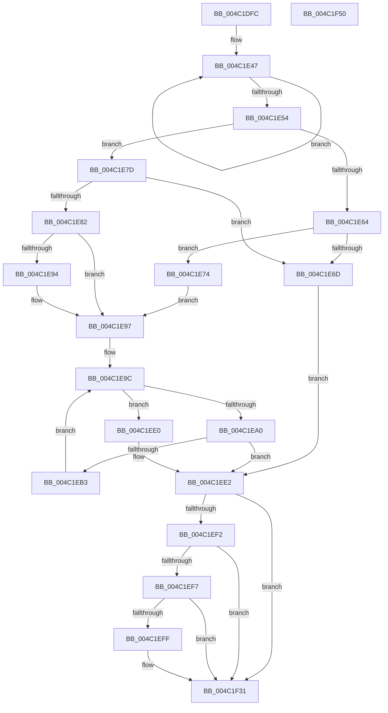

# ST_STORE&lt;SM_TRAITS&gt;::StMetaRegionsUpdate

- RVA: `0x004C1DFC`–`0x004C1F51` (길이 `341` bytes)
- VA: `0x00000001404C1DFC`
- 실행 섹션: `.text`
- PDB 이름 있음: `예`; PDB Function 태그: `아니요`
- unwind 정보 RVA: `0x0005D79C`
- 디코드: `101`개 명령, `341/341` bytes 표시
- 미해석 바이트: `0` (있으면 어셈블리에 `.byte`로 보존)

> 이 문서는 커널 이미지의 기계어와 PDB 기호를 분석해 생성했습니다. 4번과 5번은 함수 원형과 자료형을 바이너리 사용 방식에서 추정한 C 해석이며 원본 소스 복구 결과는 아닙니다.

## 1. Dependencies

- 직접 호출 지점: **4**; 고유 호출 대상: **3**
- 직접 호출자로 확인된 함수: **1**
- RIP 상대 이미지 참조: **0**

### Outgoing calls
- `0x004C1EA8` → [ST_STORE<SM_TRAITS>::StDmRegionRemove](../60/ST_STORE_SM_TRAITS_StDmRegionRemove_function_0060E314.md) (function, `0x0060E314`)
- `0x004C1EE8` → [ST_STORE<SM_TRAITS>::StStoreWorkItemCleanup](ST_STORE_SM_TRAITS_StStoreWorkItemCleanup_function_004C1F58.md) (function, `0x004C1F58`)
- `0x004C1F10` → [NP_CONTEXT::NpNodesPageOut](../60/NP_CONTEXT_NpNodesPageOut_function_0060BF78.md) (function, `0x0060BF78`)
- `0x004C1F2C` → [NP_CONTEXT::NpNodesPageOut](../60/NP_CONTEXT_NpNodesPageOut_function_0060BF78.md) (function, `0x0060BF78`)

### Direct callers
- [sub_0020634E](../20/Unknown_function_0020634E.md) at `0x0020640A`

### Static image references
- 디코드된 RIP-relative 메모리 참조가 없습니다.

## 2. Other-region calls and transfers

- 다른 실행 섹션으로 향하는 call: **0**
- 별도 외부 분기/꼬리 이동을 확인하지 못했습니다.

## 3. Assembly (complete function range)

```asm
004C1DFC  48 89 5C 24 10                  mov qword ptr [rsp + 0x10], rbx
004C1E01  48 89 6C 24 18                  mov qword ptr [rsp + 0x18], rbp
004C1E06  48 89 74 24 20                  mov qword ptr [rsp + 0x20], rsi
004C1E0B  57                              push rdi
004C1E0C  41 54                           push r12
004C1E0E  41 55                           push r13
004C1E10  41 56                           push r14
004C1E12  41 57                           push r15
004C1E14  48 83 EC 20                     sub rsp, 0x20
004C1E18  8B 81 68 0C 00 00               mov eax, dword ptr [rcx + 0xc68]
004C1E1E  4C 8D B9 60 09 00 00            lea r15, [rcx + 0x960]
004C1E25  48 8B F9                        mov rdi, rcx
004C1E28  45 33 E4                        xor r12d, r12d
004C1E2B  33 ED                           xor ebp, ebp
004C1E2D  45 33 C0                        xor r8d, r8d
004C1E30  F6 D8                           neg al
004C1E32  4C 8B EA                        mov r13, rdx
004C1E35  48 1B C9                        sbb rcx, rcx
004C1E38  48 8D 87 F8 11 00 00            lea rax, [rdi + 0x11f8]
004C1E3F  48 83 E1 F9                     and rcx, 0xfffffffffffffff9
004C1E43  48 83 C1 08                     add rcx, 8
004C1E47  44 03 00                        add r8d, dword ptr [rax]
004C1E4A  48 8D 40 08                     lea rax, [rax + 8]
004C1E4E  48 83 E9 01                     sub rcx, 1
004C1E52  75 F3                           jne 0x1404c1e47
004C1E54  8B 8F B8 0C 00 00               mov ecx, dword ptr [rdi + 0xcb8]
004C1E5A  8B 42 10                        mov eax, dword ptr [rdx + 0x10]
004C1E5D  41 2B C8                        sub ecx, r8d
004C1E60  A8 01                           test al, 1
004C1E62  74 19                           je 0x1404c1e7d
004C1E64  BE 02 00 00 00                  mov esi, 2
004C1E69  3B CE                           cmp ecx, esi
004C1E6B  72 07                           jb 0x1404c1e74
004C1E6D  BB 34 00 19 40                  mov ebx, 0x40190034
004C1E72  EB 6E                           jmp 0x1404c1ee2
004C1E74  4C 8D 77 50                     lea r14, [rdi + 0x50]
004C1E78  49 8B EF                        mov rbp, r15
004C1E7B  EB 1A                           jmp 0x1404c1e97
004C1E7D  83 F9 08                        cmp ecx, 8
004C1E80  72 EB                           jb 0x1404c1e6d
004C1E82  48 8D 6F 50                     lea rbp, [rdi + 0x50]
004C1E86  4D 8B F7                        mov r14, r15
004C1E89  8B F1                           mov esi, ecx
004C1E8B  41 39 8F 58 03 00 00            cmp dword ptr [r15 + 0x358], ecx
004C1E92  75 03                           jne 0x1404c1e97
004C1E94  8D 71 FF                        lea esi, [rcx - 1]
004C1E97  44 21 64 24 50                  and dword ptr [rsp + 0x50], r12d
004C1E9C  85 F6                           test esi, esi
004C1E9E  74 40                           je 0x1404c1ee0
004C1EA0  48 8D 54 24 50                  lea rdx, [rsp + 0x50]
004C1EA5  49 8B CE                        mov rcx, r14
004C1EA8  E8 67 C4 14 00                  call 0x14060e314
004C1EAD  8B D8                           mov ebx, eax
004C1EAF  85 C0                           test eax, eax
004C1EB1  78 2F                           js 0x1404c1ee2
004C1EB3  8B 4C 24 50                     mov ecx, dword ptr [rsp + 0x50]
004C1EB7  41 FF C4                        inc r12d
004C1EBA  4C 8B 85 50 03 00 00            mov r8, qword ptr [rbp + 0x350]
004C1EC1  8B D1                           mov edx, ecx
004C1EC3  48 C1 EA 03                     shr rdx, 3
004C1EC7  83 E1 07                        and ecx, 7
004C1ECA  42 0F B6 04 02                  movzx eax, byte ptr [rdx + r8]
004C1ECF  0F AB C8                        bts eax, ecx
004C1ED2  42 88 04 02                     mov byte ptr [rdx + r8], al
004C1ED6  FF 85 58 03 00 00               inc dword ptr [rbp + 0x358]
004C1EDC  FF CE                           dec esi
004C1EDE  EB BC                           jmp 0x1404c1e9c
004C1EE0  33 DB                           xor ebx, ebx
004C1EE2  49 8B D5                        mov rdx, r13
004C1EE5  48 8B CF                        mov rcx, rdi
004C1EE8  E8 6B 00 00 00                  call 0x1404c1f58
004C1EED  49 3B EF                        cmp rbp, r15
004C1EF0  75 3F                           jne 0x1404c1f31
004C1EF2  45 85 E4                        test r12d, r12d
004C1EF5  74 3A                           je 0x1404c1f31
004C1EF7  81 FB 06 00 00 C0               cmp ebx, 0xc0000006
004C1EFD  74 32                           je 0x1404c1f31
004C1EFF  48 8D 57 60                     lea rdx, [rdi + 0x60]
004C1F03  48 8D 47 50                     lea rax, [rdi + 0x50]
004C1F07  48 F7 D8                        neg rax
004C1F0A  48 1B C9                        sbb rcx, rcx
004C1F0D  48 23 CA                        and rcx, rdx
004C1F10  E8 63 A0 14 00                  call 0x14060bf78
004C1F15  48 8D 97 A0 00 00 00            lea rdx, [rdi + 0xa0]
004C1F1C  48 8D 87 90 00 00 00            lea rax, [rdi + 0x90]
004C1F23  48 F7 D8                        neg rax
004C1F26  48 1B C9                        sbb rcx, rcx
004C1F29  48 23 CA                        and rcx, rdx
004C1F2C  E8 47 A0 14 00                  call 0x14060bf78
004C1F31  48 8B 6C 24 60                  mov rbp, qword ptr [rsp + 0x60]
004C1F36  8B C3                           mov eax, ebx
004C1F38  48 8B 5C 24 58                  mov rbx, qword ptr [rsp + 0x58]
004C1F3D  48 8B 74 24 68                  mov rsi, qword ptr [rsp + 0x68]
004C1F42  48 83 C4 20                     add rsp, 0x20
004C1F46  41 5F                           pop r15
004C1F48  41 5E                           pop r14
004C1F4A  41 5D                           pop r13
004C1F4C  41 5C                           pop r12
004C1F4E  5F                              pop rdi
004C1F4F  C3                              ret
004C1F50  CC                              int3
```

## 4. C-style interpretation (structured pseudocode)

```c
__int64 __fastcall ST_STORE_SM_TRAITS___StMetaRegionsUpdate(__int64 a1, __int64 a2, int a3)
{
    __int64 result;
    __int64 v_r12;
    __int64 v_rbp;
    __int64 v_rbx;
    __int64 v_rsi;
    __int64 v_rsp;
    unsigned __int64 v_stack_p10;
    unsigned __int64 v_stack_p18;
    unsigned __int64 v_stack_p20;
    unsigned int v_stack_p8;

    v_stack_p10 = v_rbx;
    v_stack_p18 = v_rbp;
    v_stack_p20 = v_rsi;
    v_rsp = (v_rsp) - (32);
    v_r12 = 0;
    v_rbp = 0;
    a3 = 0;
    result = (unsigned __int8)(-((unsigned int)(*(unsigned int *)(a1 + 3176))));
    a1 = (a1) & (-7);
    a1 = (a1) + (8);
loc_004C1E47:
    a3 = (unsigned int)((a3) + (*(unsigned int *)(a1 + 4600)));
    a1 = (a1) - (1);
    if (condition_is_not_equal) goto loc_004C1E47;
    a1 = (unsigned int)(((unsigned int)(*(unsigned int *)(a1 + 3256))) - (a3));
    if ((((unsigned __int8)((unsigned int)(*(unsigned int *)(a2 + 16)))) & (1)) == 0) goto loc_004C1E7D;
    if (((unsigned int)(a1)) < 2) goto loc_004C1E74;
loc_004C1E6D:
    goto loc_004C1EE2;
loc_004C1E74:
    goto loc_004C1E97;
loc_004C1E7D:
    if (((unsigned int)(a1)) < 8) goto loc_004C1E6D;
    v_rsi = (unsigned int)((unsigned int)(a1));
    if ((*(unsigned int *)(a1 + 2400 + 856)) == ((unsigned int)(a1))) {
        v_rsi = a1 - 1;
    }
loc_004C1E9C:
    if ((unsigned int)(v_rsi) == 0) goto loc_004C1EE0;
    result = ST_STORE_SM_TRAITS___StDmRegionRemove(a1 + 2400, v_stack_p8, a3, a4);
    if (sign_flag) goto loc_004C1EE2;
    v_r12 = (unsigned int)((v_r12) + 1);
    a2 = ((unsigned int)((unsigned int)((unsigned int)(v_stack_p8)))) >> (3);
    a1 = (unsigned int)(((unsigned int)(v_stack_p8)) & (7));
    *(unsigned __int8 *)(a2 + *(unsigned __int64 *)(a1 + 80 + 848) * 1) = (unsigned __int8)(*(unsigned __int8 *)(a2 + *(unsigned __int64 *)(a1 + 80 + 848) * 1));
    v_rsi = (unsigned int)((v_rsi) - 1);
    goto loc_004C1E9C;
loc_004C1EE0:
    v_rbx = 0;
loc_004C1EE2:
    result = ST_STORE_SM_TRAITS___StStoreWorkItemCleanup(a1, a2, *(unsigned __int64 *)(a1 + 80 + 848), a4);
    if ((a1 + 80) != (a1 + 2400)) goto loc_004C1F31;
    if ((unsigned int)(v_r12) == 0) goto loc_004C1F31;
    if (0 != 0xC0000006ULL) {
        a2 = a1 + 96;
        result = a1 + 80;
        result = -(result);
        a1 = (a1) & (a2);
        result = NP_CONTEXT__NpNodesPageOut(a1, a2, *(unsigned __int64 *)(a1 + 80 + 848), a4);
        a2 = a1 + 160;
        result = a1 + 144;
        result = -(result);
        a1 = (a1) & (a2);
        result = NP_CONTEXT__NpNodesPageOut(a1, a2, *(unsigned __int64 *)(a1 + 80 + 848), a4);
    }
    v_rsp = (v_rsp) + (32);
    return 0;
}
```

## 5. (Beta) C Style

```c
int64_t ST_STORE_SM_TRAITS___StMetaRegionsUpdate(void *Arg1, void *Arg2, int32_t Arg3)
{
    uint8_t *arg1 = (uint8_t *)Arg1;
    uint8_t *arg2 = (uint8_t *)Arg2;

    int64_t result;
    int64_t local_r12;
    int64_t local_rbp;
    int64_t local_rbx;
    int64_t local_rsi;
    int64_t local_rsp;
    uint64_t v_stack_p10;
    uint64_t v_stack_p18;
    uint64_t v_stack_p20;
    uint32_t v_stack_p8;

    v_stack_p10 = local_rbx;
    v_stack_p18 = local_rbp;
    v_stack_p20 = local_rsi;
    local_rsp = (local_rsp) - (32);
    local_r12 = 0;
    local_rbp = 0;
    Arg3 = 0;
    result = (uint8_t)(-((uint32_t)(*(uint32_t *)(arg1 + 0xC68))));
    Arg1 = (Arg1) & (-7);
    Arg1 = (Arg1) + (8);
loc_004C1E47:
    Arg3 = (uint32_t)((Arg3) + (*(uint32_t *)(arg1 + 0x11F8)));
    Arg1 = (Arg1) - (1);
    if (condition_is_not_equal) goto loc_004C1E47;
    Arg1 = (uint32_t)(((uint32_t)(*(uint32_t *)(arg1 + 0xCB8))) - (Arg3));
    if ((((uint8_t)((uint32_t)(*(uint32_t *)(arg2 + 0x10)))) & (1)) == 0) goto loc_004C1E7D;
    if (((uint32_t)(Arg1)) < 2) goto loc_004C1E74;
loc_004C1E6D:
    goto loc_004C1EE2;
loc_004C1E74:
    goto loc_004C1E97;
loc_004C1E7D:
    if (((uint32_t)(Arg1)) < 8) goto loc_004C1E6D;
    local_rsi = (uint32_t)((uint32_t)(Arg1));
    if ((*(uint32_t *)(arg1 + 0x960 + 0x358)) == ((uint32_t)(Arg1))) {
        local_rsi = Arg1 - 1;
    }
loc_004C1E9C:
    if ((uint32_t)(local_rsi) == 0) goto loc_004C1EE0;
    result = ST_STORE_SM_TRAITS___StDmRegionRemove(Arg1 + 2400, v_stack_p8, Arg3, a4);
    if (sign_flag) goto loc_004C1EE2;
    local_r12 = (uint32_t)((local_r12) + 1);
    Arg2 = ((uint32_t)((uint32_t)((uint32_t)(v_stack_p8)))) >> (3);
    Arg1 = (uint32_t)(((uint32_t)(v_stack_p8)) & (7));
    *(uint8_t *)(arg2 + *(uint64_t *)(arg1 + 0x50 + 0x350) * 1) = (uint8_t)(*(uint8_t *)(arg2 + *(uint64_t *)(arg1 + 0x50 + 0x350) * 1));
    local_rsi = (uint32_t)((local_rsi) - 1);
    goto loc_004C1E9C;
loc_004C1EE0:
    local_rbx = 0;
loc_004C1EE2:
    result = ST_STORE_SM_TRAITS___StStoreWorkItemCleanup(Arg1, Arg2, *(uint64_t *)(arg1 + 0x50 + 0x350), a4);
    if ((Arg1 + 80) != (Arg1 + 2400)) goto loc_004C1F31;
    if ((uint32_t)(local_r12) == 0) goto loc_004C1F31;
    if (0 != 0xC0000006ULL) {
        Arg2 = Arg1 + 96;
        result = Arg1 + 80;
        result = -(result);
        Arg1 = (Arg1) & (Arg2);
        result = NP_CONTEXT__NpNodesPageOut(Arg1, Arg2, *(uint64_t *)(arg1 + 0x50 + 0x350), a4);
        Arg2 = Arg1 + 160;
        result = Arg1 + 144;
        result = -(result);
        Arg1 = (Arg1) & (Arg2);
        result = NP_CONTEXT__NpNodesPageOut(Arg1, Arg2, *(uint64_t *)(arg1 + 0x50 + 0x350), a4);
    }
    local_rsp = (local_rsp) + (32);
    return 0;
}
```

### 관측된 메모리 오프셋

구조체 형식이 확인되지 않은 접근은 인자 기준의 오프셋으로만 기록했습니다.

| 기준 인자 | 오프셋 표현 | 폭 (bit) | 접근 |
|---|---:|---:|---|
| `Arg1` | `+ 0x0` | `32` | `R` |
| `Arg1` | `+ 0x8` | `64` | `R` |
| `Arg1` | `+ 0x50` | `64` | `R` |
| `Arg1` | `+ 0x60` | `64` | `R` |
| `Arg1` | `+ 0x90` | `64` | `R` |
| `Arg1` | `+ 0xA0` | `64` | `R` |
| `Arg1` | `+ 0x350` | `64` | `R` |
| `Arg1` | `+ 0x358` | `32` | `R` |
| `Arg1` | `+ 0x358` | `32` | `R/W` |
| `Arg1` | `+ 0x960` | `64` | `R` |
| `Arg1` | `+ 0xC68` | `32` | `R` |
| `Arg1` | `+ 0xCB8` | `32` | `R` |
| `Arg1` | `+ 0x11F8` | `64` | `R` |
| `Arg2` | `+ 0x10` | `32` | `R` |

## 6. Execution-region graph

[열기: 2D/3D 그래프와 함수 탐색 컨트롤 패널](../../../control-panel.html?section=text&rva=0x004C1DFC&view=graph)

- 2D 그래프는 위에서 아래로 흐르고, 3D 그래프는 빈 공간을 드래그해 회전합니다. Shift+드래그는 이동, 휠은 확대·축소, 함수 노드 선택은 대상 보고서 이동입니다.

### Static fallback


