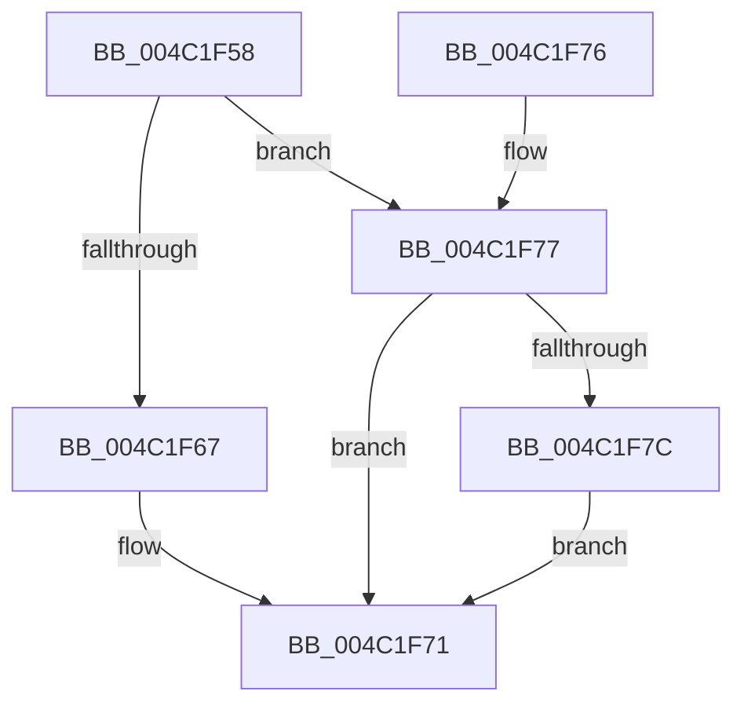

# ST_STORE&lt;SM_TRAITS&gt;::StStoreWorkItemCleanup

- RVA: `0x004C1F58`–`0x004C1F85` (길이 `45` bytes)
- VA: `0x00000001404C1F58`
- 실행 섹션: `.text`
- PDB 이름 있음: `예`; PDB Function 태그: `아니요`
- unwind 정보 RVA: `0x00064C74`
- 디코드: `15`개 명령, `45/45` bytes 표시
- 미해석 바이트: `0` (있으면 어셈블리에 `.byte`로 보존)

> 이 문서는 커널 이미지의 기계어와 PDB 기호를 분석해 생성했습니다. 4번과 5번은 함수 원형과 자료형을 바이너리 사용 방식에서 추정한 C 해석이며 원본 소스 복구 결과는 아닙니다.

## 1. Dependencies

- 직접 호출 지점: **1**; 고유 호출 대상: **1**
- 직접 호출자로 확인된 함수: **2**
- RIP 상대 이미지 참조: **0**

### Outgoing calls
- `0x004C1F6C` → [ExFreePoolWithTag](../../poolcode/B8/ExFreePoolWithTag_function_00B82870.md) (function, `0x00B82870`)

### Direct callers
- [sub_00206190](../20/Unknown_function_00206190.md) at `0x00206196`
- [ST_STORE&lt;SM_TRAITS&gt;::StMetaRegionsUpdate](ST_STORE_SM_TRAITS_StMetaRegionsUpdate_function_004C1DFC.md) at `0x004C1EE8`

### Static image references
- 디코드된 RIP-relative 메모리 참조가 없습니다.

## 2. Other-region calls and transfers

- 다른 실행 섹션으로 향하는 call: **1**
  - `0x004C1F6C` → [ExFreePoolWithTag](../../poolcode/B8/ExFreePoolWithTag_function_00B82870.md) (`.text` → `POOLCODE`)
- 별도 외부 분기/꼬리 이동을 확인하지 못했습니다.

## 3. Assembly (complete function range)

```asm
004C1F58  48 83 EC 28                     sub rsp, 0x28
004C1F5C  8B 42 08                        mov eax, dword ptr [rdx + 8]
004C1F5F  4C 8B C2                        mov r8, rdx
004C1F62  83 F8 02                        cmp eax, 2
004C1F65  75 10                           jne 0x1404c1f77
004C1F67  33 D2                           xor edx, edx
004C1F69  49 8B C8                        mov rcx, r8
004C1F6C  E8 FF 08 6C 00                  call 0x140b82870
004C1F71  48 83 C4 28                     add rsp, 0x28
004C1F75  C3                              ret
004C1F76  CC                              int3
004C1F77  83 F8 03                        cmp eax, 3
004C1F7A  75 F5                           jne 0x1404c1f71
004C1F7C  83 A1 80 1A 00 00 FE            and dword ptr [rcx + 0x1a80], 0xfffffffe
004C1F83  EB EC                           jmp 0x1404c1f71
```

## 4. C-style interpretation (structured pseudocode)

```c
__int64 __fastcall ST_STORE_SM_TRAITS___StStoreWorkItemCleanup(__int64 a1, __int64 a2)
{
    __int64 result;
    __int64 v_rsp;

    v_rsp = (v_rsp) - (40);
    if (((unsigned int)((unsigned int)(*(unsigned int *)(a2 + 8)))) != 2) goto loc_004C1F77;
    a2 = 0;
    result = ExFreePoolWithTag(0, a2, a2, a4);
loc_004C1F71:
    v_rsp = (v_rsp) + (40);
    return result;
loc_004C1F77:
    if (((unsigned int)(result)) != 3) goto loc_004C1F71;
    goto loc_004C1F71;
}
```

## 5. (Beta) C Style

```c
int64_t ST_STORE_SM_TRAITS___StStoreWorkItemCleanup(void *Arg1, void *Arg2)
{
    uint8_t *arg1 = (uint8_t *)Arg1;
    uint8_t *arg2 = (uint8_t *)Arg2;

    int64_t result;
    int64_t local_rsp;

    local_rsp = (local_rsp) - (40);
    if (((uint32_t)((uint32_t)(*(uint32_t *)(arg2 + 0x8)))) != 2) goto loc_004C1F77;
    Arg2 = 0;
    result = ExFreePoolWithTag(0, Arg2, Arg2, a4);
loc_004C1F71:
    local_rsp = (local_rsp) + (40);
    return result;
loc_004C1F77:
    if (((uint32_t)(result)) != 3) goto loc_004C1F71;
    goto loc_004C1F71;
}
```

### 관측된 메모리 오프셋

구조체 형식이 확인되지 않은 접근은 인자 기준의 오프셋으로만 기록했습니다.

| 기준 인자 | 오프셋 표현 | 폭 (bit) | 접근 |
|---|---:|---:|---|
| `Arg1` | `+ 0x1A80` | `32` | `R/W` |
| `Arg2` | `+ 0x8` | `32` | `R` |

## 6. Execution-region graph

[열기: 2D/3D 그래프와 함수 탐색 컨트롤 패널](../../../control-panel.html?section=text&rva=0x004C1F58&view=graph)

- 2D 그래프는 위에서 아래로 흐르고, 3D 그래프는 빈 공간을 드래그해 회전합니다. Shift+드래그는 이동, 휠은 확대·축소, 함수 노드 선택은 대상 보고서 이동입니다.

### Static fallback


