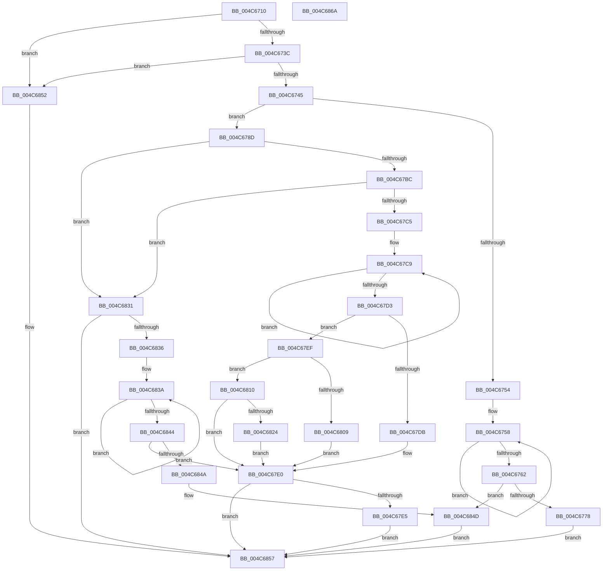

# SeConvertStringSidToSid

- RVA: `0x004C6710`–`0x004C686B` (길이 `347` bytes)
- VA: `0x00000001404C6710`
- 실행 섹션: `.text`
- PDB 이름 있음: `예`; PDB Function 태그: `아니요`
- unwind 정보 RVA: `0x000BD018`
- 디코드: `106`개 명령, `347/347` bytes 표시
- 미해석 바이트: `0` (있으면 어셈블리에 `.byte`로 보존)

> 이 문서는 커널 이미지의 기계어와 PDB 기호를 분석해 생성했습니다. 4번과 5번은 함수 원형과 자료형을 바이너리 사용 방식에서 추정한 C 해석이며 원본 소스 복구 결과는 아닙니다.

## 1. Dependencies

- 직접 호출 지점: **7**; 고유 호출 대상: **5**
- 직접 호출자로 확인된 함수: **1**
- RIP 상대 이미지 참조: **0**

### Outgoing calls
- `0x004C6749` → [LocalpConvertStringSidToSid](../../page/A1/LocalpConvertStringSidToSid_function_00A17490.md) (function, `0x00A17490`)
- `0x004C6780` → [PdcCloseEvent](../../page/8D/PdcCloseEvent_function_008D2404.md) (function, `0x008D2404`)
- `0x004C67A7` → [LookupSidInTable](../../page/92/LookupSidInTable_function_009293C0.md) (function, `0x009293C0`)
- `0x004C67E8` → [PdcCloseEvent](../../page/8D/PdcCloseEvent_function_008D2404.md) (function, `0x008D2404`)
- `0x004C67FC` → [SddlpAlloc](../../page/92/SddlpAlloc_function_00925F88.md) (function, `0x00925F88`)
- `0x004C6819` → [RtlCopySid](../../page/9A/RtlCopySid_function_009A9A50.md) (function, `0x009A9A50`)
- `0x004C6827` → [PdcCloseEvent](../../page/8D/PdcCloseEvent_function_008D2404.md) (function, `0x008D2404`)

### Direct callers
- [ExWnfHiveUnloaded](../../page/9A/ExWnfHiveUnloaded_function_009AF900.md) at `0x009AF9D7`

### Static image references
- 디코드된 RIP-relative 메모리 참조가 없습니다.

## 2. Other-region calls and transfers

- 다른 실행 섹션으로 향하는 call: **7**
  - `0x004C6749` → [LocalpConvertStringSidToSid](../../page/A1/LocalpConvertStringSidToSid_function_00A17490.md) (`.text` → `PAGE`)
  - `0x004C6780` → [PdcCloseEvent](../../page/8D/PdcCloseEvent_function_008D2404.md) (`.text` → `PAGE`)
  - `0x004C67A7` → [LookupSidInTable](../../page/92/LookupSidInTable_function_009293C0.md) (`.text` → `PAGE`)
  - `0x004C67E8` → [PdcCloseEvent](../../page/8D/PdcCloseEvent_function_008D2404.md) (`.text` → `PAGE`)
  - `0x004C67FC` → [SddlpAlloc](../../page/92/SddlpAlloc_function_00925F88.md) (`.text` → `PAGE`)
  - `0x004C6819` → [RtlCopySid](../../page/9A/RtlCopySid_function_009A9A50.md) (`.text` → `PAGE`)
  - `0x004C6827` → [PdcCloseEvent](../../page/8D/PdcCloseEvent_function_008D2404.md) (`.text` → `PAGE`)
- 별도 외부 분기/꼬리 이동을 확인하지 못했습니다.

## 3. Assembly (complete function range)

```asm
004C6710  48 8B C4                        mov rax, rsp
004C6713  48 89 58 10                     mov qword ptr [rax + 0x10], rbx
004C6717  55                              push rbp
004C6718  56                              push rsi
004C6719  57                              push rdi
004C671A  41 56                           push r14
004C671C  41 57                           push r15
004C671E  48 83 EC 40                     sub rsp, 0x40
004C6722  45 33 FF                        xor r15d, r15d
004C6725  48 8B FA                        mov rdi, rdx
004C6728  4C 89 78 08                     mov qword ptr [rax + 8], r15
004C672C  48 8B F1                        mov rsi, rcx
004C672F  4C 89 78 18                     mov qword ptr [rax + 0x18], r15
004C6733  48 85 C9                        test rcx, rcx
004C6736  0F 84 16 01 00 00               je 0x1404c6852
004C673C  48 85 D2                        test rdx, rdx
004C673F  0F 84 0D 01 00 00               je 0x1404c6852
004C6745  4C 8D 40 08                     lea r8, [rax + 8]
004C6749  E8 42 0D 55 00                  call 0x140a17490
004C674E  8B D8                           mov ebx, eax
004C6750  85 C0                           test eax, eax
004C6752  79 39                           jns 0x1404c678d
004C6754  48 83 C9 FF                     or rcx, 0xffffffffffffffff
004C6758  48 FF C1                        inc rcx
004C675B  66 44 39 3C 4E                  cmp word ptr [rsi + rcx*2], r15w
004C6760  75 F6                           jne 0x1404c6758
004C6762  48 8B 44 24 70                  mov rax, qword ptr [rsp + 0x70]
004C6767  48 2B C6                        sub rax, rsi
004C676A  48 D1 F8                        sar rax, 1
004C676D  8B C0                           mov eax, eax
004C676F  48 3B C1                        cmp rax, rcx
004C6772  0F 84 D5 00 00 00               je 0x1404c684d
004C6778  48 8B 0F                        mov rcx, qword ptr [rdi]
004C677B  BB 78 00 00 C0                  mov ebx, 0xc0000078
004C6780  E8 7F BC 40 00                  call 0x1408d2404
004C6785  4C 89 3F                        mov qword ptr [rdi], r15
004C6788  E9 CA 00 00 00                  jmp 0x1404c6857
004C678D  48 8D 84 24 80 00 00 00         lea rax, [rsp + 0x80]
004C6795  45 33 C0                        xor r8d, r8d
004C6798  48 89 44 24 30                  mov qword ptr [rsp + 0x30], rax
004C679D  33 D2                           xor edx, edx
004C679F  48 8B CE                        mov rcx, rsi
004C67A2  44 88 7C 24 28                  mov byte ptr [rsp + 0x28], r15b
004C67A7  E8 14 2C 46 00                  call 0x1409293c0
004C67AC  48 8B AC 24 80 00 00 00         mov rbp, qword ptr [rsp + 0x80]
004C67B4  4C 8B F0                        mov r14, rax
004C67B7  48 85 C0                        test rax, rax
004C67BA  74 75                           je 0x1404c6831
004C67BC  48 8B 50 10                     mov rdx, qword ptr [rax + 0x10]
004C67C0  48 85 D2                        test rdx, rdx
004C67C3  74 6C                           je 0x1404c6831
004C67C5  48 83 C9 FF                     or rcx, 0xffffffffffffffff
004C67C9  48 FF C1                        inc rcx
004C67CC  66 44 39 3C 4E                  cmp word ptr [rsi + rcx*2], r15w
004C67D1  75 F6                           jne 0x1404c67c9
004C67D3  8B 40 0C                        mov eax, dword ptr [rax + 0xc]
004C67D6  48 3B C8                        cmp rcx, rax
004C67D9  74 14                           je 0x1404c67ef
004C67DB  BB 78 00 00 C0                  mov ebx, 0xc0000078
004C67E0  48 85 ED                        test rbp, rbp
004C67E3  74 72                           je 0x1404c6857
004C67E5  48 8B CD                        mov rcx, rbp
004C67E8  E8 17 BC 40 00                  call 0x1408d2404
004C67ED  EB 68                           jmp 0x1404c6857
004C67EF  0F B6 42 01                     movzx eax, byte ptr [rdx + 1]
004C67F3  8D 1C 85 08 00 00 00            lea ebx, [rax*4 + 8]
004C67FA  8B CB                           mov ecx, ebx
004C67FC  E8 87 F7 45 00                  call 0x140925f88
004C6801  48 89 07                        mov qword ptr [rdi], rax
004C6804  48 85 C0                        test rax, rax
004C6807  75 07                           jne 0x1404c6810
004C6809  BB 17 00 00 C0                  mov ebx, 0xc0000017
004C680E  EB D0                           jmp 0x1404c67e0
004C6810  4D 8B 46 10                     mov r8, qword ptr [r14 + 0x10]
004C6814  48 8B D0                        mov rdx, rax
004C6817  8B CB                           mov ecx, ebx
004C6819  E8 32 32 4E 00                  call 0x1409a9a50
004C681E  8B D8                           mov ebx, eax
004C6820  85 C0                           test eax, eax
004C6822  79 BC                           jns 0x1404c67e0
004C6824  48 8B 0F                        mov rcx, qword ptr [rdi]
004C6827  E8 D8 BB 40 00                  call 0x1408d2404
004C682C  4C 89 3F                        mov qword ptr [rdi], r15
004C682F  EB AF                           jmp 0x1404c67e0
004C6831  48 85 ED                        test rbp, rbp
004C6834  74 21                           je 0x1404c6857
004C6836  48 83 C9 FF                     or rcx, 0xffffffffffffffff
004C683A  48 FF C1                        inc rcx
004C683D  66 44 39 3C 4E                  cmp word ptr [rsi + rcx*2], r15w
004C6842  75 F6                           jne 0x1404c683a
004C6844  48 83 F9 02                     cmp rcx, 2
004C6848  75 96                           jne 0x1404c67e0
004C684A  48 89 2F                        mov qword ptr [rdi], rbp
004C684D  41 8B DF                        mov ebx, r15d
004C6850  EB 05                           jmp 0x1404c6857
004C6852  BB 0D 00 00 C0                  mov ebx, 0xc000000d
004C6857  8B C3                           mov eax, ebx
004C6859  48 8B 5C 24 78                  mov rbx, qword ptr [rsp + 0x78]
004C685E  48 83 C4 40                     add rsp, 0x40
004C6862  41 5F                           pop r15
004C6864  41 5E                           pop r14
004C6866  5F                              pop rdi
004C6867  5E                              pop rsi
004C6868  5D                              pop rbp
004C6869  C3                              ret
004C686A  CC                              int3
```

## 4. C-style interpretation (structured pseudocode)

```c
__int64 __fastcall SeConvertStringSidToSid(__int64 a1, __int64 a2)
{
    __int64 result;
    __int64 v_r15;
    __int64 v_rsp;
    unsigned __int64 v_stack_m38;
    unsigned __int8 v_stack_m40;
    unsigned __int64 v_stack_p10;
    unsigned __int64 v_stack_p18;
    unsigned __int64 v_stack_p8;

    *(unsigned __int64 *)(v_rsp + 16) = v_rbx;
    v_rsp = (v_rsp) - (64);
    v_r15 = 0;
    *(unsigned __int64 *)(v_rsp + 8) = 0;
    *(unsigned __int64 *)(v_rsp + 24) = 0;
    if (a1 == 0) goto loc_004C6852;
    if (a2 == 0) goto loc_004C6852;
    result = LocalpConvertStringSidToSid(a1, a2, v_rsp + 8, a4);
    if (!sign_flag) goto loc_004C678D;
    a1 = (a1) | (-1);
loc_004C6758:
    a1 = (a1) + 1;
    if ((*(unsigned __int16 *)(a1 + a1 * 2)) != 0) goto loc_004C6758;
    result = (v_stack_p8) - (a1);
    result = (result) >> (1);
    if (((unsigned int)((unsigned int)(result))) == a1) goto loc_004C684D;
    result = PdcCloseEvent(*(unsigned __int64 *)(a2), a2, v_rsp + 8, a4);
    *(unsigned __int64 *)(a2) = 0;
    goto loc_004C6857;
loc_004C678D:
    a3 = 0;
    v_stack_m38 = v_stack_p18;
    a2 = 0;
    v_stack_m40 = 0;
    result = LookupSidInTable(a1, a2, a3, a4);
    if (result == 0) goto loc_004C6831;
    if (*(unsigned __int64 *)(result + 16) == 0) goto loc_004C6831;
    a1 = (a1) | (-1);
loc_004C67C9:
    a1 = (a1) + 1;
    if ((*(unsigned __int16 *)(a1 + a1 * 2)) != 0) goto loc_004C67C9;
    if (a1 == ((unsigned int)(*(unsigned int *)(result + 12)))) goto loc_004C67EF;
loc_004C67E0:
    if (v_stack_p18 == 0) goto loc_004C6857;
    result = PdcCloseEvent(v_stack_p18, *(unsigned __int64 *)(result + 16), a3, a4);
    goto loc_004C6857;
loc_004C67EF:
    result = SddlpAlloc((unsigned int)((unsigned int)(*(unsigned __int8 *)(*(unsigned __int64 *)(result + 16) + 1) * 4 + 8)), *(unsigned __int64 *)(result + 16), a3, a4);
    *(unsigned __int64 *)(a2) = result;
    if (result != 0) goto loc_004C6810;
    goto loc_004C67E0;
loc_004C6810:
    result = RtlCopySid((unsigned int)((unsigned int)((unsigned int)(0xC0000017ULL))), result, *(unsigned __int64 *)(result + 16), a4);
    if (!sign_flag) goto loc_004C67E0;
    result = PdcCloseEvent(*(unsigned __int64 *)(a2), result, *(unsigned __int64 *)(result + 16), a4);
    *(unsigned __int64 *)(a2) = 0;
    goto loc_004C67E0;
loc_004C6831:
    if (v_stack_p18 == 0) goto loc_004C6857;
    a1 = (*(unsigned __int64 *)(a2)) | (-1);
loc_004C683A:
    a1 = (a1) + 1;
    if ((*(unsigned __int16 *)(a1 + a1 * 2)) != 0) goto loc_004C683A;
    if (a1 != 2) goto loc_004C67E0;
    *(unsigned __int64 *)(a2) = v_stack_p18;
loc_004C684D:
    goto loc_004C6857;
loc_004C6852:
loc_004C6857:
    v_rsp = (v_rsp) + (64);
    return (unsigned int)((unsigned int)((unsigned int)(0xC000000DULL)));
}
```

## 5. (Beta) C Style

```c
int64_t SeConvertStringSidToSid(void *Arg1, void *Arg2)
{
    uint8_t *arg1 = (uint8_t *)Arg1;
    uint8_t *arg2 = (uint8_t *)Arg2;

    int64_t result;
    int64_t local_r15;
    int64_t local_rsp;
    uint64_t v_stack_m38;
    uint8_t v_stack_m40;
    uint64_t v_stack_p10;
    uint64_t v_stack_p18;
    uint64_t v_stack_p8;

    *(uint64_t *)(local_rsp + 0x10) = local_rbx;
    local_rsp = (local_rsp) - (64);
    local_r15 = 0;
    *(uint64_t *)(local_rsp + 0x8) = 0;
    *(uint64_t *)(local_rsp + 0x18) = 0;
    if (Arg1 == NULL) goto loc_004C6852;
    if (Arg2 == NULL) goto loc_004C6852;
    result = LocalpConvertStringSidToSid(Arg1, Arg2, local_rsp + 8, a4);
    if (!sign_flag) goto loc_004C678D;
    Arg1 = (Arg1) | (-1);
loc_004C6758:
    Arg1 = (Arg1) + 1;
    if ((*(uint16_t *)(arg1 + arg1 * 2)) != 0) goto loc_004C6758;
    result = (v_stack_p8) - (Arg1);
    result = (result) >> (1);
    if (((uint32_t)((uint32_t)(result))) == Arg1) goto loc_004C684D;
    result = PdcCloseEvent(*(uint64_t *)(arg2), Arg2, local_rsp + 8, a4);
    *(uint64_t *)(arg2) = 0;
    goto loc_004C6857;
loc_004C678D:
    a3 = 0;
    v_stack_m38 = v_stack_p18;
    Arg2 = 0;
    v_stack_m40 = 0;
    result = LookupSidInTable(Arg1, Arg2, a3, a4);
    if (result == 0) goto loc_004C6831;
    if (*(uint64_t *)(result + 0x10) == 0) goto loc_004C6831;
    Arg1 = (Arg1) | (-1);
loc_004C67C9:
    Arg1 = (Arg1) + 1;
    if ((*(uint16_t *)(arg1 + arg1 * 2)) != 0) goto loc_004C67C9;
    if (Arg1 == ((uint32_t)(*(uint32_t *)(result + 0xC)))) goto loc_004C67EF;
loc_004C67E0:
    if (v_stack_p18 == 0) goto loc_004C6857;
    result = PdcCloseEvent(v_stack_p18, *(uint64_t *)(result + 0x10), a3, a4);
    goto loc_004C6857;
loc_004C67EF:
    result = SddlpAlloc((uint32_t)((uint32_t)(*(uint8_t *)(*(uint64_t *)(result + 0x10) + 0x1) * 4 + 8)), *(uint64_t *)(result + 0x10), a3, a4);
    *(uint64_t *)(arg2) = result;
    if (result != 0) goto loc_004C6810;
    goto loc_004C67E0;
loc_004C6810:
    result = RtlCopySid((uint32_t)((uint32_t)((uint32_t)(0xC0000017ULL))), result, *(uint64_t *)(result + 0x10), a4);
    if (!sign_flag) goto loc_004C67E0;
    result = PdcCloseEvent(*(uint64_t *)(arg2), result, *(uint64_t *)(result + 0x10), a4);
    *(uint64_t *)(arg2) = 0;
    goto loc_004C67E0;
loc_004C6831:
    if (v_stack_p18 == 0) goto loc_004C6857;
    Arg1 = (*(uint64_t *)(arg2)) | (-1);
loc_004C683A:
    Arg1 = (Arg1) + 1;
    if ((*(uint16_t *)(arg1 + arg1 * 2)) != 0) goto loc_004C683A;
    if (Arg1 != 2) goto loc_004C67E0;
    *(uint64_t *)(arg2) = v_stack_p18;
loc_004C684D:
    goto loc_004C6857;
loc_004C6852:
loc_004C6857:
    local_rsp = (local_rsp) + (64);
    return (uint32_t)((uint32_t)((uint32_t)(0xC000000DULL)));
}
```

### 관측된 메모리 오프셋

구조체 형식이 확인되지 않은 접근은 인자 기준의 오프셋으로만 기록했습니다.

| 기준 인자 | 오프셋 표현 | 폭 (bit) | 접근 |
|---|---:|---:|---|
| `Arg1` | `+ 0x0 + rcx*2` | `16` | `R` |
| `Arg2` | `+ 0x0` | `64` | `R` |
| `Arg2` | `+ 0x0` | `64` | `W` |

## 6. Execution-region graph

[열기: 2D/3D 그래프와 함수 탐색 컨트롤 패널](../../../control-panel.html?section=text&rva=0x004C6710&view=graph)

- 2D 그래프는 위에서 아래로 흐르고, 3D 그래프는 빈 공간을 드래그해 회전합니다. Shift+드래그는 이동, 휠은 확대·축소, 함수 노드 선택은 대상 보고서 이동입니다.

### Static fallback


