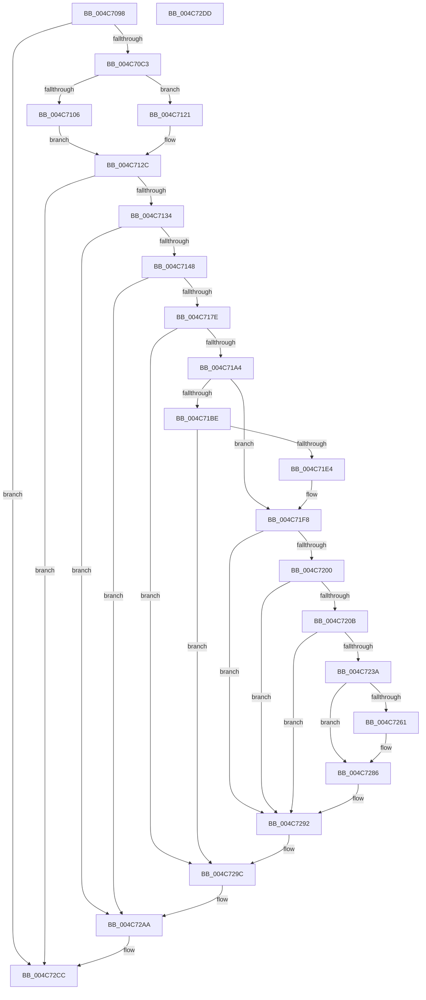

# SeSetLearningModeObjectInformation

- RVA: `0x004C7098`–`0x004C72DE` (길이 `582` bytes)
- VA: `0x00000001404C7098`
- 실행 섹션: `.text`
- PDB 이름 있음: `예`; PDB Function 태그: `아니요`
- unwind 정보 RVA: `0x000BD1CC`
- 디코드: `145`개 명령, `582/582` bytes 표시
- 미해석 바이트: `0` (있으면 어셈블리에 `.byte`로 보존)

> 이 문서는 커널 이미지의 기계어와 PDB 기호를 분석해 생성했습니다. 4번과 5번은 함수 원형과 자료형을 바이너리 사용 방식에서 추정한 C 해석이며 원본 소스 복구 결과는 아닙니다.

## 1. Dependencies

- 직접 호출 지점: **18**; 고유 호출 대상: **12**
- 직접 호출자로 확인된 함수: **5**
- RIP 상대 이미지 참조: **2**

### Outgoing calls
- `0x004C70EF` → [PsReferenceEffectiveToken](../../page/9A/PsReferenceEffectiveToken_function_009A2B40.md) (function, `0x009A2B40`)
- `0x004C711A` → [ObFastDereferenceObject](../3E/ObFastDereferenceObject_function_003ED5F0.md) (function, `0x003ED5F0`)
- `0x004C7127` → [ObfDereferenceObjectWithTag](../2F/ObfDereferenceObjectWithTag_function_002F78E0.md) (function, `0x002F78E0`)
- `0x004C7171` → [ObReferenceObjectByHandle](../../page/86/ObReferenceObjectByHandle_function_00868DB0.md) (function, `0x00868DB0`)
- `0x004C7193` → [ExAllocatePool2](../../poolcode/B8/ExAllocatePool2_function_00B820F0.md) (function, `0x00B820F0`)
- `0x004C71B2` → [ObQueryNameString](../../page/8A/ObQueryNameString_function_008A7EB0.md) (function, `0x008A7EB0`)
- `0x004C71C3` → [ExFreePoolWithTag](../../poolcode/B8/ExFreePoolWithTag_function_00B82870.md) (function, `0x00B82870`)
- `0x004C71D3` → [ExAllocatePool2](../../poolcode/B8/ExAllocatePool2_function_00B820F0.md) (function, `0x00B820F0`)
- `0x004C71F3` → [ObQueryNameString](../../page/8A/ObQueryNameString_function_008A7EB0.md) (function, `0x008A7EB0`)
- `0x004C722D` → [ExAllocatePool2](../../poolcode/B8/ExAllocatePool2_function_00B820F0.md) (function, `0x00B820F0`)
- `0x004C7242` → [memset](../6C/memset_function_006C6C40.md) (function, `0x006C6C40`)
- `0x004C7251` → [RtlStringCbCopyW](../43/RtlStringCbCopyW_function_0043B910.md) (function, `0x0043B910`)
- `0x004C726E` → [RtlStringCbCatW](../45/RtlStringCbCatW_function_00453E24.md) (function, `0x00453E24`)
- `0x004C7281` → [RtlStringCbCatW](../45/RtlStringCbCatW_function_00453E24.md) (function, `0x00453E24`)
- `0x004C728D` → [RtlInitUnicodeString](../42/RtlInitUnicodeString_function_0042A780.md) (function, `0x0042A780`)
- `0x004C7297` → [ExFreePoolWithTag](../../poolcode/B8/ExFreePoolWithTag_function_00B82870.md) (function, `0x00B82870`)
- `0x004C72A5` → [ObfDereferenceObjectWithTag](../2F/ObfDereferenceObjectWithTag_function_002F78E0.md) (function, `0x002F78E0`)
- `0x004C72B3` → [SepGetCurrentLogLevel](../41/SepGetCurrentLogLevel_function_004109C0.md) (function, `0x004109C0`)

### Direct callers
- [sub_006EF3AA](../6E/Unknown_function_006EF3AA.md) at `0x006EF423`
- [sub_0089A903](../../page/89/Unknown_function_0089A903.md) at `0x0089AC54`
- [ObpLookupObjectName](../../page/89/ObpLookupObjectName_function_0089BE90.md) at `0x0089C0D8`
- [ObpLookupObjectName](../../page/89/ObpLookupObjectName_function_0089BE90.md) at `0x0089DCF7`
- [ObReferenceObjectByNameEx](../../page/8B/ObReferenceObjectByNameEx_function_008BD524.md) at `0x008BD83E`
- [ObReferenceObjectByName](../../page/8C/ObReferenceObjectByName_function_008C4A00.md) at `0x008C4C78`

### Static image references
- `0x004C70B6` → RVA `0x00FD9AD8` (`PAGEDATA`; read)
- `0x004C7261` → RVA `0x006CC5D0` (` ?? ::FNODOBFM::`string'`; read)

## 2. Other-region calls and transfers

- 다른 실행 섹션으로 향하는 call: **9**
  - `0x004C70EF` → [PsReferenceEffectiveToken](../../page/9A/PsReferenceEffectiveToken_function_009A2B40.md) (`.text` → `PAGE`)
  - `0x004C7171` → [ObReferenceObjectByHandle](../../page/86/ObReferenceObjectByHandle_function_00868DB0.md) (`.text` → `PAGE`)
  - `0x004C7193` → [ExAllocatePool2](../../poolcode/B8/ExAllocatePool2_function_00B820F0.md) (`.text` → `POOLCODE`)
  - `0x004C71B2` → [ObQueryNameString](../../page/8A/ObQueryNameString_function_008A7EB0.md) (`.text` → `PAGE`)
  - `0x004C71C3` → [ExFreePoolWithTag](../../poolcode/B8/ExFreePoolWithTag_function_00B82870.md) (`.text` → `POOLCODE`)
  - `0x004C71D3` → [ExAllocatePool2](../../poolcode/B8/ExAllocatePool2_function_00B820F0.md) (`.text` → `POOLCODE`)
  - `0x004C71F3` → [ObQueryNameString](../../page/8A/ObQueryNameString_function_008A7EB0.md) (`.text` → `PAGE`)
  - `0x004C722D` → [ExAllocatePool2](../../poolcode/B8/ExAllocatePool2_function_00B820F0.md) (`.text` → `POOLCODE`)
  - `0x004C7297` → [ExFreePoolWithTag](../../poolcode/B8/ExFreePoolWithTag_function_00B82870.md) (`.text` → `POOLCODE`)
- 별도 외부 분기/꼬리 이동을 확인하지 못했습니다.

## 3. Assembly (complete function range)

```asm
004C7098  48 89 5C 24 08                  mov qword ptr [rsp + 8], rbx
004C709D  55                              push rbp
004C709E  56                              push rsi
004C709F  57                              push rdi
004C70A0  41 54                           push r12
004C70A2  41 56                           push r14
004C70A4  48 8B EC                        mov rbp, rsp
004C70A7  48 83 EC 40                     sub rsp, 0x40
004C70AB  83 65 40 00                     and dword ptr [rbp + 0x40], 0
004C70AF  48 8B D9                        mov rbx, rcx
004C70B2  83 65 48 00                     and dword ptr [rbp + 0x48], 0
004C70B6  83 3D 1B 2A B1 00 00            cmp dword ptr [rip + 0xb12a1b], 0
004C70BD  0F 84 09 02 00 00               je 0x1404c72cc
004C70C3  65 48 8B 34 25 88 01 00 00      mov rsi, qword ptr gs:[0x188]
004C70CC  48 8D 45 F0                     lea rax, [rbp - 0x10]
004C70D0  48 83 64 24 28 00               and qword ptr [rsp + 0x28], 0
004C70D6  4C 8D 4D 38                     lea r9, [rbp + 0x38]
004C70DA  41 BE 53 68 72 74               mov r14d, 0x74726853
004C70E0  48 89 44 24 20                  mov qword ptr [rsp + 0x20], rax
004C70E5  41 8B D6                        mov edx, r14d
004C70E8  4C 8D 45 48                     lea r8, [rbp + 0x48]
004C70EC  48 8B CE                        mov rcx, rsi
004C70EF  E8 4C BA 4D 00                  call 0x1409a2b40
004C70F4  8B B8 C8 00 00 00               mov edi, dword ptr [rax + 0xc8]
004C70FA  81 E7 00 00 00 01               and edi, 0x1000000
004C7100  83 7D 48 01                     cmp dword ptr [rbp + 0x48], 1
004C7104  75 1B                           jne 0x1404c7121
004C7106  48 8B 8E B8 00 00 00            mov rcx, qword ptr [rsi + 0xb8]
004C710D  45 8B C6                        mov r8d, r14d
004C7110  48 81 C1 48 02 00 00            add rcx, 0x248
004C7117  48 8B D0                        mov rdx, rax
004C711A  E8 D1 64 F2 FF                  call 0x1403ed5f0
004C711F  EB 0B                           jmp 0x1404c712c
004C7121  41 8B D6                        mov edx, r14d
004C7124  48 8B C8                        mov rcx, rax
004C7127  E8 B4 07 E3 FF                  call 0x1402f78e0
004C712C  85 FF                           test edi, edi
004C712E  0F 84 98 01 00 00               je 0x1404c72cc
004C7134  0F 57 C0                        xorps xmm0, xmm0
004C7137  0F 11 43 28                     movups xmmword ptr [rbx + 0x28], xmm0
004C713B  48 8B 4B 20                     mov rcx, qword ptr [rbx + 0x20]
004C713F  48 85 C9                        test rcx, rcx
004C7142  0F 84 62 01 00 00               je 0x1404c72aa
004C7148  65 48 8B 04 25 88 01 00 00      mov rax, qword ptr gs:[0x188]
004C7151  45 33 C0                        xor r8d, r8d
004C7154  48 83 64 24 28 00               and qword ptr [rsp + 0x28], 0
004C715A  33 D2                           xor edx, edx
004C715C  48 83 65 38 00                  and qword ptr [rbp + 0x38], 0
004C7161  44 8A 88 32 02 00 00            mov r9b, byte ptr [rax + 0x232]
004C7168  48 8D 45 38                     lea rax, [rbp + 0x38]
004C716C  48 89 44 24 20                  mov qword ptr [rsp + 0x20], rax
004C7171  E8 3A 1C 3A 00                  call 0x140868db0
004C7176  85 C0                           test eax, eax
004C7178  0F 88 2C 01 00 00               js 0x1404c72aa
004C717E  41 BE 53 65 52 4F               mov r14d, 0x4f526553
004C7184  BE 10 02 00 00                  mov esi, 0x210
004C7189  45 8B C6                        mov r8d, r14d
004C718C  8B D6                           mov edx, esi
004C718E  B9 00 01 00 00                  mov ecx, 0x100
004C7193  E8 58 AF 6B 00                  call 0x140b820f0
004C7198  48 8B F8                        mov rdi, rax
004C719B  48 85 C0                        test rax, rax
004C719E  0F 84 F8 00 00 00               je 0x1404c729c
004C71A4  48 8B 4D 38                     mov rcx, qword ptr [rbp + 0x38]
004C71A8  4C 8D 4D 40                     lea r9, [rbp + 0x40]
004C71AC  44 8B C6                        mov r8d, esi
004C71AF  48 8B D0                        mov rdx, rax
004C71B2  E8 F9 0C 3E 00                  call 0x1408a7eb0
004C71B7  3D 04 00 00 C0                  cmp eax, 0xc0000004
004C71BC  75 3A                           jne 0x1404c71f8
004C71BE  33 D2                           xor edx, edx
004C71C0  48 8B CF                        mov rcx, rdi
004C71C3  E8 A8 B6 6B 00                  call 0x140b82870
004C71C8  8B 55 40                        mov edx, dword ptr [rbp + 0x40]
004C71CB  45 8B C6                        mov r8d, r14d
004C71CE  B9 00 01 00 00                  mov ecx, 0x100
004C71D3  E8 18 AF 6B 00                  call 0x140b820f0
004C71D8  48 8B F8                        mov rdi, rax
004C71DB  48 85 C0                        test rax, rax
004C71DE  0F 84 B8 00 00 00               je 0x1404c729c
004C71E4  44 8B 45 40                     mov r8d, dword ptr [rbp + 0x40]
004C71E8  4C 8D 4D 40                     lea r9, [rbp + 0x40]
004C71EC  48 8B 4D 38                     mov rcx, qword ptr [rbp + 0x38]
004C71F0  48 8B D0                        mov rdx, rax
004C71F3  E8 B8 0C 3E 00                  call 0x1408a7eb0
004C71F8  85 C0                           test eax, eax
004C71FA  0F 88 92 00 00 00               js 0x1404c7292
004C7200  48 83 7F 08 00                  cmp qword ptr [rdi + 8], 0
004C7205  0F 84 87 00 00 00               je 0x1404c7292
004C720B  48 8B 43 18                     mov rax, qword ptr [rbx + 0x18]
004C720F  41 B8 53 65 52 4F               mov r8d, 0x4f526553
004C7215  44 0F B7 77 02                  movzx r14d, word ptr [rdi + 2]
004C721A  B9 00 01 00 00                  mov ecx, 0x100
004C721F  0F B7 50 02                     movzx edx, word ptr [rax + 2]
004C7223  48 83 C2 02                     add rdx, 2
004C7227  4C 03 F2                        add r14, rdx
004C722A  49 8B D6                        mov rdx, r14
004C722D  E8 BE AE 6B 00                  call 0x140b820f0
004C7232  48 8B F0                        mov rsi, rax
004C7235  48 85 C0                        test rax, rax
004C7238  74 58                           je 0x1404c7292
004C723A  4D 8B C6                        mov r8, r14
004C723D  33 D2                           xor edx, edx
004C723F  48 8B C8                        mov rcx, rax
004C7242  E8 F9 F9 1F 00                  call 0x1406c6c40
004C7247  4C 8B 47 08                     mov r8, qword ptr [rdi + 8]
004C724B  49 8B D6                        mov rdx, r14
004C724E  48 8B CE                        mov rcx, rsi
004C7251  E8 BA 46 F7 FF                  call 0x14043b910
004C7256  48 8B 4B 18                     mov rcx, qword ptr [rbx + 0x18]
004C725A  48 83 79 08 00                  cmp qword ptr [rcx + 8], 0
004C725F  74 25                           je 0x1404c7286
004C7261  4C 8D 05 68 53 20 00            lea r8, [rip + 0x205368]
004C7268  49 8B D6                        mov rdx, r14
004C726B  48 8B CE                        mov rcx, rsi
004C726E  E8 B1 CB F8 FF                  call 0x140453e24
004C7273  4C 8B 43 18                     mov r8, qword ptr [rbx + 0x18]
004C7277  49 8B D6                        mov rdx, r14
004C727A  48 8B CE                        mov rcx, rsi
004C727D  4D 8B 40 08                     mov r8, qword ptr [r8 + 8]
004C7281  E8 9E CB F8 FF                  call 0x140453e24
004C7286  48 8B D6                        mov rdx, rsi
004C7289  48 8D 4B 28                     lea rcx, [rbx + 0x28]
004C728D  E8 EE 34 F6 FF                  call 0x14042a780
004C7292  33 D2                           xor edx, edx
004C7294  48 8B CF                        mov rcx, rdi
004C7297  E8 D4 B5 6B 00                  call 0x140b82870
004C729C  48 8B 4D 38                     mov rcx, qword ptr [rbp + 0x38]
004C72A0  BA 44 66 6C 74                  mov edx, 0x746c6644
004C72A5  E8 36 06 E3 FF                  call 0x1402f78e0
004C72AA  65 48 8B 0C 25 88 01 00 00      mov rcx, qword ptr gs:[0x188]
004C72B3  E8 08 97 F4 FF                  call 0x1404109c0
004C72B8  89 43 08                        mov dword ptr [rbx + 8], eax
004C72BB  48 8B 81 38 06 00 00            mov rax, qword ptr [rcx + 0x638]
004C72C2  48 89 03                        mov qword ptr [rbx], rax
004C72C5  48 89 99 38 06 00 00            mov qword ptr [rcx + 0x638], rbx
004C72CC  48 8B 5C 24 70                  mov rbx, qword ptr [rsp + 0x70]
004C72D1  48 83 C4 40                     add rsp, 0x40
004C72D5  41 5E                           pop r14
004C72D7  41 5C                           pop r12
004C72D9  5F                              pop rdi
004C72DA  5E                              pop rsi
004C72DB  5D                              pop rbp
004C72DC  C3                              ret
004C72DD  CC                              int3
```

## 4. C-style interpretation (structured pseudocode)

```c
__int64 __fastcall SeSetLearningModeObjectInformation(__int64 a1)
{
    __int64 result;
    __int64 v_r14;
    __int64 v_rdi;
    __int64 v_rsp;
    unsigned __int64 v_stack_m38;
    unsigned __int64 v_stack_m40;
    unsigned __int64 v_stack_m48;
    unsigned __int64 v_stack_p10;
    unsigned int v_stack_p18;
    unsigned int v_stack_p20;
    unsigned __int64 v_stack_p8;

    v_stack_p8 = v_rbx;
    v_rsp = (v_rsp) - (64);
    if ((*(unsigned int *)(v_rip + 11610651)) == 0) goto loc_004C72CC;
    v_stack_m48 = v_stack_m38;
    result = PsReferenceEffectiveToken(*(unsigned __int64 *)(gs_base + (0 + 392)), (unsigned int)((unsigned int)((unsigned int)(0x74726853ULL))), v_stack_p20, v_stack_p10);
    v_rdi = (unsigned int)(((unsigned int)(*(unsigned int *)(result + 200))) & (0x1000000ULL));
    if (v_stack_p20 != 1) goto loc_004C7121;
    a1 = (*(unsigned __int64 *)(*(unsigned __int64 *)(gs_base + (0 + 392)) + 184)) + (584);
    result = ObFastDereferenceObject(a1, result, (unsigned int)((unsigned int)((unsigned int)(0x74726853ULL))), v_stack_p10);
    goto loc_004C712C;
loc_004C7121:
    result = ObfDereferenceObjectWithTag(result, (unsigned int)((unsigned int)((unsigned int)(0x74726853ULL))), (unsigned int)((unsigned int)((unsigned int)(0x74726853ULL))), v_stack_p10);
loc_004C712C:
    if ((unsigned int)(v_rdi) == 0) goto loc_004C72CC;
    *(unsigned __int64 *)(a1 + 40) = v_xmm0;
    if (*(unsigned __int64 *)(a1 + 32) == 0) goto loc_004C72AA;
    a3 = 0;
    a2 = 0;
    v_stack_m48 = v_stack_p10;
    result = ObReferenceObjectByHandle(*(unsigned __int64 *)(a1 + 32), a2, a3, *(unsigned __int8 *)(*(unsigned __int64 *)(gs_base + (0 + 392)) + 562));
    if (sign_flag) goto loc_004C72AA;
    result = ExAllocatePool2(256, 528, (unsigned int)((unsigned int)((unsigned int)(0x4F526553ULL))), *(unsigned __int8 *)(*(unsigned __int64 *)(gs_base + (0 + 392)) + 562));
    if (result == 0) goto loc_004C729C;
    result = ObQueryNameString(v_stack_p10, result, 528, v_stack_p18);
    if (((unsigned int)(result)) != 0xC0000004ULL) goto loc_004C71F8;
    a2 = 0;
    result = ExFreePoolWithTag(result, a2, 528, v_stack_p18);
    result = ExAllocatePool2(256, (unsigned int)(v_stack_p18), (unsigned int)((unsigned int)((unsigned int)(0x4F526553ULL))), v_stack_p18);
    if (result == 0) goto loc_004C729C;
    result = ObQueryNameString(v_stack_p10, result, (unsigned int)(v_stack_p18), v_stack_p18);
loc_004C71F8:
    if (sign_flag) goto loc_004C7292;
    if ((*(unsigned __int64 *)(result + 8)) == 0) goto loc_004C7292;
    a2 = (*(unsigned __int16 *)(*(unsigned __int64 *)(a1 + 24) + 2)) + (2);
    v_r14 = (*(unsigned __int16 *)(result + 2)) + (a2);
    result = ExAllocatePool2(256, v_r14, (unsigned int)(0x4F526553ULL), v_stack_p18);
    if (result == 0) goto loc_004C7292;
    a2 = 0;
    result = memset(result, a2, v_r14, v_stack_p18);
    result = RtlStringCbCopyW(result, v_r14, *(unsigned __int64 *)(result + 8), v_stack_p18);
    if ((*(unsigned __int64 *)(*(unsigned __int64 *)(a1 + 24) + 8)) != 0) {
        a3 = v_rip + 2118504;
        a2 = v_r14;
        a1 = result;
        result = RtlStringCbCatW(a1, a2, a3, v_stack_p18);
        a3 = *(unsigned __int64 *)(a1 + 24);
        a2 = v_r14;
        a1 = result;
        a3 = *(unsigned __int64 *)(a3 + 8);
        result = RtlStringCbCatW(a1, a2, a3, v_stack_p18);
    }
    result = RtlInitUnicodeString(a1 + 40, result, a3, v_stack_p18);
loc_004C7292:
    a2 = 0;
    result = ExFreePoolWithTag(result, a2, a3, v_stack_p18);
loc_004C729C:
    result = ObfDereferenceObjectWithTag(v_stack_p10, (unsigned int)(0x746C6644ULL), a3, v_stack_p18);
loc_004C72AA:
    result = SepGetCurrentLogLevel(*(unsigned __int64 *)(gs_base + (0 + 392)), (unsigned int)(0x746C6644ULL), a3, v_stack_p18);
    *(unsigned int *)(a1 + 8) = (unsigned int)(result);
    *(unsigned __int64 *)(a1) = *(unsigned __int64 *)(*(unsigned __int64 *)(gs_base + (0 + 392)) + 1592);
    *(unsigned __int64 *)(*(unsigned __int64 *)(gs_base + (0 + 392)) + 1592) = a1;
loc_004C72CC:
    v_rsp = (v_rsp) + (64);
    return *(unsigned __int64 *)(*(unsigned __int64 *)(gs_base + (0 + 392)) + 1592);
}
```

## 5. (Beta) C Style

```c
int64_t SeSetLearningModeObjectInformation(void *Arg1)
{
    uint8_t *arg1 = (uint8_t *)Arg1;

    int64_t result;
    int64_t local_r14;
    int64_t local_rdi;
    int64_t local_rsp;
    uint64_t v_stack_m38;
    uint64_t v_stack_m40;
    uint64_t v_stack_m48;
    uint64_t v_stack_p10;
    uint32_t v_stack_p18;
    uint32_t v_stack_p20;
    uint64_t v_stack_p8;

    v_stack_p8 = local_rbx;
    local_rsp = (local_rsp) - (64);
    if ((*(uint32_t *)(v_rip + 0xB12A1B)) == 0) goto loc_004C72CC;
    v_stack_m48 = v_stack_m38;
    result = PsReferenceEffectiveToken(*(uint64_t *)(gs_base + (0 + 0x188)), (uint32_t)((uint32_t)((uint32_t)(0x74726853ULL))), v_stack_p20, v_stack_p10);
    local_rdi = (uint32_t)(((uint32_t)(*(uint32_t *)(result + 0xC8))) & (0x1000000ULL));
    if (v_stack_p20 != 1) goto loc_004C7121;
    Arg1 = (*(uint64_t *)(*(uint64_t *)(gs_base + (0 + 0x188)) + 0xB8)) + (584);
    result = ObFastDereferenceObject(Arg1, result, (uint32_t)((uint32_t)((uint32_t)(0x74726853ULL))), v_stack_p10);
    goto loc_004C712C;
loc_004C7121:
    result = ObfDereferenceObjectWithTag(result, (uint32_t)((uint32_t)((uint32_t)(0x74726853ULL))), (uint32_t)((uint32_t)((uint32_t)(0x74726853ULL))), v_stack_p10);
loc_004C712C:
    if ((uint32_t)(local_rdi) == 0) goto loc_004C72CC;
    *(uint64_t *)(arg1 + 0x28) = v_xmm0;
    if (*(uint64_t *)(arg1 + 0x20) == 0) goto loc_004C72AA;
    a3 = 0;
    a2 = 0;
    v_stack_m48 = v_stack_p10;
    result = ObReferenceObjectByHandle(*(uint64_t *)(arg1 + 0x20), a2, a3, *(uint8_t *)(*(uint64_t *)(gs_base + (0 + 0x188)) + 0x232));
    if (sign_flag) goto loc_004C72AA;
    result = ExAllocatePool2(256, 528, (uint32_t)((uint32_t)((uint32_t)(0x4F526553ULL))), *(uint8_t *)(*(uint64_t *)(gs_base + (0 + 0x188)) + 0x232));
    if (result == 0) goto loc_004C729C;
    result = ObQueryNameString(v_stack_p10, result, 528, v_stack_p18);
    if (((uint32_t)(result)) != 0xC0000004ULL) goto loc_004C71F8;
    a2 = 0;
    result = ExFreePoolWithTag(result, a2, 528, v_stack_p18);
    result = ExAllocatePool2(256, (uint32_t)(v_stack_p18), (uint32_t)((uint32_t)((uint32_t)(0x4F526553ULL))), v_stack_p18);
    if (result == 0) goto loc_004C729C;
    result = ObQueryNameString(v_stack_p10, result, (uint32_t)(v_stack_p18), v_stack_p18);
loc_004C71F8:
    if (sign_flag) goto loc_004C7292;
    if ((*(uint64_t *)(result + 0x8)) == 0) goto loc_004C7292;
    a2 = (*(uint16_t *)(*(uint64_t *)(arg1 + 0x18) + 0x2)) + (2);
    local_r14 = (*(uint16_t *)(result + 0x2)) + (a2);
    result = ExAllocatePool2(256, local_r14, (uint32_t)(0x4F526553ULL), v_stack_p18);
    if (result == 0) goto loc_004C7292;
    a2 = 0;
    result = memset(result, a2, local_r14, v_stack_p18);
    result = RtlStringCbCopyW(result, local_r14, *(uint64_t *)(result + 0x8), v_stack_p18);
    if ((*(uint64_t *)(*(uint64_t *)(arg1 + 0x18) + 0x8)) != 0) {
        a3 = v_rip + 2118504;
        a2 = local_r14;
        Arg1 = result;
        result = RtlStringCbCatW(Arg1, a2, a3, v_stack_p18);
        a3 = *(uint64_t *)(arg1 + 0x18);
        a2 = local_r14;
        Arg1 = result;
        a3 = *(uint64_t *)(a3 + 0x8);
        result = RtlStringCbCatW(Arg1, a2, a3, v_stack_p18);
    }
    result = RtlInitUnicodeString(Arg1 + 40, result, a3, v_stack_p18);
loc_004C7292:
    a2 = 0;
    result = ExFreePoolWithTag(result, a2, a3, v_stack_p18);
loc_004C729C:
    result = ObfDereferenceObjectWithTag(v_stack_p10, (uint32_t)(0x746C6644ULL), a3, v_stack_p18);
loc_004C72AA:
    result = SepGetCurrentLogLevel(*(uint64_t *)(gs_base + (0 + 0x188)), (uint32_t)(0x746C6644ULL), a3, v_stack_p18);
    *(uint32_t *)(arg1 + 0x8) = (uint32_t)(result);
    *(uint64_t *)(arg1) = *(uint64_t *)(*(uint64_t *)(gs_base + (0 + 0x188)) + 0x638);
    *(void **)(*(uint64_t *)(gs_base + (0 + 0x188)) + 0x638) = Arg1;
loc_004C72CC:
    local_rsp = (local_rsp) + (64);
    return *(uint64_t *)(*(uint64_t *)(gs_base + (0 + 0x188)) + 0x638);
}
```

### 관측된 메모리 오프셋

구조체 형식이 확인되지 않은 접근은 인자 기준의 오프셋으로만 기록했습니다.

| 기준 인자 | 오프셋 표현 | 폭 (bit) | 접근 |
|---|---:|---:|---|
| `Arg1` | `+ 0x0` | `64` | `W` |
| `Arg1` | `+ 0x8` | `32` | `W` |
| `Arg1` | `+ 0x18` | `64` | `R` |
| `Arg1` | `+ 0x20` | `64` | `R` |
| `Arg1` | `+ 0x28` | `64` | `R` |
| `Arg1` | `+ 0x28` | `128` | `R` |

## 6. Execution-region graph

[열기: 2D/3D 그래프와 함수 탐색 컨트롤 패널](../../../control-panel.html?section=text&rva=0x004C7098&view=graph)

- 2D 그래프는 위에서 아래로 흐르고, 3D 그래프는 빈 공간을 드래그해 회전합니다. Shift+드래그는 이동, 휠은 확대·축소, 함수 노드 선택은 대상 보고서 이동입니다.

### Static fallback


