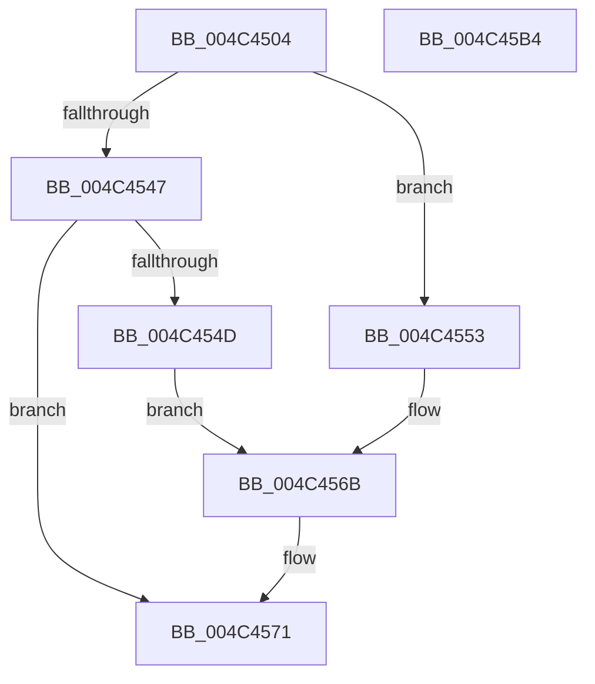

# SeTokenSetNoChildProcessRestricted

- RVA: `0x004C4504`–`0x004C45B5` (길이 `177` bytes)
- VA: `0x00000001404C4504`
- 실행 섹션: `.text`
- PDB 이름 있음: `예`; PDB Function 태그: `아니요`
- unwind 정보 RVA: `0x00060BC4`
- 디코드: `46`개 명령, `177/177` bytes 표시
- 미해석 바이트: `0` (있으면 어셈블리에 `.byte`로 보존)

> 이 문서는 커널 이미지의 기계어와 PDB 기호를 분석해 생성했습니다. 4번과 5번은 함수 원형과 자료형을 바이너리 사용 방식에서 추정한 C 해석이며 원본 소스 복구 결과는 아닙니다.

## 1. Dependencies

- 직접 호출 지점: **3**; 고유 호출 대상: **3**
- 직접 호출자로 확인된 함수: **1**
- RIP 상대 이미지 참조: **2**

### Outgoing calls
- `0x004C4533` → [ExAcquireResourceExclusiveLite](../21/ExAcquireResourceExclusiveLite_function_00214E20.md) (function, `0x00214E20`)
- `0x004C459A` → [ExReleaseResourceLite](../25/ExReleaseResourceLite_function_0025FA10.md) (function, `0x0025FA10`)
- `0x004C459F` → [KeLeaveCriticalRegion](../25/KeLeaveCriticalRegion_function_0025D8B0.md) (function, `0x0025D8B0`)

### Direct callers
- [PspSetNoChildProcessRestrictedPolicy](../../page/AB/PspSetNoChildProcessRestrictedPolicy_function_00AB1BE0.md) at `0x00AB1C11`

### Static image references
- `0x004C4571` → RVA `0x00012D08` (`.rdata`; read)
- `0x004C457B` → RVA `0x00E0EBF0` (`.data`; read/write)

## 2. Other-region calls and transfers

- 다른 실행 섹션으로 향하는 call: **0**
- 별도 외부 분기/꼬리 이동을 확인하지 못했습니다.

## 3. Assembly (complete function range)

```asm
004C4504  48 89 5C 24 08                  mov qword ptr [rsp + 8], rbx
004C4509  48 89 74 24 10                  mov qword ptr [rsp + 0x10], rsi
004C450E  57                              push rdi
004C450F  48 83 EC 20                     sub rsp, 0x20
004C4513  65 48 8B 04 25 88 01 00 00      mov rax, qword ptr gs:[0x188]
004C451C  40 8A F2                        mov sil, dl
004C451F  48 8B F9                        mov rdi, rcx
004C4522  B2 01                           mov dl, 1
004C4524  41 8A D8                        mov bl, r8b
004C4527  66 FF 88 E4 01 00 00            dec word ptr [rax + 0x1e4]
004C452E  90                              nop
004C452F  48 8B 49 30                     mov rcx, qword ptr [rcx + 0x30]
004C4533  E8 E8 08 D5 FF                  call 0x140214e20
004C4538  F0 83 0C 24 00                  lock or dword ptr [rsp], 0
004C453D  8B 8F C8 00 00 00               mov ecx, dword ptr [rdi + 0xc8]
004C4543  84 DB                           test bl, bl
004C4545  74 0C                           je 0x1404c4553
004C4547  0F BA E1 13                     bt ecx, 0x13
004C454B  72 24                           jb 0x1404c4571
004C454D  0F BA E9 15                     bts ecx, 0x15
004C4551  EB 18                           jmp 0x1404c456b
004C4553  0F BA E9 13                     bts ecx, 0x13
004C4557  8B C1                           mov eax, ecx
004C4559  0F BA E9 14                     bts ecx, 0x14
004C455D  0F BA F0 14                     btr eax, 0x14
004C4561  40 84 F6                        test sil, sil
004C4564  0F 44 C8                        cmove ecx, eax
004C4567  0F BA F1 15                     btr ecx, 0x15
004C456B  89 8F C8 00 00 00               mov dword ptr [rdi + 0xc8], ecx
004C4571  48 8B 0D 90 E7 B4 FF            mov rcx, qword ptr [rip - 0x4b1870]
004C4578  48 8B C1                        mov rax, rcx
004C457B  F0 48 0F C1 05 6C A6 94 00      lock xadd qword ptr [rip + 0x94a66c], rax
004C4584  48 03 C1                        add rax, rcx
004C4587  89 47 38                        mov dword ptr [rdi + 0x38], eax
004C458A  48 C1 E8 20                     shr rax, 0x20
004C458E  89 47 3C                        mov dword ptr [rdi + 0x3c], eax
004C4591  F0 83 0C 24 00                  lock or dword ptr [rsp], 0
004C4596  48 8B 4F 30                     mov rcx, qword ptr [rdi + 0x30]
004C459A  E8 71 B4 D9 FF                  call 0x14025fa10
004C459F  E8 0C 93 D9 FF                  call 0x14025d8b0
004C45A4  48 8B 5C 24 30                  mov rbx, qword ptr [rsp + 0x30]
004C45A9  48 8B 74 24 38                  mov rsi, qword ptr [rsp + 0x38]
004C45AE  48 83 C4 20                     add rsp, 0x20
004C45B2  5F                              pop rdi
004C45B3  C3                              ret
004C45B4  CC                              int3
```

## 4. C-style interpretation (structured pseudocode)

```c
__int64 __fastcall SeTokenSetNoChildProcessRestricted(__int64 a1, unsigned __int8 a2, unsigned __int8 a3)
{
    __int64 result;
    __int64 v_rsp;
    unsigned int v_stack_m28;
    unsigned __int64 v_stack_p10;
    unsigned __int64 v_stack_p8;

    v_stack_p8 = v_rbx;
    v_stack_p10 = v_rsi;
    v_rsp = (v_rsp) - (32);
    result = ExAcquireResourceExclusiveLite(*(unsigned __int64 *)(a1 + 48), 1, a3, a4);
    if (a3 == 0) goto loc_004C4553;
    if (condition_is_below) goto loc_004C4571;
    goto loc_004C456B;
loc_004C4553:
    a1 = (unsigned int)(*(unsigned int *)(a1 + 200));
    if (a2 == 0) { a1 = (unsigned int)((unsigned int)((unsigned int)((unsigned int)(*(unsigned int *)(a1 + 200))))); }
loc_004C456B:
    *(unsigned int *)(a1 + 200) = (unsigned int)(a1);
loc_004C4571:
    result = (*(unsigned __int64 *)(v_rip - 4921456)) + (*(unsigned __int64 *)(v_rip - 4921456));
    *(unsigned int *)(a1 + 56) = (unsigned int)(result);
    result = (result) >> (32);
    *(unsigned int *)(a1 + 60) = (unsigned int)(result);
    result = ExReleaseResourceLite(*(unsigned __int64 *)(a1 + 48), 1, a3, a4);
    result = KeLeaveCriticalRegion(*(unsigned __int64 *)(a1 + 48), 1, a3, a4);
    v_rsp = (v_rsp) + (32);
    return result;
}
```

## 5. (Beta) C Style

```c
int64_t SeTokenSetNoChildProcessRestricted(void *Arg1, uint8_t Arg2, uint8_t Arg3)
{
    uint8_t *arg1 = (uint8_t *)Arg1;

    int64_t result;
    int64_t local_rsp;
    uint32_t v_stack_m28;
    uint64_t v_stack_p10;
    uint64_t v_stack_p8;

    v_stack_p8 = local_rbx;
    v_stack_p10 = local_rsi;
    local_rsp = (local_rsp) - (32);
    result = ExAcquireResourceExclusiveLite(*(uint64_t *)(arg1 + 0x30), 1, Arg3, a4);
    if (Arg3 == 0) goto loc_004C4553;
    if (condition_is_below) goto loc_004C4571;
    goto loc_004C456B;
loc_004C4553:
    Arg1 = (uint32_t)(*(uint32_t *)(arg1 + 0xC8));
    if (Arg2 == 0) { Arg1 = (uint32_t)((uint32_t)((uint32_t)((uint32_t)(*(uint32_t *)(arg1 + 0xC8))))); }
loc_004C456B:
    *(uint32_t *)(arg1 + 0xC8) = (uint32_t)(Arg1);
loc_004C4571:
    result = (*(uint64_t *)(v_rip - 0x4B1870)) + (*(uint64_t *)(v_rip - 0x4B1870));
    *(uint32_t *)(arg1 + 0x38) = (uint32_t)(result);
    result = (result) >> (32);
    *(uint32_t *)(arg1 + 0x3C) = (uint32_t)(result);
    result = ExReleaseResourceLite(*(uint64_t *)(arg1 + 0x30), 1, Arg3, a4);
    result = KeLeaveCriticalRegion(*(uint64_t *)(arg1 + 0x30), 1, Arg3, a4);
    local_rsp = (local_rsp) + (32);
    return result;
}
```

### 관측된 메모리 오프셋

구조체 형식이 확인되지 않은 접근은 인자 기준의 오프셋으로만 기록했습니다.

| 기준 인자 | 오프셋 표현 | 폭 (bit) | 접근 |
|---|---:|---:|---|
| `Arg1` | `+ 0x30` | `64` | `R` |
| `Arg1` | `+ 0x38` | `32` | `W` |
| `Arg1` | `+ 0x3C` | `32` | `W` |
| `Arg1` | `+ 0xC8` | `32` | `R` |
| `Arg1` | `+ 0xC8` | `32` | `W` |

## 6. Execution-region graph

[열기: 2D/3D 그래프와 함수 탐색 컨트롤 패널](../../../control-panel.html?section=text&rva=0x004C4504&view=graph)

- 2D 그래프는 위에서 아래로 흐르고, 3D 그래프는 빈 공간을 드래그해 회전합니다. Shift+드래그는 이동, 휠은 확대·축소, 함수 노드 선택은 대상 보고서 이동입니다.

### Static fallback


