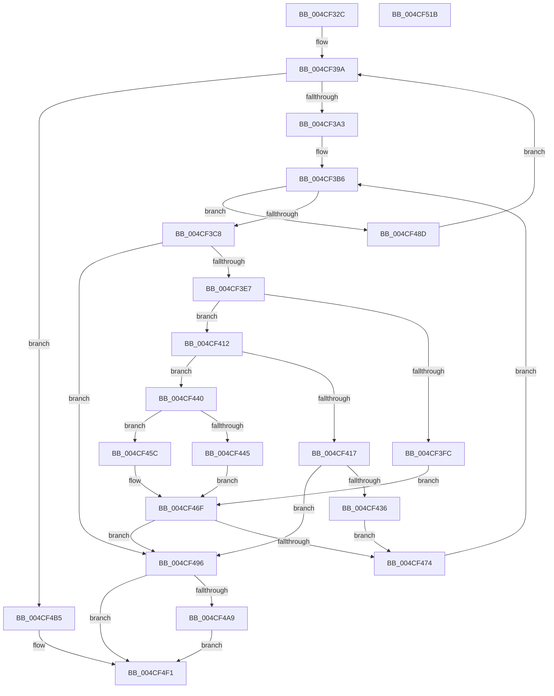

# SmFpPreAllocate

- RVA: `0x004CF32C`–`0x004CF51C` (길이 `496` bytes)
- VA: `0x00000001404CF32C`
- 실행 섹션: `.text`
- PDB 이름 있음: `예`; PDB Function 태그: `아니요`
- unwind 정보 RVA: `0x000BDA9C`
- 디코드: `140`개 명령, `496/496` bytes 표시
- 미해석 바이트: `0` (있으면 어셈블리에 `.byte`로 보존)

> 이 문서는 커널 이미지의 기계어와 PDB 기호를 분석해 생성했습니다. 4번과 5번은 함수 원형과 자료형을 바이너리 사용 방식에서 추정한 C 해석이며 원본 소스 복구 결과는 아닙니다.

## 1. Dependencies

- 직접 호출 지점: **11**; 고유 호출 대상: **10**
- 직접 호출자로 확인된 함수: **3**
- RIP 상대 이미지 참조: **1**

### Outgoing calls
- `0x004CF36B` → [memset](../6C/memset_function_006C6C40.md) (function, `0x006C6C40`)
- `0x004CF3D6` → [SmAllocEx](../34/SmAllocEx_function_0034C794.md) (function, `0x0034C794`)
- `0x004CF40B` → [SmKmAllocateMdlForLock](../47/SmKmAllocateMdlForLock_function_00470E68.md) (function, `0x00470E68`)
- `0x004CF42D` → [SmAcquireReleaseCharges](../28/SmAcquireReleaseCharges_function_00285C40.md) (function, `0x00285C40`)
- `0x004CF455` → [SmAllocEx](../34/SmAllocEx_function_0034C794.md) (function, `0x0034C794`)
- `0x004CF46A` → [MmAllocateMappingAddress](../../page/A7/MmAllocateMappingAddress_function_00A72690.md) (function, `0x00A72690`)
- `0x004CF49F` → [SmFpCleanup](../3B/SmFpCleanup_function_003B082C.md) (function, `0x003B082C`)
- `0x004CF4AE` → [ExFreePoolWithTag](../../poolcode/B8/ExFreePoolWithTag_function_00B82870.md) (function, `0x00B82870`)
- `0x004CF4B8` → [ExAcquireSpinLockExclusive](../24/ExAcquireSpinLockExclusive_function_00248690.md) (function, `0x00248690`)
- `0x004CF4EA` → [ExReleaseSpinLockExclusive](../2C/ExReleaseSpinLockExclusive_function_002C0EF0.md) (function, `0x002C0EF0`)
- `0x004CF4FA` → [_security_check_cookie](../6A/_security_check_cookie_function_006AC640.md) (function, `0x006AC640`)

### Direct callers
- [SMKM_STORE&lt;SM_TRAITS&gt;::SmStStart](../3B/SMKM_STORE_SM_TRAITS_SmStStart_function_003B14DC.md) at `0x003B1A18`
- [SmFirstTimeInit](../4E/SmFirstTimeInit_function_004EA944.md) at `0x004EACBC`
- [SmFirstTimeInit](../4E/SmFirstTimeInit_function_004EA944.md) at `0x004EACDC`
- [SMKM_STORE_MGR&lt;SM_TRAITS&gt;::SmStorePrepare](../60/SMKM_STORE_MGR_SM_TRAITS_SmStorePrepare_function_0060CC98.md) at `0x0060CD25`
- [SMKM_STORE_MGR&lt;SM_TRAITS&gt;::SmStorePrepare](../60/SMKM_STORE_MGR_SM_TRAITS_SmStorePrepare_function_0060CC98.md) at `0x0060CD40`

### Static image references
- `0x004CF34A` → RVA `0x00E0A740` (`.data`; read)

## 2. Other-region calls and transfers

- 다른 실행 섹션으로 향하는 call: **2**
  - `0x004CF46A` → [MmAllocateMappingAddress](../../page/A7/MmAllocateMappingAddress_function_00A72690.md) (`.text` → `PAGE`)
  - `0x004CF4AE` → [ExFreePoolWithTag](../../poolcode/B8/ExFreePoolWithTag_function_00B82870.md) (`.text` → `POOLCODE`)
- 별도 외부 분기/꼬리 이동을 확인하지 못했습니다.

## 3. Assembly (complete function range)

```asm
004CF32C  48 89 5C 24 18                  mov qword ptr [rsp + 0x18], rbx
004CF331  48 89 74 24 20                  mov qword ptr [rsp + 0x20], rsi
004CF336  55                              push rbp
004CF337  57                              push rdi
004CF338  41 54                           push r12
004CF33A  41 56                           push r14
004CF33C  41 57                           push r15
004CF33E  48 8D 6C 24 C9                  lea rbp, [rsp - 0x37]
004CF343  48 81 EC B0 00 00 00            sub rsp, 0xb0
004CF34A  48 8B 05 EF B3 93 00            mov rax, qword ptr [rip + 0x93b3ef]
004CF351  48 33 C4                        xor rax, rsp
004CF354  48 89 45 27                     mov qword ptr [rbp + 0x27], rax
004CF358  4C 8B F2                        mov r14, rdx
004CF35B  41 8B D8                        mov ebx, r8d
004CF35E  33 D2                           xor edx, edx
004CF360  48 8B F1                        mov rsi, rcx
004CF363  48 8D 4D A7                     lea rcx, [rbp - 0x59]
004CF367  44 8D 42 78                     lea r8d, [rdx + 0x78]
004CF36B  E8 D0 78 1F 00                  call 0x1406c6c40
004CF370  83 65 B3 00                     and dword ptr [rbp - 0x4d], 0
004CF374  48 8D 45 B7                     lea rax, [rbp - 0x49]
004CF378  48 89 45 BF                     mov qword ptr [rbp - 0x41], rax
004CF37C  4D 8D 24 9E                     lea r12, [r14 + rbx*4]
004CF380  48 8D 45 B7                     lea rax, [rbp - 0x49]
004CF384  66 C7 45 AF 01 00               mov word ptr [rbp - 0x51], 1
004CF38A  48 89 45 B7                     mov qword ptr [rbp - 0x49], rax
004CF38E  48 8B 46 20                     mov rax, qword ptr [rsi + 0x20]
004CF392  48 89 45 C7                     mov qword ptr [rbp - 0x39], rax
004CF396  C6 45 B1 06                     mov byte ptr [rbp - 0x4f], 6
004CF39A  4D 3B F4                        cmp r14, r12
004CF39D  0F 83 12 01 00 00               jae 0x1404cf4b5
004CF3A3  41 8B 06                        mov eax, dword ptr [r14]
004CF3A6  8B D8                           mov ebx, eax
004CF3A8  83 E3 0F                        and ebx, 0xf
004CF3AB  C1 E8 04                        shr eax, 4
004CF3AE  45 33 FF                        xor r15d, r15d
004CF3B1  66 89 44 5D 07                  mov word ptr [rbp + rbx*2 + 7], ax
004CF3B6  41 8B 06                        mov eax, dword ptr [r14]
004CF3B9  C1 E8 14                        shr eax, 0x14
004CF3BC  0F B6 C0                        movzx eax, al
004CF3BF  44 3B F8                        cmp r15d, eax
004CF3C2  0F 83 C5 00 00 00               jae 0x1404cf48d
004CF3C8  41 83 C8 FF                     or r8d, 0xffffffff
004CF3CC  BA 73 6D 46 70                  mov edx, 0x70466d73
004CF3D1  B9 10 00 00 00                  mov ecx, 0x10
004CF3D6  E8 B9 D3 E7 FF                  call 0x14034c794
004CF3DB  48 8B F8                        mov rdi, rax
004CF3DE  48 85 C0                        test rax, rax
004CF3E1  0F 84 AF 00 00 00               je 0x1404cf496
004CF3E7  0F 57 C0                        xorps xmm0, xmm0
004CF3EA  0F 11 00                        movups xmmword ptr [rax], xmm0
004CF3ED  41 8B 06                        mov eax, dword ptr [r14]
004CF3F0  8B C8                           mov ecx, eax
004CF3F2  83 E1 0F                        and ecx, 0xf
004CF3F5  8B D0                           mov edx, eax
004CF3F7  83 F9 02                        cmp ecx, 2
004CF3FA  75 16                           jne 0x1404cf412
004CF3FC  48 8B 4E 20                     mov rcx, qword ptr [rsi + 0x20]
004CF400  48 C1 EA 04                     shr rdx, 4
004CF404  0F B7 D2                        movzx edx, dx
004CF407  48 C1 E2 0C                     shl rdx, 0xc
004CF40B  E8 58 1A FA FF                  call 0x140470e68
004CF410  EB 5D                           jmp 0x1404cf46f
004CF412  83 F9 03                        cmp ecx, 3
004CF415  75 29                           jne 0x1404cf440
004CF417  48 C1 E8 04                     shr rax, 4
004CF41B  44 8D 41 FE                     lea r8d, [rcx - 2]
004CF41F  48 8B 4E 20                     mov rcx, qword ptr [rsi + 0x20]
004CF423  45 33 C9                        xor r9d, r9d
004CF426  0F B7 D0                        movzx edx, ax
004CF429  48 C1 E2 0C                     shl rdx, 0xc
004CF42D  E8 0E 68 DB FF                  call 0x140285c40
004CF432  85 C0                           test eax, eax
004CF434  74 60                           je 0x1404cf496
004CF436  41 8D 47 01                     lea eax, [r15 + 1]
004CF43A  48 C1 E0 03                     shl rax, 3
004CF43E  EB 34                           jmp 0x1404cf474
004CF440  83 F9 05                        cmp ecx, 5
004CF443  73 17                           jae 0x1404cf45c
004CF445  48 C1 E8 04                     shr rax, 4
004CF449  41 83 C8 FF                     or r8d, 0xffffffff
004CF44D  0F B7 C8                        movzx ecx, ax
004CF450  BA 73 6D 46 70                  mov edx, 0x70466d73
004CF455  E8 3A D3 E7 FF                  call 0x14034c794
004CF45A  EB 13                           jmp 0x1404cf46f
004CF45C  C1 E8 04                        shr eax, 4
004CF45F  BA 73 6D 52 6D                  mov edx, 0x6d526d73
004CF464  0F B7 C8                        movzx ecx, ax
004CF467  C1 E1 0C                        shl ecx, 0xc
004CF46A  E8 21 32 5A 00                  call 0x140a72690
004CF46F  48 85 C0                        test rax, rax
004CF472  74 22                           je 0x1404cf496
004CF474  48 89 47 08                     mov qword ptr [rdi + 8], rax
004CF478  41 FF C7                        inc r15d
004CF47B  48 8B 44 DD CF                  mov rax, qword ptr [rbp + rbx*8 - 0x31]
004CF480  48 89 07                        mov qword ptr [rdi], rax
004CF483  48 89 7C DD CF                  mov qword ptr [rbp + rbx*8 - 0x31], rdi
004CF488  E9 29 FF FF FF                  jmp 0x1404cf3b6
004CF48D  49 83 C6 04                     add r14, 4
004CF491  E9 04 FF FF FF                  jmp 0x1404cf39a
004CF496  48 8D 4D A7                     lea rcx, [rbp - 0x59]
004CF49A  BB 9A 00 00 C0                  mov ebx, 0xc000009a
004CF49F  E8 88 13 EE FF                  call 0x1403b082c
004CF4A4  48 85 FF                        test rdi, rdi
004CF4A7  74 48                           je 0x1404cf4f1
004CF4A9  33 D2                           xor edx, edx
004CF4AB  48 8B CF                        mov rcx, rdi
004CF4AE  E8 BD 33 6B 00                  call 0x140b82870
004CF4B3  EB 3C                           jmp 0x1404cf4f1
004CF4B5  48 8B CE                        mov rcx, rsi
004CF4B8  E8 D3 91 D7 FF                  call 0x140248690
004CF4BD  F2 0F 10 45 07                  movsd xmm0, qword ptr [rbp + 7]
004CF4C2  48 8B CE                        mov rcx, rsi
004CF4C5  8B 55 0F                        mov edx, dword ptr [rbp + 0xf]
004CF4C8  0F 10 4D DF                     movups xmm1, xmmword ptr [rbp - 0x21]
004CF4CC  F2 0F 11 46 60                  movsd qword ptr [rsi + 0x60], xmm0
004CF4D1  0F 10 45 CF                     movups xmm0, xmmword ptr [rbp - 0x31]
004CF4D5  89 56 68                        mov dword ptr [rsi + 0x68], edx
004CF4D8  8A D0                           mov dl, al
004CF4DA  0F 11 46 28                     movups xmmword ptr [rsi + 0x28], xmm0
004CF4DE  0F 10 45 EF                     movups xmm0, xmmword ptr [rbp - 0x11]
004CF4E2  0F 11 4E 38                     movups xmmword ptr [rsi + 0x38], xmm1
004CF4E6  0F 11 46 48                     movups xmmword ptr [rsi + 0x48], xmm0
004CF4EA  E8 01 1A DF FF                  call 0x1402c0ef0
004CF4EF  33 DB                           xor ebx, ebx
004CF4F1  8B C3                           mov eax, ebx
004CF4F3  48 8B 4D 27                     mov rcx, qword ptr [rbp + 0x27]
004CF4F7  48 33 CC                        xor rcx, rsp
004CF4FA  E8 41 D1 1D 00                  call 0x1406ac640
004CF4FF  4C 8D 9C 24 B0 00 00 00         lea r11, [rsp + 0xb0]
004CF507  49 8B 5B 40                     mov rbx, qword ptr [r11 + 0x40]
004CF50B  49 8B 73 48                     mov rsi, qword ptr [r11 + 0x48]
004CF50F  49 8B E3                        mov rsp, r11
004CF512  41 5F                           pop r15
004CF514  41 5E                           pop r14
004CF516  41 5C                           pop r12
004CF518  5F                              pop rdi
004CF519  5D                              pop rbp
004CF51A  C3                              ret
004CF51B  CC                              int3
```

## 4. C-style interpretation (structured pseudocode)

```c
__int64 __fastcall SmFpPreAllocate(__int64 a1, __int64 a2, int a3, int a4)
{
    __int64 result;
    __int64 v_r14;
    __int64 v_r15;
    __int64 v_rbx;
    __int64 v_rsp;
    unsigned __int64 v_stack_m28;
    unsigned __int64 v_stack_m38;
    unsigned int v_stack_m50;
    unsigned __int64 v_stack_m58;
    unsigned __int64 v_stack_m5F;
    unsigned __int64 v_stack_m70;
    unsigned __int64 v_stack_m80;
    unsigned __int64 v_stack_m90;
    unsigned __int64 v_stack_m98;
    unsigned __int64 v_stack_mA0;
    unsigned __int64 v_stack_mA8;
    unsigned int v_stack_mAC;
    unsigned __int8 v_stack_mAE;
    unsigned __int16 v_stack_mB0;
    unsigned __int64 v_stack_mB8;
    unsigned __int64 v_stack_p18;
    unsigned __int64 v_stack_p20;

    v_stack_p18 = v_rbx;
    v_stack_p20 = v_rsi;
    v_rsp = (v_rsp) - (176);
    result = (*(unsigned __int64 *)(v_rip + 9679855)) ^ (v_rsp);
    v_stack_m38 = result;
    a2 = 0;
    result = memset(v_stack_mB8, a2, a2 + 120, a4);
    v_stack_mA0 = v_stack_mA8;
    v_stack_mB0 = 1;
    v_stack_mA8 = v_stack_mA8;
    v_stack_m98 = *(unsigned __int64 *)(a1 + 32);
    v_stack_mAE = 6;
loc_004CF39A:
    if (0 >= (a2 + (unsigned int)(a3) * 4)) goto loc_004CF4B5;
    v_rbx = (unsigned int)(((unsigned int)((unsigned int)((unsigned int)(*(unsigned int *)(a2))))) & (15));
    result = (unsigned int)(((unsigned int)(*(unsigned int *)(a2))) >> (4));
    v_r15 = 0;
    *(unsigned __int16 *)(v_stack_m5F + v_rbx * 2 + 7) = (unsigned __int16)(result);
loc_004CF3B6:
    result = (unsigned int)(((unsigned int)(*(unsigned int *)(a2))) >> (20));
    if (0 >= ((unsigned int)((unsigned __int8)(result)))) goto loc_004CF48D;
    a3 = (unsigned int)((a2 + 120) | (0xFFFFFFFFULL));
    result = SmAllocEx(16, (unsigned int)(0x70466D73ULL), a3, a4);
    if (result == 0) goto loc_004CF496;
    *(unsigned __int64 *)(result) = v_xmm0;
    a1 = (unsigned int)(((unsigned int)((unsigned int)((unsigned int)(*(unsigned int *)(a2))))) & (15));
    if (((unsigned int)(a1)) != 2) goto loc_004CF412;
    a2 = ((unsigned int)((unsigned int)((unsigned int)(*(unsigned int *)(a2))))) >> (4);
    a2 = ((unsigned __int16)(a2)) << (12);
    result = SmKmAllocateMdlForLock(*(unsigned __int64 *)(a1 + 32), a2, a3, a4);
    goto loc_004CF46F;
loc_004CF412:
    if (((unsigned int)(*(unsigned __int64 *)(a1 + 32))) != 3) goto loc_004CF440;
    result = (result) >> (4);
    a4 = 0;
    a2 = ((unsigned __int16)(result)) << (12);
    result = SmAcquireReleaseCharges(*(unsigned __int64 *)(a1 + 32), a2, *(unsigned __int64 *)(a1 + 32) - 2, a4);
    if ((unsigned int)(result) == 0) goto loc_004CF496;
    result = (v_r15 + 1) << (3);
    goto loc_004CF474;
loc_004CF440:
    if (((unsigned int)(*(unsigned __int64 *)(a1 + 32))) >= 5) goto loc_004CF45C;
    result = (result) >> (4);
    a3 = (unsigned int)((*(unsigned __int64 *)(a1 + 32) - 2) | (0xFFFFFFFFULL));
    result = SmAllocEx((unsigned __int16)(result), (unsigned int)(0x70466D73ULL), a3, a4);
    goto loc_004CF46F;
loc_004CF45C:
    result = (unsigned int)((result) >> (4));
    a1 = (unsigned int)(((unsigned __int16)(result)) << (12));
    result = MmAllocateMappingAddress(a1, (unsigned int)(0x6D526D73ULL), a3, a4);
loc_004CF46F:
    if (result == 0) goto loc_004CF496;
loc_004CF474:
    *(unsigned __int64 *)(result + 8) = result;
    v_r15 = (unsigned int)((v_r15) + 1);
    *(unsigned __int64 *)(result) = *(unsigned __int64 *)(v_stack_m5F + v_rbx * 8 - 49);
    *(unsigned __int64 *)(v_stack_m5F + v_rbx * 8 - 49) = result;
    goto loc_004CF3B6;
loc_004CF48D:
    v_r14 = (a2) + (4);
    goto loc_004CF39A;
loc_004CF496:
    result = SmFpCleanup(v_stack_mB8, (unsigned int)(0x6D526D73ULL), a3, a4);
    if (result == 0) goto loc_004CF4F1;
    a2 = 0;
    result = ExFreePoolWithTag(result, a2, a3, a4);
    goto loc_004CF4F1;
loc_004CF4B5:
    result = ExAcquireSpinLockExclusive(a1, a2, a3, a4);
    *(unsigned __int64 *)(a1 + 96) = v_xmm0;
    *(unsigned int *)(a1 + 104) = (unsigned int)((unsigned int)(v_stack_m50));
    *(unsigned __int64 *)(a1 + 40) = v_xmm0;
    *(unsigned __int64 *)(a1 + 56) = v_xmm1;
    *(unsigned __int64 *)(a1 + 72) = v_xmm0;
    result = ExReleaseSpinLockExclusive(a1, (unsigned __int8)(result), a3, a4);
    v_rbx = 0;
loc_004CF4F1:
    a1 = (v_stack_m38) ^ (v_rsp);
    result = _security_check_cookie(a1, (unsigned __int8)(result), a3, a4);
    return result;
}
```

## 5. (Beta) C Style

```c
int64_t SmFpPreAllocate(void *Arg1, void *Arg2, int32_t Arg3, int32_t Arg4)
{
    uint8_t *arg1 = (uint8_t *)Arg1;
    uint8_t *arg2 = (uint8_t *)Arg2;

    int64_t result;
    int64_t local_r14;
    int64_t local_r15;
    int64_t local_rbx;
    int64_t local_rsp;
    uint64_t v_stack_m28;
    uint64_t v_stack_m38;
    uint32_t v_stack_m50;
    uint64_t v_stack_m58;
    uint64_t v_stack_m5F;
    uint64_t v_stack_m70;
    uint64_t v_stack_m80;
    uint64_t v_stack_m90;
    uint64_t v_stack_m98;
    uint64_t v_stack_mA0;
    uint64_t v_stack_mA8;
    uint32_t v_stack_mAC;
    uint8_t v_stack_mAE;
    uint16_t v_stack_mB0;
    uint64_t v_stack_mB8;
    uint64_t v_stack_p18;
    uint64_t v_stack_p20;

    v_stack_p18 = local_rbx;
    v_stack_p20 = local_rsi;
    local_rsp = (local_rsp) - (176);
    result = (*(uint64_t *)(v_rip + 0x93B3EF)) ^ (local_rsp);
    v_stack_m38 = result;
    Arg2 = 0;
    result = memset(v_stack_mB8, Arg2, Arg2 + 120, Arg4);
    v_stack_mA0 = v_stack_mA8;
    v_stack_mB0 = 1;
    v_stack_mA8 = v_stack_mA8;
    v_stack_m98 = *(uint64_t *)(arg1 + 0x20);
    v_stack_mAE = 6;
loc_004CF39A:
    if (0 >= (Arg2 + (uint32_t)(Arg3) * 4)) goto loc_004CF4B5;
    local_rbx = (uint32_t)(((uint32_t)((uint32_t)((uint32_t)(*(uint32_t *)(arg2))))) & (15));
    result = (uint32_t)(((uint32_t)(*(uint32_t *)(arg2))) >> (4));
    local_r15 = 0;
    *(uint16_t *)(v_stack_m5F + local_rbx * 2 + 0x7) = (uint16_t)(result);
loc_004CF3B6:
    result = (uint32_t)(((uint32_t)(*(uint32_t *)(arg2))) >> (20));
    if (0 >= ((uint32_t)((uint8_t)(result)))) goto loc_004CF48D;
    Arg3 = (uint32_t)((Arg2 + 120) | (0xFFFFFFFFULL));
    result = SmAllocEx(16, (uint32_t)(0x70466D73ULL), Arg3, Arg4);
    if (result == 0) goto loc_004CF496;
    *(uint64_t *)(result) = v_xmm0;
    Arg1 = (uint32_t)(((uint32_t)((uint32_t)((uint32_t)(*(uint32_t *)(arg2))))) & (15));
    if (((uint32_t)(Arg1)) != 2) goto loc_004CF412;
    Arg2 = ((uint32_t)((uint32_t)((uint32_t)(*(uint32_t *)(arg2))))) >> (4);
    Arg2 = ((uint16_t)(Arg2)) << (12);
    result = SmKmAllocateMdlForLock(*(uint64_t *)(arg1 + 0x20), Arg2, Arg3, Arg4);
    goto loc_004CF46F;
loc_004CF412:
    if (((uint32_t)(*(uint64_t *)(arg1 + 0x20))) != 3) goto loc_004CF440;
    result = (result) >> (4);
    Arg4 = 0;
    Arg2 = ((uint16_t)(result)) << (12);
    result = SmAcquireReleaseCharges(*(uint64_t *)(arg1 + 0x20), Arg2, *(uint64_t *)(arg1 + 0x20) - 2, Arg4);
    if ((uint32_t)(result) == 0) goto loc_004CF496;
    result = (local_r15 + 1) << (3);
    goto loc_004CF474;
loc_004CF440:
    if (((uint32_t)(*(uint64_t *)(arg1 + 0x20))) >= 5) goto loc_004CF45C;
    result = (result) >> (4);
    Arg3 = (uint32_t)((*(uint64_t *)(arg1 + 0x20) - 2) | (0xFFFFFFFFULL));
    result = SmAllocEx((uint16_t)(result), (uint32_t)(0x70466D73ULL), Arg3, Arg4);
    goto loc_004CF46F;
loc_004CF45C:
    result = (uint32_t)((result) >> (4));
    Arg1 = (uint32_t)(((uint16_t)(result)) << (12));
    result = MmAllocateMappingAddress(Arg1, (uint32_t)(0x6D526D73ULL), Arg3, Arg4);
loc_004CF46F:
    if (result == 0) goto loc_004CF496;
loc_004CF474:
    *(uint64_t *)(result + 0x8) = result;
    local_r15 = (uint32_t)((local_r15) + 1);
    *(uint64_t *)(result) = *(uint64_t *)(v_stack_m5F + local_rbx * 8 - 0x31);
    *(uint64_t *)(v_stack_m5F + local_rbx * 8 - 0x31) = result;
    goto loc_004CF3B6;
loc_004CF48D:
    local_r14 = (Arg2) + (4);
    goto loc_004CF39A;
loc_004CF496:
    result = SmFpCleanup(v_stack_mB8, (uint32_t)(0x6D526D73ULL), Arg3, Arg4);
    if (result == 0) goto loc_004CF4F1;
    Arg2 = 0;
    result = ExFreePoolWithTag(result, Arg2, Arg3, Arg4);
    goto loc_004CF4F1;
loc_004CF4B5:
    result = ExAcquireSpinLockExclusive(Arg1, Arg2, Arg3, Arg4);
    *(uint64_t *)(arg1 + 0x60) = v_xmm0;
    *(uint32_t *)(arg1 + 0x68) = (uint32_t)((uint32_t)(v_stack_m50));
    *(uint64_t *)(arg1 + 0x28) = v_xmm0;
    *(uint64_t *)(arg1 + 0x38) = v_xmm1;
    *(uint64_t *)(arg1 + 0x48) = v_xmm0;
    result = ExReleaseSpinLockExclusive(Arg1, (uint8_t)(result), Arg3, Arg4);
    local_rbx = 0;
loc_004CF4F1:
    Arg1 = (v_stack_m38) ^ (local_rsp);
    result = _security_check_cookie(Arg1, (uint8_t)(result), Arg3, Arg4);
    return result;
}
```

### 관측된 메모리 오프셋

구조체 형식이 확인되지 않은 접근은 인자 기준의 오프셋으로만 기록했습니다.

| 기준 인자 | 오프셋 표현 | 폭 (bit) | 접근 |
|---|---:|---:|---|
| `Arg1` | `+ 0x20` | `64` | `R` |
| `Arg1` | `+ 0x28` | `128` | `R` |
| `Arg1` | `+ 0x38` | `128` | `R` |
| `Arg1` | `+ 0x48` | `128` | `R` |
| `Arg1` | `+ 0x60` | `64` | `W` |
| `Arg1` | `+ 0x68` | `32` | `W` |
| `Arg2` | `+ 0x0 + rbx*4` | `64` | `R` |

## 6. Execution-region graph

[열기: 2D/3D 그래프와 함수 탐색 컨트롤 패널](../../../control-panel.html?section=text&rva=0x004CF32C&view=graph)

- 2D 그래프는 위에서 아래로 흐르고, 3D 그래프는 빈 공간을 드래그해 회전합니다. Shift+드래그는 이동, 휠은 확대·축소, 함수 노드 선택은 대상 보고서 이동입니다.

### Static fallback


