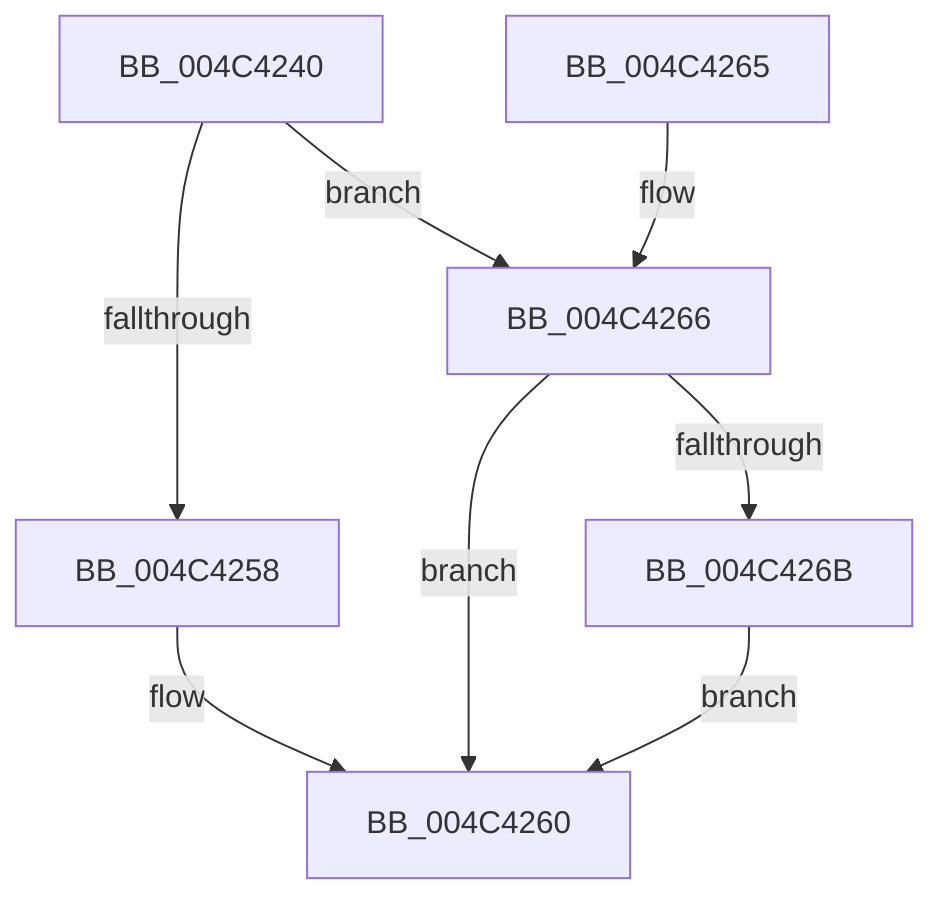

# TlgAggregateInternalFlushTimerCallbackKernelMode

- RVA: `0x004C4240`–`0x004C4277` (길이 `55` bytes)
- VA: `0x00000001404C4240`
- 실행 섹션: `.text`
- PDB 이름 있음: `예`; PDB Function 태그: `아니요`
- unwind 정보 RVA: `0x00063CEC`
- 디코드: `17`개 명령, `55/55` bytes 표시
- 미해석 바이트: `0` (있으면 어셈블리에 `.byte`로 보존)

> 이 문서는 커널 이미지의 기계어와 PDB 기호를 분석해 생성했습니다. 4번과 5번은 함수 원형과 자료형을 바이너리 사용 방식에서 추정한 C 해석이며 원본 소스 복구 결과는 아닙니다.

## 1. Dependencies

- 직접 호출 지점: **2**; 고유 호출 대상: **2**
- 직접 호출자로 확인된 함수: **1**
- RIP 상대 이미지 참조: **0**

### Outgoing calls
- `0x004C425B` → [ExQueueWorkItem](../2F/ExQueueWorkItem_function_002F9520.md) (function, `0x002F9520`)
- `0x004C4270` → [EnableFlushTimer](../45/EnableFlushTimer_function_0045B5B8.md) (function, `0x0045B5B8`)

### Direct callers
- [TlgAggregateFlush](../6A/TlgAggregateFlush_function_006A5DCC.md) at `0x006A5E14`

### Static image references
- 디코드된 RIP-relative 메모리 참조가 없습니다.

## 2. Other-region calls and transfers

- 다른 실행 섹션으로 향하는 call: **0**
- 별도 외부 분기/꼬리 이동을 확인하지 못했습니다.

## 3. Assembly (complete function range)

```asm
004C4240  48 83 EC 28                     sub rsp, 0x28
004C4244  33 C0                           xor eax, eax
004C4246  4C 8B C2                        mov r8, rdx
004C4249  8D 50 01                        lea edx, [rax + 1]
004C424C  66 F0 41 0F B1 50 38            lock cmpxchg word ptr [r8 + 0x38], dx
004C4253  66 85 C0                        test ax, ax
004C4256  75 0E                           jne 0x1404c4266
004C4258  49 8B C8                        mov rcx, r8
004C425B  E8 C0 52 E3 FF                  call 0x1402f9520
004C4260  48 83 C4 28                     add rsp, 0x28
004C4264  C3                              ret
004C4265  CC                              int3
004C4266  66 3B C2                        cmp ax, dx
004C4269  75 F5                           jne 0x1404c4260
004C426B  BA 98 3A 00 00                  mov edx, 0x3a98
004C4270  E8 43 73 F9 FF                  call 0x14045b5b8
004C4275  EB E9                           jmp 0x1404c4260
```

## 4. C-style interpretation (structured pseudocode)

```c
__int64 __fastcall TlgAggregateInternalFlushTimerCallbackKernelMode(__int64 a1, __int64 a2)
{
    __int64 result;
    __int64 v_rsp;

    v_rsp = (v_rsp) - (40);
    result = 0;
    if (0 != 0) goto loc_004C4266;
    result = ExQueueWorkItem(a2, result + 1, a2, a4);
loc_004C4260:
    v_rsp = (v_rsp) + (40);
    return result;
loc_004C4266:
    if (((unsigned __int16)(result)) != ((unsigned __int16)(result + 1))) goto loc_004C4260;
    result = EnableFlushTimer(a2, (unsigned int)(0x3A98ULL), a2, a4);
    goto loc_004C4260;
}
```

## 5. (Beta) C Style

```c
int64_t TlgAggregateInternalFlushTimerCallbackKernelMode(int64_t Arg1, void *Arg2)
{
    uint8_t *arg2 = (uint8_t *)Arg2;

    int64_t result;
    int64_t local_rsp;

    local_rsp = (local_rsp) - (40);
    result = 0;
    if (0 != 0) goto loc_004C4266;
    result = ExQueueWorkItem(Arg2, result + 1, Arg2, a4);
loc_004C4260:
    local_rsp = (local_rsp) + (40);
    return result;
loc_004C4266:
    if (((uint16_t)(result)) != ((uint16_t)(result + 1))) goto loc_004C4260;
    result = EnableFlushTimer(Arg2, (uint32_t)(0x3A98ULL), Arg2, a4);
    goto loc_004C4260;
}
```

### 관측된 메모리 오프셋

구조체 형식이 확인되지 않은 접근은 인자 기준의 오프셋으로만 기록했습니다.

| 기준 인자 | 오프셋 표현 | 폭 (bit) | 접근 |
|---|---:|---:|---|
| `Arg2` | `+ 0x38` | `16` | `R` |

## 6. Execution-region graph

[열기: 2D/3D 그래프와 함수 탐색 컨트롤 패널](../../../control-panel.html?section=text&rva=0x004C4240&view=graph)

- 2D 그래프는 위에서 아래로 흐르고, 3D 그래프는 빈 공간을 드래그해 회전합니다. Shift+드래그는 이동, 휠은 확대·축소, 함수 노드 선택은 대상 보고서 이동입니다.

### Static fallback


