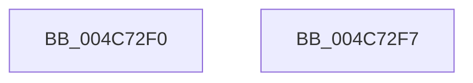

# VfIsVerifierEnabled

- RVA: `0x004C72F0`–`0x004C72F8` (길이 `8` bytes)
- VA: `0x00000001404C72F0`
- 실행 섹션: `.text`
- PDB 이름 있음: `예`; PDB Function 태그: `아니요`
- unwind 정보 RVA: `0x000DB714`
- 디코드: `3`개 명령, `8/8` bytes 표시
- 미해석 바이트: `0` (있으면 어셈블리에 `.byte`로 보존)

> 이 문서는 커널 이미지의 기계어와 PDB 기호를 분석해 생성했습니다. 4번과 5번은 함수 원형과 자료형을 바이너리 사용 방식에서 추정한 C 해석이며 원본 소스 복구 결과는 아닙니다.

## 1. Dependencies

- 직접 호출 지점: **0**; 고유 호출 대상: **0**
- 직접 호출자로 확인된 함수: **12**
- RIP 상대 이미지 참조: **1**

### Outgoing calls
- 직접 디코드된 call 명령이 없습니다.

### Direct callers
- [PipDmgIsDmaVerifierEnabled](../../page/73/PipDmgIsDmaVerifierEnabled_function_00730A84.md) at `0x00730A8D`
- [KsepPatchDriverImportsTable](../../page/74/KsepPatchDriverImportsTable_function_00749F64.md) at `0x0074A052`
- [PopDripsWatchdogTakeAction](../../page/77/PopDripsWatchdogTakeAction_function_007732D0.md) at `0x0077355D`
- [MiIssueDllInitializeCall](../../page/7F/MiIssueDllInitializeCall_function_007F8078.md) at `0x007F80E5`
- [MiUnloadApproved](../../page/7F/MiUnloadApproved_function_007F82A0.md) at `0x007F832E`
- [IopLoadUnloadDriver](../../page/99/IopLoadUnloadDriver_function_00996B80.md) at `0x00996CA0`
- [IoShutdownSystem](../../pagelk/B6/IoShutdownSystem_function_00B63B8C.md) at `0x00B63BB1`
- [PopMarkComponentsBootPhase](../../pagelk/B6/PopMarkComponentsBootPhase_function_00B6E0E4.md) at `0x00B6E20E`
- [PopInvokeSystemStateHandler](../../pagelk/B7/PopInvokeSystemStateHandler_function_00B76A6C.md) at `0x00B76DBB`
- [PopInvokeSystemStateHandler](../../pagelk/B7/PopInvokeSystemStateHandler_function_00B76A6C.md) at `0x00B77038`
- [KdExitDebugger](../../pagekd/B8/KdExitDebugger_function_00B85008.md) at `0x00B85141`
- [KdEnterDebugger](../../pagekd/B8/KdEnterDebugger_function_00B8A96C.md) at `0x00B8A98B`
- [VfDriverUnloadImage](../../pagevrfy/B9/VfDriverUnloadImage_function_00B9A5B0.md) at `0x00B9A5B9`

### Static image references
- `0x004C72F0` → RVA `0x00F04984` (`.data`; read)

## 2. Other-region calls and transfers

- 다른 실행 섹션으로 향하는 call: **0**
- 별도 외부 분기/꼬리 이동을 확인하지 못했습니다.

## 3. Assembly (complete function range)

```asm
004C72F0  8B 05 8E D6 A3 00               mov eax, dword ptr [rip + 0xa3d68e]
004C72F6  C3                              ret
004C72F7  CC                              int3
```

## 4. C-style interpretation (structured pseudocode)

```c
__int64 __fastcall VfIsVerifierEnabled(void)
{
    return (unsigned int)(*(unsigned int *)(v_rip + 10737294));
}
```

## 5. (Beta) C Style

```c
void VfIsVerifierEnabled(void)
{
    return (uint32_t)(*(uint32_t *)(v_rip + 0xA3D68E));
}
```

## 6. Execution-region graph

[열기: 2D/3D 그래프와 함수 탐색 컨트롤 패널](../../../control-panel.html?section=text&rva=0x004C72F0&view=graph)

- 2D 그래프는 위에서 아래로 흐르고, 3D 그래프는 빈 공간을 드래그해 회전합니다. Shift+드래그는 이동, 휠은 확대·축소, 함수 노드 선택은 대상 보고서 이동입니다.

### Static fallback


