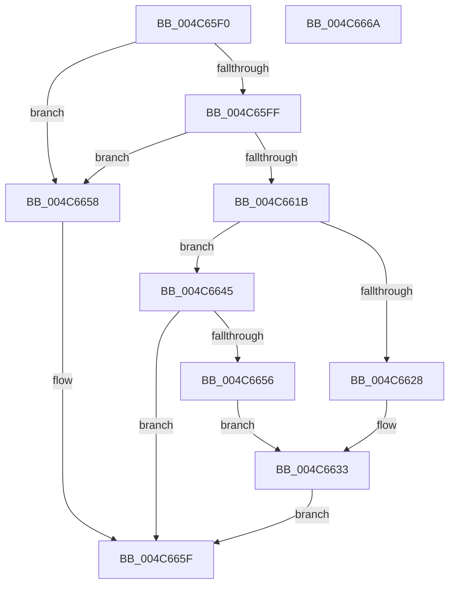

# VfPoolDelayFreeIfPossible

- RVA: `0x004C65F0`–`0x004C666B` (길이 `123` bytes)
- VA: `0x00000001404C65F0`
- 실행 섹션: `.text`
- PDB 이름 있음: `예`; PDB Function 태그: `아니요`
- unwind 정보 RVA: `0x0005CAAC`
- 디코드: `38`개 명령, `123/123` bytes 표시
- 미해석 바이트: `0` (있으면 어셈블리에 `.byte`로 보존)

> 이 문서는 커널 이미지의 기계어와 PDB 기호를 분석해 생성했습니다. 4번과 5번은 함수 원형과 자료형을 바이너리 사용 방식에서 추정한 C 해석이며 원본 소스 복구 결과는 아닙니다.

## 1. Dependencies

- 직접 호출 지점: **4**; 고유 호출 대상: **3**
- 직접 호출자로 확인된 함수: **2**
- RIP 상대 이미지 참조: **1**

### Outgoing calls
- `0x004C662E` → [ExFreePoolWithTag](../../poolcode/B8/ExFreePoolWithTag_function_00B82870.md) (function, `0x00B82870`)
- `0x004C663E` → [KeSetEvent](../33/KeSetEvent_function_0033F310.md) (function, `0x0033F310`)
- `0x004C664B` → [ExpInterlockedPushEntrySList](../6B/ExpInterlockedPushEntrySList_function_006BA5B0.md) (function, `0x006BA5B0`)
- `0x004C665A` → [ExFreePoolWithTag](../../poolcode/B8/ExFreePoolWithTag_function_00B82870.md) (function, `0x00B82870`)

### Direct callers
- [VfUtilFreePoolCheckIRQL](VfUtilFreePoolCheckIRQL_function_004C65D0.md) at `0x004C65DF`
- [VfUtilFreePoolDispatchLevel](../61/VfUtilFreePoolDispatchLevel_function_00612300.md) at `0x00612306`

### Static image references
- `0x004C6602` → RVA `0x00E28950` (`.data`; read)

## 2. Other-region calls and transfers

- 다른 실행 섹션으로 향하는 call: **2**
  - `0x004C662E` → [ExFreePoolWithTag](../../poolcode/B8/ExFreePoolWithTag_function_00B82870.md) (`.text` → `POOLCODE`)
  - `0x004C665A` → [ExFreePoolWithTag](../../poolcode/B8/ExFreePoolWithTag_function_00B82870.md) (`.text` → `POOLCODE`)
- 별도 외부 분기/꼬리 이동을 확인하지 못했습니다.

## 3. Assembly (complete function range)

```asm
004C65F0  48 89 5C 24 08                  mov qword ptr [rsp + 8], rbx
004C65F5  57                              push rdi
004C65F6  48 83 EC 20                     sub rsp, 0x20
004C65FA  83 FA 01                        cmp edx, 1
004C65FD  77 59                           ja 0x1404c6658
004C65FF  48 63 DA                        movsxd rbx, edx
004C6602  48 8D 05 47 23 96 00            lea rax, [rip + 0x962347]
004C6609  48 C1 E3 06                     shl rbx, 6
004C660D  48 03 D8                        add rbx, rax
004C6610  F0 FF 43 34                     lock inc dword ptr [rbx + 0x34]
004C6614  8B 43 30                        mov eax, dword ptr [rbx + 0x30]
004C6617  85 C0                           test eax, eax
004C6619  74 3D                           je 0x1404c6658
004C661B  0F B7 3B                        movzx edi, word ptr [rbx]
004C661E  B8 00 02 00 00                  mov eax, 0x200
004C6623  66 3B F8                        cmp di, ax
004C6626  72 1D                           jb 0x1404c6645
004C6628  F0 FF 43 38                     lock inc dword ptr [rbx + 0x38]
004C662C  33 D2                           xor edx, edx
004C662E  E8 3D C2 6B 00                  call 0x140b82870
004C6633  45 33 C0                        xor r8d, r8d
004C6636  48 8D 4B 10                     lea rcx, [rbx + 0x10]
004C663A  41 8D 50 01                     lea edx, [r8 + 1]
004C663E  E8 CD 8C E7 FF                  call 0x14033f310
004C6643  EB 1A                           jmp 0x1404c665f
004C6645  48 8B D1                        mov rdx, rcx
004C6648  48 8B CB                        mov rcx, rbx
004C664B  E8 60 3F 1F 00                  call 0x1406ba5b0
004C6650  66 83 FF 40                     cmp di, 0x40
004C6654  72 09                           jb 0x1404c665f
004C6656  EB DB                           jmp 0x1404c6633
004C6658  33 D2                           xor edx, edx
004C665A  E8 11 C2 6B 00                  call 0x140b82870
004C665F  48 8B 5C 24 30                  mov rbx, qword ptr [rsp + 0x30]
004C6664  48 83 C4 20                     add rsp, 0x20
004C6668  5F                              pop rdi
004C6669  C3                              ret
004C666A  CC                              int3
```

## 4. C-style interpretation (structured pseudocode)

```c
__int64 __fastcall VfPoolDelayFreeIfPossible(__int64 a1, int a2, int a3)
{
    __int64 result;
    __int64 v_rbx;
    __int64 v_rsp;
    unsigned __int64 v_stack_p8;

    v_stack_p8 = v_rbx;
    v_rsp = (v_rsp) - (32);
    if (a2 > 1) goto loc_004C6658;
    v_rbx = ((int)(a2)) << (6);
    v_rbx = (v_rbx) + (v_rip + 9839431);
    if ((unsigned int)((unsigned int)(*(unsigned int *)(v_rbx + 48))) == 0) goto loc_004C6658;
    if (((unsigned __int16)(*(unsigned __int16 *)(v_rbx))) < 512) goto loc_004C6645;
    a2 = 0;
    result = ExFreePoolWithTag(a1, a2, a3, a4);
loc_004C6633:
    a3 = 0;
    result = KeSetEvent(v_rbx + 16, a3 + 1, a3, a4);
    goto loc_004C665F;
loc_004C6645:
    result = ExpInterlockedPushEntrySList(v_rbx, v_rbx + 16, a3, a4);
    if (((unsigned __int16)(*(unsigned __int16 *)(v_rbx))) < 64) goto loc_004C665F;
    goto loc_004C6633;
loc_004C6658:
    a2 = 0;
    result = ExFreePoolWithTag(v_rbx, a2, a3, a4);
loc_004C665F:
    v_rsp = (v_rsp) + (32);
    return result;
}
```

## 5. (Beta) C Style

```c
int64_t VfPoolDelayFreeIfPossible(int64_t Arg1, int32_t Arg2, int32_t Arg3)
{
    int64_t result;
    int64_t local_rbx;
    int64_t local_rsp;
    uint64_t v_stack_p8;

    v_stack_p8 = local_rbx;
    local_rsp = (local_rsp) - (32);
    if (Arg2 > 1) goto loc_004C6658;
    local_rbx = ((int32_t)(Arg2)) << (6);
    local_rbx = (local_rbx) + (v_rip + 9839431);
    if ((uint32_t)((uint32_t)(*(uint32_t *)(local_rbx + 0x30))) == 0) goto loc_004C6658;
    if (((uint16_t)(*(uint16_t *)(local_rbx))) < 512) goto loc_004C6645;
    Arg2 = 0;
    result = ExFreePoolWithTag(Arg1, Arg2, Arg3, a4);
loc_004C6633:
    Arg3 = 0;
    result = KeSetEvent(local_rbx + 16, Arg3 + 1, Arg3, a4);
    goto loc_004C665F;
loc_004C6645:
    result = ExpInterlockedPushEntrySList(local_rbx, local_rbx + 16, Arg3, a4);
    if (((uint16_t)(*(uint16_t *)(local_rbx))) < 64) goto loc_004C665F;
    goto loc_004C6633;
loc_004C6658:
    Arg2 = 0;
    result = ExFreePoolWithTag(local_rbx, Arg2, Arg3, a4);
loc_004C665F:
    local_rsp = (local_rsp) + (32);
    return result;
}
```

## 6. Execution-region graph

[열기: 2D/3D 그래프와 함수 탐색 컨트롤 패널](../../../control-panel.html?section=text&rva=0x004C65F0&view=graph)

- 2D 그래프는 위에서 아래로 흐르고, 3D 그래프는 빈 공간을 드래그해 회전합니다. Shift+드래그는 이동, 휠은 확대·축소, 함수 노드 선택은 대상 보고서 이동입니다.

### Static fallback


