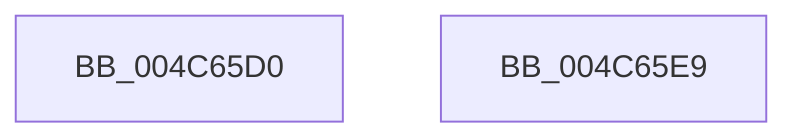

# VfUtilFreePoolCheckIRQL

- RVA: `0x004C65D0`–`0x004C65EA` (길이 `26` bytes)
- VA: `0x00000001404C65D0`
- 실행 섹션: `.text`
- PDB 이름 있음: `예`; PDB Function 태그: `아니요`
- unwind 정보 RVA: `0x0005C788`
- 디코드: `9`개 명령, `26/26` bytes 표시
- 미해석 바이트: `0` (있으면 어셈블리에 `.byte`로 보존)

> 이 문서는 커널 이미지의 기계어와 PDB 기호를 분석해 생성했습니다. 4번과 5번은 함수 원형과 자료형을 바이너리 사용 방식에서 추정한 C 해석이며 원본 소스 복구 결과는 아닙니다.

## 1. Dependencies

- 직접 호출 지점: **1**; 고유 호출 대상: **1**
- 직접 호출자로 확인된 함수: **3**
- RIP 상대 이미지 참조: **0**

### Outgoing calls
- `0x004C65DF` → [VfPoolDelayFreeIfPossible](VfPoolDelayFreeIfPossible_function_004C65F0.md) (function, `0x004C65F0`)

### Direct callers
- [VfAvlFreeNodeNoLock](../61/VfAvlFreeNodeNoLock_function_006126D8.md) at `0x006126F3`
- [ViFreeMapRegisterFile](../../pagevrfy/B9/ViFreeMapRegisterFile_function_00B98B8C.md) at `0x00B98CB8`
- [ViFreeMapRegisterFile](../../pagevrfy/B9/ViFreeMapRegisterFile_function_00B98B8C.md) at `0x00B98CCE`
- [ViSpIoSetCompletionRoutineEx_Exit](../../pagevrfy/BB/ViSpIoSetCompletionRoutineEx_Exit_function_00BB4A00.md) at `0x00BB4A6E`

### Static image references
- 디코드된 RIP-relative 메모리 참조가 없습니다.

## 2. Other-region calls and transfers

- 다른 실행 섹션으로 향하는 call: **0**
- 별도 외부 분기/꼬리 이동을 확인하지 못했습니다.

## 3. Assembly (complete function range)

```asm
004C65D0  48 83 EC 28                     sub rsp, 0x28
004C65D4  44 0F 20 C0                     mov rax, cr8
004C65D8  33 D2                           xor edx, edx
004C65DA  3C 02                           cmp al, 2
004C65DC  0F 95 C2                        setne dl
004C65DF  E8 0C 00 00 00                  call 0x1404c65f0
004C65E4  48 83 C4 28                     add rsp, 0x28
004C65E8  C3                              ret
004C65E9  CC                              int3
```

## 4. C-style interpretation (structured pseudocode)

```c
__int64 __fastcall VfUtilFreePoolCheckIRQL(__int64 a1, int a2)
{
    __int64 result;
    __int64 v_rsp;

    v_rsp = (v_rsp) - (40);
    a2 = 0;
    a2 = (((unsigned __int8)(v_cr8)) != 2) ? 1 : 0;
    result = VfPoolDelayFreeIfPossible(a1, a2, a3, a4);
    v_rsp = (v_rsp) + (40);
    return result;
}
```

## 5. (Beta) C Style

```c
int64_t VfUtilFreePoolCheckIRQL(int64_t Arg1, int32_t Arg2)
{
    int64_t result;
    int64_t local_rsp;

    local_rsp = (local_rsp) - (40);
    Arg2 = 0;
    Arg2 = (((uint8_t)(v_cr8)) != 2) ? 1 : 0;
    result = VfPoolDelayFreeIfPossible(Arg1, Arg2, a3, a4);
    local_rsp = (local_rsp) + (40);
    return result;
}
```

## 6. Execution-region graph

[열기: 2D/3D 그래프와 함수 탐색 컨트롤 패널](../../../control-panel.html?section=text&rva=0x004C65D0&view=graph)

- 2D 그래프는 위에서 아래로 흐르고, 3D 그래프는 빈 공간을 드래그해 회전합니다. Shift+드래그는 이동, 휠은 확대·축소, 함수 노드 선택은 대상 보고서 이동입니다.

### Static fallback


