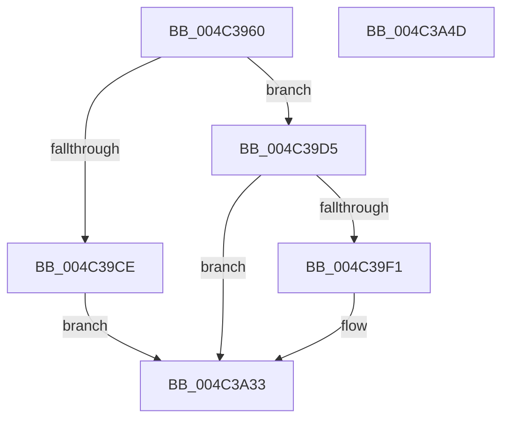

# VslTransferSecureImageVersionResource

- RVA: `0x004C3960`–`0x004C3A4E` (길이 `238` bytes)
- VA: `0x00000001404C3960`
- 실행 섹션: `.text`
- PDB 이름 있음: `예`; PDB Function 태그: `아니요`
- unwind 정보 RVA: `0x000BCC04`
- 디코드: `67`개 명령, `238/238` bytes 표시
- 미해석 바이트: `0` (있으면 어셈블리에 `.byte`로 보존)

> 이 문서는 커널 이미지의 기계어와 PDB 기호를 분석해 생성했습니다. 4번과 5번은 함수 원형과 자료형을 바이너리 사용 방식에서 추정한 C 해석이며 원본 소스 복구 결과는 아닙니다.

## 1. Dependencies

- 직접 호출 지점: **6**; 고유 호출 대상: **5**
- 직접 호출자로 확인된 함수: **0**
- RIP 상대 이미지 참조: **1**

### Outgoing calls
- `0x004C3997` → [memset](../6C/memset_function_006C6C40.md) (function, `0x006C6C40`)
- `0x004C39A7` → [memset](../6C/memset_function_006C6C40.md) (function, `0x006C6C40`)
- `0x004C39E8` → [VslpLockPagesForTransfer](../29/VslpLockPagesForTransfer_function_0029E0FC.md) (function, `0x0029E0FC`)
- `0x004C3A20` → [VslpEnterIumSecureMode](../23/VslpEnterIumSecureMode_function_00235E50.md) (function, `0x00235E50`)
- `0x004C3A2C` → [VslpUnlockPagesForTransfer](../29/VslpUnlockPagesForTransfer_function_0029EE4C.md) (function, `0x0029EE4C`)
- `0x004C3A3A` → [_security_check_cookie](../6A/_security_check_cookie_function_006AC640.md) (function, `0x006AC640`)

### Direct callers
- 이 함수 시작 RVA로 연결되는 직접 call은 확인되지 않았습니다. 간접 호출은 완전히 역산할 수 없습니다.

### Static image references
- `0x004C3973` → RVA `0x00E0A740` (`.data`; read)

## 2. Other-region calls and transfers

- 다른 실행 섹션으로 향하는 call: **0**
- 별도 외부 분기/꼬리 이동을 확인하지 못했습니다.

## 3. Assembly (complete function range)

```asm
004C3960  40 55                           push rbp
004C3962  53                              push rbx
004C3963  56                              push rsi
004C3964  57                              push rdi
004C3965  41 56                           push r14
004C3967  48 8D 6C 24 D1                  lea rbp, [rsp - 0x2f]
004C396C  48 81 EC 00 01 00 00            sub rsp, 0x100
004C3973  48 8B 05 C6 6D 94 00            mov rax, qword ptr [rip + 0x946dc6]
004C397A  48 33 C4                        xor rax, rsp
004C397D  48 89 45 1F                     mov qword ptr [rbp + 0x1f], rax
004C3981  44 8B F2                        mov r14d, edx
004C3984  49 8B D8                        mov rbx, r8
004C3987  33 D2                           xor edx, edx
004C3989  48 8B F1                        mov rsi, rcx
004C398C  48 8D 4D AF                     lea rcx, [rbp - 0x51]
004C3990  49 8B F9                        mov rdi, r9
004C3993  44 8D 42 68                     lea r8d, [rdx + 0x68]
004C3997  E8 A4 32 20 00                  call 0x1406c6c40
004C399C  33 D2                           xor edx, edx
004C399E  48 8D 4C 24 30                  lea rcx, [rsp + 0x30]
004C39A3  44 8D 42 48                     lea r8d, [rdx + 0x48]
004C39A7  E8 94 32 20 00                  call 0x1406c6c40
004C39AC  48 8B C3                        mov rax, rbx
004C39AF  48 8D 8F FF 0F 00 00            lea rcx, [rdi + 0xfff]
004C39B6  25 FF 0F 00 00                  and eax, 0xfff
004C39BB  48 03 C8                        add rcx, rax
004C39BE  48 81 E1 00 F0 FF FF            and rcx, 0xfffffffffffff000
004C39C5  48 81 F9 00 A0 1F 00            cmp rcx, 0x1fa000
004C39CC  76 07                           jbe 0x1404c39d5
004C39CE  B8 0D 00 00 C0                  mov eax, 0xc000000d
004C39D3  EB 5E                           jmp 0x1404c3a33
004C39D5  83 64 24 20 00                  and dword ptr [rsp + 0x20], 0
004C39DA  48 8D 4C 24 30                  lea rcx, [rsp + 0x30]
004C39DF  45 33 C9                        xor r9d, r9d
004C39E2  44 8B C7                        mov r8d, edi
004C39E5  48 8B D3                        mov rdx, rbx
004C39E8  E8 0F A7 DD FF                  call 0x14029e0fc
004C39ED  85 C0                           test eax, eax
004C39EF  78 42                           js 0x1404c3a33
004C39F1  48 8B 44 24 30                  mov rax, qword ptr [rsp + 0x30]
004C39F6  4C 8D 4D AF                     lea r9, [rbp - 0x51]
004C39FA  48 89 45 C7                     mov qword ptr [rbp - 0x39], rax
004C39FE  BA 21 00 00 00                  mov edx, 0x21
004C3A03  48 8B 45 97                     mov rax, qword ptr [rbp - 0x69]
004C3A07  45 33 C0                        xor r8d, r8d
004C3A0A  48 89 45 CF                     mov qword ptr [rbp - 0x31], rax
004C3A0E  B1 02                           mov cl, 2
004C3A10  48 8B 45 7F                     mov rax, qword ptr [rbp + 0x7f]
004C3A14  48 89 45 D7                     mov qword ptr [rbp - 0x29], rax
004C3A18  48 89 75 B7                     mov qword ptr [rbp - 0x49], rsi
004C3A1C  44 89 75 BF                     mov dword ptr [rbp - 0x41], r14d
004C3A20  E8 2B 24 D7 FF                  call 0x140235e50
004C3A25  48 8D 4C 24 30                  lea rcx, [rsp + 0x30]
004C3A2A  8B D8                           mov ebx, eax
004C3A2C  E8 1B B4 DD FF                  call 0x14029ee4c
004C3A31  8B C3                           mov eax, ebx
004C3A33  48 8B 4D 1F                     mov rcx, qword ptr [rbp + 0x1f]
004C3A37  48 33 CC                        xor rcx, rsp
004C3A3A  E8 01 8C 1E 00                  call 0x1406ac640
004C3A3F  48 81 C4 00 01 00 00            add rsp, 0x100
004C3A46  41 5E                           pop r14
004C3A48  5F                              pop rdi
004C3A49  5E                              pop rsi
004C3A4A  5B                              pop rbx
004C3A4B  5D                              pop rbp
004C3A4C  C3                              ret
004C3A4D  CC                              int3
```

## 4. C-style interpretation (structured pseudocode)

```c
__int64 __fastcall VslTransferSecureImageVersionResource(__int64 a1, int a2, __int64 a3, __int64 a4, __int64 a5)
{
    __int64 result;
    __int64 v_rbx;
    __int64 v_rsp;
    unsigned int v_stack_m108;
    unsigned __int64 v_stack_m38;
    unsigned __int64 v_stack_m57;
    unsigned __int64 v_stack_m80;
    unsigned __int64 v_stack_m88;
    unsigned __int64 v_stack_m90;
    unsigned int v_stack_m98;
    unsigned __int64 v_stack_mA0;
    unsigned __int64 v_stack_mA8;
    unsigned __int64 v_stack_mC0;
    unsigned __int64 v_stack_mF8;

    v_rsp = (v_rsp) - (256);
    result = (*(unsigned __int64 *)(v_rip + 9727430)) ^ (v_rsp);
    v_stack_m38 = result;
    a2 = 0;
    result = memset(v_stack_mA8, a2, a2 + 104, a4);
    a2 = 0;
    result = memset(v_stack_mF8, a2, a2 + 72, a4);
    result = (unsigned int)((a3) & (0xFFFULL));
    a1 = (a4 + 4095) + (result);
    a1 = (a1) & (0xFFFFFFFFFFFFF000ULL);
    if (a1 <= 0x1FA000ULL) goto loc_004C39D5;
    goto loc_004C3A33;
loc_004C39D5:
    a4 = 0;
    result = VslpLockPagesForTransfer(v_stack_mF8, a3, 0, a4);
    v_rbx = a3;
    if (!(sign_flag)) {
        result = v_stack_mF8;
        a4 = v_stack_mA8;
        v_stack_m90 = result;
        a2 = 33;
        result = v_stack_mC0;
        a3 = 0;
        v_stack_m88 = result;
        a1 = 2;
        result = a5;
        v_stack_m80 = result;
        v_stack_mA0 = a1;
        v_stack_m98 = (unsigned int)((unsigned int)(a2));
        result = VslpEnterIumSecureMode(a1, a2, a3, a4);
        a1 = v_stack_mF8;
        v_rbx = (unsigned int)(result);
        result = VslpUnlockPagesForTransfer(a1, a2, a3, a4);
        result = (unsigned int)(v_rbx);
    }
    a1 = (v_stack_m38) ^ (v_rsp);
    result = _security_check_cookie(a1, a2, a3, a4);
    v_rsp = (v_rsp) + (256);
    return result;
}
```

## 5. (Beta) C Style

```c
int64_t VslTransferSecureImageVersionResource(int64_t Arg1, int32_t Arg2, int64_t Arg3, void *Arg4, int64_t Arg5)
{
    uint8_t *arg4 = (uint8_t *)Arg4;

    int64_t result;
    int64_t local_rbx;
    int64_t local_rsp;
    uint32_t v_stack_m108;
    uint64_t v_stack_m38;
    uint64_t v_stack_m57;
    uint64_t v_stack_m80;
    uint64_t v_stack_m88;
    uint64_t v_stack_m90;
    uint32_t v_stack_m98;
    uint64_t v_stack_mA0;
    uint64_t v_stack_mA8;
    uint64_t v_stack_mC0;
    uint64_t v_stack_mF8;

    local_rsp = (local_rsp) - (256);
    result = (*(uint64_t *)(v_rip + 0x946DC6)) ^ (local_rsp);
    v_stack_m38 = result;
    Arg2 = 0;
    result = memset(v_stack_mA8, Arg2, Arg2 + 104, Arg4);
    Arg2 = 0;
    result = memset(v_stack_mF8, Arg2, Arg2 + 72, Arg4);
    result = (uint32_t)((Arg3) & (0xFFFULL));
    Arg1 = (Arg4 + 4095) + (result);
    Arg1 = (Arg1) & (0xFFFFFFFFFFFFF000ULL);
    if (Arg1 <= 0x1FA000ULL) goto loc_004C39D5;
    goto loc_004C3A33;
loc_004C39D5:
    Arg4 = 0;
    result = VslpLockPagesForTransfer(v_stack_mF8, Arg3, 0, Arg4);
    local_rbx = Arg3;
    if (!(sign_flag)) {
        result = v_stack_mF8;
        Arg4 = v_stack_mA8;
        v_stack_m90 = result;
        Arg2 = 33;
        result = v_stack_mC0;
        Arg3 = 0;
        v_stack_m88 = result;
        Arg1 = 2;
        result = Arg5;
        v_stack_m80 = result;
        v_stack_mA0 = Arg1;
        v_stack_m98 = (uint32_t)((uint32_t)(Arg2));
        result = VslpEnterIumSecureMode(Arg1, Arg2, Arg3, Arg4);
        Arg1 = v_stack_mF8;
        local_rbx = (uint32_t)(result);
        result = VslpUnlockPagesForTransfer(Arg1, Arg2, Arg3, Arg4);
        result = (uint32_t)(local_rbx);
    }
    Arg1 = (v_stack_m38) ^ (local_rsp);
    result = _security_check_cookie(Arg1, Arg2, Arg3, Arg4);
    local_rsp = (local_rsp) + (256);
    return result;
}
```

### 관측된 메모리 오프셋

구조체 형식이 확인되지 않은 접근은 인자 기준의 오프셋으로만 기록했습니다.

| 기준 인자 | 오프셋 표현 | 폭 (bit) | 접근 |
|---|---:|---:|---|
| `Arg4` | `+ 0xFFF` | `64` | `R` |

## 6. Execution-region graph

[열기: 2D/3D 그래프와 함수 탐색 컨트롤 패널](../../../control-panel.html?section=text&rva=0x004C3960&view=graph)

- 2D 그래프는 위에서 아래로 흐르고, 3D 그래프는 빈 공간을 드래그해 회전합니다. Shift+드래그는 이동, 휠은 확대·축소, 함수 노드 선택은 대상 보고서 이동입니다.

### Static fallback


