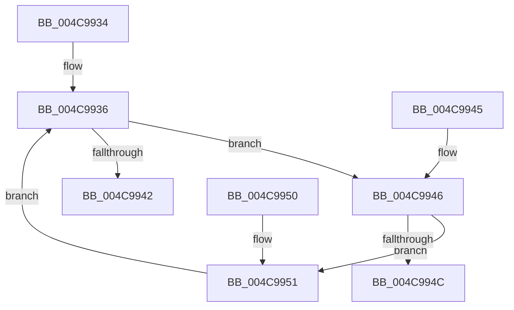

# wil_details_FeatureDescriptors_SkipPadding

- RVA: `0x004C9934`–`0x004C9957` (길이 `35` bytes)
- VA: `0x00000001404C9934`
- 실행 섹션: `.text`
- PDB 이름 있음: `예`; PDB Function 태그: `아니요`
- unwind 정보 RVA: `0x000DB714`
- 디코드: `14`개 명령, `35/35` bytes 표시
- 미해석 바이트: `0` (있으면 어셈블리에 `.byte`로 보존)

> 이 문서는 커널 이미지의 기계어와 PDB 기호를 분석해 생성했습니다. 4번과 5번은 함수 원형과 자료형을 바이너리 사용 방식에서 추정한 C 해석이며 원본 소스 복구 결과는 아닙니다.

## 1. Dependencies

- 직접 호출 지점: **0**; 고유 호출 대상: **0**
- 직접 호출자로 확인된 함수: **7**
- RIP 상대 이미지 참조: **1**

### Outgoing calls
- 직접 디코드된 call 명령이 없습니다.

### Direct callers
- [wil_details_EvaluateFeatureDependencies](../../page/70/wil_details_EvaluateFeatureDependencies_function_0070282C.md) at `0x0070283F`
- [wil_details_EvaluateFeatureDependencies](../../page/70/wil_details_EvaluateFeatureDependencies_function_0070282C.md) at `0x007028A2`
- [wil_details_EvaluateFeatureDependencies](../../page/70/wil_details_EvaluateFeatureDependencies_function_0070282C.md) at `0x007028C7`
- [wil_details_OnFeatureUsageProviderFlushNotification](../../page/7E/wil_details_OnFeatureUsageProviderFlushNotification_function_007E5FD0.md) at `0x007E600A`
- [wil_details_RegisterFeatureUsageProvider](../../page/7E/wil_details_RegisterFeatureUsageProvider_function_007E6080.md) at `0x007E609E`
- [wil_details_ShouldRegisterFeatureStagingChangeNotification](../../page/7E/wil_details_ShouldRegisterFeatureStagingChangeNotification_function_007E60F4.md) at `0x007E60FF`
- [wil_details_ShouldRegisterFeatureStagingChangeNotification](../../page/7E/wil_details_ShouldRegisterFeatureStagingChangeNotification_function_007E60F4.md) at `0x007E611E`
- [wil_details_UpdateFeatureConfiguredStates](../../page/AB/wil_details_UpdateFeatureConfiguredStates_function_00ABD258.md) at `0x00ABD31B`
- [wil_details_PopulateInitialConfiguredFeatureStatesFromBuffers](../../init/C5/wil_details_PopulateInitialConfiguredFeatureStatesFromBuffers_function_00C5ADC8.md) at `0x00C5ADEB`
- [wil_details_PopulateInitialConfiguredFeatureStatesWithDefaults](../../init/C5/wil_details_PopulateInitialConfiguredFeatureStatesWithDefaults_function_00C5AE88.md) at `0x00C5AEAE`

### Static image references
- `0x004C9936` → RVA `0x000E0998` (`.rdata`; read)

## 2. Other-region calls and transfers

- 다른 실행 섹션으로 향하는 call: **0**
- 별도 외부 분기/꼬리 이동을 확인하지 못했습니다.

## 3. Assembly (complete function range)

```asm
004C9934  66 90                           nop
004C9936  48 8D 05 5B 70 C1 FF            lea rax, [rip - 0x3e8fa5]
004C993D  48 3B C8                        cmp rcx, rax
004C9940  72 04                           jb 0x1404c9946
004C9942  33 C0                           xor eax, eax
004C9944  C3                              ret
004C9945  CC                              int3
004C9946  48 83 39 00                     cmp qword ptr [rcx], 0
004C994A  74 05                           je 0x1404c9951
004C994C  48 8B C1                        mov rax, rcx
004C994F  C3                              ret
004C9950  CC                              int3
004C9951  48 83 C1 08                     add rcx, 8
004C9955  EB DF                           jmp 0x1404c9936
```

## 4. C-style interpretation (structured pseudocode)

```c
__int64 __fastcall wil_details_FeatureDescriptors_SkipPadding(__int64 a1)
{
    __int64 result;

loc_004C9936:
    if (a1 < (v_rip - 4100005)) goto loc_004C9946;
    result = 0;
    return result;
loc_004C9946:
    if ((*(unsigned __int64 *)(a1)) == 0) goto loc_004C9951;
    return a1;
loc_004C9951:
    a1 = (a1) + (8);
    goto loc_004C9936;
}
```

## 5. (Beta) C Style

```c
int64_t wil_details_FeatureDescriptors_SkipPadding(int64_t Arg1)
{
    int64_t result;

loc_004C9936:
    if (Arg1 < (v_rip - 4100005)) goto loc_004C9946;
    result = 0;
    return result;
loc_004C9946:
    if ((*(uint64_t *)(Arg1)) == 0) goto loc_004C9951;
    return Arg1;
loc_004C9951:
    Arg1 = (Arg1) + (8);
    goto loc_004C9936;
}
```

## 6. Execution-region graph

[열기: 2D/3D 그래프와 함수 탐색 컨트롤 패널](../../../control-panel.html?section=text&rva=0x004C9934&view=graph)

- 2D 그래프는 위에서 아래로 흐르고, 3D 그래프는 빈 공간을 드래그해 회전합니다. Shift+드래그는 이동, 휠은 확대·축소, 함수 노드 선택은 대상 보고서 이동입니다.

### Static fallback


