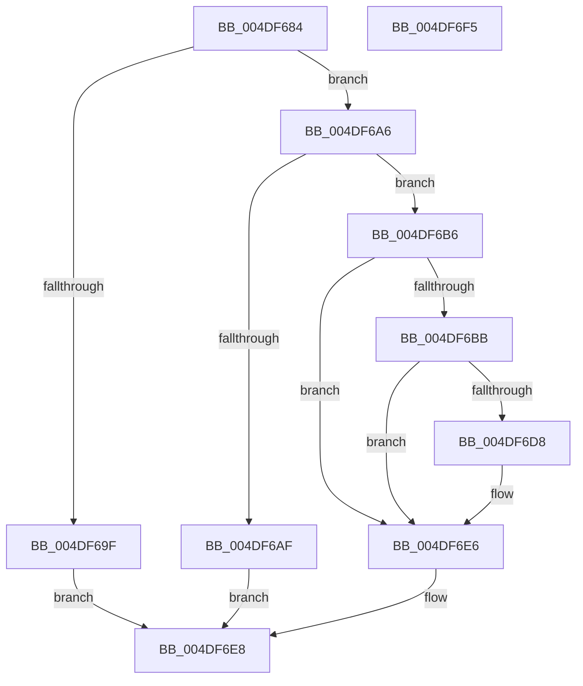

# AdtpIsSDValidSelfRelative

- RVA: `0x004DF684`–`0x004DF6F6` (길이 `114` bytes)
- VA: `0x00000001404DF684`
- 실행 섹션: `.text`
- PDB 이름 있음: `예`; PDB Function 태그: `아니요`
- unwind 정보 RVA: `0x000BEE74`
- 디코드: `40`개 명령, `114/114` bytes 표시
- 미해석 바이트: `0` (있으면 어셈블리에 `.byte`로 보존)

> 이 문서는 커널 이미지의 기계어와 PDB 기호를 분석해 생성했습니다. 4번과 5번은 함수 원형과 자료형을 바이너리 사용 방식에서 추정한 C 해석이며 원본 소스 복구 결과는 아닙니다.

## 1. Dependencies

- 직접 호출 지점: **2**; 고유 호출 대상: **2**
- 직접 호출자로 확인된 함수: **1**
- RIP 상대 이미지 참조: **0**

### Outgoing calls
- `0x004DF6A6` → [RtlValidSecurityDescriptor](../../page/8B/RtlValidSecurityDescriptor_function_008BD3F0.md) (function, `0x008BD3F0`)
- `0x004DF6CD` → [RtlGetControlSecurityDescriptor](../../page/A6/RtlGetControlSecurityDescriptor_function_00A65810.md) (function, `0x00A65810`)

### Direct callers
- [AdtpBuildAccessReasonAuditString](../40/AdtpBuildAccessReasonAuditString_function_0040EE04.md) at `0x0040EF38`
- [AdtpBuildAccessReasonAuditString](../40/AdtpBuildAccessReasonAuditString_function_0040EE04.md) at `0x0040EF73`
- [AdtpBuildAccessReasonAuditString](../40/AdtpBuildAccessReasonAuditString_function_0040EE04.md) at `0x0040EF90`

### Static image references
- 디코드된 RIP-relative 메모리 참조가 없습니다.

## 2. Other-region calls and transfers

- 다른 실행 섹션으로 향하는 call: **2**
  - `0x004DF6A6` → [RtlValidSecurityDescriptor](../../page/8B/RtlValidSecurityDescriptor_function_008BD3F0.md) (`.text` → `PAGE`)
  - `0x004DF6CD` → [RtlGetControlSecurityDescriptor](../../page/A6/RtlGetControlSecurityDescriptor_function_00A65810.md) (`.text` → `PAGE`)
- 별도 외부 분기/꼬리 이동을 확인하지 못했습니다.

## 3. Assembly (complete function range)

```asm
004DF684  48 89 5C 24 10                  mov qword ptr [rsp + 0x10], rbx
004DF689  55                              push rbp
004DF68A  56                              push rsi
004DF68B  57                              push rdi
004DF68C  48 83 EC 20                     sub rsp, 0x20
004DF690  33 ED                           xor ebp, ebp
004DF692  48 8B F2                        mov rsi, rdx
004DF695  48 8B F9                        mov rdi, rcx
004DF698  8B DD                           mov ebx, ebp
004DF69A  48 85 C9                        test rcx, rcx
004DF69D  75 07                           jne 0x1404df6a6
004DF69F  B8 0D 00 00 C0                  mov eax, 0xc000000d
004DF6A4  EB 42                           jmp 0x1404df6e8
004DF6A6  E8 45 DD 3D 00                  call 0x1408bd3f0
004DF6AB  84 C0                           test al, al
004DF6AD  75 07                           jne 0x1404df6b6
004DF6AF  B8 79 00 00 C0                  mov eax, 0xc0000079
004DF6B4  EB 32                           jmp 0x1404df6e8
004DF6B6  48 85 F6                        test rsi, rsi
004DF6B9  74 2B                           je 0x1404df6e6
004DF6BB  4C 8D 44 24 50                  lea r8, [rsp + 0x50]
004DF6C0  66 89 6C 24 40                  mov word ptr [rsp + 0x40], bp
004DF6C5  48 8D 54 24 40                  lea rdx, [rsp + 0x40]
004DF6CA  48 8B CF                        mov rcx, rdi
004DF6CD  E8 3E 61 58 00                  call 0x140a65810
004DF6D2  8B D8                           mov ebx, eax
004DF6D4  85 C0                           test eax, eax
004DF6D6  78 0E                           js 0x1404df6e6
004DF6D8  0F B7 4C 24 40                  movzx ecx, word ptr [rsp + 0x40]
004DF6DD  66 C1 E9 0F                     shr cx, 0xf
004DF6E1  80 E1 01                        and cl, 1
004DF6E4  88 0E                           mov byte ptr [rsi], cl
004DF6E6  8B C3                           mov eax, ebx
004DF6E8  48 8B 5C 24 48                  mov rbx, qword ptr [rsp + 0x48]
004DF6ED  48 83 C4 20                     add rsp, 0x20
004DF6F1  5F                              pop rdi
004DF6F2  5E                              pop rsi
004DF6F3  5D                              pop rbp
004DF6F4  C3                              ret
004DF6F5  CC                              int3
```

## 4. C-style interpretation (structured pseudocode)

```c
__int64 __fastcall AdtpIsSDValidSelfRelative(__int64 a1, __int64 a2)
{
    __int64 result;
    __int64 v_rbp;
    __int64 v_rsp;
    unsigned __int64 v_stack_p10;
    unsigned __int64 v_stack_p18;
    unsigned __int16 v_stack_p8;

    v_stack_p10 = v_rbx;
    v_rsp = (v_rsp) - (32);
    v_rbp = 0;
    if (a1 != 0) goto loc_004DF6A6;
    goto loc_004DF6E8;
loc_004DF6A6:
    result = RtlValidSecurityDescriptor(a1, a2, a3, a4);
    if ((unsigned __int8)(result) != 0) goto loc_004DF6B6;
    goto loc_004DF6E8;
loc_004DF6B6:
    if (a2 == 0) goto loc_004DF6E6;
    v_stack_p8 = 0;
    result = RtlGetControlSecurityDescriptor(a1, v_stack_p8, v_stack_p18, a4);
    if (!(sign_flag)) {
        a1 = v_stack_p8;
        a1 = (unsigned __int16)((a1) >> (15));
        a1 = (unsigned __int8)((a1) & (1));
        *(unsigned __int8 *)(a2) = (unsigned __int8)(a1);
    }
loc_004DF6E8:
    v_rsp = (v_rsp) + (32);
    return (unsigned int)((unsigned int)((unsigned int)((unsigned int)(result))));
}
```

## 5. (Beta) C Style

```c
int64_t AdtpIsSDValidSelfRelative(int64_t Arg1, int64_t Arg2)
{
    int64_t result;
    int64_t local_rbp;
    int64_t local_rsp;
    uint64_t v_stack_p10;
    uint64_t v_stack_p18;
    uint16_t v_stack_p8;

    v_stack_p10 = local_rbx;
    local_rsp = (local_rsp) - (32);
    local_rbp = 0;
    if (Arg1 != 0) goto loc_004DF6A6;
    goto loc_004DF6E8;
loc_004DF6A6:
    result = RtlValidSecurityDescriptor(Arg1, Arg2, a3, a4);
    if ((uint8_t)(result) != 0) goto loc_004DF6B6;
    goto loc_004DF6E8;
loc_004DF6B6:
    if (Arg2 == 0) goto loc_004DF6E6;
    v_stack_p8 = 0;
    result = RtlGetControlSecurityDescriptor(Arg1, v_stack_p8, v_stack_p18, a4);
    if (!(sign_flag)) {
        Arg1 = v_stack_p8;
        Arg1 = (uint16_t)((Arg1) >> (15));
        Arg1 = (uint8_t)((Arg1) & (1));
        *(uint8_t *)(Arg2) = (uint8_t)(Arg1);
    }
loc_004DF6E8:
    local_rsp = (local_rsp) + (32);
    return (uint32_t)((uint32_t)((uint32_t)((uint32_t)(result))));
}
```

## 6. Execution-region graph

[열기: 2D/3D 그래프와 함수 탐색 컨트롤 패널](../../../control-panel.html?section=text&rva=0x004DF684&view=graph)

- 2D 그래프는 위에서 아래로 흐르고, 3D 그래프는 빈 공간을 드래그해 회전합니다. Shift+드래그는 이동, 휠은 확대·축소, 함수 노드 선택은 대상 보고서 이동입니다.

### Static fallback


