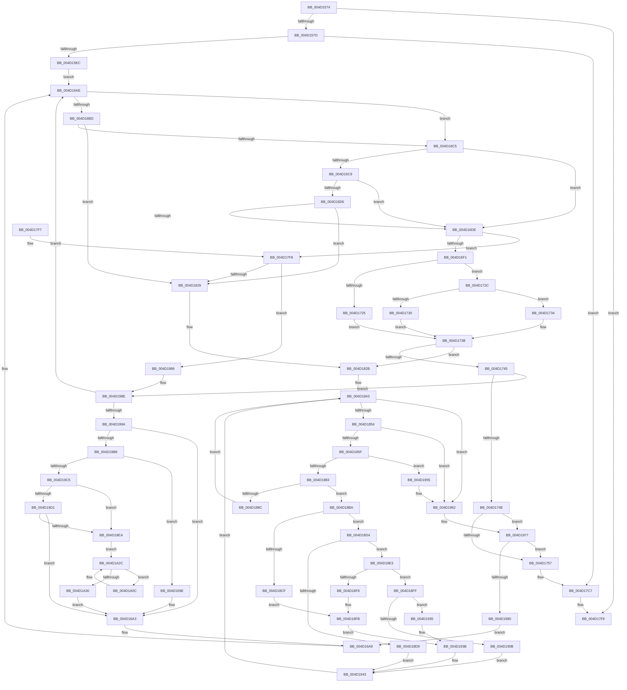

# CcAsyncLazywriteWorkerMulti

- RVA: `0x004D1574`–`0x004D1A5E` (길이 `1,258` bytes)
- VA: `0x00000001404D1574`
- 실행 섹션: `.text`
- PDB 이름 있음: `예`; PDB Function 태그: `아니요`
- unwind 정보 RVA: `0x000BDD5C`
- 디코드: `296`개 명령, `1,258/1,258` bytes 표시
- 미해석 바이트: `0` (있으면 어셈블리에 `.byte`로 보존)

> 이 문서는 커널 이미지의 기계어와 PDB 기호를 분석해 생성했습니다. 4번과 5번은 함수 원형과 자료형을 바이너리 사용 방식에서 추정한 C 해석이며 원본 소스 복구 결과는 아닙니다.

## 1. Dependencies

- 직접 호출 지점: **24**; 고유 호출 대상: **15**
- 직접 호출자로 확인된 함수: **1**
- RIP 상대 이미지 참조: **6**

### Outgoing calls
- `0x004D1642` → [DbgPrintEx](../35/DbgPrintEx_function_00359290.md) (function, `0x00359290`)
- `0x004D1655` → [memset](../6C/memset_function_006C6C40.md) (function, `0x006C6C40`)
- `0x004D1666` → [memset](../6C/memset_function_006C6C40.md) (function, `0x006C6C40`)
- `0x004D1717` → [KeWaitForMultipleObjects](../20/KeWaitForMultipleObjects_function_0020D110.md) (function, `0x0020D110`)
- `0x004D17C2` → [DbgPrintEx](../35/DbgPrintEx_function_00359290.md) (function, `0x00359290`)
- `0x004D17D1` → [_security_check_cookie](../6A/_security_check_cookie_function_006AC640.md) (function, `0x006AC640`)
- `0x004D181A` → [KeWaitForMultipleObjects](../20/KeWaitForMultipleObjects_function_0020D110.md) (function, `0x0020D110`)
- `0x004D183A` → [KeAcquireInStackQueuedSpinLock](../27/KeAcquireInStackQueuedSpinLock_function_002757A0.md) (function, `0x002757A0`)
- `0x004D1868` → [CcFindNextWBWorkQueueEntry](../57/CcFindNextWBWorkQueueEntry_function_0057F9E8.md) (function, `0x0057F9E8`)
- `0x004D1875` → [KeReleaseInStackQueuedSpinLock](../34/KeReleaseInStackQueuedSpinLock_function_00342CE0.md) (function, `0x00342CE0`)
- `0x004D1895` → [KeSetEvent](../33/KeSetEvent_function_0033F310.md) (function, `0x0033F310`)
- `0x004D189D` → [CcFreeWorkQueueEntry](../35/CcFreeWorkQueueEntry_function_0035723C.md) (function, `0x0035723C`)
- `0x004D18AA` → [KeAcquireInStackQueuedSpinLock](../27/KeAcquireInStackQueuedSpinLock_function_002757A0.md) (function, `0x002757A0`)
- `0x004D18C5` → [CcWriteBehindAsyncPreProcess](../57/CcWriteBehindAsyncPreProcess_function_0057FB6C.md) (function, `0x0057FB6C`)
- `0x004D18DC` → [CcRepostToSynchronousLazywriter](../35/CcRepostToSynchronousLazywriter_function_0035492C.md) (function, `0x0035492C`)
- `0x004D18EA` → [CcFlushCachePreProcess](../35/CcFlushCachePreProcess_function_0035A9B0.md) (function, `0x0035A9B0`)
- `0x004D1902` → [CcWriteBehindAsyncFlushOneRange](../57/CcWriteBehindAsyncFlushOneRange_function_0057FAEC.md) (function, `0x0057FAEC`)
- `0x004D193E` → [CcQueueAsyncLazywriteCompletion](../57/CcQueueAsyncLazywriteCompletion_function_0057FA60.md) (function, `0x0057FA60`)
- `0x004D194B` → [KeAcquireInStackQueuedSpinLock](../27/KeAcquireInStackQueuedSpinLock_function_002757A0.md) (function, `0x002757A0`)
- `0x004D195D` → [KeAcquireInStackQueuedSpinLock](../27/KeAcquireInStackQueuedSpinLock_function_002757A0.md) (function, `0x002757A0`)
- `0x004D1967` → [KeReleaseInStackQueuedSpinLock](../34/KeReleaseInStackQueuedSpinLock_function_00342CE0.md) (function, `0x00342CE0`)
- `0x004D19C8` → [CcFlushCachePostProcessOneRange](../35/CcFlushCachePostProcessOneRange_function_00359710.md) (function, `0x00359710`)
- `0x004D19D4` → [CcWriteBehindAsyncFlushOneRange](../57/CcWriteBehindAsyncFlushOneRange_function_0057FAEC.md) (function, `0x0057FAEC`)
- `0x004D1A02` → [CcQueueAsyncLazywriteCompletion](../57/CcQueueAsyncLazywriteCompletion_function_0057FA60.md) (function, `0x0057FA60`)

### Direct callers
- [CcAsyncLazywriteWorkerThread](../4B/CcAsyncLazywriteWorkerThread_function_004B2130.md) at `0x004B223B`

### Static image references
- `0x004D15A3` → RVA `0x00E0A740` (`.data`; read)
- `0x004D15FD` → RVA `0x006C91A0` (` ?? ::FNODOBFM::`string'`; read)
- `0x004D1701` → RVA `0x00F8F4D8` (`.data`; read)
- `0x004D175A` → RVA `0x006C92E0` (` ?? ::FNODOBFM::`string'`; read)
- `0x004D1761` → RVA `0x006C92D0` (` ?? ::FNODOBFM::`string'`; read)
- `0x004D1794` → RVA `0x006C9260` (` ?? ::FNODOBFM::`string'`; read)

## 2. Other-region calls and transfers

- 다른 실행 섹션으로 향하는 call: **0**
- 별도 외부 분기/꼬리 이동을 확인하지 못했습니다.

## 3. Assembly (complete function range)

```asm
004D1574  48 85 C9                        test rcx, rcx
004D1577  0F 84 79 02 00 00               je 0x1404d17f6
004D157D  48 8B C4                        mov rax, rsp
004D1580  48 89 58 10                     mov qword ptr [rax + 0x10], rbx
004D1584  48 89 70 18                     mov qword ptr [rax + 0x18], rsi
004D1588  48 89 78 20                     mov qword ptr [rax + 0x20], rdi
004D158C  55                              push rbp
004D158D  41 54                           push r12
004D158F  41 55                           push r13
004D1591  41 56                           push r14
004D1593  41 57                           push r15
004D1595  48 8D A8 C8 EF FF FF            lea rbp, [rax - 0x1038]
004D159C  48 81 EC 10 11 00 00            sub rsp, 0x1110
004D15A3  48 8B 05 96 91 93 00            mov rax, qword ptr [rip + 0x939196]
004D15AA  48 33 C4                        xor rax, rsp
004D15AD  48 89 85 00 10 00 00            mov qword ptr [rbp + 0x1000], rax
004D15B4  44 8B 79 28                     mov r15d, dword ptr [rcx + 0x28]
004D15B8  33 C0                           xor eax, eax
004D15BA  4C 8B 71 38                     mov r14, qword ptr [rcx + 0x38]
004D15BE  0F 57 C0                        xorps xmm0, xmm0
004D15C1  4C 8B 61 48                     mov r12, qword ptr [rcx + 0x48]
004D15C5  BF 03 00 00 00                  mov edi, 3
004D15CA  48 89 44 24 78                  mov qword ptr [rsp + 0x78], rax
004D15CF  44 89 7C 24 54                  mov dword ptr [rsp + 0x54], r15d
004D15D4  4C 89 74 24 58                  mov qword ptr [rsp + 0x58], r14
004D15D9  0F 11 44 24 68                  movups xmmword ptr [rsp + 0x68], xmm0
004D15DE  0F 11 45 88                     movups xmmword ptr [rbp - 0x78], xmm0
004D15E2  41 83 FF 01                     cmp r15d, 1
004D15E6  0F 83 DB 01 00 00               jae 0x1404d17c7
004D15EC  65 48 8B 04 25 88 01 00 00      mov rax, qword ptr gs:[0x188]
004D15F5  44 8D 6F FF                     lea r13d, [rdi - 1]
004D15F9  48 8B 59 40                     mov rbx, qword ptr [rcx + 0x40]
004D15FD  4C 8D 05 9C 7B 1F 00            lea r8, [rip + 0x1f7b9c]
004D1604  65 48 8B 0C 25 88 01 00 00      mov rcx, qword ptr gs:[0x188]
004D160D  41 8B D5                        mov edx, r13d
004D1610  65 4C 8B 0C 25 88 01 00 00      mov r9, qword ptr gs:[0x188]
004D1619  48 89 44 24 38                  mov qword ptr [rsp + 0x38], rax
004D161E  8B 43 18                        mov eax, dword ptr [rbx + 0x18]
004D1621  44 89 7C 24 30                  mov dword ptr [rsp + 0x30], r15d
004D1626  45 8B 89 08 05 00 00            mov r9d, dword ptr [r9 + 0x508]
004D162D  89 44 24 28                     mov dword ptr [rsp + 0x28], eax
004D1631  8B 81 10 05 00 00               mov eax, dword ptr [rcx + 0x510]
004D1637  8D 4F 7C                        lea ecx, [rdi + 0x7c]
004D163A  48 89 5D 80                     mov qword ptr [rbp - 0x80], rbx
004D163E  89 44 24 20                     mov dword ptr [rsp + 0x20], eax
004D1642  E8 49 7C E8 FF                  call 0x140359290
004D1647  BE 00 02 00 00                  mov esi, 0x200
004D164C  48 8D 4D 00                     lea rcx, [rbp]
004D1650  44 8B C6                        mov r8d, esi
004D1653  33 D2                           xor edx, edx
004D1655  E8 E6 55 1F 00                  call 0x1406c6c40
004D165A  44 8B C6                        mov r8d, esi
004D165D  48 8D 8D 00 02 00 00            lea rcx, [rbp + 0x200]
004D1664  33 D2                           xor edx, edx
004D1666  E8 D5 55 1F 00                  call 0x1406c6c40
004D166B  8B 93 48 06 00 00               mov edx, dword ptr [rbx + 0x648]
004D1671  48 8D 83 98 04 00 00            lea rax, [rbx + 0x498]
004D1678  49 8D 8C 24 48 01 00 00         lea rcx, [r12 + 0x148]
004D1680  48 89 45 90                     mov qword ptr [rbp - 0x70], rax
004D1684  83 FA 40                        cmp edx, 0x40
004D1687  48 89 4D 88                     mov qword ptr [rbp - 0x78], rcx
004D168B  8D 47 3C                        lea eax, [rdi + 0x3c]
004D168E  48 89 4D 00                     mov qword ptr [rbp], rcx
004D1692  0F 43 D0                        cmovae edx, eax
004D1695  8D 77 FE                        lea esi, [rdi - 2]
004D1698  89 54 24 50                     mov dword ptr [rsp + 0x50], edx
004D169C  EB 10                           jmp 0x1404d16ae
004D169E  44 8B 7C 24 54                  mov r15d, dword ptr [rsp + 0x54]
004D16A3  41 BD 02 00 00 00               mov r13d, 2
004D16A9  4C 8B 74 24 58                  mov r14, qword ptr [rsp + 0x58]
004D16AE  41 8A 8C 24 C4 00 00 00         mov cl, byte ptr [r12 + 0xc4]
004D16B6  8D 46 FF                        lea eax, [rsi - 1]
004D16B9  84 C9                           test cl, cl
004D16BB  74 08                           je 0x1404d16c5
004D16BD  85 C0                           test eax, eax
004D16BF  0F 84 64 01 00 00               je 0x1404d1829
004D16C5  3B C2                           cmp eax, edx
004D16C7  73 15                           jae 0x1404d16de
004D16C9  49 8D 84 24 38 01 00 00         lea rax, [r12 + 0x138]
004D16D1  48 39 00                        cmp qword ptr [rax], rax
004D16D4  74 08                           je 0x1404d16de
004D16D6  84 C9                           test cl, cl
004D16D8  0F 84 4B 01 00 00               je 0x1404d1829
004D16DE  41 B9 08 00 00 00               mov r9d, 8
004D16E4  45 8D 41 F9                     lea r8d, [r9 - 7]
004D16E8  41 3B F0                        cmp esi, r8d
004D16EB  0F 85 07 01 00 00               jne 0x1404d17f8
004D16F1  48 8D 45 A0                     lea rax, [rbp - 0x60]
004D16F5  41 8B CD                        mov ecx, r13d
004D16F8  48 89 44 24 38                  mov qword ptr [rsp + 0x38], rax
004D16FD  48 8D 55 88                     lea rdx, [rbp - 0x78]
004D1701  48 8D 05 D0 DD AB 00            lea rax, [rip + 0xabddd0]
004D1708  48 89 44 24 30                  mov qword ptr [rsp + 0x30], rax
004D170D  C6 44 24 28 00                  mov byte ptr [rsp + 0x28], 0
004D1712  C6 44 24 20 00                  mov byte ptr [rsp + 0x20], 0
004D1717  E8 F4 B9 D3 FF                  call 0x14020d110
004D171C  8B D8                           mov ebx, eax
004D171E  3D 02 01 00 00                  cmp eax, 0x102
004D1723  75 07                           jne 0x1404d172c
004D1725  BF 03 00 00 00                  mov edi, 3
004D172A  EB 0F                           jmp 0x1404d173b
004D172C  85 C0                           test eax, eax
004D172E  75 04                           jne 0x1404d1734
004D1730  33 FF                           xor edi, edi
004D1732  EB 07                           jmp 0x1404d173b
004D1734  83 F8 01                        cmp eax, 1
004D1737  41 0F 44 FD                     cmove edi, r13d
004D173B  8B CF                           mov ecx, edi
004D173D  85 FF                           test edi, edi
004D173F  0F 84 E6 00 00 00               je 0x1404d182b
004D1745  83 F9 01                        cmp ecx, 1
004D1748  0F 84 40 02 00 00               je 0x1404d198e
004D174E  41 3B CD                        cmp ecx, r13d
004D1751  0F 85 20 02 00 00               jne 0x1404d1977
004D1757  41 3B FD                        cmp edi, r13d
004D175A  48 8D 05 7F 7B 1F 00            lea rax, [rip + 0x1f7b7f]
004D1761  4C 8D 05 68 7B 1F 00            lea r8, [rip + 0x1f7b68]
004D1768  41 8B D5                        mov edx, r13d
004D176B  4C 0F 45 C0                     cmovne r8, rax
004D176F  B9 7F 00 00 00                  mov ecx, 0x7f
004D1774  65 48 8B 04 25 88 01 00 00      mov rax, qword ptr gs:[0x188]
004D177D  65 4C 8B 14 25 88 01 00 00      mov r10, qword ptr gs:[0x188]
004D1786  65 4C 8B 0C 25 88 01 00 00      mov r9, qword ptr gs:[0x188]
004D178F  4C 89 44 24 40                  mov qword ptr [rsp + 0x40], r8
004D1794  4C 8D 05 C5 7A 1F 00            lea r8, [rip + 0x1f7ac5]
004D179B  48 89 44 24 38                  mov qword ptr [rsp + 0x38], rax
004D17A0  48 8B 45 80                     mov rax, qword ptr [rbp - 0x80]
004D17A4  45 8B 89 08 05 00 00            mov r9d, dword ptr [r9 + 0x508]
004D17AB  44 89 7C 24 30                  mov dword ptr [rsp + 0x30], r15d
004D17B0  8B 40 18                        mov eax, dword ptr [rax + 0x18]
004D17B3  89 44 24 28                     mov dword ptr [rsp + 0x28], eax
004D17B7  41 8B 82 10 05 00 00            mov eax, dword ptr [r10 + 0x510]
004D17BE  89 44 24 20                     mov dword ptr [rsp + 0x20], eax
004D17C2  E8 C9 7A E8 FF                  call 0x140359290
004D17C7  48 8B 8D 00 10 00 00            mov rcx, qword ptr [rbp + 0x1000]
004D17CE  48 33 CC                        xor rcx, rsp
004D17D1  E8 6A AE 1D 00                  call 0x1406ac640
004D17D6  4C 8D 9C 24 10 11 00 00         lea r11, [rsp + 0x1110]
004D17DE  49 8B 5B 38                     mov rbx, qword ptr [r11 + 0x38]
004D17E2  49 8B 73 40                     mov rsi, qword ptr [r11 + 0x40]
004D17E6  49 8B 7B 48                     mov rdi, qword ptr [r11 + 0x48]
004D17EA  49 8B E3                        mov rsp, r11
004D17ED  41 5F                           pop r15
004D17EF  41 5E                           pop r14
004D17F1  41 5D                           pop r13
004D17F3  41 5C                           pop r12
004D17F5  5D                              pop rbp
004D17F6  C3                              ret
004D17F7  CC                              int3
004D17F8  48 8D 85 00 04 00 00            lea rax, [rbp + 0x400]
004D17FF  8B CE                           mov ecx, esi
004D1801  48 89 44 24 38                  mov qword ptr [rsp + 0x38], rax
004D1806  48 8D 55 00                     lea rdx, [rbp]
004D180A  48 83 64 24 30 00               and qword ptr [rsp + 0x30], 0
004D1810  C6 44 24 28 00                  mov byte ptr [rsp + 0x28], 0
004D1815  C6 44 24 20 00                  mov byte ptr [rsp + 0x20], 0
004D181A  E8 F1 B8 D3 FF                  call 0x14020d110
004D181F  8B D8                           mov ebx, eax
004D1821  85 C0                           test eax, eax
004D1823  0F 85 60 01 00 00               jne 0x1404d1989
004D1829  33 FF                           xor edi, edi
004D182B  49 81 C6 40 03 00 00            add r14, 0x340
004D1832  48 8D 54 24 68                  lea rdx, [rsp + 0x68]
004D1837  49 8B CE                        mov rcx, r14
004D183A  E8 61 3F DA FF                  call 0x1402757a0
004D183F  44 8D 6E FF                     lea r13d, [rsi - 1]
004D1843  49 8D 84 24 38 01 00 00         lea rax, [r12 + 0x138]
004D184B  48 39 00                        cmp qword ptr [rax], rax
004D184E  0F 84 0E 01 00 00               je 0x1404d1962
004D1854  44 3B 6C 24 50                  cmp r13d, dword ptr [rsp + 0x50]
004D1859  0F 83 03 01 00 00               jae 0x1404d1962
004D185F  45 8B CD                        mov r9d, r13d
004D1862  4C 8B C0                        mov r8, rax
004D1865  49 8B D4                        mov rdx, r12
004D1868  E8 7B E1 0A 00                  call 0x14057f9e8
004D186D  48 8D 4C 24 68                  lea rcx, [rsp + 0x68]
004D1872  48 8B D8                        mov rbx, rax
004D1875  E8 66 14 E7 FF                  call 0x140342ce0
004D187A  48 85 DB                        test rbx, rbx
004D187D  0F 84 D2 00 00 00               je 0x1404d1955
004D1883  83 BB 80 00 00 00 04            cmp dword ptr [rbx + 0x80], 4
004D188A  75 2E                           jne 0x1404d18ba
004D188C  48 8B 4B 10                     mov rcx, qword ptr [rbx + 0x10]
004D1890  45 33 C0                        xor r8d, r8d
004D1893  33 D2                           xor edx, edx
004D1895  E8 76 DA E6 FF                  call 0x14033f310
004D189A  48 8B CB                        mov rcx, rbx
004D189D  E8 9A 59 E8 FF                  call 0x14035723c
004D18A2  48 8D 54 24 68                  lea rdx, [rsp + 0x68]
004D18A7  49 8B CE                        mov rcx, r14
004D18AA  E8 F1 3E DA FF                  call 0x1402757a0
004D18AF  41 C6 84 24 C4 00 00 00 00      mov byte ptr [r12 + 0xc4], 0
004D18B8  EB 89                           jmp 0x1404d1843
004D18BA  4C 8D 43 20                     lea r8, [rbx + 0x20]
004D18BE  48 8B CB                        mov rcx, rbx
004D18C1  48 8D 53 38                     lea rdx, [rbx + 0x38]
004D18C5  E8 A2 E2 0A 00                  call 0x14057fb6c
004D18CA  83 F8 01                        cmp eax, 1
004D18CD  75 05                           jne 0x1404d18d4
004D18CF  45 33 C0                        xor r8d, r8d
004D18D2  EB 27                           jmp 0x1404d18fb
004D18D4  83 F8 02                        cmp eax, 2
004D18D7  75 0A                           jne 0x1404d18e3
004D18D9  48 8B CB                        mov rcx, rbx
004D18DC  E8 4B 30 E8 FF                  call 0x14035492c
004D18E1  EB 60                           jmp 0x1404d1943
004D18E3  4C 8B 7B 10                     mov r15, qword ptr [rbx + 0x10]
004D18E7  49 8B CF                        mov rcx, r15
004D18EA  E8 C1 90 E8 FF                  call 0x14035a9b0
004D18EF  49 83 67 60 00                  and qword ptr [r15 + 0x60], 0
004D18F4  84 C0                           test al, al
004D18F6  75 07                           jne 0x1404d18ff
004D18F8  41 B0 01                        mov r8b, 1
004D18FB  33 D2                           xor edx, edx
004D18FD  EB 3C                           jmp 0x1404d193b
004D18FF  49 8B CF                        mov rcx, r15
004D1902  E8 E5 E1 0A 00                  call 0x14057faec
004D1907  84 C0                           test al, al
004D1909  74 2A                           je 0x1404d1935
004D190B  49 8B 47 48                     mov rax, qword ptr [r15 + 0x48]
004D190F  8B CE                           mov ecx, esi
004D1911  FF C6                           inc esi
004D1913  41 FF C5                        inc r13d
004D1916  48 89 44 CD 00                  mov qword ptr [rbp + rcx*8], rax
004D191B  49 8B 84 24 60 01 00 00         mov rax, qword ptr [r12 + 0x160]
004D1923  48 89 9C CD 00 02 00 00         mov qword ptr [rbp + rcx*8 + 0x200], rbx
004D192B  8B 4C 24 54                     mov ecx, dword ptr [rsp + 0x54]
004D192F  F0 FF 04 88                     lock inc dword ptr [rax + rcx*4]
004D1933  EB 0E                           jmp 0x1404d1943
004D1935  41 B0 01                        mov r8b, 1
004D1938  41 8A D0                        mov dl, r8b
004D193B  48 8B CB                        mov rcx, rbx
004D193E  E8 1D E1 0A 00                  call 0x14057fa60
004D1943  48 8D 54 24 68                  lea rdx, [rsp + 0x68]
004D1948  49 8B CE                        mov rcx, r14
004D194B  E8 50 3E DA FF                  call 0x1402757a0
004D1950  E9 EE FE FF FF                  jmp 0x1404d1843
004D1955  48 8D 54 24 68                  lea rdx, [rsp + 0x68]
004D195A  49 8B CE                        mov rcx, r14
004D195D  E8 3E 3E DA FF                  call 0x1402757a0
004D1962  48 8D 4C 24 68                  lea rcx, [rsp + 0x68]
004D1967  E8 74 13 E7 FF                  call 0x140342ce0
004D196C  44 8B 7C 24 54                  mov r15d, dword ptr [rsp + 0x54]
004D1971  41 BD 02 00 00 00               mov r13d, 2
004D1977  83 FF 03                        cmp edi, 3
004D197A  0F 84 D7 FD FF FF               je 0x1404d1757
004D1980  8B 54 24 50                     mov edx, dword ptr [rsp + 0x50]
004D1984  E9 20 FD FF FF                  jmp 0x1404d16a9
004D1989  BF 01 00 00 00                  mov edi, 1
004D198E  8B 54 24 50                     mov edx, dword ptr [rsp + 0x50]
004D1992  3B DE                           cmp ebx, esi
004D1994  0F 83 14 FD FF FF               jae 0x1404d16ae
004D199A  0F AE E8                        lfence
004D199D  8B C3                           mov eax, ebx
004D199F  4C 8D 34 C5 00 00 00 00         lea r14, [rax*8]
004D19A7  4E 8B AC 35 00 02 00 00         mov r13, qword ptr [rbp + r14 + 0x200]
004D19AF  4D 85 ED                        test r13, r13
004D19B2  0F 84 EB FC FF FF               je 0x1404d16a3
004D19B8  4D 8B 7D 10                     mov r15, qword ptr [r13 + 0x10]
004D19BC  4D 85 FF                        test r15, r15
004D19BF  0F 84 D9 FC FF FF               je 0x1404d169e
004D19C5  49 8B CF                        mov rcx, r15
004D19C8  E8 43 7D E8 FF                  call 0x140359710
004D19CD  84 C0                           test al, al
004D19CF  74 19                           je 0x1404d19ea
004D19D1  49 8B CF                        mov rcx, r15
004D19D4  E8 13 E1 0A 00                  call 0x14057faec
004D19D9  44 8B 7C 24 54                  mov r15d, dword ptr [rsp + 0x54]
004D19DE  8B 54 24 50                     mov edx, dword ptr [rsp + 0x50]
004D19E2  84 C0                           test al, al
004D19E4  0F 85 B9 FC FF FF               jne 0x1404d16a3
004D19EA  4A 83 64 35 00 00               and qword ptr [rbp + r14], 0
004D19F0  41 B0 01                        mov r8b, 1
004D19F3  4A 83 A4 35 00 02 00 00 00      and qword ptr [rbp + r14 + 0x200], 0
004D19FC  41 8A D0                        mov dl, r8b
004D19FF  49 8B CD                        mov rcx, r13
004D1A02  E8 59 E0 0A 00                  call 0x14057fa60
004D1A07  8D 56 FF                        lea edx, [rsi - 1]
004D1A0A  EB 20                           jmp 0x1404d1a2c
004D1A0C  FF C3                           inc ebx
004D1A0E  4D 8D 76 08                     lea r14, [r14 + 8]
004D1A12  48 8B 44 DD 00                  mov rax, qword ptr [rbp + rbx*8]
004D1A17  4A 89 44 35 F8                  mov qword ptr [rbp + r14 - 8], rax
004D1A1C  48 8B 84 DD 00 02 00 00         mov rax, qword ptr [rbp + rbx*8 + 0x200]
004D1A24  4A 89 84 35 F8 01 00 00         mov qword ptr [rbp + r14 + 0x1f8], rax
004D1A2C  3B DA                           cmp ebx, edx
004D1A2E  72 DC                           jb 0x1404d1a0c
004D1A30  44 8B 7C 24 54                  mov r15d, dword ptr [rsp + 0x54]
004D1A35  FF CE                           dec esi
004D1A37  8B 54 24 50                     mov edx, dword ptr [rsp + 0x50]
004D1A3B  8B C3                           mov eax, ebx
004D1A3D  48 83 64 C5 00 00               and qword ptr [rbp + rax*8], 0
004D1A43  48 83 A4 C5 00 02 00 00 00      and qword ptr [rbp + rax*8 + 0x200], 0
004D1A4C  49 8B 84 24 60 01 00 00         mov rax, qword ptr [r12 + 0x160]
004D1A54  F0 42 FF 0C B8                  lock dec dword ptr [rax + r15*4]
004D1A59  E9 45 FC FF FF                  jmp 0x1404d16a3
```

## 4. C-style interpretation (structured pseudocode)

```c
__int64 __fastcall CcAsyncLazywriteWorkerMulti(__int64 a1)
{
    __int64 result;
    __int64 v_r13;
    __int64 v_r14;
    __int64 v_rbx;
    __int64 v_rdi;
    __int64 v_rsi;
    __int64 v_rsp;
    unsigned __int64 v_stack_m10A8;
    unsigned int v_stack_m10BC;
    unsigned __int64 v_stack_m10C0;
    unsigned __int64 v_stack_m10D0;
    unsigned __int64 v_stack_m10D8;
    unsigned __int64 v_stack_m10E0;
    unsigned int v_stack_m10E4;
    unsigned int v_stack_m10E8;
    unsigned __int8 v_stack_m10F0;
    unsigned __int64 v_stack_m10F8;
    unsigned __int64 v_stack_m1100;
    unsigned int v_stack_m1108;
    unsigned int v_stack_m1110;
    unsigned int v_stack_m1118;
    unsigned __int64 v_stack_m28;

    if (a1 == 0) goto loc_004D17F6;
    *(unsigned __int64 *)(v_rsp + 16) = v_rbx;
    *(unsigned __int64 *)(v_rsp + 24) = v_rsi;
    *(unsigned __int64 *)(v_rsp + 32) = v_rdi;
    v_rsp = (v_rsp) - (0x1110ULL);
    result = (*(unsigned __int64 *)(v_rip + 9671062)) ^ (v_rsp);
    *(unsigned __int64 *)(v_rsp - 4152 + 4096) = result;
    result = 0;
    v_stack_m10C0 = 0;
    v_stack_m10E4 = (unsigned int)((unsigned int)(*(unsigned int *)(a1 + 40)));
    v_stack_m10E0 = *(unsigned __int64 *)(a1 + 56);
    v_stack_m10D0 = v_xmm0;
    *(unsigned __int64 *)(v_rsp - 4152 - 120) = v_xmm0;
    if (((unsigned int)((unsigned int)(*(unsigned int *)(a1 + 40)))) >= 1) goto loc_004D17C7;
    v_stack_m1100 = *(unsigned __int64 *)(gs_base + (0 + 392));
    v_stack_m1108 = (unsigned int)((unsigned int)(*(unsigned int *)(a1 + 40)));
    v_stack_m1110 = (unsigned int)((unsigned int)(*(unsigned int *)(*(unsigned __int64 *)(a1 + 64) + 24)));
    *(unsigned __int64 *)(v_rsp - 4152 - 128) = *(unsigned __int64 *)(a1 + 64);
    v_stack_m1118 = (unsigned int)((unsigned int)(*(unsigned int *)(*(unsigned __int64 *)(gs_base + (0 + 392)) + 1296)));
    result = DbgPrintEx(3 + 124, (unsigned int)((unsigned int)(3 - 1)), v_rip + 2063260, (unsigned int)(*(unsigned int *)(*(unsigned __int64 *)(gs_base + (0 + 392)) + 1288)));
    a2 = 0;
    result = memset(v_rsp - 4152, a2, 512, (unsigned int)(*(unsigned int *)(*(unsigned __int64 *)(gs_base + (0 + 392)) + 1288)));
    a2 = 0;
    result = memset(v_rsp - 4152 + 512, a2, 512, (unsigned int)(*(unsigned int *)(*(unsigned __int64 *)(gs_base + (0 + 392)) + 1288)));
    *(unsigned __int64 *)(v_rsp - 4152 - 112) = *(unsigned __int64 *)(a1 + 64) + 1176;
    *(unsigned __int64 *)(v_rsp - 4152 - 120) = *(unsigned __int64 *)(a1 + 72) + 328;
    *(unsigned __int64 *)(v_rsp - 4152) = *(unsigned __int64 *)(a1 + 72) + 328;
    a2 = (unsigned int)(*(unsigned int *)(*(unsigned __int64 *)(a1 + 64) + 1608));
    if (((unsigned int)((unsigned int)(*(unsigned int *)(*(unsigned __int64 *)(a1 + 64) + 1608)))) >= 64) { a2 = (unsigned int)(3 + 60); }
    v_stack_m10E8 = (unsigned int)(a2);
    goto loc_004D16AE;
loc_004D169E:
loc_004D16A3:
loc_004D16A9:
loc_004D16AE:
    if ((unsigned __int8)(*(unsigned __int8 *)(*(unsigned __int64 *)(a1 + 72) + 196)) == 0) goto loc_004D16C5;
    if ((unsigned int)(3 - 2 - 1) == 0) goto loc_004D1829;
loc_004D16C5:
    if (((unsigned int)(3 - 2 - 1)) >= ((unsigned int)(a2))) goto loc_004D16DE;
    if ((*(unsigned __int64 *)(*(unsigned __int64 *)(a1 + 72) + 312)) == (*(unsigned __int64 *)(a1 + 72) + 312)) goto loc_004D16DE;
    if ((unsigned __int8)(*(unsigned __int8 *)(*(unsigned __int64 *)(a1 + 72) + 196)) == 0) goto loc_004D1829;
loc_004D16DE:
    if (((unsigned int)(3 - 2)) != ((unsigned int)(8 - 7))) goto loc_004D17F8;
    v_stack_m1100 = v_rsp - 4152 - 96;
    v_stack_m1108 = v_rip + 11263440;
    v_stack_m1110 = 0;
    v_stack_m1118 = 0;
    result = KeWaitForMultipleObjects(2, v_rsp - 4152 - 120, 8 - 7, 8);
    if (((unsigned int)(result)) != 258) goto loc_004D172C;
    goto loc_004D173B;
loc_004D172C:
    if ((unsigned int)(result) != 0) goto loc_004D1734;
    v_rdi = 0;
    goto loc_004D173B;
loc_004D1734:
    if (((unsigned int)(result)) == 1) { v_rdi = 2; }
loc_004D173B:
    if ((unsigned int)(v_rdi) == 0) goto loc_004D182B;
    if (((unsigned int)((unsigned int)((unsigned int)(v_rdi)))) == 1) goto loc_004D198E;
    if (((unsigned int)((unsigned int)((unsigned int)(v_rdi)))) != 2) goto loc_004D1977;
loc_004D1757:
    a3 = v_rip + 2063208;
    if (((unsigned int)(v_rdi)) != 2) { a3 = v_rip + 2063231; }
    v_stack_m10F8 = a3;
    v_stack_m1100 = *(unsigned __int64 *)(gs_base + (0 + 392));
    v_stack_m1108 = (unsigned int)((unsigned int)(v_stack_m10E4));
    v_stack_m1110 = (unsigned int)((unsigned int)(*(unsigned int *)(*(unsigned __int64 *)(v_rsp - 4152 - 128) + 24)));
    v_stack_m1118 = (unsigned int)((unsigned int)(*(unsigned int *)(*(unsigned __int64 *)(gs_base + (0 + 392)) + 1296)));
    result = DbgPrintEx(127, 2, v_rip + 2063045, (unsigned int)(*(unsigned int *)(*(unsigned __int64 *)(gs_base + (0 + 392)) + 1288)));
loc_004D17C7:
    a1 = (*(unsigned __int64 *)(v_rsp - 4152 + 4096)) ^ (v_rsp);
    result = _security_check_cookie(a1, 2, v_rip + 2063045, (unsigned int)(*(unsigned int *)(*(unsigned __int64 *)(gs_base + (0 + 392)) + 1288)));
loc_004D17F6:
    return result;
loc_004D17F8:
    v_stack_m10D8 = v_rsp - 4152 + 1024;
    v_stack_m10E8 = 0;
    v_stack_m10F0 = 0;
    result = KeWaitForMultipleObjects((unsigned int)((unsigned int)(*(unsigned __int64 *)(v_stack_m28 + 64))), v_rsp - 4152, v_rip + 2063045, (unsigned int)(*(unsigned int *)(*(unsigned __int64 *)(gs_base + (0 + 392)) + 1288)));
    if ((unsigned int)(result) != 0) goto loc_004D1989;
loc_004D1829:
    v_rdi = 0;
loc_004D182B:
    v_r14 = (v_stack_m10E0) + (832);
    result = KeAcquireInStackQueuedSpinLock(v_r14, v_stack_m10A8, v_rip + 2063045, (unsigned int)(*(unsigned int *)(*(unsigned __int64 *)(gs_base + (0 + 392)) + 1288)));
loc_004D1843:
    if ((*(unsigned __int64 *)(*(unsigned __int64 *)(a1 + 72) + 312)) == (*(unsigned __int64 *)(a1 + 72) + 312)) goto loc_004D1962;
    if (((unsigned int)(*(unsigned __int64 *)(v_stack_m28 + 64) - 1)) >= v_stack_m10C0) goto loc_004D1962;
    result = CcFindNextWBWorkQueueEntry(v_r14, *(unsigned __int64 *)(a1 + 72), *(unsigned __int64 *)(a1 + 72) + 312, (unsigned int)((unsigned int)(*(unsigned __int64 *)(v_stack_m28 + 64) - 1)));
    result = KeReleaseInStackQueuedSpinLock(v_stack_m10A8, *(unsigned __int64 *)(a1 + 72), *(unsigned __int64 *)(a1 + 72) + 312, (unsigned int)((unsigned int)(*(unsigned __int64 *)(v_stack_m28 + 64) - 1)));
    if (result == 0) goto loc_004D1955;
    if ((*(unsigned int *)(result + 128)) != 4) goto loc_004D18BA;
    a3 = 0;
    a2 = 0;
    result = KeSetEvent(*(unsigned __int64 *)(result + 16), a2, a3, (unsigned int)((unsigned int)(*(unsigned __int64 *)(v_stack_m28 + 64) - 1)));
    result = CcFreeWorkQueueEntry(result, a2, a3, (unsigned int)((unsigned int)(*(unsigned __int64 *)(v_stack_m28 + 64) - 1)));
    result = KeAcquireInStackQueuedSpinLock(v_r14, v_stack_m10A8, a3, (unsigned int)((unsigned int)(*(unsigned __int64 *)(v_stack_m28 + 64) - 1)));
    *(unsigned __int8 *)(*(unsigned __int64 *)(a1 + 72) + 196) = 0;
    goto loc_004D1843;
loc_004D18BA:
    result = CcWriteBehindAsyncPreProcess(result, result + 56, result + 32, (unsigned int)((unsigned int)(*(unsigned __int64 *)(v_stack_m28 + 64) - 1)));
    if (((unsigned int)(result)) != 1) goto loc_004D18D4;
    a3 = 0;
    goto loc_004D18FB;
loc_004D18D4:
    if (((unsigned int)(result)) != 2) goto loc_004D18E3;
    result = CcRepostToSynchronousLazywriter(result, result + 56, a3, (unsigned int)((unsigned int)(*(unsigned __int64 *)(v_stack_m28 + 64) - 1)));
    goto loc_004D1943;
loc_004D18E3:
    result = CcFlushCachePreProcess(*(unsigned __int64 *)(result + 16), result + 56, a3, (unsigned int)((unsigned int)(*(unsigned __int64 *)(v_stack_m28 + 64) - 1)));
    if ((unsigned __int8)(result) != 0) goto loc_004D18FF;
loc_004D18FB:
    a2 = 0;
    goto loc_004D193B;
loc_004D18FF:
    result = CcWriteBehindAsyncFlushOneRange(*(unsigned __int64 *)(result + 16), a2, 1, (unsigned int)((unsigned int)(*(unsigned __int64 *)(v_stack_m28 + 64) - 1)));
    if ((unsigned __int8)(result) == 0) goto loc_004D1935;
    v_rsi = (unsigned int)((*(unsigned __int64 *)(v_stack_m28 + 64)) + 1);
    v_r13 = (unsigned int)((*(unsigned __int64 *)(v_stack_m28 + 64) - 1) + 1);
    *(unsigned __int64 *)(v_rsp - 4152 + (unsigned int)((unsigned int)(*(unsigned __int64 *)(v_stack_m28 + 64))) * 8) = *(unsigned __int64 *)(*(unsigned __int64 *)(result + 16) + 72);
    *(unsigned __int64 *)(v_rsp - 4152 + (unsigned int)((unsigned int)(*(unsigned __int64 *)(v_stack_m28 + 64))) * 8 + 512) = result;
    goto loc_004D1943;
loc_004D1935:
loc_004D193B:
    result = CcQueueAsyncLazywriteCompletion(result, 1, 1, (unsigned int)((unsigned int)(*(unsigned __int64 *)(v_stack_m28 + 64) - 1)));
loc_004D1943:
    result = KeAcquireInStackQueuedSpinLock(v_r14, v_stack_m10A8, 1, (unsigned int)((unsigned int)(*(unsigned __int64 *)(v_stack_m28 + 64) - 1)));
    goto loc_004D1843;
loc_004D1955:
    result = KeAcquireInStackQueuedSpinLock(v_r14, v_stack_m10A8, 1, (unsigned int)((unsigned int)(*(unsigned __int64 *)(v_stack_m28 + 64) - 1)));
loc_004D1962:
    result = KeReleaseInStackQueuedSpinLock(v_stack_m10A8, v_stack_m10A8, 1, (unsigned int)((unsigned int)(*(unsigned __int64 *)(v_stack_m28 + 64) - 1)));
loc_004D1977:
    if (0 == 3) goto loc_004D1757;
    goto loc_004D16A9;
loc_004D1989:
loc_004D198E:
    if (((unsigned int)(result)) >= ((unsigned int)(v_rsi))) goto loc_004D16AE;
    if (*(unsigned __int64 *)(v_rsp - 4152 + (unsigned int)((unsigned int)(result)) * 8 * 1 + 512) == 0) goto loc_004D16A3;
    if (*(unsigned __int64 *)(*(unsigned __int64 *)(v_rsp - 4152 + (unsigned int)((unsigned int)(result)) * 8 * 1 + 512) + 16) == 0) goto loc_004D169E;
    result = CcFlushCachePostProcessOneRange(*(unsigned __int64 *)(*(unsigned __int64 *)(v_rsp - 4152 + (unsigned int)((unsigned int)(result)) * 8 * 1 + 512) + 16), (unsigned int)(v_stack_m10C0), 1, (unsigned int)((unsigned int)(*(unsigned __int64 *)(v_stack_m28 + 64) - 1)));
    if ((unsigned __int8)(result) == 0) goto loc_004D19EA;
    result = CcWriteBehindAsyncFlushOneRange(*(unsigned __int64 *)(*(unsigned __int64 *)(v_rsp - 4152 + (unsigned int)((unsigned int)(result)) * 8 * 1 + 512) + 16), (unsigned int)(v_stack_m10C0), 1, (unsigned int)((unsigned int)(*(unsigned __int64 *)(v_stack_m28 + 64) - 1)));
    if ((unsigned __int8)(result) != 0) goto loc_004D16A3;
loc_004D19EA:
    result = CcQueueAsyncLazywriteCompletion(*(unsigned __int64 *)(v_rsp - 4152 + (unsigned int)((unsigned int)(result)) * 8 * 1 + 512), 1, 1, (unsigned int)((unsigned int)(*(unsigned __int64 *)(v_stack_m28 + 64) - 1)));
    goto loc_004D1A2C;
loc_004D1A0C:
    v_rbx = (unsigned int)((result) + 1);
    *(unsigned __int64 *)(v_rsp - 4152 + (unsigned int)((unsigned int)(result)) * 8 + 8 * 1 - 8) = *(unsigned __int64 *)(v_rsp - 4152 + v_rbx * 8);
    *(unsigned __int64 *)(v_rsp - 4152 + (unsigned int)((unsigned int)(result)) * 8 + 8 * 1 + 504) = *(unsigned __int64 *)(v_rsp - 4152 + v_rbx * 8 + 512);
loc_004D1A2C:
    if (((unsigned int)(v_rbx)) < ((unsigned int)(v_rsi - 1))) goto loc_004D1A0C;
    v_rsi = (unsigned int)((v_rsi) - 1);
    goto loc_004D16A3;
}
```

## 5. (Beta) C Style

```c
int64_t CcAsyncLazywriteWorkerMulti(int64_t Arg1)
{
    int64_t result;
    int64_t local_r13;
    int64_t local_r14;
    int64_t local_rbx;
    int64_t local_rdi;
    int64_t local_rsi;
    int64_t local_rsp;
    uint64_t v_stack_m10A8;
    uint32_t v_stack_m10BC;
    uint64_t v_stack_m10C0;
    uint64_t v_stack_m10D0;
    uint64_t v_stack_m10D8;
    uint64_t v_stack_m10E0;
    uint32_t v_stack_m10E4;
    uint32_t v_stack_m10E8;
    uint8_t v_stack_m10F0;
    uint64_t v_stack_m10F8;
    uint64_t v_stack_m1100;
    uint32_t v_stack_m1108;
    uint32_t v_stack_m1110;
    uint32_t v_stack_m1118;
    uint64_t v_stack_m28;

    if (Arg1 == 0) goto loc_004D17F6;
    *(uint64_t *)(local_rsp + 0x10) = local_rbx;
    *(uint64_t *)(local_rsp + 0x18) = local_rsi;
    *(uint64_t *)(local_rsp + 0x20) = local_rdi;
    local_rsp = (local_rsp) - (0x1110ULL);
    result = (*(uint64_t *)(v_rip + 0x939196)) ^ (local_rsp);
    *(uint64_t *)(local_rsp - 0x1038 + 0x1000) = result;
    result = 0;
    v_stack_m10C0 = 0;
    v_stack_m10E4 = (uint32_t)((uint32_t)(*(uint32_t *)(Arg1 + 0x28)));
    v_stack_m10E0 = *(uint64_t *)(Arg1 + 0x38);
    v_stack_m10D0 = v_xmm0;
    *(uint64_t *)(local_rsp - 0x1038 - 0x78) = v_xmm0;
    if (((uint32_t)((uint32_t)(*(uint32_t *)(Arg1 + 0x28)))) >= 1) goto loc_004D17C7;
    v_stack_m1100 = *(uint64_t *)(gs_base + (0 + 0x188));
    v_stack_m1108 = (uint32_t)((uint32_t)(*(uint32_t *)(Arg1 + 0x28)));
    v_stack_m1110 = (uint32_t)((uint32_t)(*(uint32_t *)(*(uint64_t *)(Arg1 + 0x40) + 0x18)));
    *(uint64_t *)(local_rsp - 0x1038 - 0x80) = *(uint64_t *)(Arg1 + 0x40);
    v_stack_m1118 = (uint32_t)((uint32_t)(*(uint32_t *)(*(uint64_t *)(gs_base + (0 + 0x188)) + 0x510)));
    result = DbgPrintEx(3 + 124, (uint32_t)((uint32_t)(3 - 1)), v_rip + 2063260, (uint32_t)(*(uint32_t *)(*(uint64_t *)(gs_base + (0 + 0x188)) + 0x508)));
    a2 = 0;
    result = memset(local_rsp - 4152, a2, 512, (uint32_t)(*(uint32_t *)(*(uint64_t *)(gs_base + (0 + 0x188)) + 0x508)));
    a2 = 0;
    result = memset(local_rsp - 4152 + 512, a2, 512, (uint32_t)(*(uint32_t *)(*(uint64_t *)(gs_base + (0 + 0x188)) + 0x508)));
    *(uint64_t *)(local_rsp - 0x1038 - 0x70) = *(uint64_t *)(Arg1 + 0x40) + 1176;
    *(uint64_t *)(local_rsp - 0x1038 - 0x78) = *(uint64_t *)(Arg1 + 0x48) + 328;
    *(uint64_t *)(local_rsp - 0x1038) = *(uint64_t *)(Arg1 + 0x48) + 328;
    a2 = (uint32_t)(*(uint32_t *)(*(uint64_t *)(Arg1 + 0x40) + 0x648));
    if (((uint32_t)((uint32_t)(*(uint32_t *)(*(uint64_t *)(Arg1 + 0x40) + 0x648)))) >= 64) { a2 = (uint32_t)(3 + 60); }
    v_stack_m10E8 = (uint32_t)(a2);
    goto loc_004D16AE;
loc_004D169E:
loc_004D16A3:
loc_004D16A9:
loc_004D16AE:
    if ((uint8_t)(*(uint8_t *)(*(uint64_t *)(Arg1 + 0x48) + 0xC4)) == 0) goto loc_004D16C5;
    if ((uint32_t)(3 - 2 - 1) == 0) goto loc_004D1829;
loc_004D16C5:
    if (((uint32_t)(3 - 2 - 1)) >= ((uint32_t)(a2))) goto loc_004D16DE;
    if ((*(uint64_t *)(*(uint64_t *)(Arg1 + 0x48) + 0x138)) == (*(uint64_t *)(Arg1 + 0x48) + 312)) goto loc_004D16DE;
    if ((uint8_t)(*(uint8_t *)(*(uint64_t *)(Arg1 + 0x48) + 0xC4)) == 0) goto loc_004D1829;
loc_004D16DE:
    if (((uint32_t)(3 - 2)) != ((uint32_t)(8 - 7))) goto loc_004D17F8;
    v_stack_m1100 = local_rsp - 4152 - 96;
    v_stack_m1108 = v_rip + 11263440;
    v_stack_m1110 = 0;
    v_stack_m1118 = 0;
    result = KeWaitForMultipleObjects(2, local_rsp - 4152 - 120, 8 - 7, 8);
    if (((uint32_t)(result)) != 258) goto loc_004D172C;
    goto loc_004D173B;
loc_004D172C:
    if ((uint32_t)(result) != 0) goto loc_004D1734;
    local_rdi = 0;
    goto loc_004D173B;
loc_004D1734:
    if (((uint32_t)(result)) == 1) { local_rdi = 2; }
loc_004D173B:
    if ((uint32_t)(local_rdi) == 0) goto loc_004D182B;
    if (((uint32_t)((uint32_t)((uint32_t)(local_rdi)))) == 1) goto loc_004D198E;
    if (((uint32_t)((uint32_t)((uint32_t)(local_rdi)))) != 2) goto loc_004D1977;
loc_004D1757:
    a3 = v_rip + 2063208;
    if (((uint32_t)(local_rdi)) != 2) { a3 = v_rip + 2063231; }
    v_stack_m10F8 = a3;
    v_stack_m1100 = *(uint64_t *)(gs_base + (0 + 0x188));
    v_stack_m1108 = (uint32_t)((uint32_t)(v_stack_m10E4));
    v_stack_m1110 = (uint32_t)((uint32_t)(*(uint32_t *)(*(uint64_t *)(local_rsp - 0x1038 - 0x80) + 0x18)));
    v_stack_m1118 = (uint32_t)((uint32_t)(*(uint32_t *)(*(uint64_t *)(gs_base + (0 + 0x188)) + 0x510)));
    result = DbgPrintEx(127, 2, v_rip + 2063045, (uint32_t)(*(uint32_t *)(*(uint64_t *)(gs_base + (0 + 0x188)) + 0x508)));
loc_004D17C7:
    Arg1 = (*(uint64_t *)(local_rsp - 0x1038 + 0x1000)) ^ (local_rsp);
    result = _security_check_cookie(Arg1, 2, v_rip + 2063045, (uint32_t)(*(uint32_t *)(*(uint64_t *)(gs_base + (0 + 0x188)) + 0x508)));
loc_004D17F6:
    return result;
loc_004D17F8:
    v_stack_m10D8 = local_rsp - 4152 + 1024;
    v_stack_m10E8 = 0;
    v_stack_m10F0 = 0;
    result = KeWaitForMultipleObjects((uint32_t)((uint32_t)(*(uint64_t *)(v_stack_m28 + 0x40))), local_rsp - 4152, v_rip + 2063045, (uint32_t)(*(uint32_t *)(*(uint64_t *)(gs_base + (0 + 0x188)) + 0x508)));
    if ((uint32_t)(result) != 0) goto loc_004D1989;
loc_004D1829:
    local_rdi = 0;
loc_004D182B:
    local_r14 = (v_stack_m10E0) + (832);
    result = KeAcquireInStackQueuedSpinLock(local_r14, v_stack_m10A8, v_rip + 2063045, (uint32_t)(*(uint32_t *)(*(uint64_t *)(gs_base + (0 + 0x188)) + 0x508)));
loc_004D1843:
    if ((*(uint64_t *)(*(uint64_t *)(Arg1 + 0x48) + 0x138)) == (*(uint64_t *)(Arg1 + 0x48) + 312)) goto loc_004D1962;
    if (((uint32_t)(*(uint64_t *)(v_stack_m28 + 0x40) - 1)) >= v_stack_m10C0) goto loc_004D1962;
    result = CcFindNextWBWorkQueueEntry(local_r14, *(uint64_t *)(Arg1 + 0x48), *(uint64_t *)(Arg1 + 0x48) + 312, (uint32_t)((uint32_t)(*(uint64_t *)(v_stack_m28 + 0x40) - 1)));
    result = KeReleaseInStackQueuedSpinLock(v_stack_m10A8, *(uint64_t *)(Arg1 + 0x48), *(uint64_t *)(Arg1 + 0x48) + 312, (uint32_t)((uint32_t)(*(uint64_t *)(v_stack_m28 + 0x40) - 1)));
    if (result == 0) goto loc_004D1955;
    if ((*(uint32_t *)(result + 0x80)) != 4) goto loc_004D18BA;
    a3 = 0;
    a2 = 0;
    result = KeSetEvent(*(uint64_t *)(result + 0x10), a2, a3, (uint32_t)((uint32_t)(*(uint64_t *)(v_stack_m28 + 0x40) - 1)));
    result = CcFreeWorkQueueEntry(result, a2, a3, (uint32_t)((uint32_t)(*(uint64_t *)(v_stack_m28 + 0x40) - 1)));
    result = KeAcquireInStackQueuedSpinLock(local_r14, v_stack_m10A8, a3, (uint32_t)((uint32_t)(*(uint64_t *)(v_stack_m28 + 0x40) - 1)));
    *(uint8_t *)(*(uint64_t *)(Arg1 + 0x48) + 0xC4) = 0;
    goto loc_004D1843;
loc_004D18BA:
    result = CcWriteBehindAsyncPreProcess(result, result + 56, result + 32, (uint32_t)((uint32_t)(*(uint64_t *)(v_stack_m28 + 0x40) - 1)));
    if (((uint32_t)(result)) != 1) goto loc_004D18D4;
    a3 = 0;
    goto loc_004D18FB;
loc_004D18D4:
    if (((uint32_t)(result)) != 2) goto loc_004D18E3;
    result = CcRepostToSynchronousLazywriter(result, result + 56, a3, (uint32_t)((uint32_t)(*(uint64_t *)(v_stack_m28 + 0x40) - 1)));
    goto loc_004D1943;
loc_004D18E3:
    result = CcFlushCachePreProcess(*(uint64_t *)(result + 0x10), result + 56, a3, (uint32_t)((uint32_t)(*(uint64_t *)(v_stack_m28 + 0x40) - 1)));
    if ((uint8_t)(result) != 0) goto loc_004D18FF;
loc_004D18FB:
    a2 = 0;
    goto loc_004D193B;
loc_004D18FF:
    result = CcWriteBehindAsyncFlushOneRange(*(uint64_t *)(result + 0x10), a2, 1, (uint32_t)((uint32_t)(*(uint64_t *)(v_stack_m28 + 0x40) - 1)));
    if ((uint8_t)(result) == 0) goto loc_004D1935;
    local_rsi = (uint32_t)((*(uint64_t *)(v_stack_m28 + 0x40)) + 1);
    local_r13 = (uint32_t)((*(uint64_t *)(v_stack_m28 + 0x40) - 1) + 1);
    *(uint64_t *)(local_rsp - 0x1038 + (uint32_t)((uint32_t)(*(uint64_t *)(v_stack_m28 + 0x40))) * 8) = *(uint64_t *)(*(uint64_t *)(result + 0x10) + 0x48);
    *(uint64_t *)(local_rsp - 0x1038 + (uint32_t)((uint32_t)(*(uint64_t *)(v_stack_m28 + 0x40))) * 8 + 0x200) = result;
    goto loc_004D1943;
loc_004D1935:
loc_004D193B:
    result = CcQueueAsyncLazywriteCompletion(result, 1, 1, (uint32_t)((uint32_t)(*(uint64_t *)(v_stack_m28 + 0x40) - 1)));
loc_004D1943:
    result = KeAcquireInStackQueuedSpinLock(local_r14, v_stack_m10A8, 1, (uint32_t)((uint32_t)(*(uint64_t *)(v_stack_m28 + 0x40) - 1)));
    goto loc_004D1843;
loc_004D1955:
    result = KeAcquireInStackQueuedSpinLock(local_r14, v_stack_m10A8, 1, (uint32_t)((uint32_t)(*(uint64_t *)(v_stack_m28 + 0x40) - 1)));
loc_004D1962:
    result = KeReleaseInStackQueuedSpinLock(v_stack_m10A8, v_stack_m10A8, 1, (uint32_t)((uint32_t)(*(uint64_t *)(v_stack_m28 + 0x40) - 1)));
loc_004D1977:
    if (0 == 3) goto loc_004D1757;
    goto loc_004D16A9;
loc_004D1989:
loc_004D198E:
    if (((uint32_t)(result)) >= ((uint32_t)(local_rsi))) goto loc_004D16AE;
    if (*(uint64_t *)(local_rsp - 0x1038 + (uint32_t)((uint32_t)(result)) * 8 * 1 + 0x200) == 0) goto loc_004D16A3;
    if (*(uint64_t *)(*(uint64_t *)(local_rsp - 0x1038 + (uint32_t)((uint32_t)(result)) * 8 * 1 + 0x200) + 0x10) == 0) goto loc_004D169E;
    result = CcFlushCachePostProcessOneRange(*(uint64_t *)(*(uint64_t *)(local_rsp - 0x1038 + (uint32_t)((uint32_t)(result)) * 8 * 1 + 0x200) + 0x10), (uint32_t)(v_stack_m10C0), 1, (uint32_t)((uint32_t)(*(uint64_t *)(v_stack_m28 + 0x40) - 1)));
    if ((uint8_t)(result) == 0) goto loc_004D19EA;
    result = CcWriteBehindAsyncFlushOneRange(*(uint64_t *)(*(uint64_t *)(local_rsp - 0x1038 + (uint32_t)((uint32_t)(result)) * 8 * 1 + 0x200) + 0x10), (uint32_t)(v_stack_m10C0), 1, (uint32_t)((uint32_t)(*(uint64_t *)(v_stack_m28 + 0x40) - 1)));
    if ((uint8_t)(result) != 0) goto loc_004D16A3;
loc_004D19EA:
    result = CcQueueAsyncLazywriteCompletion(*(uint64_t *)(local_rsp - 0x1038 + (uint32_t)((uint32_t)(result)) * 8 * 1 + 0x200), 1, 1, (uint32_t)((uint32_t)(*(uint64_t *)(v_stack_m28 + 0x40) - 1)));
    goto loc_004D1A2C;
loc_004D1A0C:
    local_rbx = (uint32_t)((result) + 1);
    *(uint64_t *)(local_rsp - 0x1038 + (uint32_t)((uint32_t)(result)) * 8 + 0x8 * 1 - 0x8) = *(uint64_t *)(local_rsp - 0x1038 + local_rbx * 8);
    *(uint64_t *)(local_rsp - 0x1038 + (uint32_t)((uint32_t)(result)) * 8 + 0x8 * 1 + 0x1F8) = *(uint64_t *)(local_rsp - 0x1038 + local_rbx * 8 + 0x200);
loc_004D1A2C:
    if (((uint32_t)(local_rbx)) < ((uint32_t)(local_rsi - 1))) goto loc_004D1A0C;
    local_rsi = (uint32_t)((local_rsi) - 1);
    goto loc_004D16A3;
}
```

## 6. Execution-region graph

[열기: 2D/3D 그래프와 함수 탐색 컨트롤 패널](../../../control-panel.html?section=text&rva=0x004D1574&view=graph)

- 2D 그래프는 위에서 아래로 흐르고, 3D 그래프는 빈 공간을 드래그해 회전합니다. Shift+드래그는 이동, 휠은 확대·축소, 함수 노드 선택은 대상 보고서 이동입니다.

### Static fallback


