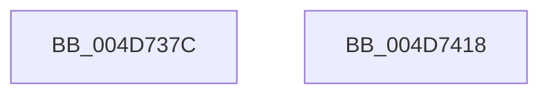

# CcLogExtraWBThreadAction

- RVA: `0x004D737C`–`0x004D7419` (길이 `157` bytes)
- VA: `0x00000001404D737C`
- 실행 섹션: `.text`
- PDB 이름 있음: `예`; PDB Function 태그: `아니요`
- unwind 정보 RVA: `0x00091ECC`
- 디코드: `39`개 명령, `157/157` bytes 표시
- 미해석 바이트: `0` (있으면 어셈블리에 `.byte`로 보존)

> 이 문서는 커널 이미지의 기계어와 PDB 기호를 분석해 생성했습니다. 4번과 5번은 함수 원형과 자료형을 바이너리 사용 방식에서 추정한 C 해석이며 원본 소스 복구 결과는 아닙니다.

## 1. Dependencies

- 직접 호출 지점: **3**; 고유 호출 대상: **3**
- 직접 호출자로 확인된 함수: **1**
- RIP 상대 이미지 참조: **0**

### Outgoing calls
- `0x004D73B7` → [KeAcquireInStackQueuedSpinLock](../27/KeAcquireInStackQueuedSpinLock_function_002757A0.md) (function, `0x002757A0`)
- `0x004D73D5` → [KeReleaseInStackQueuedSpinLock](../34/KeReleaseInStackQueuedSpinLock_function_00342CE0.md) (function, `0x00342CE0`)
- `0x004D73F8` → [CcPerfLogExtraWBThreadAction](CcPerfLogExtraWBThreadAction_function_004D7420.md) (function, `0x004D7420`)

### Direct callers
- [CcWorkerThread](../48/CcWorkerThread_function_0048F0F0.md) at `0x0048F65C`
- [CcWorkerThread](../48/CcWorkerThread_function_0048F0F0.md) at `0x0048F728`

### Static image references
- 디코드된 RIP-relative 메모리 참조가 없습니다.

## 2. Other-region calls and transfers

- 다른 실행 섹션으로 향하는 call: **0**
- 별도 외부 분기/꼬리 이동을 확인하지 못했습니다.

## 3. Assembly (complete function range)

```asm
004D737C  4C 8B DC                        mov r11, rsp
004D737F  49 89 5B 08                     mov qword ptr [r11 + 8], rbx
004D7383  49 89 6B 10                     mov qword ptr [r11 + 0x10], rbp
004D7387  49 89 73 18                     mov qword ptr [r11 + 0x18], rsi
004D738B  49 89 7B 20                     mov qword ptr [r11 + 0x20], rdi
004D738F  41 56                           push r14
004D7391  48 83 EC 50                     sub rsp, 0x50
004D7395  0F 57 C0                        xorps xmm0, xmm0
004D7398  48 8B FA                        mov rdi, rdx
004D739B  48 8B E9                        mov rbp, rcx
004D739E  49 8D 53 D8                     lea rdx, [r11 - 0x28]
004D73A2  33 C0                           xor eax, eax
004D73A4  48 81 C1 00 03 00 00            add rcx, 0x300
004D73AB  0F 11 44 24 30                  movups xmmword ptr [rsp + 0x30], xmm0
004D73B0  49 89 43 E8                     mov qword ptr [r11 - 0x18], rax
004D73B4  45 8B F0                        mov r14d, r8d
004D73B7  E8 E4 E3 D9 FF                  call 0x1402757a0
004D73BC  48 8B B5 20 04 00 00            mov rsi, qword ptr [rbp + 0x420]
004D73C3  48 8D 4C 24 30                  lea rcx, [rsp + 0x30]
004D73C8  48 8B 9D 38 04 00 00            mov rbx, qword ptr [rbp + 0x438]
004D73CF  8B BF 98 00 00 00               mov edi, dword ptr [rdi + 0x98]
004D73D5  E8 06 B9 E6 FF                  call 0x140342ce0
004D73DA  48 8B 45 08                     mov rax, qword ptr [rbp + 8]
004D73DE  4C 8B CB                        mov r9, rbx
004D73E1  4C 8B C6                        mov r8, rsi
004D73E4  8B D7                           mov edx, edi
004D73E6  48 8B 08                        mov rcx, qword ptr [rax]
004D73E9  48 8B 81 00 49 00 00            mov rax, qword ptr [rcx + 0x4900]
004D73F0  41 8B CE                        mov ecx, r14d
004D73F3  48 89 44 24 20                  mov qword ptr [rsp + 0x20], rax
004D73F8  E8 23 00 00 00                  call 0x1404d7420
004D73FD  48 8B 5C 24 60                  mov rbx, qword ptr [rsp + 0x60]
004D7402  48 8B 6C 24 68                  mov rbp, qword ptr [rsp + 0x68]
004D7407  48 8B 74 24 70                  mov rsi, qword ptr [rsp + 0x70]
004D740C  48 8B 7C 24 78                  mov rdi, qword ptr [rsp + 0x78]
004D7411  48 83 C4 50                     add rsp, 0x50
004D7415  41 5E                           pop r14
004D7417  C3                              ret
004D7418  CC                              int3
```

## 4. C-style interpretation (structured pseudocode)

```c
__int64 __fastcall CcLogExtraWBThreadAction(__int64 a1, __int64 a2, int a3)
{
    __int64 result;
    __int64 v_rsp;
    unsigned __int64 v_stack_m28;
    unsigned __int64 v_stack_m38;
    unsigned __int64 v_stack_p10;
    unsigned __int64 v_stack_p18;
    unsigned __int64 v_stack_p20;
    unsigned __int64 v_stack_p8;

    *(unsigned __int64 *)(v_rsp + 8) = v_rbx;
    *(unsigned __int64 *)(v_rsp + 16) = v_rbp;
    *(unsigned __int64 *)(v_rsp + 24) = v_rsi;
    *(unsigned __int64 *)(v_rsp + 32) = v_rdi;
    v_rsp = (v_rsp) - (80);
    result = 0;
    a1 = (a1) + (768);
    v_stack_m28 = v_xmm0;
    *(unsigned __int64 *)(v_rsp - 24) = 0;
    result = KeAcquireInStackQueuedSpinLock(a1, v_rsp - 40, a3, a4);
    result = KeReleaseInStackQueuedSpinLock(v_stack_m28, v_rsp - 40, a3, a4);
    v_stack_m38 = *(unsigned __int64 *)(*(unsigned __int64 *)(*(unsigned __int64 *)(a1 + 8)) + 18688);
    result = CcPerfLogExtraWBThreadAction((unsigned int)((unsigned int)((unsigned int)(a3))), (unsigned int)((unsigned int)((unsigned int)(*(unsigned int *)(a2 + 152)))), *(unsigned __int64 *)(a1 + 1056), *(unsigned __int64 *)(a1 + 1080));
    v_rsp = (v_rsp) + (80);
    return result;
}
```

## 5. (Beta) C Style

```c
int64_t CcLogExtraWBThreadAction(void *Arg1, void *Arg2, int32_t Arg3)
{
    uint8_t *arg1 = (uint8_t *)Arg1;
    uint8_t *arg2 = (uint8_t *)Arg2;

    int64_t result;
    int64_t local_rsp;
    uint64_t v_stack_m28;
    uint64_t v_stack_m38;
    uint64_t v_stack_p10;
    uint64_t v_stack_p18;
    uint64_t v_stack_p20;
    uint64_t v_stack_p8;

    *(uint64_t *)(local_rsp + 0x8) = local_rbx;
    *(uint64_t *)(local_rsp + 0x10) = local_rbp;
    *(uint64_t *)(local_rsp + 0x18) = local_rsi;
    *(uint64_t *)(local_rsp + 0x20) = local_rdi;
    local_rsp = (local_rsp) - (80);
    result = 0;
    Arg1 = (Arg1) + (768);
    v_stack_m28 = v_xmm0;
    *(uint64_t *)(local_rsp - 0x18) = 0;
    result = KeAcquireInStackQueuedSpinLock(Arg1, local_rsp - 40, Arg3, a4);
    result = KeReleaseInStackQueuedSpinLock(v_stack_m28, local_rsp - 40, Arg3, a4);
    v_stack_m38 = *(uint64_t *)(*(uint64_t *)(*(uint64_t *)(arg1 + 0x8)) + 0x4900);
    result = CcPerfLogExtraWBThreadAction((uint32_t)((uint32_t)((uint32_t)(Arg3))), (uint32_t)((uint32_t)((uint32_t)(*(uint32_t *)(arg2 + 0x98)))), *(uint64_t *)(arg1 + 0x420), *(uint64_t *)(arg1 + 0x438));
    local_rsp = (local_rsp) + (80);
    return result;
}
```

### 관측된 메모리 오프셋

구조체 형식이 확인되지 않은 접근은 인자 기준의 오프셋으로만 기록했습니다.

| 기준 인자 | 오프셋 표현 | 폭 (bit) | 접근 |
|---|---:|---:|---|
| `Arg1` | `+ 0x8` | `64` | `R` |
| `Arg1` | `+ 0x420` | `64` | `R` |
| `Arg1` | `+ 0x438` | `64` | `R` |
| `Arg2` | `+ 0x98` | `32` | `R` |

## 6. Execution-region graph

[열기: 2D/3D 그래프와 함수 탐색 컨트롤 패널](../../../control-panel.html?section=text&rva=0x004D737C&view=graph)

- 2D 그래프는 위에서 아래로 흐르고, 3D 그래프는 빈 공간을 드래그해 회전합니다. Shift+드래그는 이동, 휠은 확대·축소, 함수 노드 선택은 대상 보고서 이동입니다.

### Static fallback


