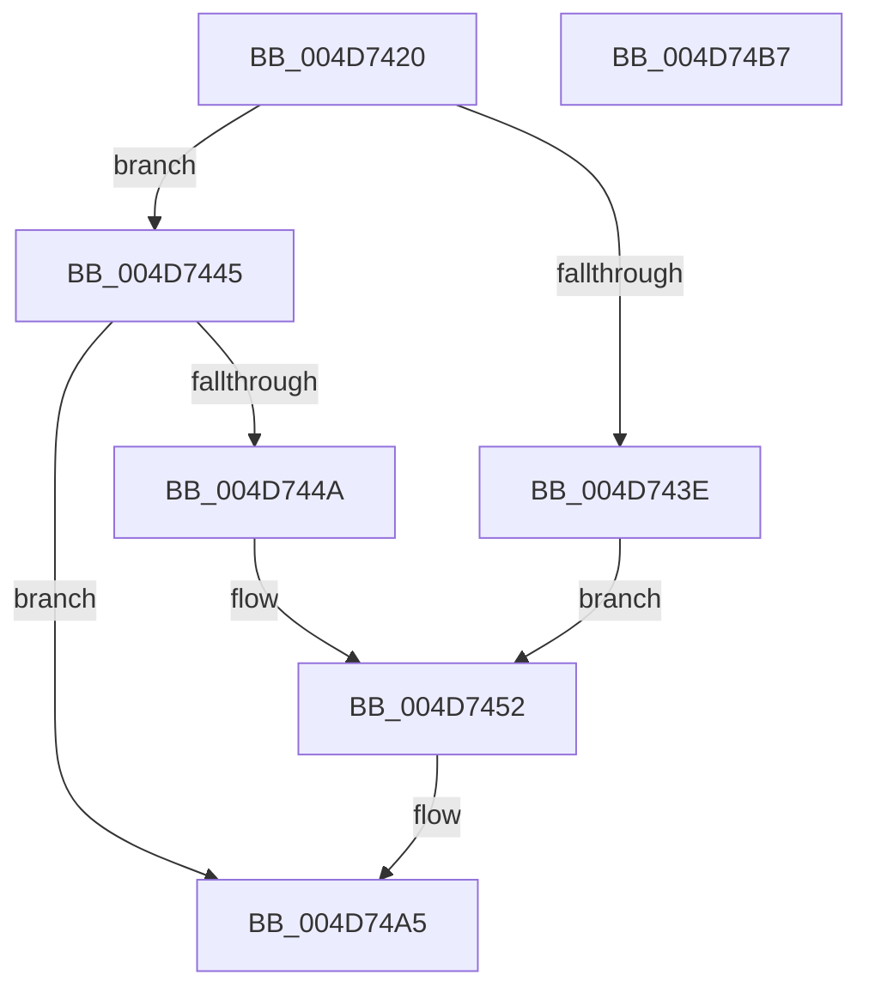

# CcPerfLogExtraWBThreadAction

- RVA: `0x004D7420`–`0x004D74B8` (길이 `152` bytes)
- VA: `0x00000001404D7420`
- 실행 섹션: `.text`
- PDB 이름 있음: `예`; PDB Function 태그: `아니요`
- unwind 정보 RVA: `0x000A02F8`
- 디코드: `33`개 명령, `152/152` bytes 표시
- 미해석 바이트: `0` (있으면 어셈블리에 `.byte`로 보존)

> 이 문서는 커널 이미지의 기계어와 PDB 기호를 분석해 생성했습니다. 4번과 5번은 함수 원형과 자료형을 바이너리 사용 방식에서 추정한 C 해석이며 원본 소스 복구 결과는 아닙니다.

## 1. Dependencies

- 직접 호출 지점: **2**; 고유 호출 대상: **2**
- 직접 호출자로 확인된 함수: **1**
- RIP 상대 이미지 참조: **1**

### Outgoing calls
- `0x004D74A0` → [EtwTraceKernelEvent](../23/EtwTraceKernelEvent_function_00235350.md) (function, `0x00235350`)
- `0x004D74AD` → [_security_check_cookie](../6A/_security_check_cookie_function_006AC640.md) (function, `0x006AC640`)

### Direct callers
- [CcLogExtraWBThreadAction](CcLogExtraWBThreadAction_function_004D737C.md) at `0x004D73F8`

### Static image references
- `0x004D7424` → RVA `0x00E0A740` (`.data`; read)

## 2. Other-region calls and transfers

- 다른 실행 섹션으로 향하는 call: **0**
- 별도 외부 분기/꼬리 이동을 확인하지 못했습니다.

## 3. Assembly (complete function range)

```asm
004D7420  48 83 EC 78                     sub rsp, 0x78
004D7424  48 8B 05 15 33 93 00            mov rax, qword ptr [rip + 0x933315]
004D742B  48 33 C4                        xor rax, rsp
004D742E  48 89 44 24 60                  mov qword ptr [rsp + 0x60], rax
004D7433  41 BA 01 00 00 00               mov r10d, 1
004D7439  83 F9 02                        cmp ecx, 2
004D743C  75 07                           jne 0x1404d7445
004D743E  44 89 54 24 40                  mov dword ptr [rsp + 0x40], r10d
004D7443  EB 0D                           jmp 0x1404d7452
004D7445  83 F9 03                        cmp ecx, 3
004D7448  75 5B                           jne 0x1404d74a5
004D744A  C7 44 24 40 02 00 00 00         mov dword ptr [rsp + 0x40], 2
004D7452  48 8B 84 24 A0 00 00 00         mov rax, qword ptr [rsp + 0xa0]
004D745A  48 8D 4C 24 30                  lea rcx, [rsp + 0x30]
004D745F  83 64 24 3C 00                  and dword ptr [rsp + 0x3c], 0
004D7464  48 89 44 24 58                  mov qword ptr [rsp + 0x58], rax
004D7469  48 8D 44 24 40                  lea rax, [rsp + 0x40]
004D746E  89 54 24 44                     mov dword ptr [rsp + 0x44], edx
004D7472  41 8B D2                        mov edx, r10d
004D7475  4C 89 44 24 48                  mov qword ptr [rsp + 0x48], r8
004D747A  41 B8 00 00 02 80               mov r8d, 0x80020000
004D7480  4C 89 4C 24 50                  mov qword ptr [rsp + 0x50], r9
004D7485  41 B9 0E 16 00 00               mov r9d, 0x160e
004D748B  48 89 44 24 30                  mov qword ptr [rsp + 0x30], rax
004D7490  C7 44 24 38 20 00 00 00         mov dword ptr [rsp + 0x38], 0x20
004D7498  C7 44 24 20 02 19 50 00         mov dword ptr [rsp + 0x20], 0x501902
004D74A0  E8 AB DE D5 FF                  call 0x140235350
004D74A5  48 8B 4C 24 60                  mov rcx, qword ptr [rsp + 0x60]
004D74AA  48 33 CC                        xor rcx, rsp
004D74AD  E8 8E 51 1D 00                  call 0x1406ac640
004D74B2  48 83 C4 78                     add rsp, 0x78
004D74B6  C3                              ret
004D74B7  CC                              int3
```

## 4. C-style interpretation (structured pseudocode)

```c
__int64 __fastcall CcPerfLogExtraWBThreadAction(int a1, int a2, __int64 a3, __int64 a4, __int64 a5)
{
    __int64 result;
    __int64 v_rsp;
    unsigned __int64 v_stack_m18;
    unsigned __int64 v_stack_m20;
    unsigned __int64 v_stack_m28;
    unsigned __int64 v_stack_m30;
    unsigned int v_stack_m34;
    unsigned int v_stack_m38;
    unsigned int v_stack_m3C;
    unsigned int v_stack_m40;
    unsigned __int64 v_stack_m48;
    unsigned int v_stack_m58;

    v_rsp = (v_rsp) - (120);
    result = (*(unsigned __int64 *)(v_rip + 9646869)) ^ (v_rsp);
    v_stack_m18 = result;
    if (a1 != 2) goto loc_004D7445;
    v_stack_m38 = 1;
    goto loc_004D7452;
loc_004D7445:
    if (a1 != 3) goto loc_004D74A5;
    v_stack_m38 = 2;
loc_004D7452:
    v_stack_m20 = a5;
    v_stack_m34 = a2;
    v_stack_m30 = a3;
    v_stack_m28 = a4;
    v_stack_m48 = v_stack_m38;
    v_stack_m40 = 32;
    v_stack_m58 = 0x501902ULL;
    result = EtwTraceKernelEvent(v_stack_m48, 1, (unsigned int)(0x80020000ULL), (unsigned int)(0x160EULL));
loc_004D74A5:
    a1 = (v_stack_m18) ^ (v_rsp);
    result = _security_check_cookie(a1, 1, (unsigned int)(0x80020000ULL), (unsigned int)(0x160EULL));
    v_rsp = (v_rsp) + (120);
    return result;
}
```

## 5. (Beta) C Style

```c
int64_t CcPerfLogExtraWBThreadAction(int32_t Arg1, int32_t Arg2, int64_t Arg3, int64_t Arg4, int64_t Arg5)
{
    int64_t result;
    int64_t local_rsp;
    uint64_t v_stack_m18;
    uint64_t v_stack_m20;
    uint64_t v_stack_m28;
    uint64_t v_stack_m30;
    uint32_t v_stack_m34;
    uint32_t v_stack_m38;
    uint32_t v_stack_m3C;
    uint32_t v_stack_m40;
    uint64_t v_stack_m48;
    uint32_t v_stack_m58;

    local_rsp = (local_rsp) - (120);
    result = (*(uint64_t *)(v_rip + 0x933315)) ^ (local_rsp);
    v_stack_m18 = result;
    if (Arg1 != 2) goto loc_004D7445;
    v_stack_m38 = 1;
    goto loc_004D7452;
loc_004D7445:
    if (Arg1 != 3) goto loc_004D74A5;
    v_stack_m38 = 2;
loc_004D7452:
    v_stack_m20 = Arg5;
    v_stack_m34 = Arg2;
    v_stack_m30 = Arg3;
    v_stack_m28 = Arg4;
    v_stack_m48 = v_stack_m38;
    v_stack_m40 = 32;
    v_stack_m58 = 0x501902ULL;
    result = EtwTraceKernelEvent(v_stack_m48, 1, (uint32_t)(0x80020000ULL), (uint32_t)(0x160EULL));
loc_004D74A5:
    Arg1 = (v_stack_m18) ^ (local_rsp);
    result = _security_check_cookie(Arg1, 1, (uint32_t)(0x80020000ULL), (uint32_t)(0x160EULL));
    local_rsp = (local_rsp) + (120);
    return result;
}
```

## 6. Execution-region graph

[열기: 2D/3D 그래프와 함수 탐색 컨트롤 패널](../../../control-panel.html?section=text&rva=0x004D7420&view=graph)

- 2D 그래프는 위에서 아래로 흐르고, 3D 그래프는 빈 공간을 드래그해 회전합니다. Shift+드래그는 이동, 휠은 확대·축소, 함수 노드 선택은 대상 보고서 이동입니다.

### Static fallback


