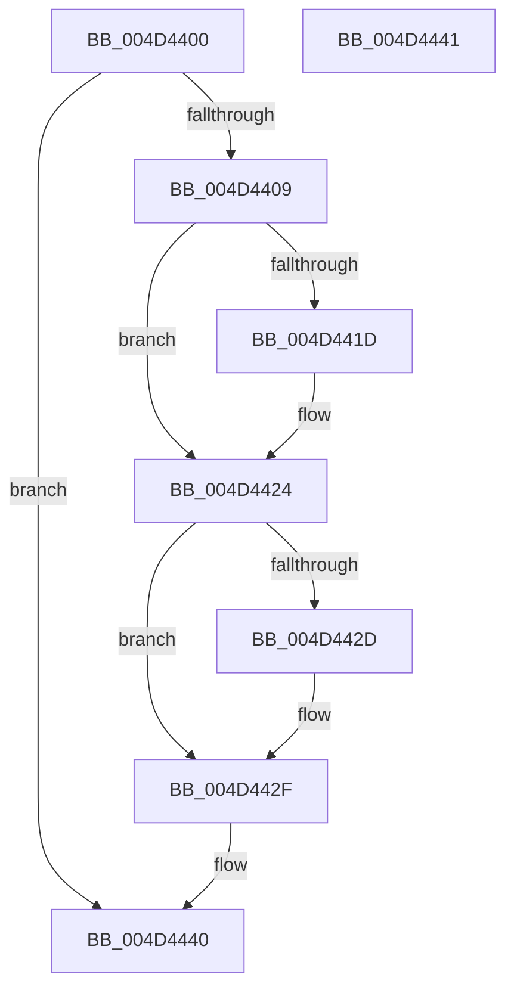

# CcSetReadAheadGranularityEx

- RVA: `0x004D4400`–`0x004D4442` (길이 `66` bytes)
- VA: `0x00000001404D4400`
- 실행 섹션: `.text`
- PDB 이름 있음: `예`; PDB Function 태그: `아니요`
- unwind 정보 RVA: `0x000DB714`
- 디코드: `23`개 명령, `66/66` bytes 표시
- 미해석 바이트: `0` (있으면 어셈블리에 `.byte`로 보존)

> 이 문서는 커널 이미지의 기계어와 PDB 기호를 분석해 생성했습니다. 4번과 5번은 함수 원형과 자료형을 바이너리 사용 방식에서 추정한 C 해석이며 원본 소스 복구 결과는 아닙니다.

## 1. Dependencies

- 직접 호출 지점: **0**; 고유 호출 대상: **0**
- 직접 호출자로 확인된 함수: **0**
- RIP 상대 이미지 참조: **0**

### Outgoing calls
- 직접 디코드된 call 명령이 없습니다.

### Direct callers
- 이 함수 시작 RVA로 연결되는 직접 call은 확인되지 않았습니다. 간접 호출은 완전히 역산할 수 없습니다.

### Static image references
- 디코드된 RIP-relative 메모리 참조가 없습니다.

## 2. Other-region calls and transfers

- 다른 실행 섹션으로 향하는 call: **0**
- 별도 외부 분기/꼬리 이동을 확인하지 못했습니다.

## 3. Assembly (complete function range)

```asm
004D4400  4C 8B 41 30                     mov r8, qword ptr [rcx + 0x30]
004D4404  48 85 D2                        test rdx, rdx
004D4407  74 37                           je 0x1404d4440
004D4409  8B 42 04                        mov eax, dword ptr [rdx + 4]
004D440C  FF C8                           dec eax
004D440E  41 89 40 04                     mov dword ptr [r8 + 4], eax
004D4412  49 8D 40 58                     lea rax, [r8 + 0x58]
004D4416  8B 4A 08                        mov ecx, dword ptr [rdx + 8]
004D4419  85 C9                           test ecx, ecx
004D441B  74 07                           je 0x1404d4424
004D441D  41 0F BA 28 15                  bts dword ptr [r8], 0x15
004D4422  89 08                           mov dword ptr [rax], ecx
004D4424  B9 00 00 80 00                  mov ecx, 0x800000
004D4429  39 08                           cmp dword ptr [rax], ecx
004D442B  76 02                           jbe 0x1404d442f
004D442D  89 08                           mov dword ptr [rax], ecx
004D442F  8B 4A 0C                        mov ecx, dword ptr [rdx + 0xc]
004D4432  B8 32 00 00 00                  mov eax, 0x32
004D4437  85 C9                           test ecx, ecx
004D4439  0F 45 C1                        cmovne eax, ecx
004D443C  41 89 40 5C                     mov dword ptr [r8 + 0x5c], eax
004D4440  C3                              ret
004D4441  CC                              int3
```

## 4. C-style interpretation (structured pseudocode)

```c
__int64 __fastcall CcSetReadAheadGranularityEx(__int64 a1, __int64 a2)
{
    __int64 result;

    if (a2 == 0) goto loc_004D4440;
    result = (unsigned int)(((unsigned int)(*(unsigned int *)(a2 + 4))) - 1);
    *(unsigned int *)(*(unsigned __int64 *)(a1 + 48) + 4) = (unsigned int)(result);
    if ((unsigned int)((unsigned int)(*(unsigned int *)(a2 + 8))) != 0) {
        *(unsigned int *)(*(unsigned __int64 *)(a1 + 48) + 88) = (unsigned int)((unsigned int)(*(unsigned int *)(a2 + 8)));
    }
    if ((*(unsigned int *)(*(unsigned __int64 *)(a1 + 48) + 88)) >= = ((unsigned int)((unsigned int)(0x800000ULL)))) {
        *(unsigned int *)(*(unsigned __int64 *)(a1 + 48) + 88) = (unsigned int)((unsigned int)(0x800000ULL));
    }
    result = 50;
    if ((unsigned int)((unsigned int)(*(unsigned int *)(a2 + 12))) != 0) { result = (unsigned int)((unsigned int)(*(unsigned int *)(a2 + 12))); }
    *(unsigned int *)(*(unsigned __int64 *)(a1 + 48) + 92) = (unsigned int)(result);
loc_004D4440:
    return result;
}
```

## 5. (Beta) C Style

```c
int64_t CcSetReadAheadGranularityEx(void *Arg1, int64_t Arg2)
{
    uint8_t *arg1 = (uint8_t *)Arg1;

    int64_t result;

    if (Arg2 == 0) goto loc_004D4440;
    result = (uint32_t)(((uint32_t)(*(uint32_t *)(Arg2 + 0x4))) - 1);
    *(uint32_t *)(*(uint64_t *)(arg1 + 0x30) + 0x4) = (uint32_t)(result);
    if ((uint32_t)((uint32_t)(*(uint32_t *)(Arg2 + 0x8))) != 0) {
        *(uint32_t *)(*(uint64_t *)(arg1 + 0x30) + 0x58) = (uint32_t)((uint32_t)(*(uint32_t *)(Arg2 + 0x8)));
    }
    if ((*(uint32_t *)(*(uint64_t *)(arg1 + 0x30) + 0x58)) >= = ((uint32_t)((uint32_t)(0x800000ULL)))) {
        *(uint32_t *)(*(uint64_t *)(arg1 + 0x30) + 0x58) = (uint32_t)((uint32_t)(0x800000ULL));
    }
    result = 50;
    if ((uint32_t)((uint32_t)(*(uint32_t *)(Arg2 + 0xC))) != 0) { result = (uint32_t)((uint32_t)(*(uint32_t *)(Arg2 + 0xC))); }
    *(uint32_t *)(*(uint64_t *)(arg1 + 0x30) + 0x5C) = (uint32_t)(result);
loc_004D4440:
    return result;
}
```

### 관측된 메모리 오프셋

구조체 형식이 확인되지 않은 접근은 인자 기준의 오프셋으로만 기록했습니다.

| 기준 인자 | 오프셋 표현 | 폭 (bit) | 접근 |
|---|---:|---:|---|
| `Arg1` | `+ 0x30` | `64` | `R` |

## 6. Execution-region graph

[열기: 2D/3D 그래프와 함수 탐색 컨트롤 패널](../../../control-panel.html?section=text&rva=0x004D4400&view=graph)

- 2D 그래프는 위에서 아래로 흐르고, 3D 그래프는 빈 공간을 드래그해 회전합니다. Shift+드래그는 이동, 휠은 확대·축소, 함수 노드 선택은 대상 보고서 이동입니다.

### Static fallback


